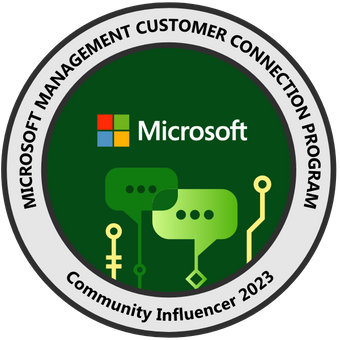

# Home


<mark style="color:orange;">**STATUS:**</mark> <mark style="color:orange;">Pictures are missing on a few blog posts from before June 2022.</mark>

:construction: <mark style="color:orange;">A solution is being worked on - please stay tuned!</mark> :construction:


## About OSDeploy | Sune Thomsen

Hi, and thank you for visiting my blog. My name is [**Sune Thomsen**](https://www.linkedin.com/in/SuneThomsenDK/), and I am a 45-year-old family guy, community blogger, official contributor, speaker, Microsoft MVP, and a passionate Cloud Consultant at [**Mindcore**](https://mindcore.dk/) with over 21 years of experience in managing and implementing various Microsoft solutions and projects.

I originally started this blog to document my work with OS Deployment and Microsoft Configuration Manager. But it has since evolved and now covers other Microsoft Intune-related topics and more.\
\
I'm very keen to share my knowledge, and I hope my blog will help others and give something back to the community. - Please feel free to reach out to me if you have any questions regarding topics on this blog. - I am most active on [**Twitter!**](https://twitter.com/SuneThomsenDK)\
\
Read more about me and follow my activities on my [**MVP profile.**](https://mvp.microsoft.com/en-us/PublicProfile/5004649?fullName=Sune%20Thomsen)

.jpg>)

<figure><figcaption>
Microsoft MVP | Windows and Devices &#x26; Security 2021 - 2027
</figcaption></figure>

<figure><figcaption>
Microsoft Management Community Influencer 2023 - 2024
</figcaption></figure>

<figure><figcaption>
Microsoft Community Contributor 2023 - 2025
</figcaption></figure>

<figure><figcaption>
Windows 365 Community | Official Contributor 2022 - 2026
</figcaption></figure>

<figure><figcaption>
Modern Endpoint Management | Official Contributor 2022 - 2024
</figcaption></figure>

<figure><figcaption>
Modern Endpoint Management | Speaker 2022 - 2024
</figcaption></figure>

## Latest Posts



## <figure><figcaption></figcaption></figure>

## Centralized Windows App Management

Take control of Windows App settings with centralized management through Microsoft Intune.



## Cookie Test 

This is a cookie test!



## I love dogs

<figure><figcaption></figcaption></figure>

The is the dog test!


