# OSDBuilder: WinPE Customization

## BEFORE YOU BEGIN


In this blog I will be using OSDBuilder created by David Segura, if you are not familiar with OSDBuilder here's an quick start.




Once OSDBuilder is installed and you have imported your first OSMedia, you then have to add some external content to OSDBuilder home path. External content can be ADK / Drivers / DaRT / Scripts or ExtraFiles and that will make it possible for you to create some awesome customized WinPE media.&#x20;

## EXTERNAL CONTENT


Location of external content .\OSDBuilder\Content


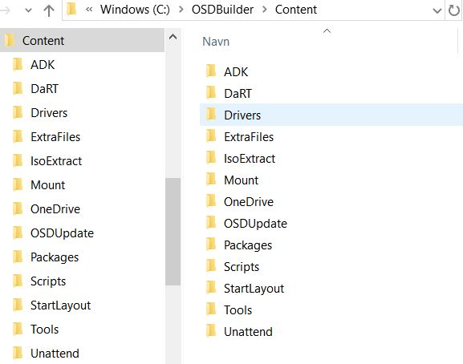

### ADK

The ADK version must match the Windows build that you are installing, and it must also match the Windows build of the image that you are offline servicing.


Starting with ADK 1809, you have to download the WinPE add-on for the ADK, as it has been separate from the ADK package.


Download ADK and WinPE add-on [here](https://docs.microsoft.com/en-us/windows-hardware/get-started/adk-install)

Once installed in your environment, copy ADK OC's (Optional Components) and Language from below directories to the below OSDBuilder location.

```
C:\Program Files (x86)\Windows Kits\10\Assessment and Deployment Kit\Windows Preinstallation Environment\amd64\WinPE_OCs
C:\Program Files (x86)\Windows Kits\10\Assessment and Deployment Kit\Windows Preinstallation Environment\x86\WinPE_OCs
```

.JPG>)

### DaRT


DaRT is not freely available.  It's part of the Microsoft Desktop Optimization Pack (**MDOP**)


Once DaRT is installed in your environment. Then use DaRT to create a config file or copy the config file from Microsoft Deployment Toolkit (**MDT**)

1. Copy **Toolsx86.cab** and **Toolsx64.cab** from "**C:\Program Files\Microsoft DaRT\v10**" to the below OSDBuilder location.
2. Copy **DartConfig8.dat** from "**C:\Program Files\Microsoft Deployment Toolkit\Templates**"  to the below OSDBuilder location.

You can rename the configuration file to **DaRTConfig.dat** if you want, OSDBuilder handles both file names. Just make sure that you copied the **DaRTConfig8.dat**.

.JPG>)

### Drivers


Do **NOT** add more than a few MB of drivers as it will increase the size of your WinPE media.


Download the WinPE driver package from your computer vendor website and extract the files to the below directory. If the driver packages contains large **\*.MSI** files I recommend removing them by deleting the driver folder before adding them to the WinPE media.

I've deleted these two driver folders from the WinPE driver package.

* **0XCPP\_A00-00**
* **7X8Y6\_A00-00**

.JPG>)

### ExtraFiles

You can add extra files to WinPE. Create a new directory in **.\Content\ExtraFiles** and add the extra files in a relative path to the WinPE root. If you eg. want **CMTrace.exe** to be located in WinPE under **X:\Windows\System32** then the path must be something like this **.\ExtraFiles\WinPE CMTrace x64\Windows\System32**

If you add Wallpapers to ExtraFiles, it must be in the following formats.

* setup.bmp - 1024x768
* winpe.bmp - 1024x768
* winpe.jpg - 1024x768
* winre.jpg - 1024x768

Here I've added **CMTrace.exe** and custom **Wallpapers** to **X:\Windows\System32**

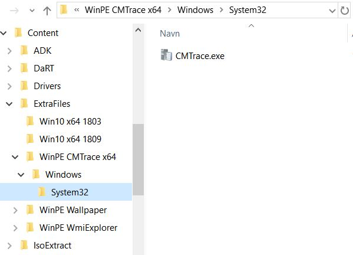

.JPG>)

### Scripts

You can add PowerShell scripts to the **.\Content\Scripts** directory. During the creation of a new PEBuild task you will be prompted to select the scripts.

In this case I've added scripts to change the default InputLocale and TimeZone to danish.

.JPG>)


```
#=================================
#   Set Keyboard Layout for WinPE
#=================================
if ($TaskType -eq 'PEBuild') {
    if (Test-Path $MountDirectory) {
        Dism /Image:"$MountDirectory" /Set-Inputlocale:"da-dk;en-us" /LogPath:"$Logs\$((Get-Date).ToString('yyyy-MM-dd-HHmmss'))-Dism-SetInputlocale.log"
    }
} else {
    if (Test-Path "$MountWinPE") {
        Dism /Image:"$MountWinPE" /Set-Inputlocale:"da-dk;en-us" /LogPath:"$PELogs\$((Get-Date).ToString('yyyy-MM-dd-HHmmss'))-Dism-SetInputlocale-WinPE.wim.log"
    }
    if (Test-Path "$MountWinSE") {
        Dism /Image:"$MountWinSE" /Set-Inputlocale:"da-dk;en-us" /LogPath:"$PELogs\$((Get-Date).ToString('yyyy-MM-dd-HHmmss'))-Dism-SetInputlocale-WinSE.wim.log"
    }
    if (Test-Path "$MountWinRE") {
        Dism /Image:"$MountWinRE" /Set-Inputlocale:"da-dk;en-us" /LogPath:"$PELogs\$((Get-Date).ToString('yyyy-MM-dd-HHmmss'))-Dism-SetInputlocale-WinRE.log"
    }
}
```



```
#====================================================
#   Set Time Zone to Romance Standard Time for WinPE
#====================================================
if ($TaskType -eq 'PEBuild') {
    if (Test-Path $MountDirectory) {
        Dism /Image:"$MountDirectory" /Set-TimeZone:"Romance Standard Time" /LogPath:"$Logs\$((Get-Date).ToString('yyyy-MM-dd-HHmmss'))-Dism-SetTimeZone.log"
    }
} else {
    if (Test-Path "$MountWinPE") {
        Dism /Image:"$MountWinPE" /Set-TimeZone:"Romance Standard Time" /LogPath:"$PELogs\$((Get-Date).ToString('yyyy-MM-dd-HHmmss'))-Dism-SetTimeZone-WinPE.wim.log"
    }
    if (Test-Path "$MountWinSE") {
        Dism /Image:"$MountWinSE" /Set-TimeZone:"Romance Standard Time" /LogPath:"$PELogs\$((Get-Date).ToString('yyyy-MM-dd-HHmmss'))-Dism-SetTimeZone-winSE.wim.log"
    }
    if (Test-Path "$MountWinRE") {
        Dism /Image:"$MountWinRE" /Set-TimeZone:"Romance Standard Time" /LogPath:"$PELogs\$((Get-Date).ToString('yyyy-MM-dd-HHmmss'))-Dism-SetTimeZone-WinRE.log"
    }
}
```


## WINPE CUSTOMIZATION


Before customizing WinPE I recommend that you increase the size of your UEFI Recovery Partition.  Default size is between 300-500MB, but this may not be enough so I will recommend changing UEFI Recovery partition size to 980MB. (**Blog post on this topic is coming soon!**)


### PEBuild Functions

* Get-PEBuilds
  * Returns information on already created PEBuilds
* New-PEBuildTask
  * Creates a custom PEBuild task configuration
* New-PEBuild
  * Executes a custom PEBuild task configuration created with New-PEBuildTask


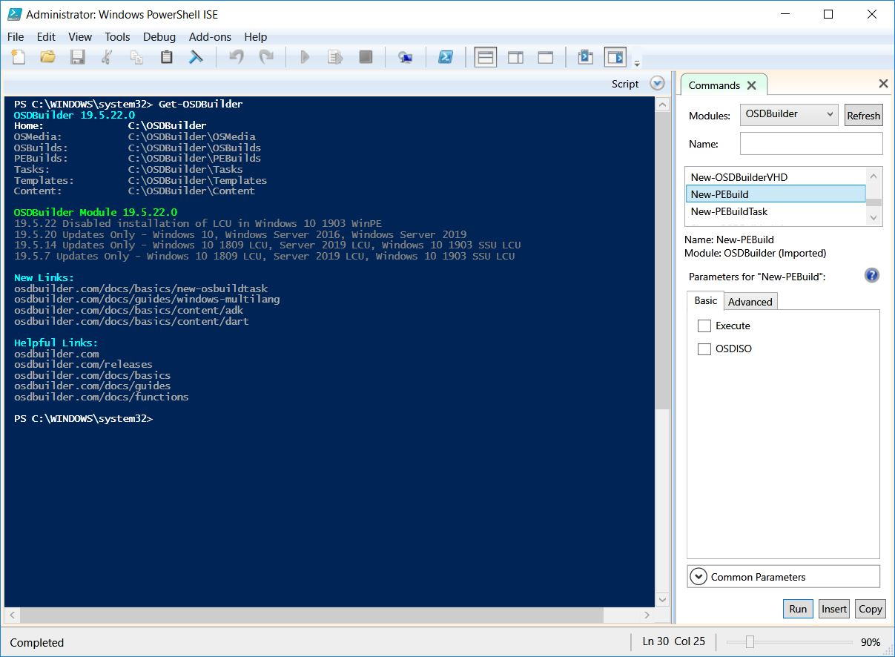

### Create WinRE Task

To create a WinRE task, select **New-PEBuildTask** in OSDBuilder and select the **Recovery** tab or enter the below command line directly in to the PowerShell console window. Keep the task name simple "**Recovery**" will be added automatically as a task name prefix. If you include Arch and ReleaseID in the task name, it will automatically sort the source OSMedia.

You can include parameters like **-ContentWinPEADK**, **-ScratchSpace** and **-WinPEAutoExtraFiles** I believe the default WinPE scratch space is 32MB, if you do not select an option it will automatically be set to 128MB.

You can either use the PowerShell ISE GUI or just write the command directly with parameters.

.JPG>)


**New-PEBuildTask -TaskName "Win10 x64 1803" -ContentWinPEADK -ContentWinPEDart -ContentWinPEDrivers -ContentWinPEExtraFiles -ContentWinPEScripts -ScratchSpace 256 -WinPEAutoExtraFiles**


Select the imported OSMedia in order to create the WinRE media.

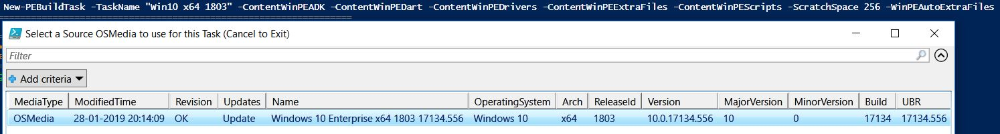

If you've added DaRT to external content and checked / added the "**ContentWinPEDart**" parameter during **New-PEBuildTask** it will show here. Select it or click cancel to continue.

.JPG>)

If you've added ADK OC's to external content and checked / added the "**ContentWinPEADK**" parameter during **New-PEBuildTask** it will show here. Select the ones you need or click cancel to continue.

.JPG>)

If you've added WinPE drivers to external content and checked / added the "**ContentWinPEDrivers**" parameter during **New-PEBuildTask** it will show here. Select the one you need or click cancel to continue.

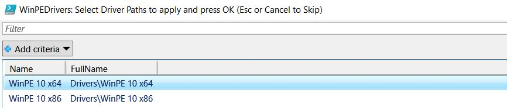

If you've added extra files to external content and checked / added the "**ContentWinPEExtraFiles**" parameter during **New-PEBuildTask** it will show here. Select the ones you need or click cancel to continue.

.JPG>)

If you've added scripts to external content and checked / added the "**ContentWinPEScripts**" parameter during **New-PEBuildTask** it will show here. Select the ones you need or click cancel to continue.

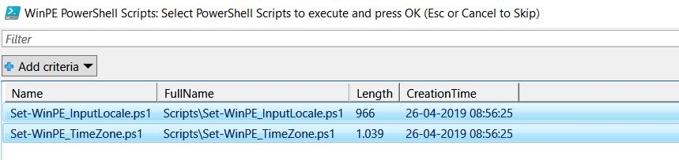

You should end up with a similar PowerShell summary.

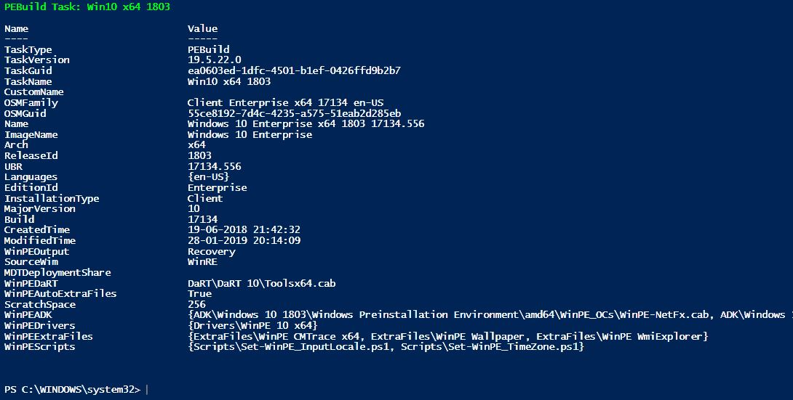

You should also see a "**Recovery Win10 x64 1803.json**" file here **.\OSDBuilder\Tasks**

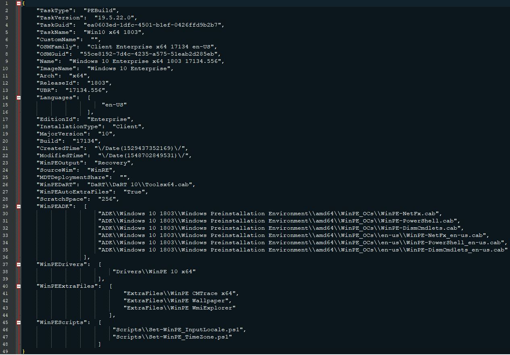

### Create WinPE Task

Creating a WinPE task is very similar to WinRE task, select **New-PEBuildTask** in OSDBuilder and select the **WinPE** tab or enter the below command line directly in to the PowerShell console window. From SourceWim select WinPE and keep the task name simple "**WinPE**" will be added automatically as a task name prefix. If you include Arch and ReleaseID in the task name, it will automatically sort the source OSMedia.

You can include parameters like **-ContentWinPEADK**, **-ScratchSpace** and **-WinPEAutoExtraFiles** I believe the default WinPE scratch space is 32MB, if you do not select an option it will automatically be set to 128MB.

You can either use the PowerShell ISE GUI or just write the command directly with parameters.

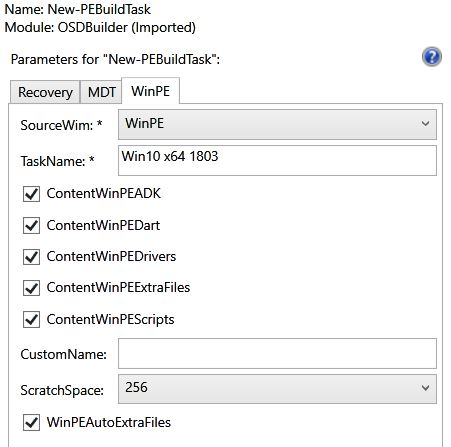


**New-PEBuildTask -SourceWim WinPE -TaskName "Win10 x64 1803" -ContentWinPEADK -ContentWinPEDart -ContentWinPEDrivers -ContentWinPEExtraFiles -ContentWinPEScripts -ScratchSpace 256 -WinPEAutoExtraFiles**


Select the imported OSMedia in order to create the WinPE media.

.JPG>)

If you've added DaRT to external content and checked / added the "**ContentWinPEDart**" parameter during **New-PEBuildTask** it will show here. Select it or click cancel to continue.

.JPG>)

If you've added ADK OC's to external content and checked / added the "**ContentWinPEADK**" parameter during **New-PEBuildTask** it will show here. Select the ones you need or click cancel to continue.

.JPG>)

If you've added WinPE drivers to external content and checked / added the "**ContentWinPEDrivers**" parameter during **New-PEBuildTask** it will show here. Select the one you need or click cancel to continue.


If you've added extra files to external content and checked / added the "**ContentWinPEExtraFiles**" parameter during **New-PEBuildTask** it will show here. Select the ones you need or click cancel to continue.

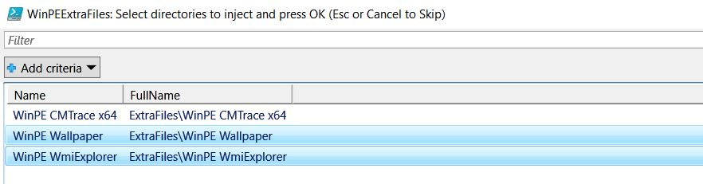

If you've added scripts to external content and checked / added the "**ContentWinPEScripts**" parameter during **New-PEBuildTask** it will show here. Select the ones you need or click cancel to continue.


You should end up with a similar PowerShell summary.

.JPG>)

You should also see a "**WinPE Win10 x64 1803.json**" file here **.\OSDBuilder\Tasks**

.JPG>)

### Create PEBuild

To create a new PEBuild, select **New-PEBuild** in OSDBuilder and select the execute option or enter the below command line directly in the PowerShell console window.

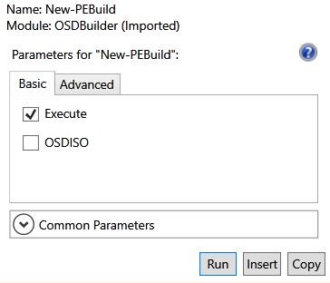


**New-PEBuild -Execute**


Select your WinPE/RE task in order to create the new PEBuild.

.JPG>)

OSDBuilder will now create your new PEBuild, it will show a lot of information during this process.

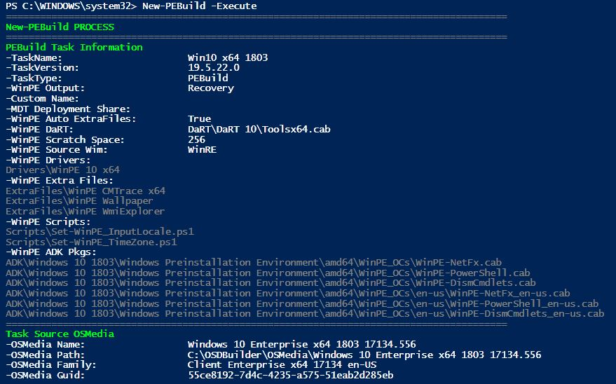

The new PEBuild will be created here **.\OSDBuilder\PEBuilds**

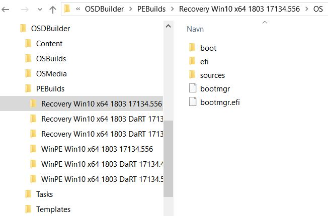

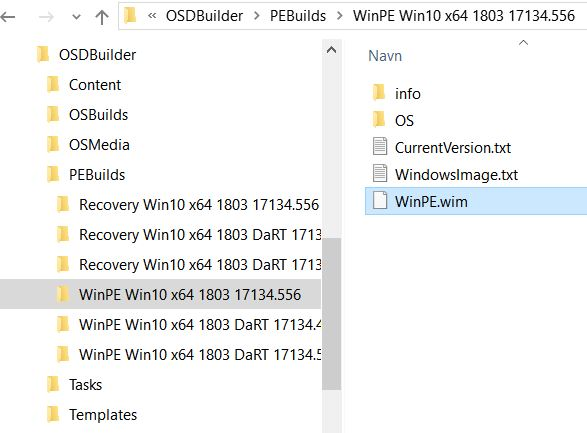

**That's it guys!** Now copy the content of the WinRE folder "**OS**" to a bootable USB device or import the WinPE.wim to ConfigMgr. You will now be able to do amazing things such as:

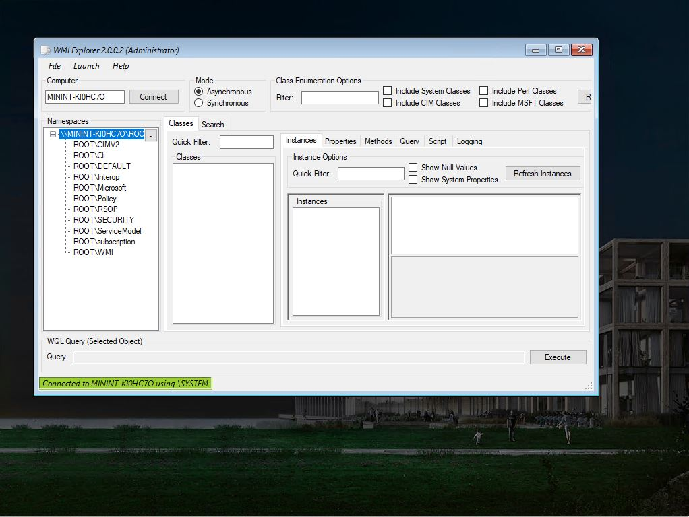

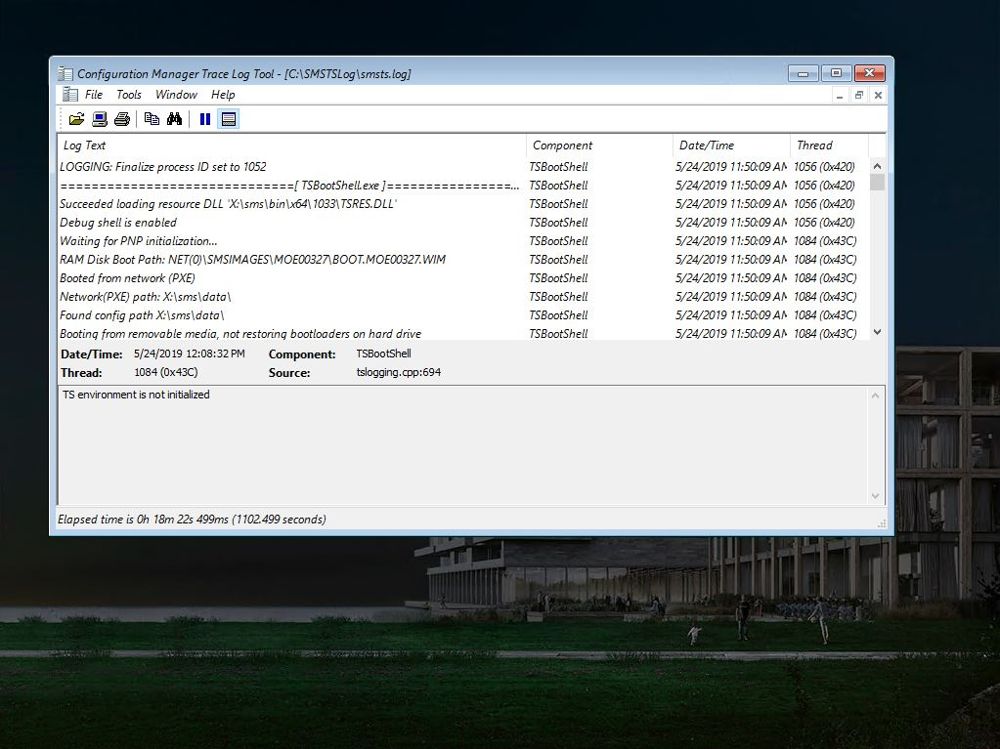

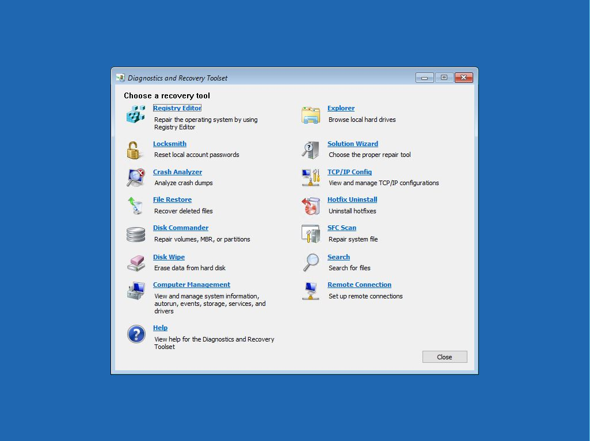

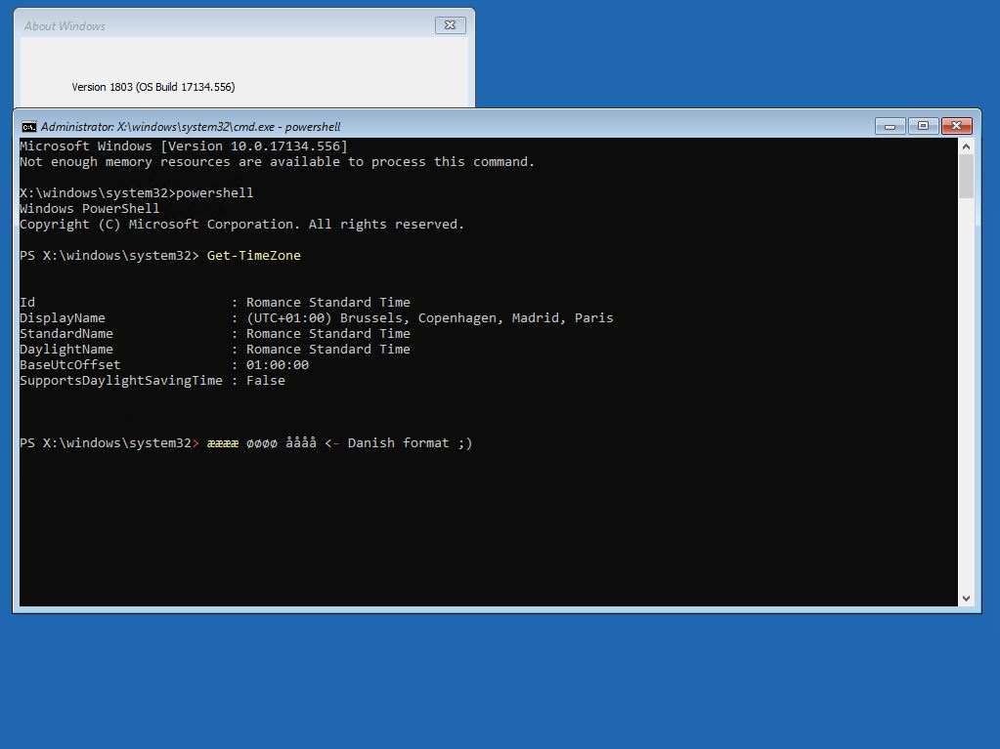

A special thanks go to one of the best OSD specialists that I know of, [David Segura](https://twitter.com/SeguraOSD)! If you want to learn a lot about OSD please visit his blog at [https://www.osdeploy.com](https://www.osdeploy.com/). If you have any questions regarding this topic, feel free to reach out to me. I am most active on [Twitter](https://www.twitter.com/SuneThomsenDK)!

Now go out and impress your boss and colleagues!
