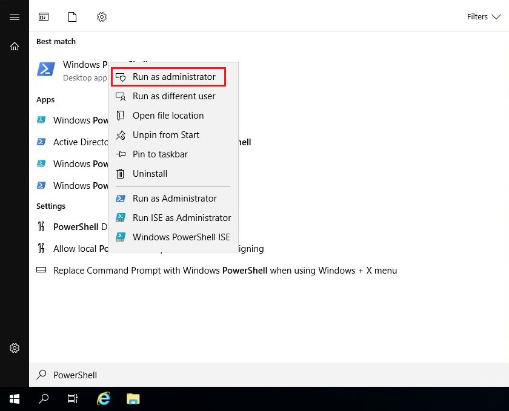
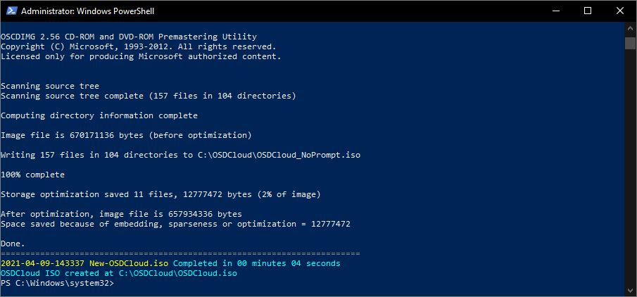
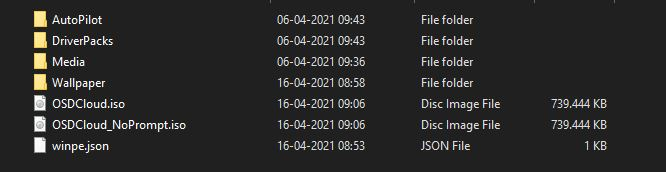
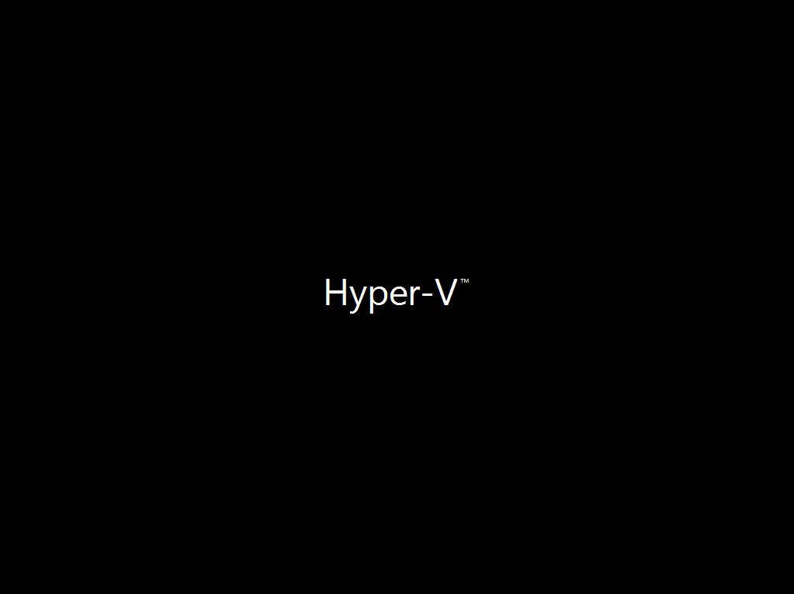

# OSDCloud: The ZTI Way

## BEFORE YOU BEGIN


**Disclaimer:** All information and content in this blog post is provided without any warranty whatsoever. The entire risk of using this information or executing the provided content remains with you. Under no circumstances should mentioned persons or vendors, the author, or anyone else involved in creating these blog posts be held liable for any damage or data loss.



**Knowledge**: I assume that people who read this blog post have an general understanding of [Windows ADK/PE](https://docs.microsoft.com/en-us/windows-hardware/get-started/adk-install), [Windows 10 deployment](https://docs.microsoft.com/en-us/windows/deployment/), [PowerShell ](https://docs.microsoft.com/en-us/powershell/)and [Windows Autopilot](https://docs.microsoft.com/en-us/mem/autopilot/), so I won't be deep-diving into details about that in this post.



**Update (04-16-2021)**: [OSDCloud ](https://osdcloud.osdeploy.com/)now support WiFi (kudos to [Andrew](https://twitter.com/AndrewZtrhgf)), wallpaper and a more dynamic method to control Zero Touch, so I've updated my blog post with the new info.&#x20;


## OSDCloud

In this blog post I'll be using [OSDCloud ](https://osdcloud.osdeploy.com/)created by [David Segura](https://twitter.com/SeguraOSD) to create a Zero Touch (ZTI) Windows 10 deployment experience, if you are not familiar with [OSDCloud](https://osdcloud.osdeploy.com/) then get started [here](https://osdcloud.osdeploy.com/get-started) or take a look at these great blog post [Part 1](https://blog.mindcore.dk/2021/03/osdcloud-image-devices-without-need-of.html) and [Part 2](https://blog.mindcore.dk/2021/04/osdcloud-image-devices-without-need-of.html) by [Mattias Melkersen](https://twitter.com/MMelkersen) which should prepare you for this blog post.


You might know [David Segura](https://twitter.com/SeguraOSD) for his [OSDBuilder ](https://osdbuilder.osdeploy.com/)project which is a awesome PowerShell module for Offline Servicing Windows Operating System Image.

### Zero Touch (ZTI)


**WHAT DOES ZTI STAND FOR?**\
\
Zero Touch Installation (ZTI) - is a fully automated deployment solution that require no user interaction.


OK, so if you have followed the walkthrough of [OSDCloud](https://osdcloud.osdeploy.com/) creation provided in the above link(s), you should now have a [workspace](https://osdcloud.osdeploy.com/get-started/new-osdcloud.workspace) containing AutoPilot profile(s), Boot Media and maybe a wallpaper.

.JPG>)

Now, let´s make the customizations that make it possible to automatically run [OSDCloud](https://osdcloud.osdeploy.com/) with ZTI.

First we'll need to create a PowerShell configuration file and upload it to a online storage e.g. GitHub or a Webserver. This sample has been borrowed from [David Segura](https://twitter.com/SeguraOSD)

```
Write-Host  -ForegroundColor Cyan "Starting SeguraOSD's Custom OSDCloud ..."
Start-Sleep -Seconds 5

#Change Display Resolution for Virtual Machine
if ((Get-MyComputerModel) -match 'Virtual') {
    Write-Host  -ForegroundColor Cyan "Setting Display Resolution to 1600x"
    Set-DisRes 1600
}

#Make sure I have the latest OSD Content
Write-Host  -ForegroundColor Cyan "Updating the awesome OSD PowerShell Module"
Install-Module OSD -Force

Write-Host  -ForegroundColor Cyan "Importing the sweet OSD PowerShell Module"
Import-Module OSD -Force

#TODO: Spend the time to write a function to do this and put it here
Write-Host  -ForegroundColor Cyan "Ejecting ISO"
Write-Warning "That didn't work because I haven't coded it yet!"
#Start-Sleep -Seconds 5

#Start OSDCloud ZTI the RIGHT way
Write-Host  -ForegroundColor Cyan "Start OSDCloud with MY Parameters"
Start-OSDCloud -OSLanguage en-us -OSBuild 20H2 -OSEdition Enterprise -ZTI

#Anything I want  can go right here and I can change it at any time since it is in the Cloud!!!!!
Write-Host  -ForegroundColor Cyan "Starting OSDCloud PostAction ..."
Write-Warning "I'm not sure of what to put here yet"

#Restart from WinPE
Write-Host  -ForegroundColor Cyan "Restarting in 20 seconds!"
Start-Sleep -Seconds 20
wpeutil reboot
```

Copy the URL of the PowerShell file, we need it in a step further down below.

.JPG>)

Run PowerShell as administrator.



So, in this elevated PowerShell session, we will now add support for WiFi and ZTI with the below command. Remember to replace the URL "**some-online-cloud-storage.com**" with your own.

```
Edit-OSDCloud.winpe -workspacepath C:\OSDCloud -CloudDriver Wifi -WebPSScript http://some-online-cloud-storage.com/Win10-Enterprise-21H2-DA-DK.ps1 -wallpaper "C:\OSDCloud\Wallpaper\WinPE.jpg" -Verbose
```


If you need WinPE drivers just add manufacturer to the parameter -CloudDriver e.g. Dell or HP.

Do you need custom WinPE drivers? No problem!\
You can add them with this parameter -DriverPath \<Path> e.g. C:\Temp\WinPE\Drivers



**Note.** The more you add to the boot media the bigger file you get - Just keep that in mind...


Now, create new ISO(s) with the below command.

```
New-OSDCloud.iso -workspacepath C:\OSDCloud
```





Mount the "**OSDCloud.iso**" or "**OSDCloud\_NoPrompt.iso**" image to a Hyper-V Virtual Machine.

.JPG>)

Start the Virtual Machine, lean back and watch the magic of ZTI :sunglasses:&#x20;



A special thanks go once again to [David Segura](https://twitter.com/SeguraOSD) and his team of contributors for their awesome dedication to the OSD-community! If you want to learn a lot about OSD please visit his blog [here](https://www.osdeploy.com/)

If you have any questions regarding this topic, feel free to reach out to me. I am most active on [Twitter](https://www.twitter.com/SuneThomsenDK)!
