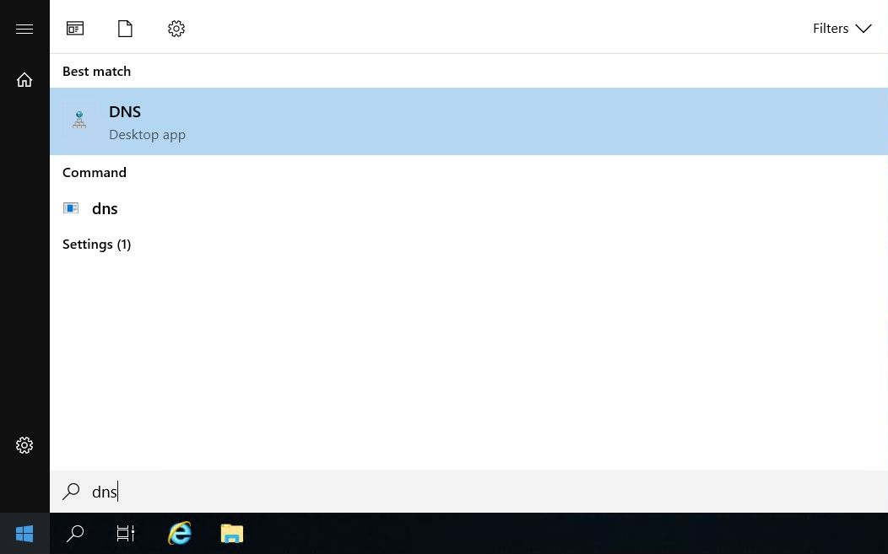
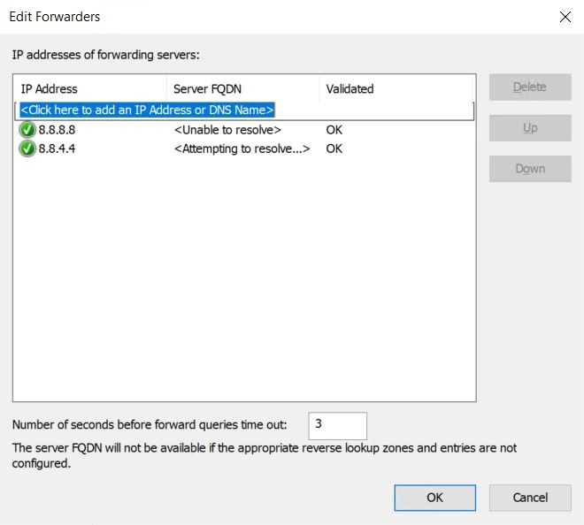

# DNS

## SETTING UP DNS


#### WHAT IS DNS?

Domain Name System (**DNS**) is one of the industry-standard suite of protocols that comprise TCP/IP, and together the DNS Client and DNS Server provide computer name-to-IP address mapping name resolution services to computers and users.&#x20;

Active Directory Domain Services (**AD DS**) uses DNS as its domain controller location mechanism. When any of the principal Active Directory operations is performed, such as authentication, updating, or searching, computers use DNS to locate Active Directory domain controllers. In addition, domain controllers use DNS to locate each other.

Read more about Domain Name System [here](https://docs.microsoft.com/da-dk/windows-server/networking/dns/dns-top)


Now that the DHCP server role is installed and configured on my DC server, it's time to configure DNS, but wait a second! Shouldn't we install it first, you might ask? The correct answer is nope! Active Directory is highly dependent on DNS, so it's installed during the installation of Active Directory.

Awesome, let's configure DNS:sunglasses:

### Configuring DNS

**Step 1.** Type "**DNS**" in the search line next to the start button, and click "**DNS**"

**Step 2.** Right-click on the computer name "**DC**" and then click "**Properties**"

.JPG>)

.JPG>)

**Step 3.** Select the tab "**Forwarders**" and click "**Edit...**"

.JPG>)

**Step 5.** Enter IP addresses of forwarding servers (**DNS servers**) and click "**OK**"


I've chosen Google's Public DNS servers (**8.8.8.8** and **8.8.4.4**).


And that's it, folks! This concludes the DNS configuration for this post. Now go back to the main section by clicking on the link below or click on "**Part 3 - Setting up the Domain Controller**" in the menu to the left.


[.](./)

