# Part 5 - Setting up Discovery Methods and Boundaries

## BEFORE YOU BEGIN


**Disclaimer**: All information and content in these blog posts is provided without any warranty whatsoever. The entire risk of using this information or executing the provided content remains with you. Under no circumstances should Microsoft, its author, or anyone else involved in the creation of these blog posts be held liable for any damage or data loss.


## DISCOVERY METHODS

In my previous blog post [Part 4](https://www.osdsune.com/home/blog/2020/configmgr-lab/part-4) we completed the basic installation of Microsoft Endpoint Configuration Manager including the SQL, Distribution Point and Management Point configuration.

In Part 5, I will walk you through the configuration of discovery methods and boundaries.


#### WHAT IS DISCOVERY METHODS?

Discovery methods are used in Microsoft Endpoint Configuration Manager to find device and user resources that you can manage. You can also use discovery to identify network infrastructure in your environment. There are several different methods you can use to discover different things, and each method has its own configurations and limitations.

The following are the available discovery methods:

* **Active Directory Forest Discovery**
* **Active Directory Group Discovery**
* **Active Directory System Discovery**
* **Active Directory User Discovery**
* **Heartbeat Discovery**
* **Network Discovery**
* **Server Discovery (hidden)**

Read more about Discovery Methods [here](https://docs.microsoft.com/en-us/mem/configmgr/core/servers/deploy/configure/about-discovery-methods)


In this blog post, I'll be looking at the Active Directory **Forest**, **System**, **User** and **Heartbeat** discovery. If you need more information about discovery methods, click [here](https://docs.microsoft.com/en-us/mem/configmgr/core/servers/deploy/configure/about-discovery-methods)

It has been a while since my last blog post, but I've been busy and then came something called COVID-19:mask:but since my last post I've upgraded my lab with latest Windows 10 ADK and WinPE for Windows 10 (**2004**) and Microsoft Endpoint Configuration Manager has been upgraded to CB 2006.&#x20;


Windows 10 ADK and WinPE can be download from [here](https://docs.microsoft.com/en-us/windows-hardware/get-started/adk-install) (_They are two separate downloads..._)


Let's get started with the discovery method configuration.

**Step 1.** Type "**Configuration**" in the search line next to the start button, and click "**Configuration Manager Console**"

.JPG>)

**Step 2.** Navigate to "**Administration**" and click "**Updates and Servicing**". As mentioned above, I've upgraded my lab to CB 2006 since my last blog post.

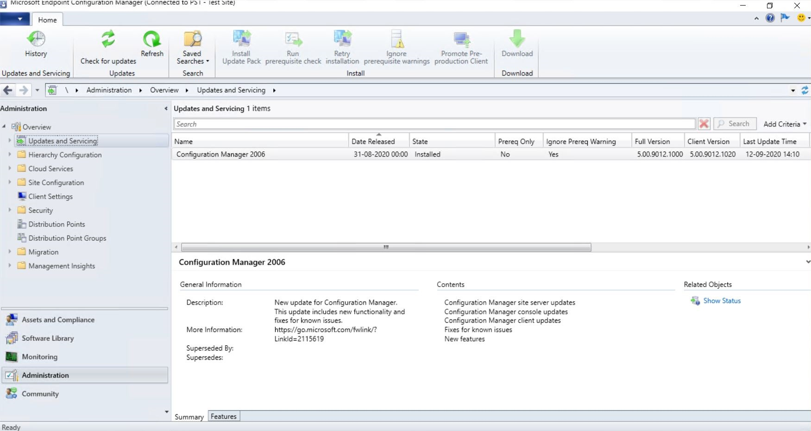

**Step 3.** In "**Administration**", expand "**Hierarchy Configuration**" and then click "**Discovery Methods**"

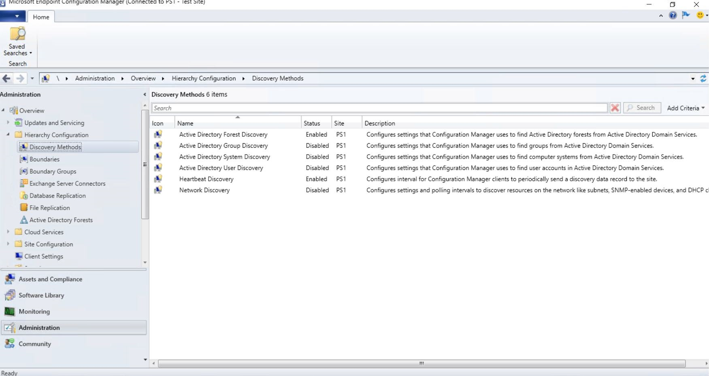

**Step 4.** Right-click on "**Active Directory Forest Discovery**" and click "**Properties**". Check the "**Enable Active Directory Forest Discovery**" box. Leave everything default and click "**OK**"

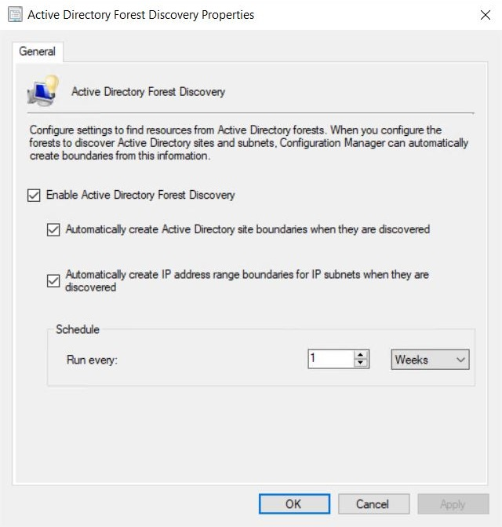

**Step 5.** Click "**Yes**" to run a full discovery as soon as possible.

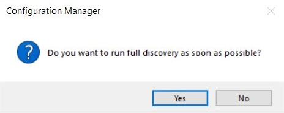

**Step 6.** Right-click on "**Active Directory System Discovery**" and click "**Properties**". Check the "**Enable Active Directory System Discovery**" box and click the "**Create Icon**".

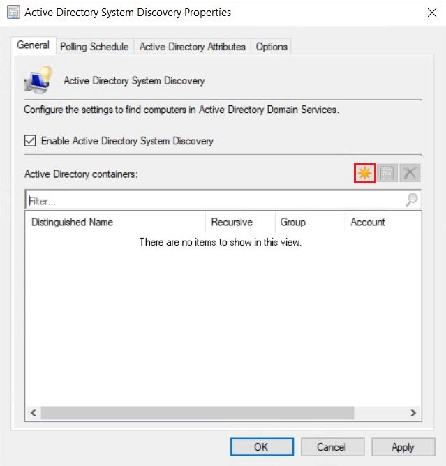

**Step 7.** Now click "**Browse...**" and find your computer OU. Leave everything default and click "**OK**"

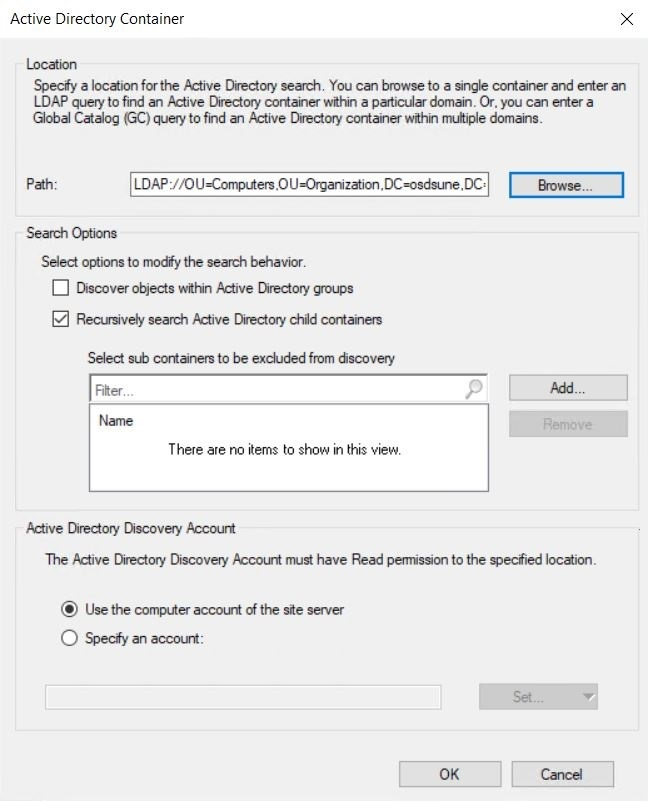

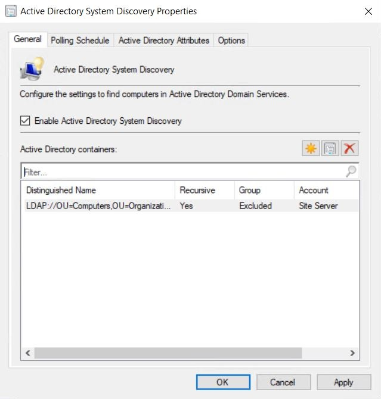

**Step 8.** Select the tab "**Polling Schedule**" and leave everything default. This is where you can change the frequency for system discovery.

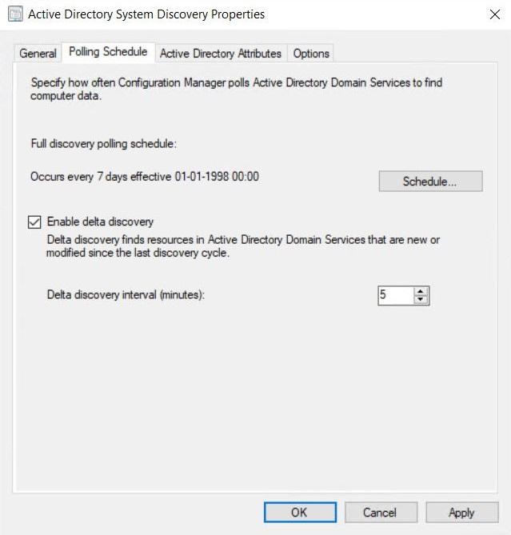

**Step 9.** Select the tab "**Active Directory Attributes**" and leave everything default. This is where you can select custom attributes to be included during system discovery.

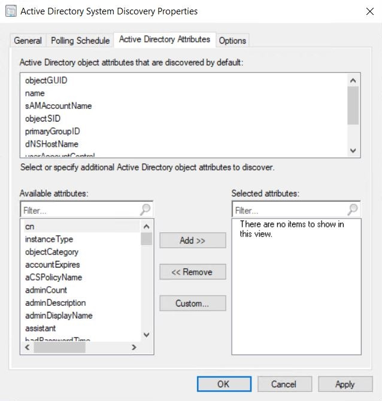

**Step 10.** Select the tab "**Options**" and leave everything default. Although in a real-world scenario I would recommend that you check the "**Only discover computers that have logged on to a domain in a given period of time**" box. Click "**OK**"

.JPG>)

**Step 11.** Click "**Yes**" to run a full discovery as soon as possible.

**Step 12.** Right-click on "**Active Directory User Discovery**" and click "**Properties**". Check the "**Enable Active Directory User Discovery**" box and add the user OU like we did in step 6-7 for the computer OU.

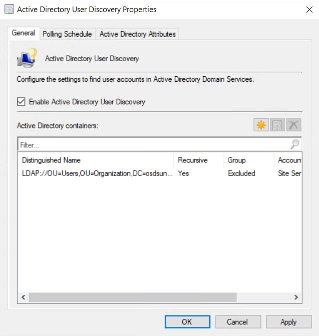

**Step 13.** Select the tab "**Polling Schedule**" and leave everything default. This is where you can change the frequency for user discovery.

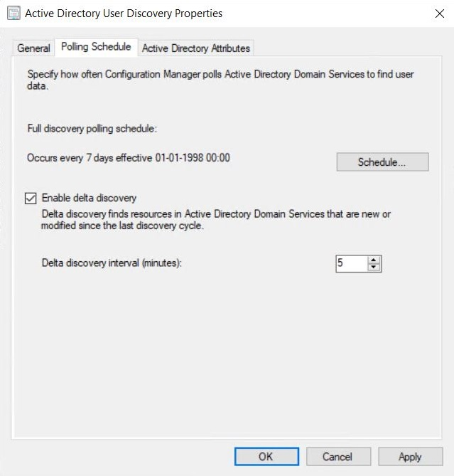

**Step 14.** Select the tab "**Active Directory Attributes**" and leave everything default. This is where you can select custom attributes to be included during user discovery. Click "**OK**"

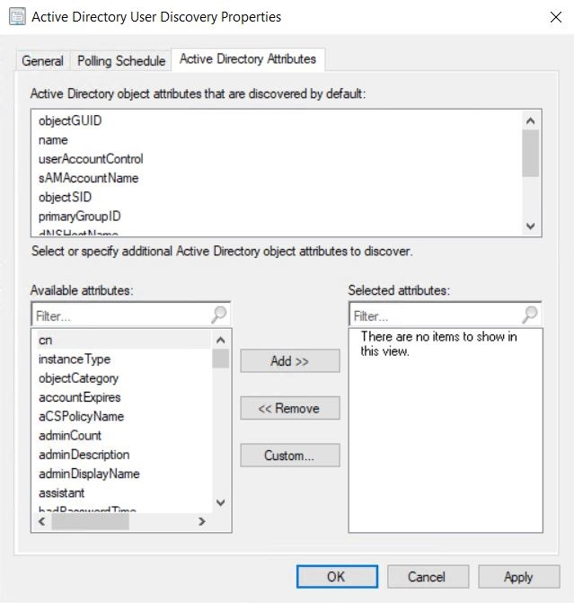

**Step 15.** Click "**Yes**" to run a full discovery as soon as possible.

**Step 16.** Right-click on "**Heartbeat Discovery**" and click "**Properties**". Leave everything default. This discovery method is enabled by default.

.JPG>)


The default schedule for Heartbeat Discovery is set to every seven days. If you change the heartbeat discovery interval, ensure that it runs more frequently than the site maintenance task **Delete Aged Discovery Data**. This task deletes inactive client records from the site database. You can configure the **Delete Aged Discovery Data** task only for primary sites.

Also, if you enable both client push installation and the site maintenance task for **Clear Install Flag** at the same site, set the schedule of Heartbeat Discovery to be less than the **Client Rediscovery period** of the **Clear Install Flag** site maintenance task.


**Step 17.** Navigate to "**Assets and Compliance**" and click "**Users**". The "**Active Directory User Discovery**" has found my two users.

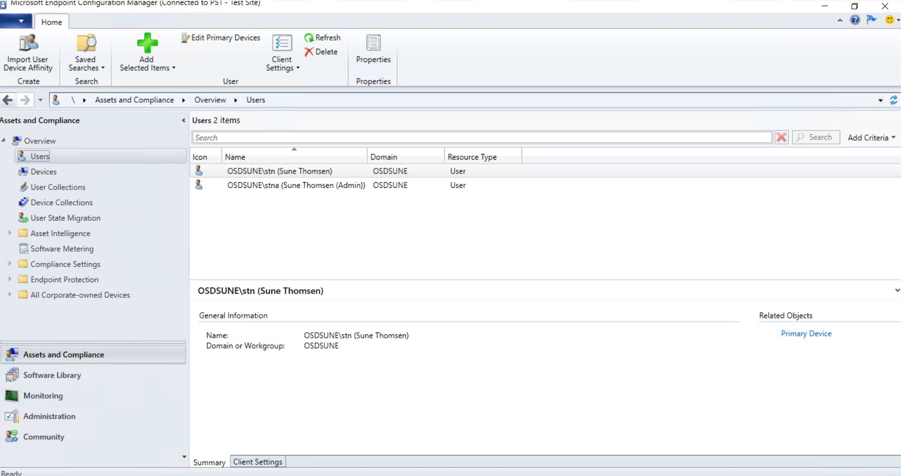

**Step 18.** Click "**Devices**" and we will see that the "**Active Directory System Discovery**" has not found any new clients, which is OK since I don't have any clients in my LAB yet.

But wait a second! The site server "**CM**" is not in the defined computer OU for the "**Active Directory System Discovery**". So why is it there and without a client installed? Regarding the missing client installation on the site server "**CM**", by default the client won't be installed on site systems, but that can be changed in the "**Client Push Installation Properties**".

The reason we are able to see the site server "**CM**" is because there is actually a "hidden" discovery method called "**Server Discovery**" which is an automatic discovery method. It finds computers that we use as site systems and it can't be configured or disabled.&#x20;

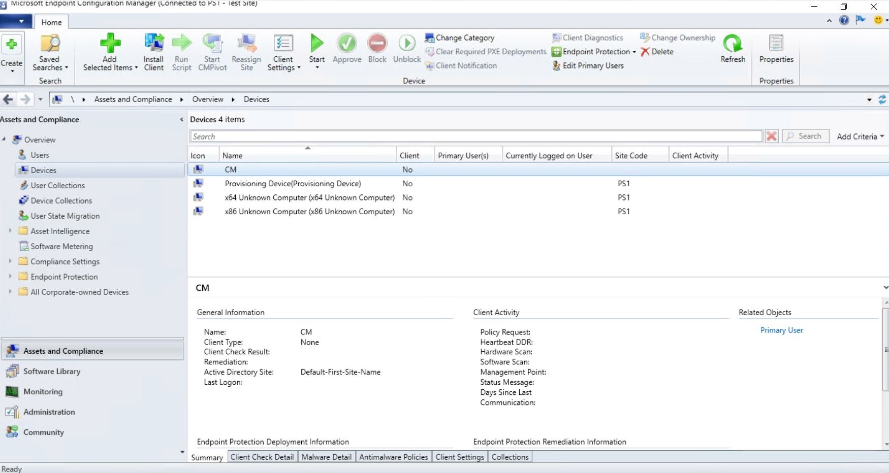

## BOUNDARIES

Now that discovery methods for this LAB has been configured, let's continue with the boundaries and boundary group configuration which is important in order to manage devices on your network.


#### WHAT IS BOUNDARIES?

Microsoft Endpoint Configuration Manager boundaries are locations on your network that contain devices that you want to manage. You can create different types of boundaries, for example, an Active Directory site or network IP address. When the Configuration Manager client identifies a similar network location, that device is a part of the boundary.

Configuration Manager supports the following boundary types:

* IP subnet
* Active Directory site
* IPv6 prefix
* IP address range
* VPN (Starting in version 2006) \*\*

\*\* Starting in version 2006, to simplify managing remote clients, create a boundary type for VPNs. When a client sends a location request, it includes additional information about its network configuration. Based upon this information, the server determines whether the client is on a VPN.

Read more about Boundaries [here](https://docs.microsoft.com/en-us/mem/configmgr/core/servers/deploy/configure/boundaries)


**Step 1.** Navigate to "**Administration**", expand "**Hierarchy Configuration**", right-click on "**Boundaries**" and click "**Create Boundary**"

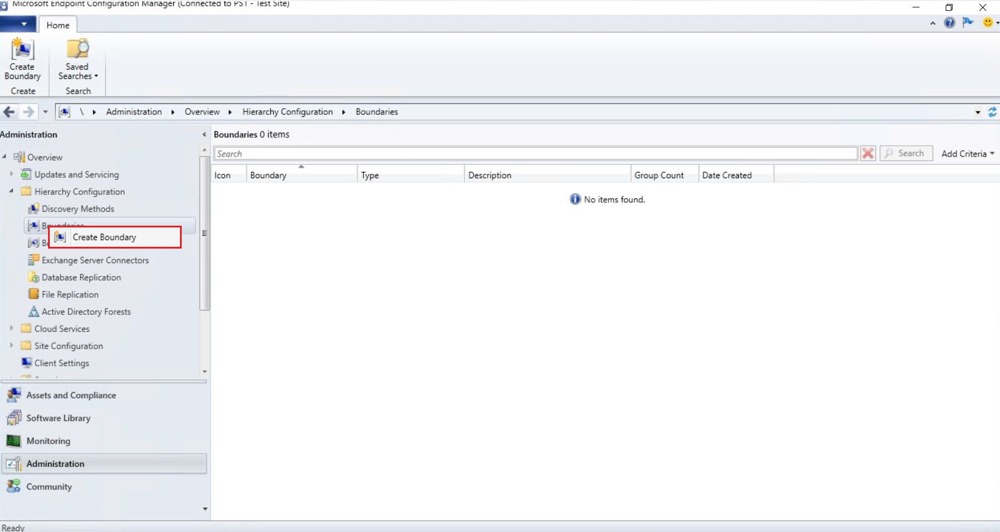

**Step 2.** Enter a description and select a boundary type. I'll recommend "**IP address range**". Click "**OK**"

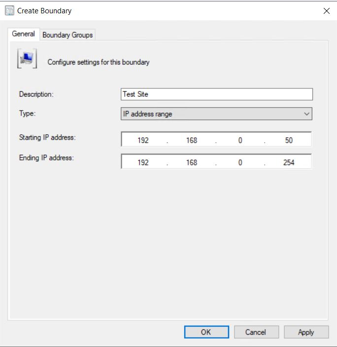

The new boundary should appear in the "**Boundaries**" list.

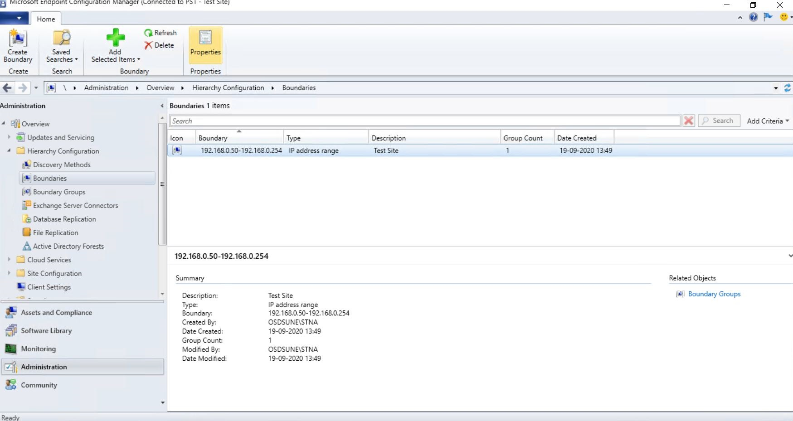


## Something to think about...

Microsoft recommendations for Configuration Manager 2012R2 in a real-world scenario were to use "**Active Directory site**".&#x20;

I'm not sure if that also applies today! It doesn't seem to be in the today recommendations from Microsoft. Although I did find this information "This configuration (IP address range) may be useful for unique devices or test environments." Read more about IP address range [here](https://docs.microsoft.com/en-us/mem/configmgr/core/servers/deploy/configure/boundaries#ip-address-range)

Clever people like [Johan Arwidmark](https://twitter.com/jarwidmark) recommend using IP address range which I also use in our production environment without any issues:wink:Read Johan's blog post [here](https://deploymentresearch.com/back-to-basics-configmgr-distribution-points-and-boundaries/)

### Consider using the IP address range boundary type only when other boundary types cannot be used 

When designing your boundary strategy, we recommend you use boundaries that are based on Active Directory sites before using other boundary types. Where boundaries based on Active Directory sites are not an option, then use IP subnet or IPv6 boundaries. If none of these options are available to you, then leverage IP address range boundaries. This is because the site evaluates boundary members periodically, and the query required to assess members of an IP address range requires a substantially larger use of SQL Server resources than queries that assess members of other boundary types.&#x20;

Note. It´s Microsoft recommendations for Configuration Manager 2012R2.

Source: [Microsoft](https://docs.microsoft.com/en-us/previous-versions/system-center/system-center-2012-R2/gg712679\(v=technet.10\)?redirectedfrom=MSDN#BKMK_BoundaryBestPractices)


### **Boundary Groups**


#### WHAT IS BOUNDAR**Y GROUPS**?

Use boundary groups in Microsoft Endpoint Configuration Manager to logically organize related network locations (boundaries) to make it easier to manage your infrastructure. Assign boundaries to boundary groups before using the boundary group.

By default, Configuration Manager creates a default site boundary group at each site.&#x20;

To configure boundary groups, associate boundaries (network locations) and site system roles, like distribution points, to the boundary group. This configuration helps associate clients to site system servers like distribution points that are located near the clients on the network.

Read more about Boundary Groups [here](https://docs.microsoft.com/en-us/mem/configmgr/core/servers/deploy/configure/boundary-groups)


**Step 1.** Right-click on "**Boundary Groups**" and click "**Create Boundary Group**"

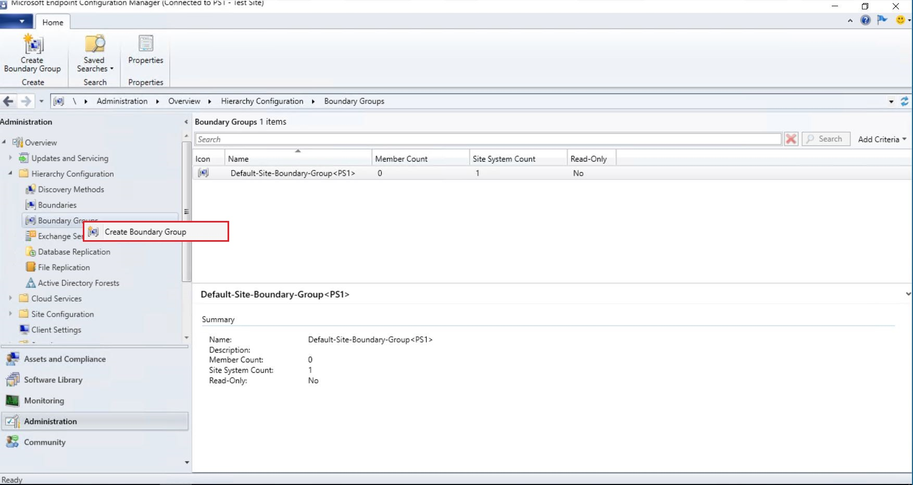

**Step 2.** Enter a name and click "**Add...**"

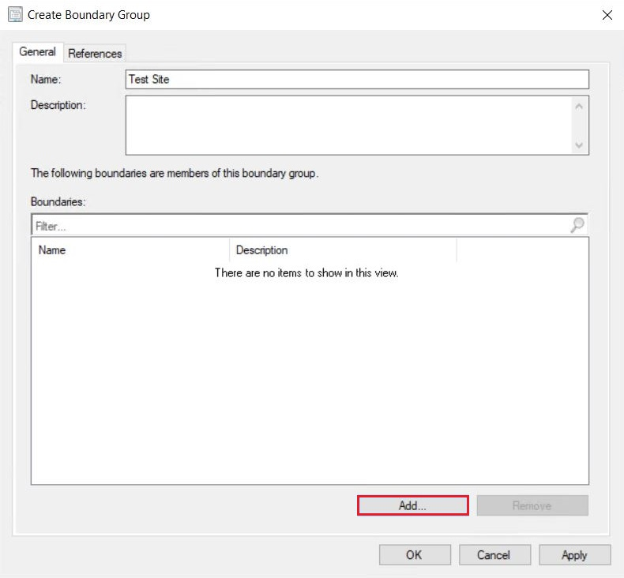

**Step 3.** Check the "**IP Address Range**" boundary box and click "**OK**"

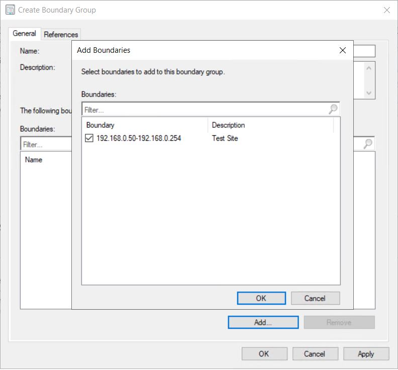

**Step 4.** Select the tab "**References**" and check the "**Use this boundary group for site assignment**" box. Add your site server to the list of site system servers and click "**OK**"

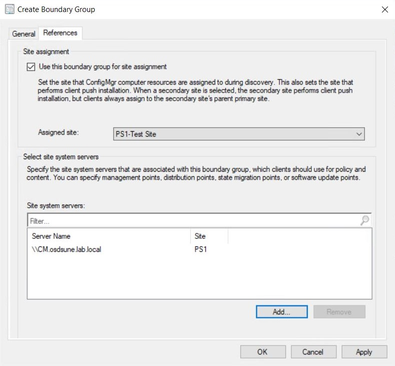

The new boundary group should appear in the "**Boundary Group**" list.

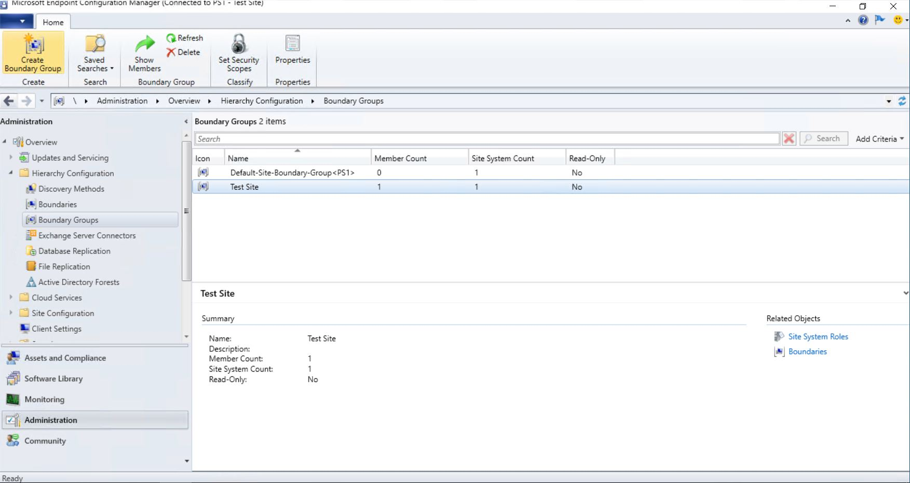


### Avoid overlapping boundaries for automatic site assignment

Although each boundary group supports both site assignment and site system reference, create a separate set of boundary groups to use only for site assignment. Make sure that each boundary in a boundary group isn't a member of another boundary group with a different site assignment.

* A single boundary can be included in multiple boundary groups
* Each boundary group can be associated with a different primary site for site assignment
* For a boundary that's a member of two different boundary groups with different site assignments, clients randomly select a site to join. This behavior might not be for the site you want the client to join. This configuration is called overlapping boundaries.

Overlapping boundaries isn't a problem for content location. It can be a useful configuration that provides clients additional resources or content locations they can use.


This should conclude the configuration of discovery methods and boundaries. In [Part 6](https://www.osdsune.com/home/blog/2020/configmgr-lab/part-6) I'll be setting up the site system role for Software Update Point and I will give you a walk-through of the maintenance configuration for WSUS and SQL.

If you have any questions regarding this topic, feel free to reach out to me. I am most active on [Twitter](https://twitter.com/SuneThomsenDK)!
