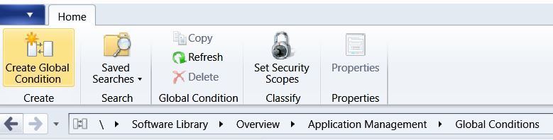
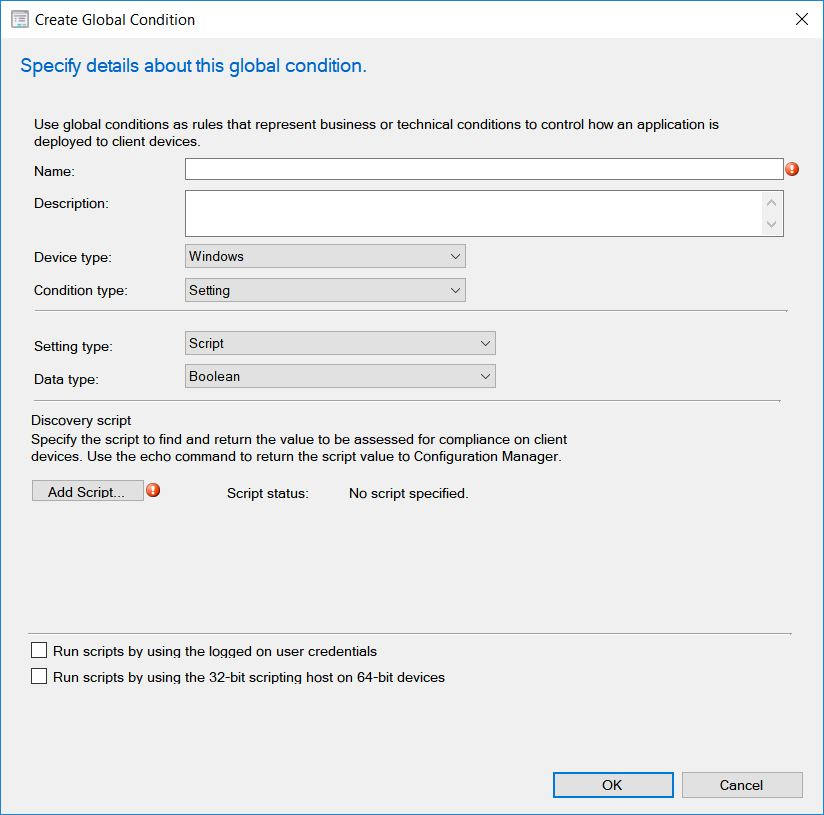
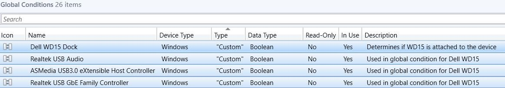
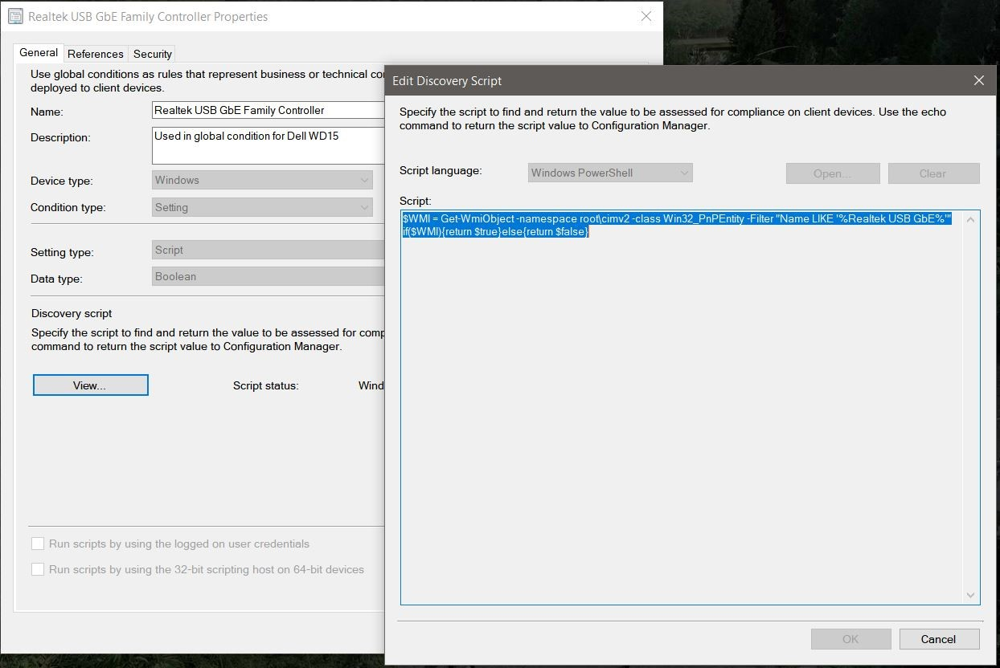
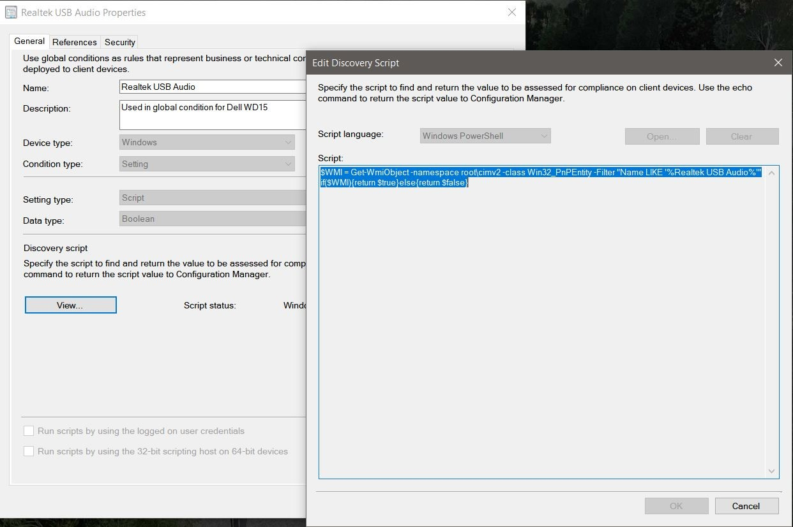
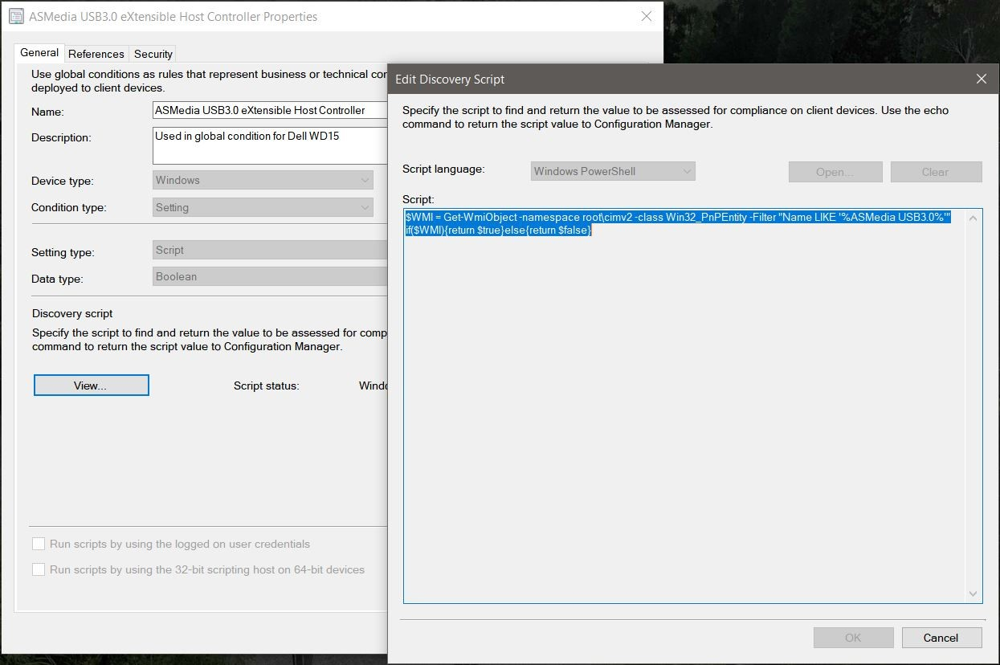
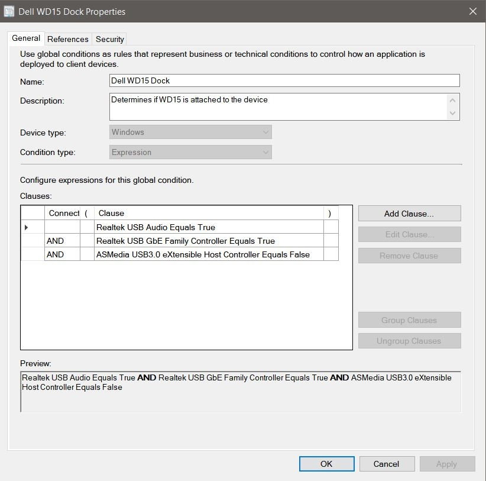
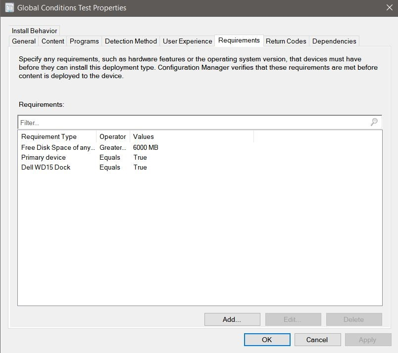
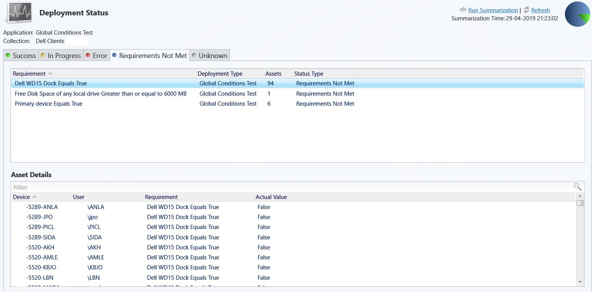

# ConfigMgr: Global Conditions for Dell WD15 Dock Detection

## BEFORE YOU BEGIN


**Disclaimer**: I'm no expert on Global Conditions! In our Dell environment we are using both the Dell TB16 and Dell WD15 dock. So you may have to modify the below information before it will work correctly in your environment.


## DELL WD15 DOCK DETECTION

Ever wanted to firmware update the Dell WD15 dock or exclude them from some deployments? Here's a way to do that, it´s called Global Conditions.

In my quest on how to detect Dell WD15 dock during OS Deployment I figured out that TB16 and WD15 are both using **Realtek USB GbE Family Controller** and **Realtek USB Audio**, but only TB16 are using **ASMedia USB3.0 eXtensible Host Controller**.

I'm using a really awesome PowerShell tool “WMI Explorer” to find all kind of useful informations. Download it [here](https://github.com/vinaypamnani/wmie2/releases/download/v2.0.0.2/WmiExplorer_2.0.0.2.zip)

So what I've done in our environment, is that I'm looking at those 3 instances in the WMI **Win32\_PnPEntity** class to determine if a Dell WD15 dock is attached.

### Global Conditions Setting

In ConfigMgr go to **Software Library** -> **Application Management** -> **Global Conditions** I've created 3 Global Conditions based on above instances by adding a small PowerShell script to each of them that return a true or false result.



Give them a name and set **Device Type** as windows and **Condition Type** as setting. Set **Setting Type** as script, select boolean for **Data Type** and add a script.



You should end up with something like this.









PowerShell examples.

```
$WMI = Get-WmiObject -namespace root\cimv2 -class Win32_PnPEntity -Filter "Name LIKE '%Realtek USB GbE%'"
if($WMI){return $true}else{return $false}

$WMI = Get-WmiObject -namespace root\cimv2 -class Win32_PnPEntity -Filter "Name LIKE '%Realtek USB Audio%'"
if($WMI){return $true}else{return $false}

$WMI = Get-WmiObject -namespace root\cimv2 -class Win32_PnPEntity -Filter "Name LIKE '%ASMedia USB3.0%'"
if($WMI){return $true}else{return $false}
```

On a device attached to a Dell WD15 dock it should return the following results.&#x20;

* Realtek USB GbE Family Controller = True
* Realtek USB Audio = True&#x20;
* ASMedia USB3.0 eXtensible Host Controller = False

Adding these Global Condition to you application deployment type should do the job.

### Global Conditions Expression

But just to make it pretty and easy you could as I did create a new Global Condition as an expression type, so in you applications deployment type you just have to add 1 requirement instead of 3.

Create a new Global Condition, give it a name and set **Device Type** as windows, **Condition Type** as expression and add clauses as below.




If you are working in a mixed environment with HP, Dell, Lenovo etc. You could add a fourth condition that check that the computer manufacturer is Dell.


Add the Global Condition to requirements on the Applications Deployment Type



Afterwards I ran a simulated deployment on a test application and viewed the result in **Monitoring** -> **Deployments**

.jpg>)



You can now detect Dell WD15 docks with Global Conditions and I hope this post will help you getting started with Global Conditions in general. Feel free to reach out to me if you have any questions regarding this topic. I am most active on [Twitter](https://www.twitter.com/SuneThomsenDK)!
