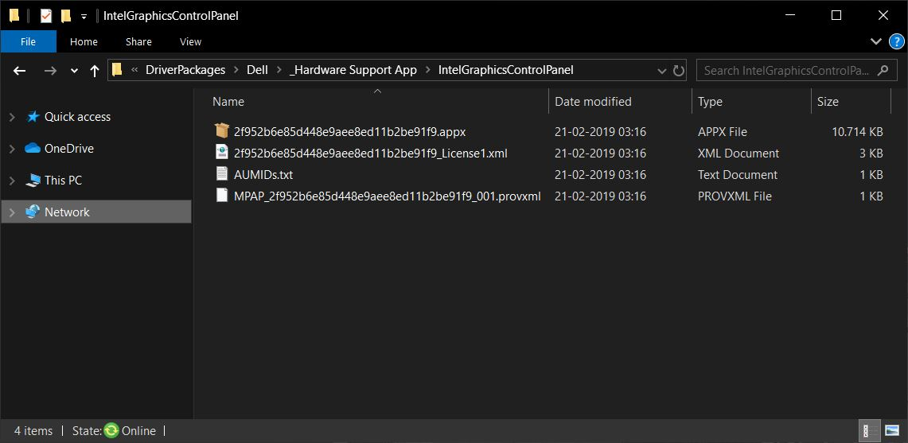
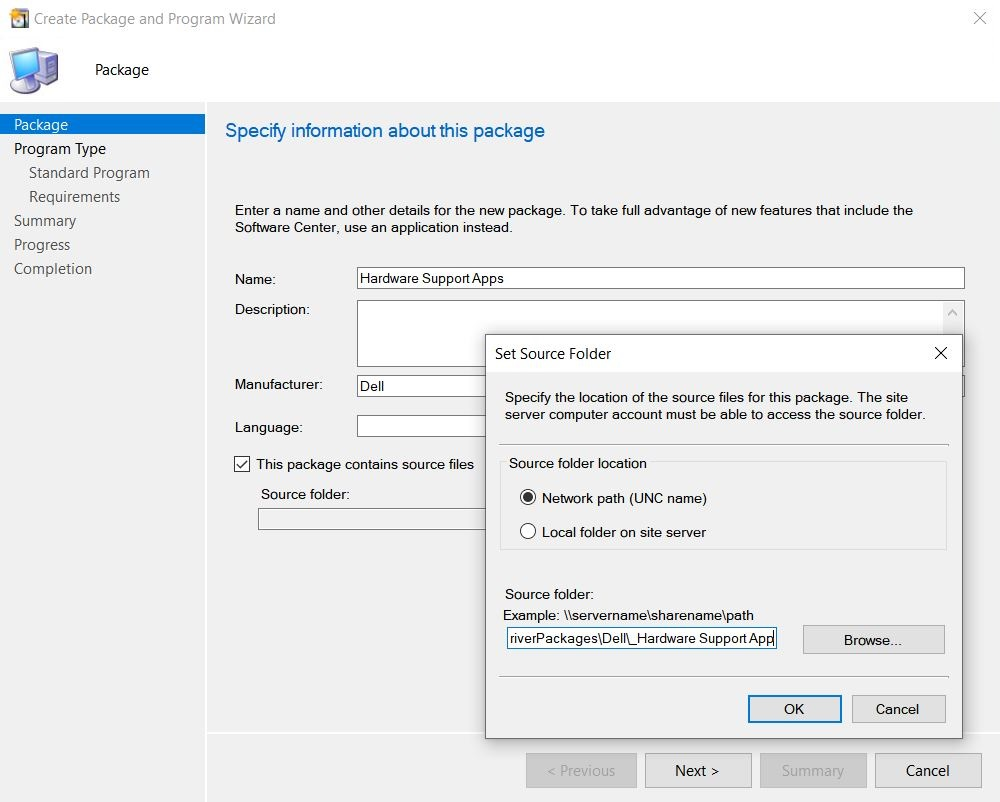
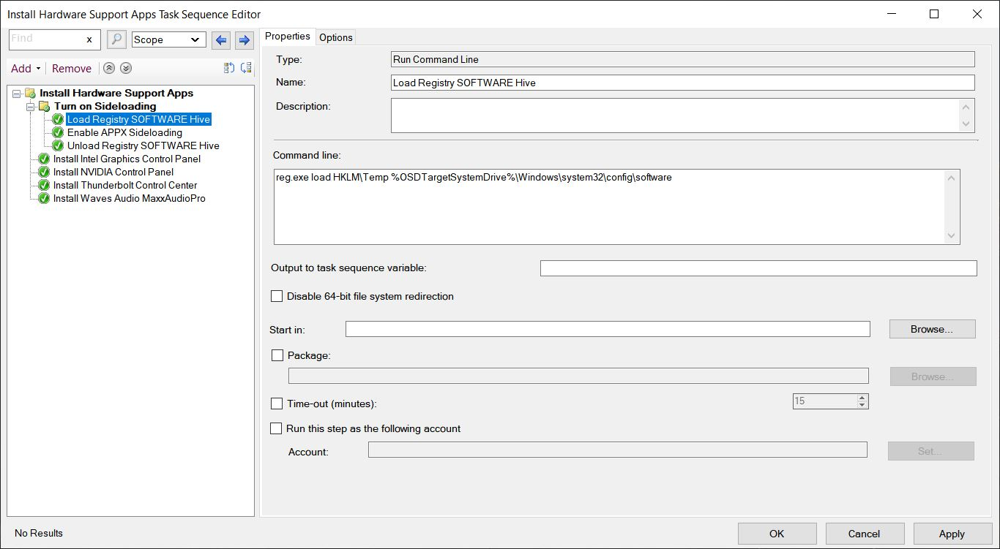
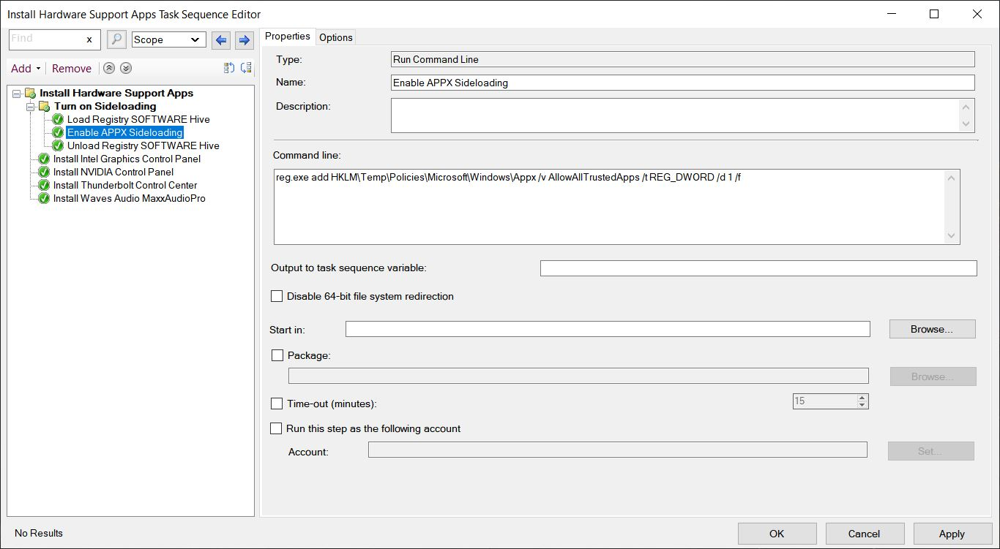
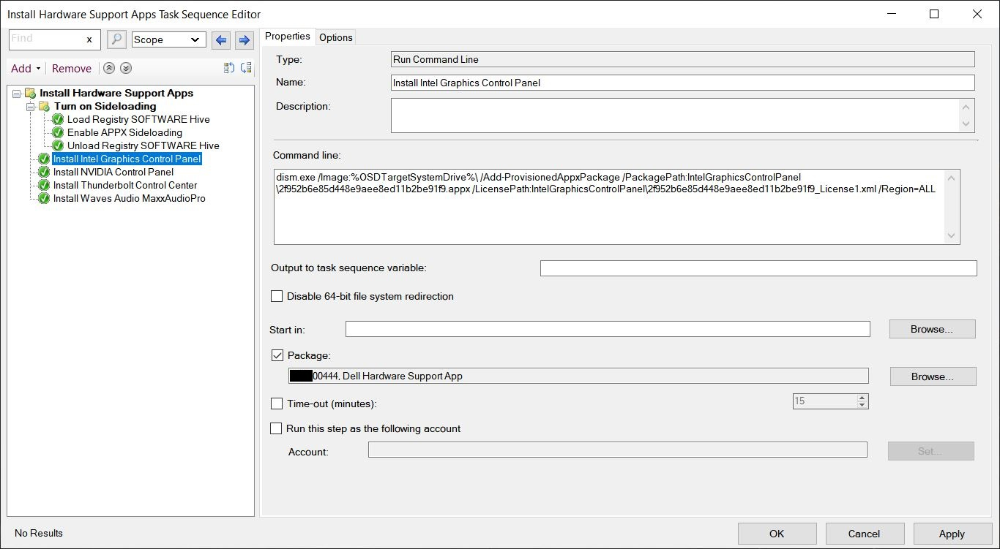
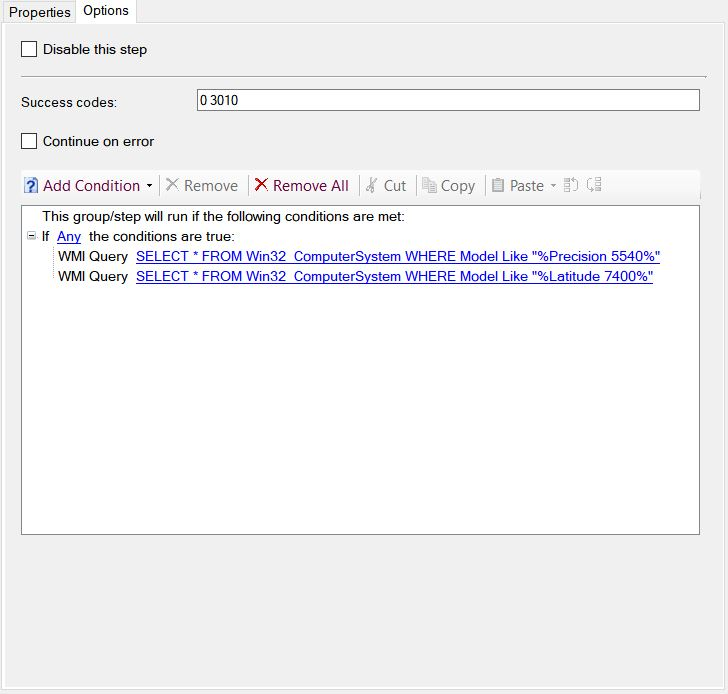
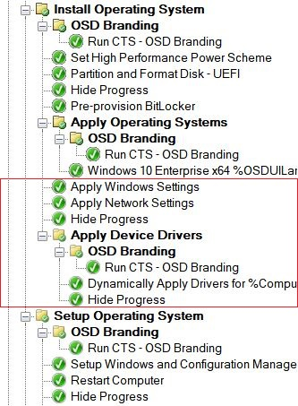
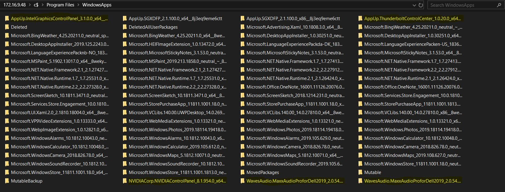
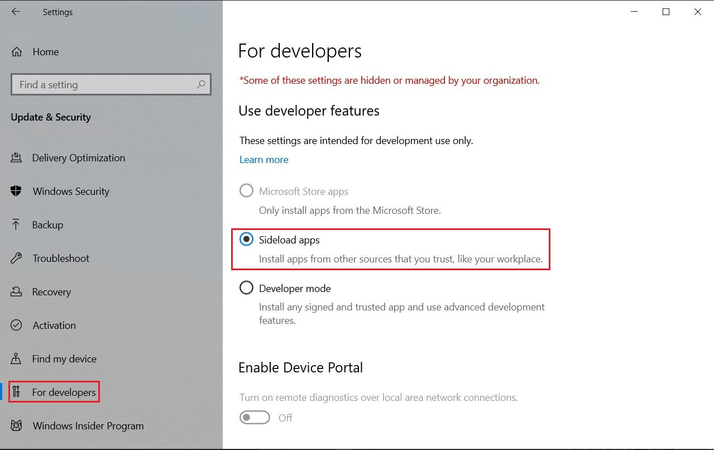
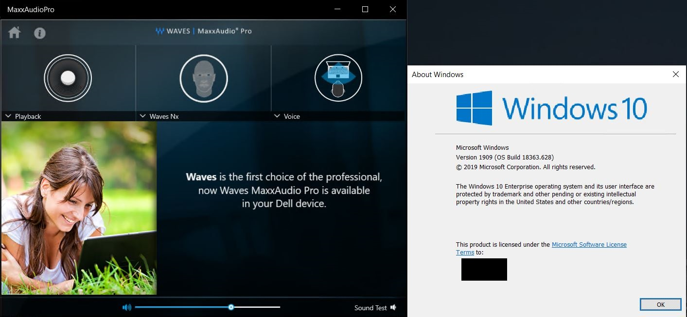

# ConfigMgr: Deploy UWP Applications During OSD

## BEFORE YOU BEGIN


**Disclaimer**: All information and content in this blog posts is provided without any warranty whatsoever. The entire risk of using this information or executing the provided content remains with you. Under no circumstances should Dell, Microsoft, its author, or anyone else involved in the creation of these blog posts be held liable for any damage or data loss.



**Knowledge**: I assume that people who read this blog post have an general understanding of OS Deployment and how to create a package and a Task Sequence in ConfigMgr, so I won't be deep-diving into details about that in this post.



**Update (03-16-2020)**: Microsoft won't be fixing this issue, but they has released a public KB article [**KB4543142**](https://support.microsoft.com/en-us/help/4543142) covering the issue.

**Update (09-02-2020)**: UWP applications now available on the Dell Support Site.

To address the below situation and to improve the overall customer experience, Dell has been posting the UWP applications to their [Drivers and Downloads page.](https://www.dell.com/support/home/en-us?app=drivers\&lwp=rt)

**Update (11-25-2020)**: Microsoft has (finally) fixed this issue in Windows 10 20H2. So UWP/HSA will no longer be deleted during first user logon.


## MODERN DRIVERS

### Introduction

In the early 2019, we saw several PC manufacturers starting to use modern drivers that no longer uses the Win32 architecture. Instead they will use Microsoft’s Universal Windows Platform (UWP) to perform service and end user application operations.

These Universal Windows Platform (UWP) applications are also known as Hardware Support App (HSA) when it's a device-specific app that is paired with a specific driver.

Universal Windows Platform (UWP) applications uses the Microsoft Store to authenticate a license that is included with the UWP application. Windows Update and the Microsoft Store are known to be block by default in many enterprise environments, which now causing issue because device-specific applications no longer are installed during driver installation as they used to.


Read more about Universal Windows Platform (UWP) and Hardware Support App (HSA) [here](https://docs.microsoft.com/en-us/windows-hardware/drivers/devapps/what-s-new)


### The UWP/HSA Nightmare

It all started on a beautiful day in April 2019, that day I received the new PC models from Dell and it didn't take me long before they were configured in our ConfigMgr environment<span data-gb-custom-inline data-tag="emoji" data-code="1f913">:nerd:</span>But the excitement was brief, because it turned out that the applications for the audio, thunderbolt and graphics card were missing in Windows 10 (1809/1903).

Missing application, and so what? You might ask. The thing is that most common things like switching between headphones, mics and the internal speakers of the device, will become an issue without the audio application installed to say the least.

Long story short, HSA are being installed correct in Windows 10 (1803) but not in newer versions and Microsoft have finally acknowledged this after 6 month of troubleshooting. They (Microsoft) are now figuring out (which can take weeks) if they can/will fix it in a upcoming update or just refer to a public KB article that basically will explain my workaround below.&#x20;

**Update**: Microsoft has released a public KB article [**KB4543142** ](https://support.microsoft.com/en-us/help/4543142/pre-installed-microsoft-store-app-is-removed-at-first-windows-logon)covering the issue.

**Update**: Microsoft has (finally) fixed this issue in Windows 10 20H2. So UWP/HSA will no longer be deleted during first user logon.


Read more about this issue in my original documentation for the support case [here](https://github.com/SuneThomsenDK/Win10Customization/blob/master/Doc/HSA_Is_Not_Installing_1809_1903.pdf)


## THE WORKAROUND

Both Microsoft and Dell states that it's not possible or supported by ConfigMgr to sideload UWP Applications (HSA) during OS Deployment!?&#x20;

Okay, here's how to sideload UWP Applications (HSA) during OS Deployment:sunglasses:&#x20;

### UWP Applications

~~**Step 1.** Open a ticket with Dell Support and ask them to escalated it to the Resolution Expert Center (REC) to obtain the UWP Applications that you need in your environment.~~


~~UWP Applications may be available from the Dell Support Site in the future.~~



**Update (09-02-2020)**: UWP applications now available on the Dell Support Site.

To address this situation and to improve the overall customer experience, Dell has been posting the UWP applications to their [Drivers and Downloads page.](https://www.dell.com/support/home/en-us?app=drivers\&lwp=rt)


**Step 2.** Once you have received the UWP applications from Dell, you need to extract them and copy them to your ConfigMgr content share.



**Step 3.** In the ConfigMgr console, go to Application Management in Software Library and create a package without a program (don't forget to distribute the content to your DP).



### Creating the Child TS

**Step 1.** In the ConfigMgr console, go to Operating Systems in Software Library, click on Task Sequence and create a new Task Sequence (TS). What I've done is that I created a TS that will be used as a Child Task Sequence (Nested TS) in my main TS.

When we are done, the TS will include a registry change and the UWP application installations.

**Step 2.** Create the first command line for the registry change and call it "**Load Registry SOFTWARE Hive**"

```
reg.exe load HKLM\Temp %OSDTargetSystemDrive%\Windows\system32\config\software
```



**Step 3.** Create the second command line for the registry change and call it "**Enable APPX Sideloading**"

```
reg.exe add HKLM\Temp\Policies\Microsoft\Windows\Appx /v AllowAllTrustedApps /t REG_DWORD /d 1 /f
```



**Step 4.** Create the final command line for the registry change and call it "**Unload Registry SOFTWARE Hive**"

```
reg.exe unload HKLM\Temp
```

**Step 5.** Create a command line for each UWP Application and call them something recognizable. Add the package you created in "**UWP Applications**" step 3 and the below dism command line.&#x20;

The important parameter for this to be working is "**Region:ALL**" or "**Region=ALL**" (They should both work)

```
dism.exe /Image:%OSDTargetSystemDrive%\ /Add-ProvisionedAppxPackage /PackagePath:IntelGraphicsControlPanel\2f952b6e85d448e9aee8ed11b2be91f9.appx /LicensePath:IntelGraphicsControlPanel\2f952b6e85d448e9aee8ed11b2be91f9_License1.xml /Region=ALL
```



**Step 6.** Click on the "**Options**" tab and create conditions for PC model detection.

```
SELECT * FROM Win32_ComputerSystem WHERE Model Like "%PC MODEL HERE%"
```



**Step 7.** Place the child TS in your main TS somewhere between the "**Apply Operating System Image**" and "**Setup Windows and ConfigMgr**" step (I've placed it right after applying drivers).



**Step 8.** Now run the OS Deployment and log on to the device afterwards. Check that the UWP Applications is installed and weren't uninstalled during first user log on.&#x20;

It should look similar to the screenshots below, if that's not the case and the UWP Applications is located in the folder "**DeletedAllUserPackages**" it means that something went wrong and that they were uninstalled during first user log on.





.JPG>)




The sideloaded UWP Applications will be auto updated by Microsoft Store in the background if you allow that in your environment.


## TROUBLESHOOTING

If the UWP Applications is uninstalled during first user log on, please go through all the above steps again and re-run the OS Deployment. If it still fails to work, take a look in the smsts.log to see if any error occurred during the process.

Sometime when you save files from a remote location Windows tries to protect your machine by blocking it using the Alternate Data Streams (ADS) technology.&#x20;

You can check if a file is blocked by right-click on it and select properties, if it on the "**General**" tab says something like "_**This file came from another computer and might be blocked to help protect this computer.**_" the file is blocked. If you find out that your UWP Applications are blocked, you can try and unblock them all with the below PowerShell command (You can add a **-WhatIf** at the end to see what happens before executing the command)

```
Get-ChildItem "E:\Source\Content\DriverPackages\Dell\_Hardware Support App\" -Recurse | Unblock-File
```

Don't forget to re-distribute the package afterwards.

## FINAL THOUGHTS

I believe, that this is a issue with the newer versions of Windows 10. Microsoft might have tried to fix one issue but then created a new issue for us enterprise customers that deploy OS through ConfigMgr.

It's awesome that Microsoft now have acknowledged this issue, let's see what's going to happen over the next couple of weeks! But until then, you now at least have a workaround:sunglasses:

**Update**: Microsoft has released a public KB article [**KB4543142** ](https://support.microsoft.com/en-us/help/4543142/pre-installed-microsoft-store-app-is-removed-at-first-windows-logon)covering the issue.

**Update**: Microsoft has (finally) fixed this issue in Windows 10 20H2. So UWP/HSA will no longer be deleted during first user logon.

If you have any questions regarding this topic, feel free to reach out to me. I am most active on [Twitter](https://twitter.com/SuneThomsenDK)!
