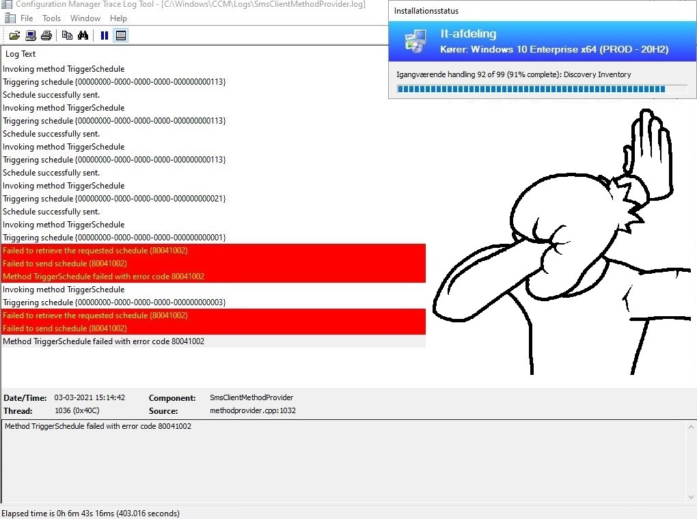
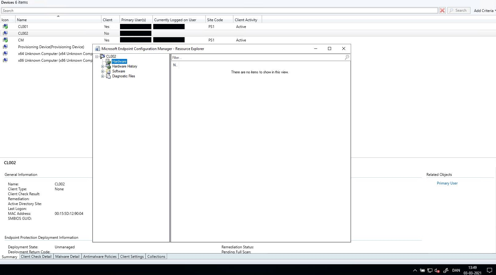
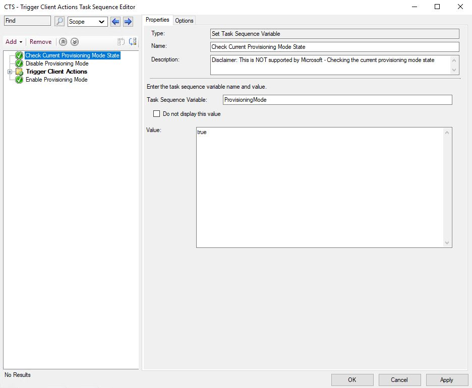
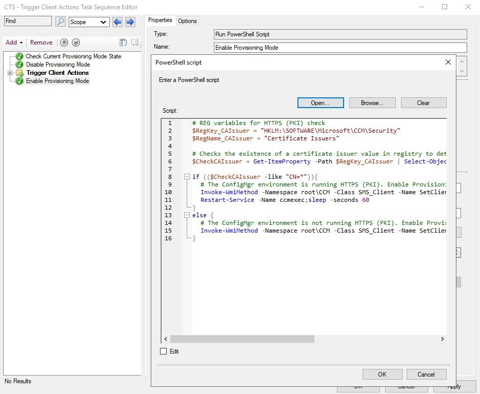
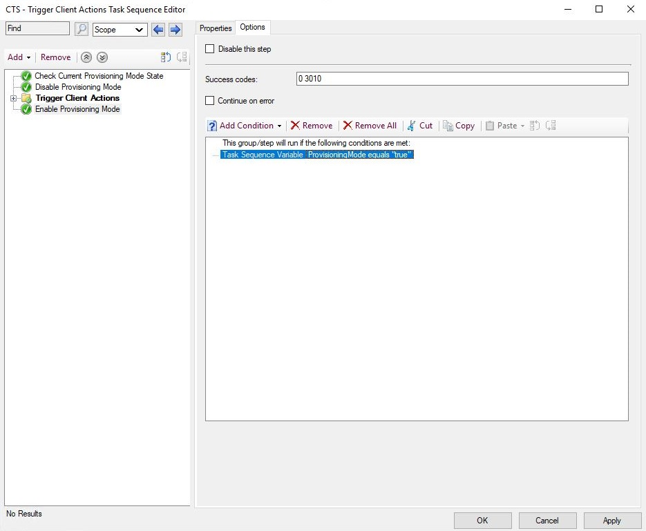
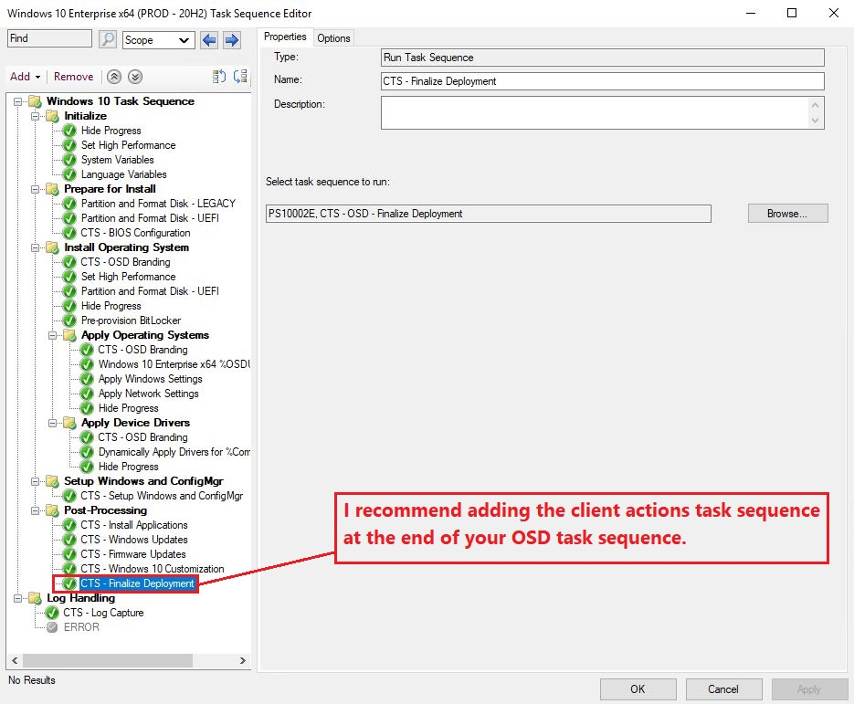
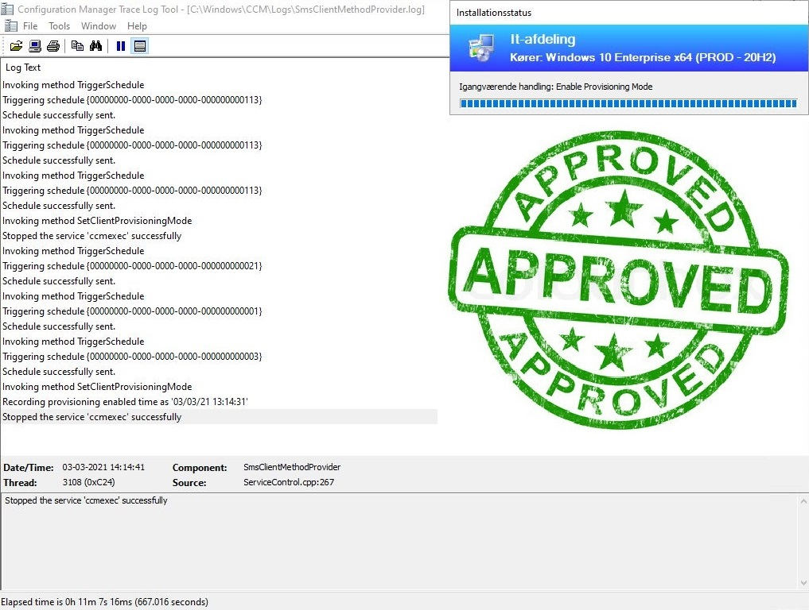
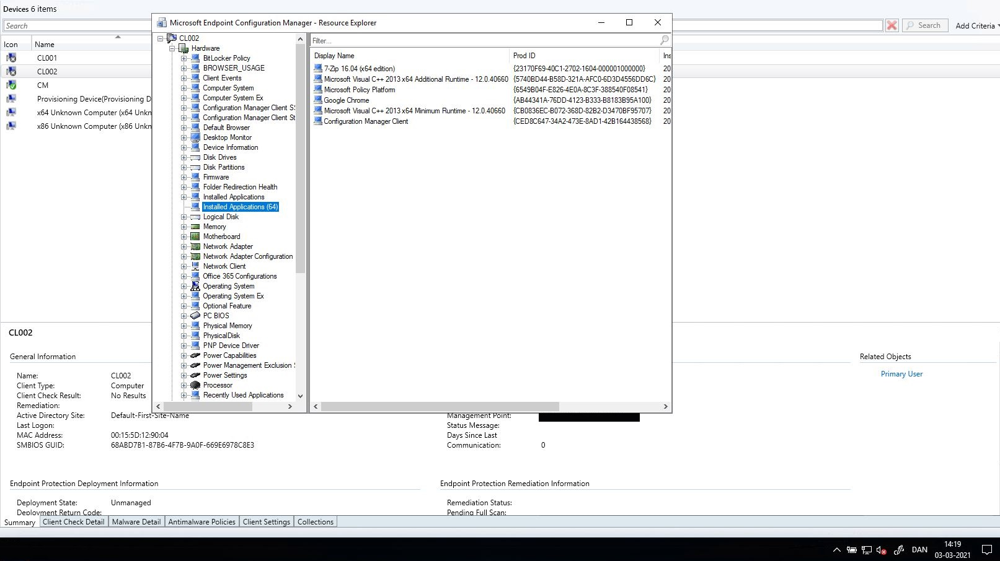

# ConfigMgr: Run "All" Client Actions During OSD

## BEFORE YOU BEGIN


**Disclaimer:** All information and content in this blog post is provided without any warranty whatsoever. The entire risk of using this information or executing the provided content remains with you. Under no circumstances should mentioned persons or vendors, the author, or anyone else involved in creating these blog posts be held liable for any damage or data loss.



**Warning:** This is **NOT** supported by Microsoft!... But it works :wink:


## THE CUSTOMER CASE

A large international customer came to us with a desire to be able to run hardware inventory during OSD as they had some other systems that were depending on data from the hardware inventory in Microsoft Endpoint Configuration Manager. My colleague had tried different things without success and since I had previously encountered this "issue" it was something I had to investigate further - Now that it has gone into production at this customer, I can now share my solution it with you guys:nerd:



### The Solution

During my research I found out that a few client actions actually did work while the devices was in provisioning mode (e.g. Scan by Update Source - 00000000-0000-0000-0000-000000000113) and others not so much :joy: which gave me the idea to toggle in and out of provisioning mode to see if that would allow me to trigger hardware inventory - well it worked :sunglasses:

[Adam Gross](https://twitter.com/AdamGrossTX) had a similar idea and he asked the Microsoft devs about some registry keys that is set in provisioning mode to prevent client actions from being triggered during OSD.

The registry key Adam was talking about: `"HKLM\Software\Microsoft\CCM\CCMExec\SystemTaskExcludes"`

Their response was: _If it is not documented, it is not supported! Leave it alone or you are running the risk of hitting unexpected behaviors._

Awesome! So, moving on with the unsupported workaround :nerd:


#### WHAT IS HARDWARE INVENTORY?

Hardware inventory is one of many client actions and its job is to collect information about the hardware configuration of devices in your environment. To collect hardware inventory, you must enable it in client settings.&#x20;

After hardware inventory is enabled and the client runs a hardware inventory cycle, the client sends the information to a management point. The management point then forwards this information to the primary site server, which stores the information in the site database.

Read more about hardware inventory [here](https://docs.microsoft.com/en-us/mem/configmgr/core/clients/manage/inventory/introduction-to-hardware-inventory)



#### WHAT IS PROVISIONING MODE?

During OS deployment task sequence, Microsoft Endpoint Configuration Manager places the client in provisioning mode. In this state, the client doesn't process policy from the site. This behavior allows the task sequence to run without risk of additional deployments running on the client. When the task sequence completes it exits provisioning mode.

Read more about provisioning mode [here](https://docs.microsoft.com/en-us/mem/configmgr/osd/understand/provisioning-mode)

[Gary Blok ](https://twitter.com/gwblok)has written a great blog post that dives deeper into client provisioning mode to find out what is going on when a system is in provisioning mode - it can be found [here](https://garytown.com/configmgr-client-provisioning-mode)


My workaround is based on Adam's awesome client action task sequence script, which can be found [here](https://www.asquaredozen.com/2018/06/14/triggering-configmgr-client-actions-from-a-task-sequence/)

So, the first thing I had to do, was to find out how to toggle in and out of provisioning mode and I ended up with two methods, one being a PowerShell command and the other a Command-line.

```
Turn Off Provisioning Mode
PowerShell -> Invoke-WmiMethod -Namespace root\CCM -Class SMS_Client -Name SetClientProvisioningMode -ArgumentList $false
Command-line -> WMIC /namespace:\\root\ccm path sms_client CALL SetClientProvisioningMode "false" /NOINTERACTIVE

Turn On Provisioning Mode
PowerShell -> Invoke-WmiMethod -Namespace root\CCM -Class SMS_Client -Name SetClientProvisioningMode -ArgumentList $true
Command-line -> WMIC /namespace:\\root\ccm path sms_client CALL SetClientProvisioningMode "true" /NOINTERACTIVE
```

I've decided to go with a small PowerShell script based on the above PowerShell commands, it may not be pretty, but it gets the job done. So, with that in place let's get started with the walkthrough of my solution. As mentioned above, it is based on Adam's client action task sequence script and I've then added a few extra steps to toggle in and out of provisioning mode. And yes! There will be a download link to my task sequence further down on this page :nerd:

On the print screen below I have imported a new device "**CL002**" and as you can see, no hardware inventory has been collected on the device yet.



As we go through the steps with the Task Sequence Editor, we can see Adam's step in the group "**Trigger Client Actions**". The first step that I've added was a "**Check Current Provisioning Mode State**" which sets a "**ProvisioningMode**" variable to "**true**" if the devices is in provisioning mode.

This step will only run if the below registry condition is true.



.JPG>)

My next step will temporarily disable provisioning mode in both HTTP and HTTPS (PKI) environments and the step will run if the variable condition "**ProvisioningMode**" is true.

.JPG>)

.JPG>)

**PowerShell Script (Disable Provisioning Mode)**

```
# REG variables for Certificate AutoEnrollment
$RegKey_AEPolicy = "HKLM:\SOFTWARE\Policies\Microsoft\Cryptography\AutoEnrollment"
$RegName_AEPolicy = "AEPolicy"
$RegValue_AEPolicy = "7"
$RegType_AEPolicy = "DWORD"

# REG variables for HTTPS (PKI) check
$RegKey_CAIssuer = "HKLM:\SOFTWARE\Microsoft\CCM\Security"
$RegName_CAIssuer = "Certificate Issuers"

# Disable Provisioning Mode
Invoke-WmiMethod -Namespace root\CCM -Class SMS_Client -Name SetClientProvisioningMode -ArgumentList $false

# Checks the existence of a certificate issuer value in registry to determine if the ConfigMgr environment is running HTTPS (PKI)
$CheckCAIssuer = Get-ItemProperty -Path $RegKey_CAIssuer | Select-Object -ExpandProperty $RegName_CAIssuer

if (($CheckCAIssuer -like "CN=*")){
	if (!(Test-Path $RegKey_AEPolicy)){
		# The ConfigMgr environment is running HTTPS (PKI). Creat Registry Key for AEPolicy, Run Certutil, Restart CCMEXEC service and wait a few minutes
		New-Item -Path $RegKey_AEPolicy -Force | Out-Null;New-ItemProperty -Path $RegKey_AEPolicy -Name $RegName_AEPolicy -PropertyType $RegType_AEPolicy -Value $RegValue_AEPolicy -Force | Out-Null;certutil -pulse;sleep -seconds 60;Restart-Service -Name ccmexec;sleep -seconds 240
	}
	else{
		# The ConfigMgr environment is running HTTPS (PKI). Run Certutil, Restart CCMEXEC service and wait a few minutes
		certutil -pulse;sleep -seconds 60;Restart-Service -Name ccmexec;sleep -seconds 240
	}
}
else {
	# The ConfigMgr environment is not running HTTPS (PKI). Restart CCMEXEC service and wait a few minutes
  Restart-Service -Name ccmexec;sleep -seconds 240
}
```

Now that the device temporarily is out of provisioning mode, we will be able to trigger "all" client actions created with Adam's client action task sequence script.


**Warning**: This is **NOT** supported by Microsoft!&#x20;

Please use it with caution and always test in lab first! I have added quotes around "all" because I haven't tested them all and some of them may have been deprecated.


.JPG>)

**Command-line (Trigger Hardware Inventory)**

```
%SYSTEMROOT%\System32\WindowsPowerShell\v1.0\powershell.exe -NoProfile -WindowStyle Hidden -ExecutionPolicy Bypass -Command "Invoke-WmiMethod -Namespace root\CCM -Class SMS_Client -Name TriggerSchedule '{00000000-0000-0000-0000-000000000001}';Start-Sleep -seconds 60;"
```

My next step will enable provisioning mode in both HTTP and HTTPS (PKI) environments and the step will run if the variable condition "**ProvisioningMode**" is true.





**PowerShell Script (Enable Provisioning Mode)**

```
# REG variables for HTTPS (PKI) check
$RegKey_CAIssuer = "HKLM:\SOFTWARE\Microsoft\CCM\Security"
$RegName_CAIssuer = "Certificate Issuers"

# Checks the existence of a certificate issuer value in registry to determine if the ConfigMgr environment is running HTTPS (PKI)
$CheckCAIssuer = Get-ItemProperty -Path $RegKey_CAIssuer | Select-Object -ExpandProperty $RegName_CAIssuer

if (($CheckCAIssuer -like "CN=*")){
	# The ConfigMgr environment is running HTTPS (PKI). Enable Provisioning Mode, restart the CCMEXEC services and wait a few minutes
	Invoke-WmiMethod -Namespace root\CCM -Class SMS_Client -Name SetClientProvisioningMode -ArgumentList $true;sleep -seconds 60
	Restart-Service -Name ccmexec;sleep -seconds 60
}
else {
	# The ConfigMgr environment is not running HTTPS (PKI). Enable Provisioning Mode and wait a few minutes
	Invoke-WmiMethod -Namespace root\CCM -Class SMS_Client -Name SetClientProvisioningMode -ArgumentList $true;sleep -seconds 120
}
```

In both scripts and command-lines I've adjusted the sleep time to fit both of my lab environments, but you may need to tweak the values to fit your environment.

The only thing left to do now, is adding the client action task sequence at the end of your OS Deployment task sequence and test it on a device.



Now let´s see what the log "**SmsClientMethodProvider.log**" says!\
And the result \*drumbeats\*… No errors :partying\_face:



If we check my previously imported device "**CL002**" we can now see that hardware inventory has been collected during OS deployment. Awesome :sunglasses:



You can download my child task sequence [here](https://github.com/SuneThomsenDK/OSDSUNE/raw/master/TaskSequence/CTS/CTS_TriggerClientActions.zip)

## FINAL THOUGHTS

I do not believe that we will see this as a supported feature in the near future. Yes this workaround does work! But please keep in mind that it is **NOT** supported by Microsoft! So, please use my solution with caution and always test in lab first! And also be aware that some of the client actions may have been deprecated.

This solution adds 10+ minutes to the overall OS deployment time, but you can try and tweak the sleep time values for your environment, you might be lucky to reduce it with a few minutes or in worst case add a few minutes before it will work perfect in your environment.

If you have any questions regarding this topic, feel free to reach out to me. I am most active on [Twitter](https://twitter.com/SuneThomsenDK)!
