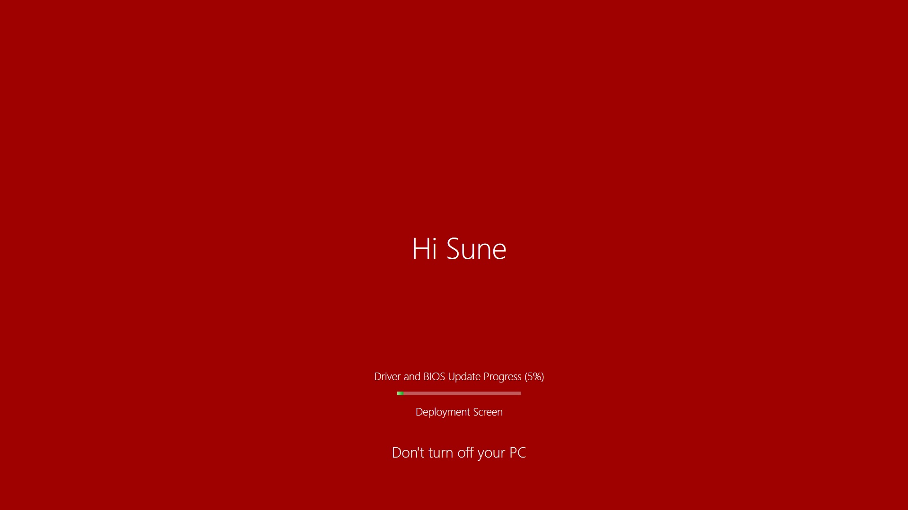
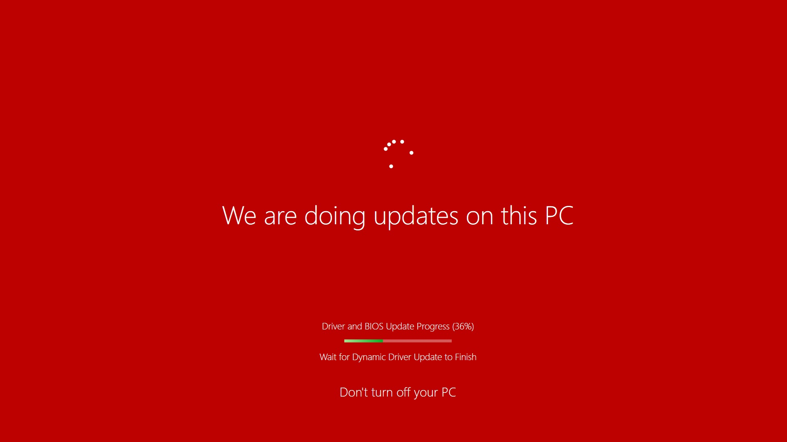
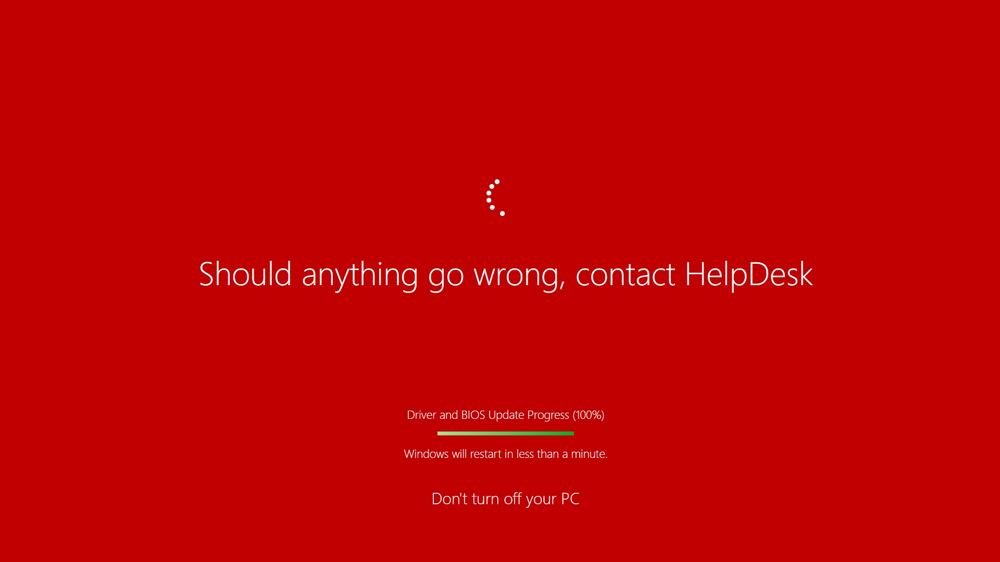
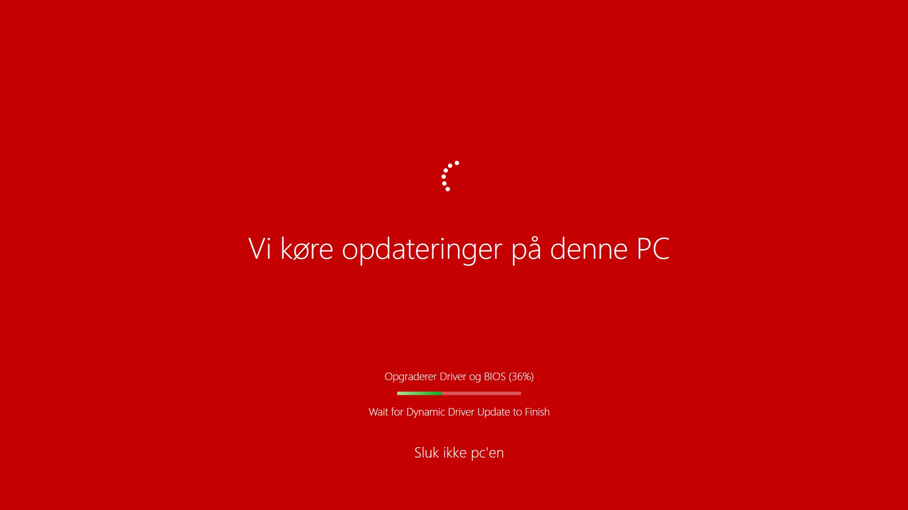
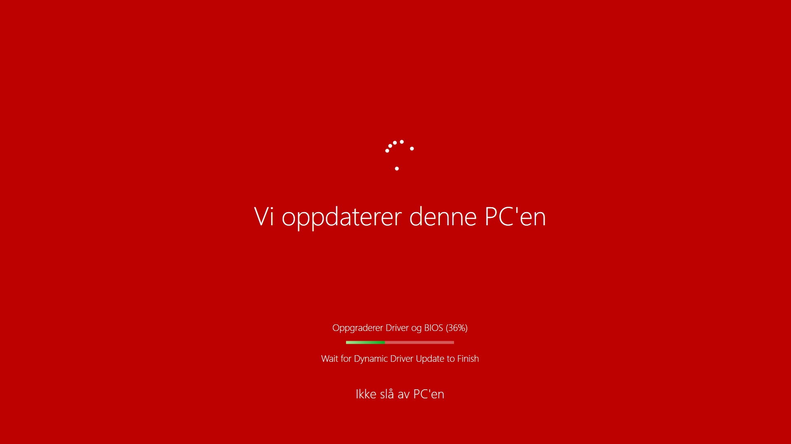
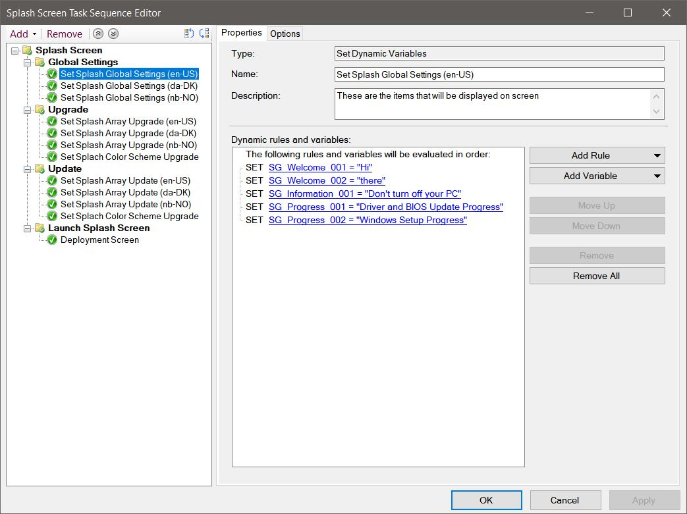
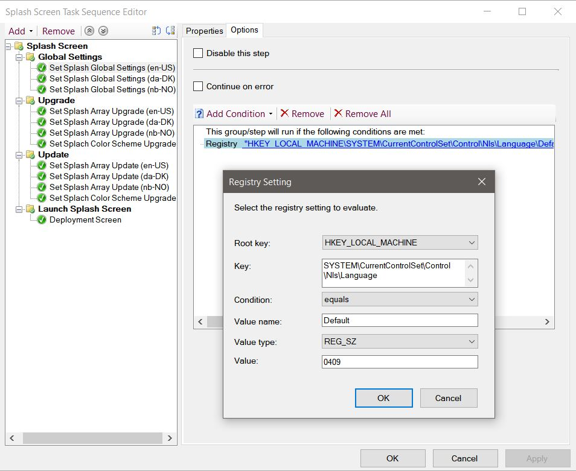
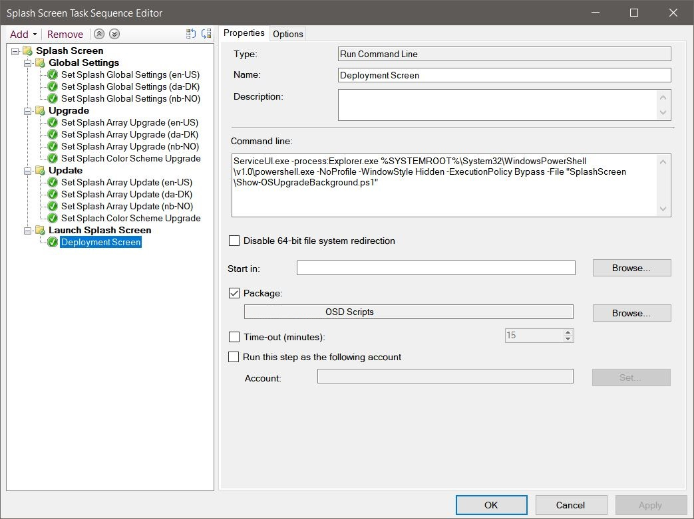
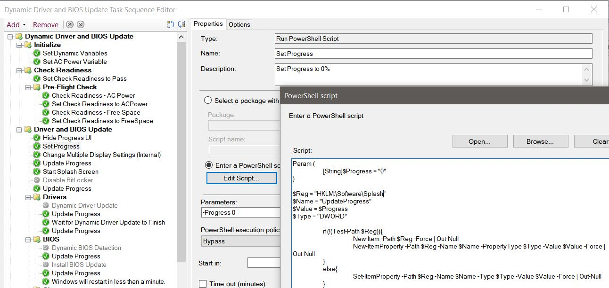
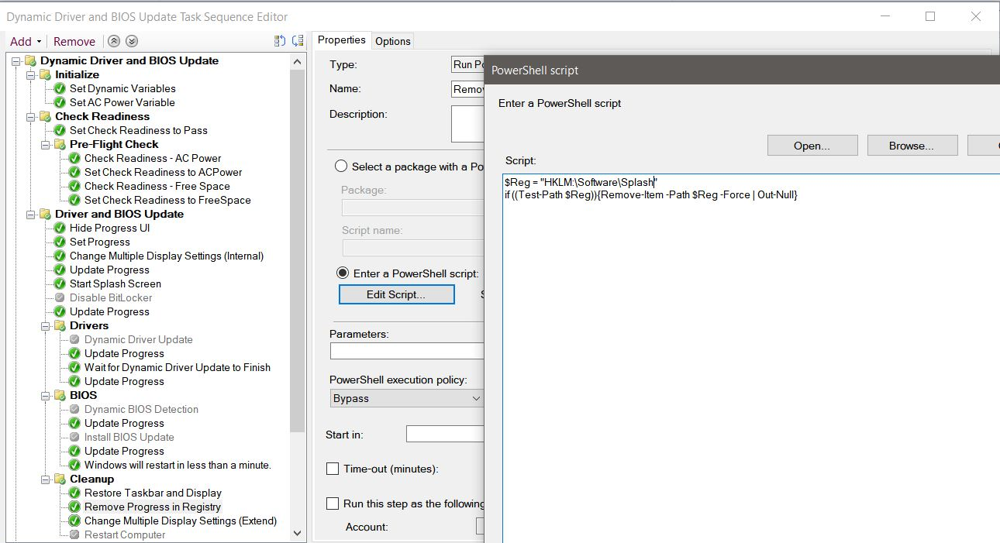

# ConfigMgr: Splash Screen for Driver and BIOS Update

## BEFORE YOU BEGIN


In this blog I will be using a Splash Screen script original created by [Trevor Jones](https://twitter.com/trevor_smsagent).


## THE SPLASH SCREEN

In my search for a solution to display information to our end users during In-Place Upgrade, I found a blog by [Gary Blok](https://twitter.com/gwblok), which led me to the original blog from [Trevor Jones](https://twitter.com/trevor_smsagent).

* **GARYTOWN**: [https://bit.ly/33j3ZNX](https://bit.ly/33j3ZNX)&#x20;
* **SMSAgent**: [https://bit.ly/2ThwAyv](https://bit.ly/2ThwAyv)&#x20;
* **SMSAgent Take 2**: [https://bit.ly/2OOvgVn](https://bit.ly/2OOvgVn)

I will not be diving deep into the details, so please read Trevor and Gary's blog above if you want detailed information about the Splash Screen.

My version is based on the original and the modified version by Gary, I started with Trevor's "Take 2" version and took some bit from Gary's version before I modified it to fit my own environment and needs.

During this process I found another purpose for the Splash Screen, why not use it for driver and BIOS update on existing machines in my environment?







A fully integrated Modern Driver and BIOS Management solution by [@SCConfigMgr](https://twitter.com/SCConfigMgr) is running behind the scenes.&#x20;

**Changes I've made:**&#x20;

Added:

* Several Task Sequence variables for multi-language purpose
  * SG\_Welcome\_001 = Hi
  * SG\_Welcome\_002 = there
  * SG\_Information\_001 = Don’t turn off your PC
  * SG\_Progress\_001 = Driver and BIOS Update Progress
  * SG\_Progress\_002 = Windows Setup Progress
* MetroProgressBar color
* ProgressBar for Driver and BIOS purpose

Changed:

* GivenName split command
* Renaming some of the Task Sequence variables
* Final sentence to display the Task Sequence SA\_002
* ProgressRing color
* ProgressBar Visibility = Default set to hidden, will only show is registry name found
* ProgressBar to MetroProgressBar
* Slowed down the rotating text
* Default Window and Animation color

Removed:

* Stopwatch / Timer

### Multi-Language





### Task Sequence Settings



I've created some new global variables for welcome, progress and general information in different languages.



I detect the language from the above registry settings.

.jpg>)

I've created some update variables that will be added into an array to be displayed in the rotating text screen and in different languages.



Because I hide the TS Progress UI during my main Task Sequence, I'm using –process: Explorer.exe instead, since the process TSProgressUI.exe is not running.

```
ServiceUI.exe -process:Explorer.exe %SYSTEMROOT%\System32\WindowsPowerShell\v1.0\powershell.exe -NoProfile -WindowStyle Hidden -ExecutionPolicy Bypass -File "SplashScreen\Show-OSUpgradeBackground.ps1"
```

### **The ProgressBar**

**Woah!** How did you create the progressbar and the % completed, you might ask?



I simply created a registry key with a small PowerShell script and added a value with a parameter that the Splash Screen script reads.

.jpg>)

I re-use that script and just add new values with the parameter



At the end of my Task Sequence, I remove the registry key with another small PowerShell script.

### **Scripts**

**Script (Create Progress)**

```
Param (
	[String]$Progress = "0"
)

$Reg = "HKLM:\Software\Splash"
$Name = "UpdateProgress"
$Value = $Progress
$Type = "DWORD"

	if (!(Test-Path $Reg)){
		New-Item -Path $Reg -Force | Out-Null
		New-ItemProperty -Path $Reg -Name $Name -PropertyType $Type -Value $Value -Force | Out-Null
	}
	else{
		Set-ItemProperty -Path $Reg -Name $Name -Type $Type -Value $Value -Force | Out-Null
	}
```

**Script (Remove Progress)**

```
$Reg = "HKLM:\Software\Splash"
if ((Test-Path $Reg)){Remove-Item -Path $Reg -Force | Out-Null}
```

To implement the Splash Screen with my changes, download the original Splash Screen from Trevor's [GitHub](https://github.com/SMSAgentSoftware/CustomW10UpgradeSplashScreen/tree/master/v2) repo, which includes all the files you need, and then replace the content of the two files with this content:

**Script (SplashScreen.xaml)**

```markup
<Window
		xmlns="http://schemas.microsoft.com/winfx/2006/xaml/presentation"
		xmlns:x="http://schemas.microsoft.com/winfx/2006/xaml"
		xmlns:Controls="clr-namespace:MahApps.Metro.Controls;assembly=MahApps.Metro"
		Title="MainWindow" Background="#00345c" WindowStyle="None" ResizeMode="NoResize" Foreground="White" Topmost="True" Left="0" Top="0" Height="0" Width="0">
	<Window.Resources>
		<ResourceDictionary>
			<ResourceDictionary.MergedDictionaries>
				<ResourceDictionary Source="pack://application:,,,/MahApps.Metro;component/Styles/Controls.xaml" />
				<ResourceDictionary Source="pack://application:,,,/MahApps.Metro;component/Styles/Fonts.xaml" />
				<ResourceDictionary Source="pack://application:,,,/MahApps.Metro;component/Styles/Colors.xaml" />
				<ResourceDictionary Source="pack://application:,,,/MahApps.Metro;component/Styles/Accents/Blue.xaml" />
				<ResourceDictionary Source="pack://application:,,,/MahApps.Metro;component/Styles/Accents/BaseLight.xaml" />
			</ResourceDictionary.MergedDictionaries>
		</ResourceDictionary>
	</Window.Resources>
	<Grid Height="Auto" Width="Auto" HorizontalAlignment="Stretch" VerticalAlignment="Stretch">
		<Grid.RowDefinitions>
			<RowDefinition Height="1*"/>
			<RowDefinition Height="0.6*"/>
			<RowDefinition Height="1*"/>
			<RowDefinition Height="Auto"/>
		</Grid.RowDefinitions>
		<Controls:ProgressRing Grid.Row="1" Name="ProgressRing" Opacity="0" IsActive="False" Margin="0,0,0,20" Foreground="#FFFFFF"/>
		<TextBlock Grid.Row="2" Name="MainTextBlock" Text="" TextWrapping="Wrap" MaxWidth="0" Margin="0,0,0,50" FontSize="50" FontWeight="Light" VerticalAlignment="Top" HorizontalAlignment="Center" Opacity="0" />
		<StackPanel Grid.Row="3" Margin="0,0,0,60" VerticalAlignment="Bottom">
			<TextBlock Name="TextBlock2" Text="" TextWrapping="Wrap" MaxWidth="0" Margin="0,0,0,15" FontSize="18" FontWeight="Light" VerticalAlignment="Bottom" HorizontalAlignment="Center" Opacity="0" />
			<Controls:MetroProgressBar Name="ProgressBar" Value="0" Width="210" Visibility="Hidden" VerticalAlignment="Bottom" HorizontalAlignment="Center" Margin="0,0,0,15">
				<Controls:MetroProgressBar.Foreground>
					<LinearGradientBrush StartPoint="0,0" EndPoint="1,0">
						<GradientStop Color="#a7e590" Offset="0"/>
						<GradientStop Color="#05b024" Offset="1"/>
					</LinearGradientBrush>
				</Controls:MetroProgressBar.Foreground>
			</Controls:MetroProgressBar>
			<TextBlock Name="TextBlock3" Text="" TextWrapping="Wrap" MaxWidth="0" Margin="0,0,0,40" FontSize="18" FontWeight="Light" VerticalAlignment="Bottom" HorizontalAlignment="Center" Opacity="0" />
			<TextBlock Name="TextBlock4" Text="" TextWrapping="Wrap" MaxWidth="0" Margin="0,0,0,40" FontSize="25" FontWeight="Light" VerticalAlignment="Bottom" HorizontalAlignment="Center" Opacity="0" />
		</StackPanel>
	</Grid>
</Window>
```

**Script (Create-FullScreenBackground.ps1)**

```
<#
 2019-08-08 Modified by @SuneThomsenDK
 OSDSune https://www.osdsune.com/home/blog/2019/splash-screen-driver-bios-update
	Added:
	 - Several TS variables for multi language purpose
		SG_Welcome_001 = Hi
		SG_Welcome_002 = there
		SG_Information_001 = Don't turn off your PC
		SG_Progress_001 = Driver and BIOS Update Progress
		SG_Progress_002 = Windows Setup Progress
	 - MetroProgressBar color
	 - ProgressBar for Driver and BIOS purpose

	Changed:
	 - GivenName split command
	 - Renaming some of @gwblok variables eg. SC_ColourBrighterAnimation1 -> SC_ColourBrighterAnimation_001
	 - @gwblok final sentence to display SA_002
	 - ProgressRing color
	 - ProgressBar Visibility  = Default set to hidden, will only show is registry name found
	 - ProgressBar to MetroProgressBar
	 - Slowed down the rotating text
	 - Default Window and Animation color

	Removed:
	 - Stopwatch / Timer


 2019-08-01 Modified by @trevor_smsagent
 SMSAgent https://smsagent.blog/2019/08/01/windows-10-upgrade-splash-screen-take-2/
	 - Added a progress bar and percentage for the Windows Setup percent complete
	 - Added a timer so the user knows how long the upgrade has been running
	 - Prevent the monitors from going to sleep while the splash screen is displayed
	 - Added a simple way to close the splash screen in a failure scenario by setting a task sequence variable
	 - Re-wrote the WPF part into XAML code


 2019-03-20 Modified by @gwblok
 GARYTOWN https://garytown.com/windows-splash-screen-for-the-task-sequence-progress
	 - Added Several Text Boxes  (3 & 4)
		Text Box 3 = TS Step Name (Pulled from TS Variable)
		Text Box 4 = Windows Setup Engine % Complete (Pulled from Registry)

	This now pulls in the Rotating Text from the Task Sequence variables.. use "Set Dynamic Task Sequence Variable" Step, then create as many as you like.
	 - Variable Name must start with SA_ ex: (SA Splash Array)
		SA_001 This Line never actually displays
		SA_002 We're upgrading you to Windows 10 %SMSTS_BUILD%
		SA_003 It may take 60 - 120 minutes
		WindowBackGroundDefault
	This now pulls colors from the Task Sequence variables as well. Example TS Vars SC_ (SC Splash Color)
		SC_WindowBackGroundDefault = Default Color of Back Ground
		SC_ColourBrighterAnimation1 = Starting Color -> Fades to SC_ColourBrighterAnimation2
		SC_ColourBrighterAnimation2
		SC_ColourDarkerAnimation1 = Starting Color -> Fades to SC_ColourDarkerAnimation2
		SC_ColourDarkerAnimation2

		SC_ColourBrighterAnimation1 Should be set the same as SC_ColourDarkerAnimation2
		SC_ColourBrighterAnimation2 Should be set the same as SC_ColourDarkerAnimation1


 2018-08-21 Created by @trevor_smsagent
 SMSAgent https://smsagent.blog/2018/08/21/create-a-custom-splash-screen-for-a-windows-10-in-place-upgrade/
	 - Creates a full screen 'background' styled for a Windows 10 upgrade, and hides the task bar
	 - Called by the "Show-OSUpgradeBackground" script

#>

	Param($DeviceName)

	#===================================================================================================
	# Create TSEnvironment COM object
	#===================================================================================================
	$TSENV = New-Object -COMObject Microsoft.SMS.TSEnvironment

	#===================================================================================================
	# Set the location we are running from
	#===================================================================================================
	$Source = $PSScriptRoot

	Add-Type -AssemblyName PresentationFramework,PresentationCore,WindowsBase,System.Windows.Forms,System.Drawing,System.DirectoryServices.AccountManagement
	Add-Type -Path "$Source\bin\System.Windows.Interactivity.dll"
	Add-Type -Path "$Source\bin\ControlzEx.dll"
	Add-Type -Path "$Source\bin\MahApps.Metro.dll"

	#===================================================================================================
	# Add custom type to hide the taskbar
	#===================================================================================================
	$CSharpTaskbar = @"
	using System;
	using System.Runtime.InteropServices;

	public class Taskbar
	{
		[DllImport("user32.dll")]
		private static extern int FindWindow(string className, string windowText);
		[DllImport("user32.dll")]
		private static extern int ShowWindow(int hwnd, int command);

		private const int SW_HIDE = 0;
		private const int SW_SHOW = 1;

		protected static int Handle
		{
			get
			{
				return FindWindow("Shell_TrayWnd", "");
			}
		}

		private Taskbar()
		{
			// hide ctor
		}

		public static void Show()
		{
			ShowWindow(Handle, SW_SHOW);
		}

		public static void Hide()
		{
			ShowWindow(Handle, SW_HIDE);
		}
	}
"@
	Add-Type -ReferencedAssemblies "System", "System.Runtime.InteropServices" -TypeDefinition $CSharpTaskbar -Language CSharp

	#===================================================================================================
	# Add custom type to prevent the screen from sleeping
	#===================================================================================================
	$CSharpScreenSleep=@' 
	using System;
	using System.Runtime.InteropServices;

	public class DisplayState
	{
		[DllImport("kernel32.dll", CharSet = CharSet.Auto,SetLastError = true)]
		public static extern void SetThreadExecutionState(uint esFlags);

		public static void KeepDisplayAwake()
		{
			SetThreadExecutionState(
				0x00000002 | 0x80000000);
		}

		public static void Cancel()
		{
			SetThreadExecutionState(0x80000000);
		}
	}
'@
	Add-Type -ReferencedAssemblies "System", "System.Runtime.InteropServices" -TypeDefinition $CSharpScreenSleep -Language CSharp

	#===================================================================================================
	# Load the main window XAML code
	#===================================================================================================
	[XML]$Xaml = [System.IO.File]::ReadAllLines("$Source\Xaml\SplashScreen.xaml")

	#===================================================================================================
	# Create a synchronized hash table and add the WPF window and its named elements to it
	#===================================================================================================
	$UI = [System.Collections.Hashtable]::Synchronized(@{})
	$UI.Window = [Windows.Markup.XamlReader]::Load((New-Object -TypeName System.Xml.XmlNodeReader -ArgumentList $xaml))
	$xaml.SelectNodes("//*[@*[contains(translate(name(.),'n','N'),'Name')]]") | ForEach-Object -Process {$UI.$($_.Name) = $UI.Window.FindName($_.Name)}
		if ($TSENV){$UI.Window.Background = $tsenv.Value("SC_WindowBackGroundDefault")}

	#===================================================================================================
	# Find screen by DeviceName
	#===================================================================================================
	$Screens = [System.Windows.Forms.Screen]::AllScreens
	$Screen = $Screens | Where {$_.DeviceName -eq $DeviceName}

	#===================================================================================================
	# Get the bounds of the primary screen
	#===================================================================================================
	$Script:Bounds = $Screen.Bounds

	#===================================================================================================
	# Set some initial values
	#===================================================================================================
	$UI.MainTextBlock.MaxWidth = $Bounds.Width
	$UI.TextBlock2.MaxWidth = $Bounds.Width
	$UI.TextBlock3.MaxWidth = $Bounds.Width
	$UI.TextBlock4.MaxWidth = $Bounds.Width
		if ($TSENV){
			$Welcome01 = $tsenv.Value("SG_Welcome_001")
			$Welcome02 = $tsenv.Value("SG_Welcome_002")
			$UI.TextBlock4.Text = $tsenv.Value("SG_Information_001")
		}
		else{
			$Welcome01 = "Hi"
			$Welcome02 = "there"
			$UI.TextBlock4.Text = "Don't turn off your PC"
		}

	#===================================================================================================
	# Find the user identity from the domain if possible
	#===================================================================================================
	$LoggedOnSID = Get-WmiObject -Namespace ROOT\CCM -Class CCM_UserLogonEvents -Filter "LogoffTime=null" | Select -ExpandProperty UserSID
		if ($LoggedOnSID.GetType().IsArray){
			#===================================================================================================
			# Multiple values returned
			#===================================================================================================
			$GivenName = "$Welcome02"
		}
		else{
			$RegKey = "HKLM:\SOFTWARE\Microsoft\Windows\CurrentVersion\Authentication\LogonUI\SessionData"
			$DisplayName = (Get-ChildItem -Path $RegKey | Where {$_.GetValue("LoggedOnUserSID") -eq $LoggedOnSID}).GetValue("LoggedOnDisplayName")
				if ($DisplayName){
					$GivenName = $DisplayName.Split()[0].Trim()
				}
				else{
					$GivenName = "$Welcome02"
				}
		}
	$UI.MainTextBlock.Text = "$Welcome01 $GivenName"

	#===================================================================================================
	# Create some animations
	#===================================================================================================
	if ($TSENV){
		$FadeinAnimation = [System.Windows.Media.Animation.DoubleAnimation]::new(0,1,[System.Windows.Duration]::new([Timespan]::FromSeconds(3)))
		$FadeOutAnimation = [System.Windows.Media.Animation.DoubleAnimation]::new(1,0,[System.Windows.Duration]::new([Timespan]::FromSeconds(3)))
		$ColourBrighterAnimation = [System.Windows.Media.Animation.ColorAnimation]::new($tsenv.Value("SC_ColourBrighterAnimation_001"),$tsenv.Value("SC_ColourBrighterAnimation_002"),[System.Windows.Duration]::new([Timespan]::FromSeconds(7)))
		$ColourDarkerAnimation = [System.Windows.Media.Animation.ColorAnimation]::new($tsenv.Value("SC_ColourDarkerAnimation_001"),$tsenv.Value("SC_ColourDarkerAnimation_002"),[System.Windows.Duration]::new([Timespan]::FromSeconds(7)))
	}
	else{
		$FadeinAnimation = [System.Windows.Media.Animation.DoubleAnimation]::new(0,1,[System.Windows.Duration]::new([Timespan]::FromSeconds(3)))
		$FadeOutAnimation = [System.Windows.Media.Animation.DoubleAnimation]::new(1,0,[System.Windows.Duration]::new([Timespan]::FromSeconds(3)))
		$ColourBrighterAnimation = [System.Windows.Media.Animation.ColorAnimation]::new("#00345c","#0171c7",[System.Windows.Duration]::new([Timespan]::FromSeconds(7)))
		$ColourDarkerAnimation = [System.Windows.Media.Animation.ColorAnimation]::new("#0171c7","#00345c",[System.Windows.Duration]::new([Timespan]::FromSeconds(7)))
	}

	if ($TSENV){
		$TextArrayVars = (New-Object -COMObject Microsoft.SMS.TSEnvironment).GetVariables() | Where-Object {$_ -Like "SA_*"}
		$TextArray = ForEach ($Values in $TextArrayVars) {$tsenv.Value($Values)}
	}
	else{
		#===================================================================================================
		# An array of sentences to display, in order. Leave the first one blank as the 0 index gets skipped.
		#===================================================================================================
		$TextArray = @(
			"This line never actually displays"
			"We are upgrading your PC to Windows 10"
			"It may take 30-90 minutes"
			"Your PC will restart several times"
			"Should anything go wrong, contact HelpDesk"
			"Now might be a good time to get a coffee :)"
		)
	}
	$Script:i = 0

	#===================================================================================================
	# Start a dispatcher timer. This is used to control when the sentences are changed.
	#===================================================================================================
	$TimerCode = {
		$UI.ProgressRing.IsActive = $True
		if ($tsenv.Value("QuitSplashing") -eq "True"){$UI.Window.Close()}

		#===================================================================================================
		# The IF statement number should equal the number of sentences in the TextArray
		#===================================================================================================
		$NumberofElements = $TextArray.Count -1
			if ($Script:i -lt $NumberofElements){
				$FadeoutAnimation.Add_Completed({
					$UI.MaintextBlock.Opacity = 0
					$UI.MaintextBlock.Text = $TextArray[$Script:i]
					$UI.MaintextBlock.BeginAnimation([System.Windows.Controls.TextBlock]::OpacityProperty,$FadeinAnimation)
				})
				$UI.MaintextBlock.BeginAnimation([System.Windows.Controls.TextBlock]::OpacityProperty,$FadeoutAnimation)
			}
		#===================================================================================================
		# The final sentence to display ongoing
		#===================================================================================================
			elseif ($Script:i -eq $NumberofElements){
				$Script:i = 0
				$FadeoutAnimation.Add_Completed({
					if ($TSENV){
						$UI.MaintextBlock.Opacity = 0
						$UI.MaintextBlock.Text = $tsenv.Value("SA_002")
						$UI.MaintextBlock.BeginAnimation([System.Windows.Controls.TextBlock]::OpacityProperty,$FadeinAnimation)
					}
					else{
						$UI.MaintextBlock.Opacity = 0
						$UI.MaintextBlock.Text = "We are upgrading your PC to Windows 10"
						$UI.MaintextBlock.BeginAnimation([System.Windows.Controls.TextBlock]::OpacityProperty,$FadeinAnimation)
					}

				})
				$UI.MaintextBlock.BeginAnimation([System.Windows.Controls.TextBlock]::OpacityProperty,$FadeoutAnimation)
			}
			else{
			}
		$ColourBrighterAnimation.Add_Completed({$UI.Window.Background.BeginAnimation([System.Windows.Media.SolidColorBrush]::ColorProperty,$ColourDarkerAnimation)})
		$UI.Window.Background.BeginAnimation([System.Windows.Media.SolidColorBrush]::ColorProperty,$ColourBrighterAnimation)
		$Script:i++
	}
	#===================================================================================================
	# Main Text Time
	#===================================================================================================
	$DispatcherTimer = New-Object -TypeName System.Windows.Threading.DispatcherTimer
	$DispatcherTimer.Interval = [TimeSpan]::FromSeconds(14)
	$DispatcherTimer.Add_Tick($TimerCode)

	#===================================================================================================
	# Runs at every 1 second to try to make sure it catches all of the progress.
	#===================================================================================================
	$TimerCodeProgress = {
		if ($TSENV){
			if ($tsenv.Value("InstallationType") -eq "DDBU"){
				$ProgressValue = Get-ItemProperty -Path HKLM:\Software\MOE -Name UpdateProgress | Select -ExpandProperty UpdateProgress -ErrorAction SilentlyContinue
				$ProgressText = $tsenv.Value("SG_Progress_001")
			}
			else{
				$ProgressValue = Get-ItemProperty -Path HKLM:\SYSTEM\Setup\MoSetup\Volatile -Name SetupProgress | Select -ExpandProperty SetupProgress -ErrorAction SilentlyContinue
				$ProgressText = $tsenv.Value("SG_Progress_002")
			}
		}
		else{
			$ProgressValue = Get-ItemProperty -Path HKLM:\SYSTEM\Setup\MoSetup\Volatile -Name SetupProgress | Select -ExpandProperty SetupProgress -ErrorAction SilentlyContinue
			$ProgressText = "Windows Setup Progress"
		}
		if ($ProgressValue){
			$UI.ProgressBar.Visibility  = "Visible"
			$UI.ProgressBar.Value  = $ProgressValue
			$UI.TextBlock2.Text = "$ProgressText ($ProgressValue%)"
		}
	}
	#===================================================================================================
	# Upgrade Text Time
	#===================================================================================================
	$DispatcherTimerProgress = New-Object -TypeName System.Windows.Threading.DispatcherTimer
	$DispatcherTimerProgress.Interval = [TimeSpan]::FromMilliseconds(500)
	$DispatcherTimerProgress.Add_Tick($TimerCodeProgress)

	#===================================================================================================
	# Runs at every 1/2 second to try to make sure it catches all of the step names.
	#===================================================================================================
	$TimerCodeStep = {
			$StepInfo = $tsenv.Value("_SMSTSCurrentActionName")
			$UI.TextBlock3.Text = $StepInfo
	}
	#===================================================================================================
	# Task Sequence Step Text Time
	#===================================================================================================
	$DispatcherTimerStep = New-Object -TypeName System.Windows.Threading.DispatcherTimer
	$DispatcherTimerStep.Interval = [TimeSpan]::FromMilliseconds(500)
	$DispatcherTimerStep.Add_Tick($TimerCodeStep)

	#===================================================================================================
	# Event: Window loaded
	#===================================================================================================
	$UI.Window.Add_Loaded({
		#===================================================================================================
		# Activate the window to bring it to the fore
		#===================================================================================================
		$This.Activate()

		#===================================================================================================
		# Fill the screen
		#===================================================================================================
		$This.Left = $Bounds.Left
		$This.Top = $Bounds.Top
		$This.Height = $Bounds.Height
		$This.Width = $Bounds.Width

		#===================================================================================================
		# Hide the taskbar
		#===================================================================================================
		[TaskBar]::Hide()

		#===================================================================================================
		# Hide the mouse cursor
		#===================================================================================================
		[System.Windows.Forms.Cursor]::Hide()

		#===================================================================================================
		# Keep Display awake
		#===================================================================================================
		[DisplayState]::KeepDisplayAwake()

		#===================================================================================================
		# Begin animations
		#===================================================================================================
		$UI.MaintextBlock.BeginAnimation([System.Windows.Controls.TextBlock]::OpacityProperty,$FadeinAnimation)
		$UI.TextBlock2.BeginAnimation([System.Windows.Controls.TextBlock]::OpacityProperty,$FadeinAnimation)
		$UI.TextBlock3.BeginAnimation([System.Windows.Controls.TextBlock]::OpacityProperty,$FadeinAnimation)
		$UI.TextBlock4.BeginAnimation([System.Windows.Controls.TextBlock]::OpacityProperty,$FadeinAnimation)
		$UI.ProgressRing.BeginAnimation([System.Windows.Controls.TextBlock]::OpacityProperty,$FadeinAnimation)
		$UI.ProgressBar.BeginAnimation([System.Windows.Controls.TextBlock]::OpacityProperty,$FadeinAnimation)
		$ColourBrighterAnimation.Add_Completed({$UI.Window.Background.BeginAnimation([System.Windows.Media.SolidColorBrush]::ColorProperty,$ColourDarkerAnimation)})
		$UI.Window.Background.BeginAnimation([System.Windows.Media.SolidColorBrush]::ColorProperty,$ColourBrighterAnimation)
	})

	#===================================================================================================
	# Event: Window closing (for testing)
	#===================================================================================================
	$UI.Window.Add_Closing({
		#===================================================================================================
		# Restore the taskbar
		#===================================================================================================
		[Taskbar]::Show()

		#===================================================================================================
		# Restore the mouse cursor
		#===================================================================================================
		[System.Windows.Forms.Cursor]::Show()

		#===================================================================================================
		# Cancel keeping the display awake
		#===================================================================================================
		[DisplayState]::Cancel()

		$DispatcherTimer.Stop()
		$DispatcherTimerProgress.Stop()
		$DispatcherTimerStep.Stop()
	})

	#===================================================================================================
	# Display the window
	#===================================================================================================
	$DispatcherTimer.Start()
	$DispatcherTimerProgress.Start()
	$DispatcherTimerStep.Start()
	$UI.Window.ShowDialog()
```

A special thanks go to [Trevor Jones](https://twitter.com/trevor_smsagent) and [Gary Blok](https://twitter.com/gwblok)! If you have any questions regarding this topic, feel free to reach out to me. I am most active on [Twitter](https://www.twitter.com/SuneThomsenDK)!

Now go out and impress your boss and colleagues!
