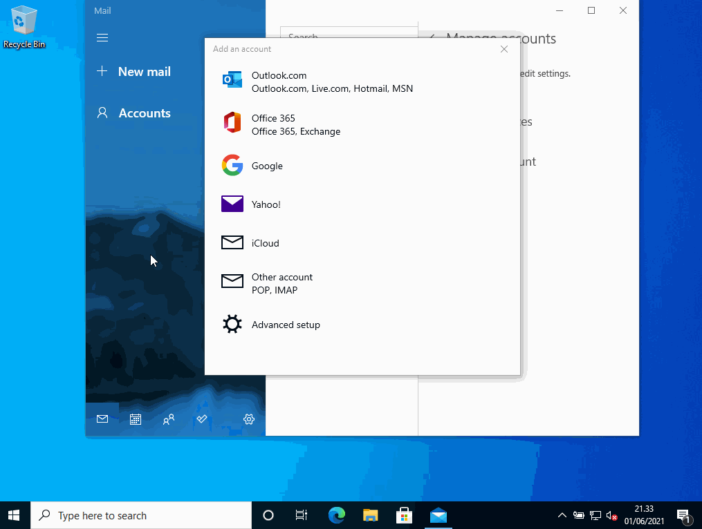
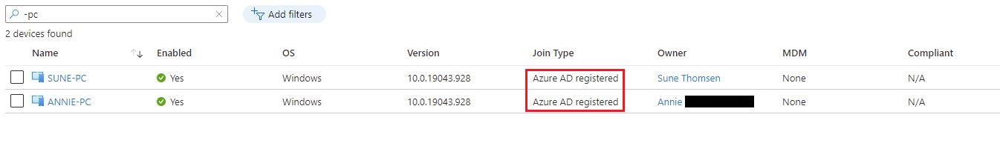
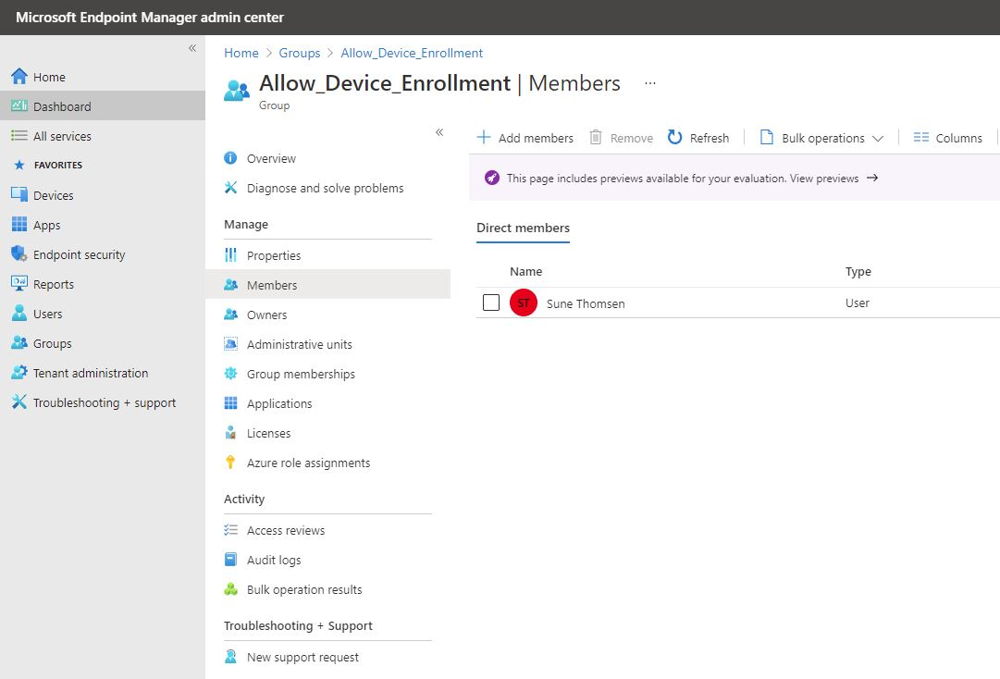
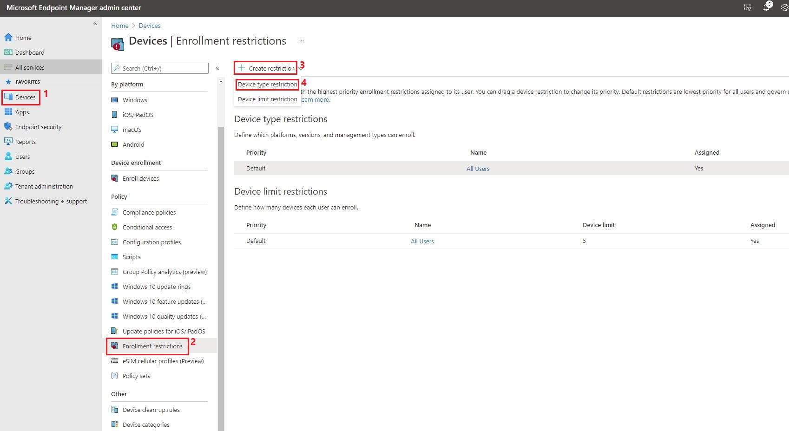
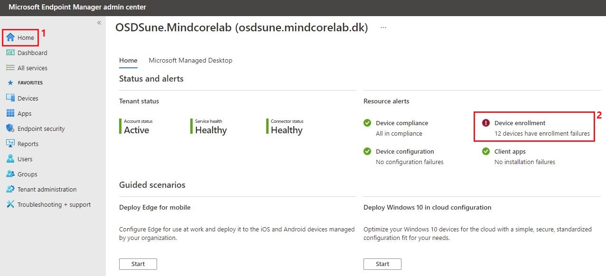
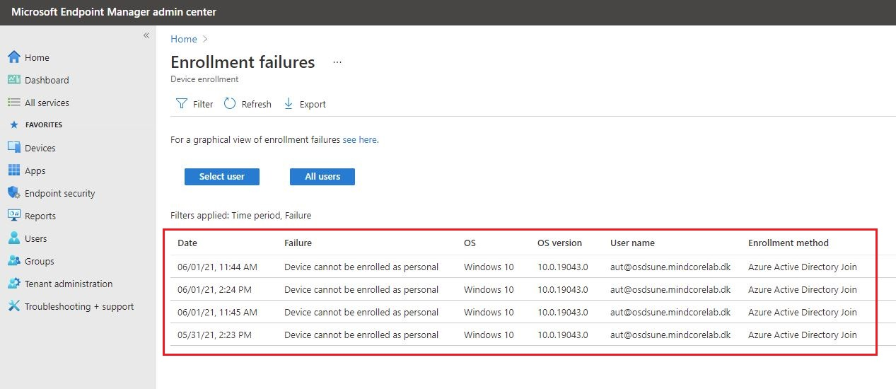
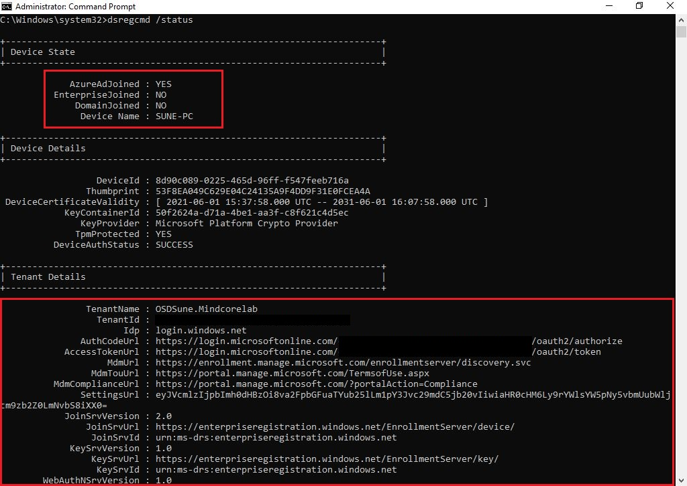

# Block personally owned devices in Intune with enrollment restrictions

## BEFORE YOU BEGIN


**Disclaimer:** All information and content in this blog post is provided without any warranty whatsoever. The entire risk of using this information or executing the provided content remains with you. Under no circumstances should mentioned persons or vendors, the author, or anyone else involved in creating these blog posts be held liable for any damage or data loss.



I initially wrote this blog post on behalf of [Mindcore, ](https://mindcore.dk/)and an agreement between us allows me to re-publish it on my blog as well. - Please visit the [Mindcore Techblog](https://blog.mindcore.dk)


## Introduction

Today I will be looking at enrollment restrictions in Intune, which is a method to block personally owned devices. Did you know that all users (with an Azure AD P1 and Intune license) in your Azure AD by default is allowed to enroll (Azure AD join) their devices into Intune, they will then get all of your company configuration and local admin permission on the device.\
\
So, with that in mind and looking from a security point of view, I would not recommend that all users can enroll their own devices, and I think that every organizations should consider which devices can be enrolled into their Intune environment.\
\
I will show you how to restrict the enrollment of personally owned Windows devices for all users, but still make it possible for a few trustworthy users (e.g. IT staff)

## Requirements

* Azure Active Directory
* Azure AD P1 ([Azure Active Directory Premium licensing](https://docs.microsoft.com/en-us/azure/active-directory/fundamentals/active-directory-whatis#what-are-the-azure-ad-licenses))
* Microsoft Endpoint Manager
* Microsoft Intune License ([Microsoft Intune licensing](https://docs.microsoft.com/en-us/mem/intune/fundamentals/licenses))

## First some important knowledge

Before I show you how to restrict the enrollment of personally owned devices for all users, it is important to know a few things first. Like for instance that there are two types of device ownership in Intune:

**Personal devices** - These devices are registered in Azure AD (Azure AD registered) and enables the user to access your organizations Azure AD controlled resources - Bring your own devices (BYOD)\
**Corporate devices** - These devices are joined to Azure AD (Azure AD joined) and enables the user to access both cloud and on-premises apps and resources - Corporate-owned devices (COD)\
\
Visit the Microsoft Docs to read more about [Azure AD joined devices](https://docs.microsoft.com/en-us/azure/active-directory/devices/concept-azure-ad-join) and [Azure AD registered devices](https://docs.microsoft.com/en-us/azure/active-directory/devices/concept-azure-ad-register)

.JPG>)

There are two locations from where you can restrict device enrollment. The first location is device settings in Azure AD, which is like a main switch it's either on or off. In device settings it is not possible to distinguish between users/type/version etc. Or create multiple groups with different settings - the field “**Users may register their devices with Azure AD**” will be grayed out and set to “**All**” when Intune is configured in your tenant.\
\
**Note.** If you haven't configured Intune in your tenant, this is where you can restrict users from Azure AD join their devices.

.JPG>)

The other location is enrollment restrictions in Intune, from here you will be able to distinguish between users/type/version etc. And create multiple groups with different settings - which I will demonstrate further down in this blog post.

.JPG>)

It's also important to know that if you block personally owned Windows devices from enrollment, Intune checks to make sure that each new Windows enrollment request has been authorized as a corporate enrollment. Unauthorized enrollments will be blocked.\
\
The following methods qualify as being authorized as a Windows corporate enrollment:

* The enrolling user is using a device enrollment manager account
* The device enrolls through Windows Autopilot
* The device is registered with Windows Autopilot but isn't an MDM enrollment only option from Windows Settings
* The device's IMEI number is listed in Device enrollment > Corporate device identifiers
* The device enrolls through a bulk provisioning package
* The device enrolls through GPO, or automatic enrollment from Configuration Manager for co-management

The following enrollments are marked as corporate by Intune. But since they don't offer the Intune administrator per-device control, they'll be blocked:

* Automatic MDM enrollment with Azure Active Directory join during Windows setup \*
* Automatic MDM enrollment with Azure Active Directory join from Windows Settings \*

The following personal enrollment methods will also be blocked:

* Automatic MDM enrollment with Add Work Account from Windows Settings \*
* MDM enrollment only option from Windows Settings

_\* These won't be blocked if registered with Autopilot._\
Source: [Microsoft Docs](https://docs.microsoft.com/en-us/mem/intune/enrollment/enrollment-restrictions-set#blocking-personal-windows-devices)

## Block personally owned devices

By default all users can enroll their devices.

.JPG>)

As you can see in the below picture, Annie (my wife) was able to Azure AD join her device.

.JPG>)

But since I do not trust her social media infected devices - let's change that possibility.\
Go to [https://endpoint.microsoft.com](https://endpoint.microsoft.com/)


**Note.** In a production tenant I would recommend that you create a new "**Device type restriction**" policy and leave the default policy untouched.


Click on “**Devices**” and select “**Enrollment restrictions**” from the “**Policy**” section. Select “**All Users**” in the name column for the default policy.

.JPG>)

Click on “**Properties**” and select “**Edit**”

.JPG>)

In this demonstration I have blocked the “**Android device administrator**” platform because Google is deprecating device administrator support in new Android releases. I will recommend the modern and more secure device management “**Android Enterprise (work profile)**” and then I've blocked all personally owned devices for all users by default.\
\
Click “**Review + save**”

.JPG>)

Click “**Save**”

.JPG>)

Now that I have blocked personally owned devices in my default policy, we should only be allowed to Azure AD register our devices. Let's switch back to our two Windows 10 devices and confirm that it actually work.\
\
First I will try to Azure AD register my device (SUNE-PC) which should still work.\
Go to “**Windows Settings**” and click on “**Accounts**”

.JPG>)

Click on “**Access work or school**” and select “**Connect**”

.JPG>)

Enter your “**email address**” and click “**Next**”

.JPG>)

Click “**OK**”

.JPG>)

Click “**Done**”

.JPG>)

Success! - Managed by mddprov account. My device is now Azure AD registered.

.JPG>)

Let's try to Azure AD join my wife's device (ANNIE-PC) and confirm that it is now being blocked.\
\
Go to “**Windows Settings**” - “**Accounts**” - “**Access work or school**” and select “**Connect**” Click on “**Join this device to Azure Active Directory**” and click “**Next**”

.JPG>)

Enter your “**email address**” and click “**Next**”

.JPG>)

She will still be prompted to join the organization.\
Click “**Join**”

.JPG>)

Oh, something went wrong. Awesome! - bye bye social media infected devices.

.JPG>)

But she will still be able to Azure AD register her devices, which is OK.

.JPG>)

Some might then ask - But what will happen if you configure your mail and forget to uncheck “**Allow my organization to manage my device**”? \
\
Well, let's test it… So as you can see in the below GIF it will only Azure AD register your device.



If you are happy with just blocking all personally owned devices in Intune - read no further. But keep on reading if you want to know how to allow personally owned devices for trustworthy users (e.g. IT staff)

## Allow personally owned devices for trustworthy users

Okay, so we have now successfully blocked all personally owned devices by default, mine included! But I want to allow myself to Azure AD join my devices (because I'm that trustworthy IT guy…)



Go to [https://endpoint.microsoft.com](https://endpoint.microsoft.com/)\
Click on “**Groups**” and then click “**New group**”

.JPG>)

Select “**Security**” as group type and give it a friendly group name and description (optional).\
Select “**Assigned**” in membership type and select members. Click “**Create**”

.JPG>)

Here you can see properties and membership for my security group.

.JPG>)



Now that we have created a security group with my account added to it, we then need to create a new enrollment restriction policy that allow personally owned devices.\
\
Click on “**Devices**” and select “**Enrollment restrictions**” from the “**Policy**” section.\
Click on “**Create restriction**” and select “**Device type restriction**”



Give the policy a friendly name and description (optional)\
Click “**Next**”

.JPG>)

Block the “**Android device administrator**” platform like we did earlier in the default policy and click “**Next**”

.JPG>)

Click “**Next**”

.JPG>)

Add the newly created security group and click “**Next**”

.JPG>)

Click “**Create**”

.JPG>)

.JPG>)

It is also possible to limit the amount of devices which can be enrolled by a user by simply click on “**All Users**” for the default policy or add a new policy for the newly created security group. By default this limit is set to 5 and the max is 15 devices.

.JPG>)

Let's switch back to my Windows 10 device (SUNE-PC) and confirm that I'm able join it to Azure AD.\
\
Go to “**Windows Settings**” - “**Accounts**” - “**Access work or school**” and select “**Connect**” Click on “**Join this device to Azure Active Directory**” and click “**Next**”

.JPG>)

Enter your “**email address**” and click “**Next**”

.JPG>)

Click “**Join**”

.JPG>)

Success! - Managed by OSDSune.Mindcorelab.

.JPG>)

.JPG>)

In Azure AD we should see that Annie's device is Azure AD registered and my device is Azure AD joined and managed by Intune.

.JPG>)

And from Microsoft Endpoint Manager admin center we should see that Annie wasn't able to enroll her device as personal.\
\
Go to [https://endpoint.microsoft.com](https://endpoint.microsoft.com/)\
Click on “**Home**” and select “**Device enrollment**”





We can also confirm the result by running this command line locally on the devices.

```
dsregcmd /status
```



.JPG>)

## Summary

That's it folks. Now you know how to block personally owned Windows devices in Intune, but still allow a few trustworthy users to Azure AD join their devices. I've explained a few important information's and shown you how to confirm and check the results. Happy testing!\
\
If you have any questions regarding this topic, feel free to reach out to me. I am most active on [Twitter](https://www.twitter.com/SuneThomsenDK)!
