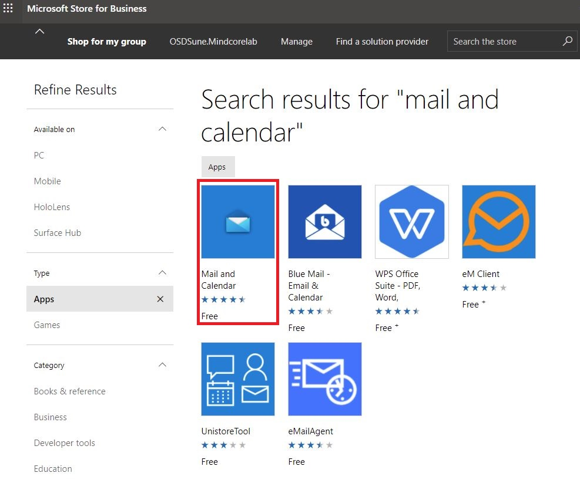
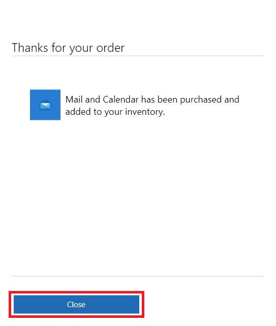
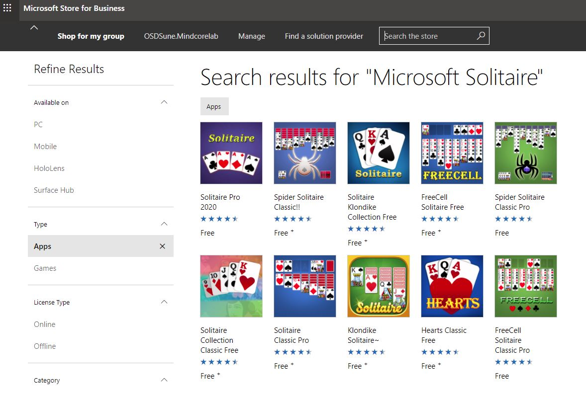
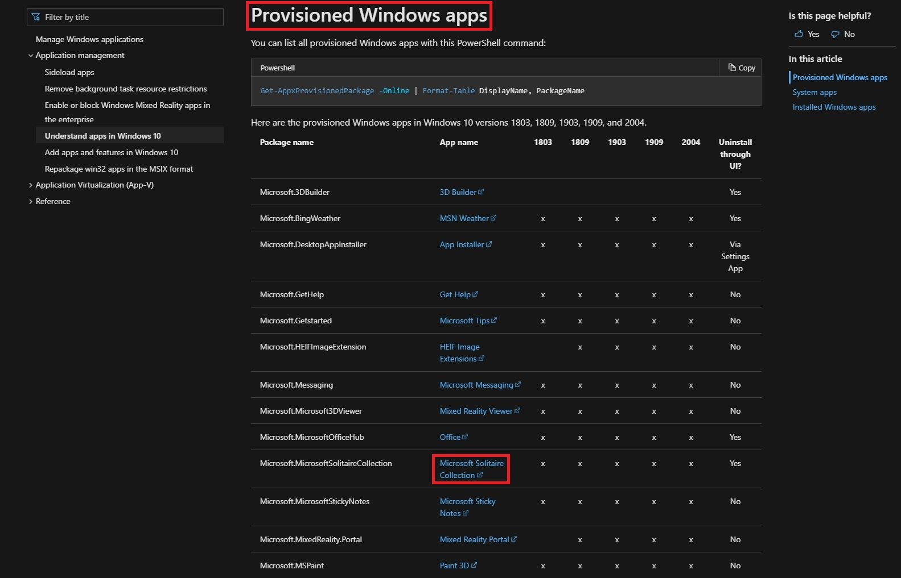
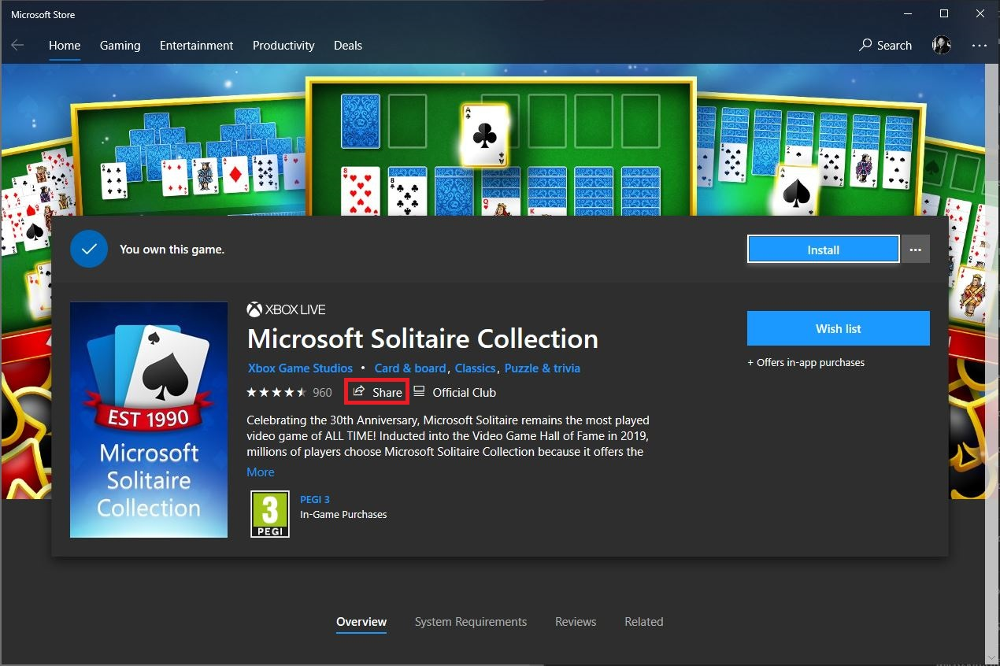
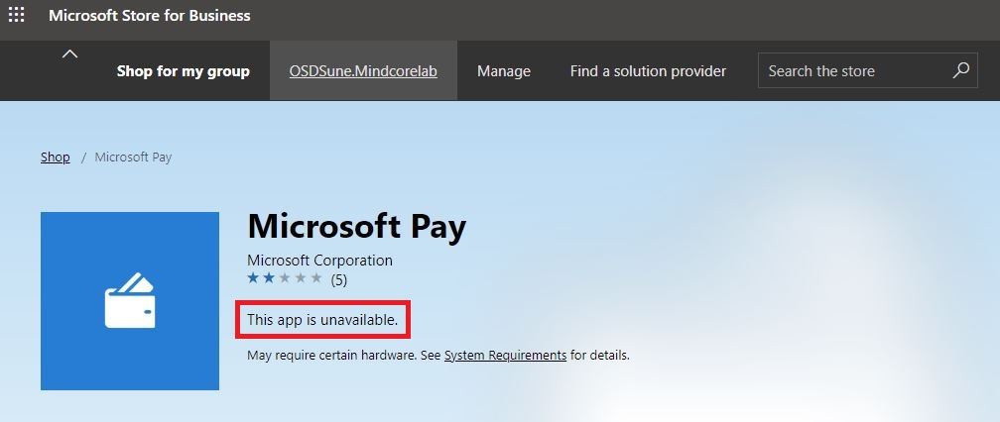

# Remove Windows 10 built-in apps with Intune & Microsoft Store for Business Apps

## BEFORE YOU BEGIN


**Disclaimer:** All information and content in this blog post is provided without any warranty whatsoever. The entire risk of using this information or executing the provided content remains with you. Under no circumstances should mentioned persons or vendors, the author, or anyone else involved in creating these blog posts be held liable for any damage or data loss.



I initially wrote this blog post on behalf of [Mindcore, ](https://mindcore.dk/)and an agreement between us allows me to re-publish it on my blog as well. - Please visit the [Mindcore Techblog](https://blog.mindcore.dk)


## Introduction

A while ago, my colleague [Mattias Melkersen](https://twitter.com/MMelkersen) wrote a blog post on how to remove unwanted apps created during the first sync between Intune and Microsoft Store for Business read more about that [here](https://blog.mindcore.dk/2021/04/intune-microsoft-store-for-business-app.html)\
\
In this blog post I will show you how to remove Windows 10 built-in apps (most of them at least…) - who really needs Mail and Calendar, Microsoft Solitaire Collection or Xbox apps in an enterprise environment?

## Requirements

* Microsoft Store for Business
* Intune Windows Apps and sync with Microsoft Store for Business

## Remove the built-in apps&#x20;

Since the first release of Windows 10, it has been common for enterprise organizations to remove several of the built-in apps since they can bring some confusions to our end-users - take for instance the built-in mail app, this is most likely the first app the end-user will try to open since it´s pinned to the taskbar, it has not been configured because the organization probably is using Outlook which will led to a unnecessary HelpDesk calls or the end-user spending time on trying to setup the mail app by themselves. \
\
The community has provided several solutions over the years from PowerShell scripts that will remove built-in apps during ConfigMgr or MDT OS Deployments to [OSDBuilder](https://osdbuilder.osdeploy.com) and [WIM Witch](https://msendpointmgr.com/2019/10/04/wim-witch-a-gui-driven-solution-for-image-customization) that will remove them during offline servicing. \
\
But let me show you how to do this with Intune and Microsoft Store for Business Apps – first I’ve installed a Windows 10 20H2 client and as you can see in the below print screen it still has the built-in apps installed.

.JPG>)

Visit the Microsoft Docs to see all provisioned Windows apps - [Understand the different apps included in Windows 10](https://docs.microsoft.com/en-us/windows/application-management/apps-in-windows-10)

Or run this command from PowerShell on a Windows 10 client.

```
Get-AppxProvisionedPackage -Online | Format-Table DisplayName, PackageName
```

.JPG>)

Go to [https://endpoint.microsoft.com](https://endpoint.microsoft.com/)\
Click on “**Apps**” and then select “**Windows**” in the “**By platform**” section.&#x20;

Aside from the Company Portal (Online) and Microsoft 365 Apps for Windows 10, this is pretty much how it looks like after the first sync between Intune and Microsoft Store for Business.

.JPG>)

So, we need to add the built-in apps that we want to remove from our Windows 10 clients. In order to do that, go to [https://businessstore.microsoft.com](https://businessstore.microsoft.com/)

Search for “**Mail and Calendar**” and click on it.



Click on “**Get the app**”

.JPG>)

Click “**Close**”



Now, go back and search for “**Microsoft Solitaire**” - and right away we can see that it is missing from the search results, that is because it’s an hidden app. What to do, you might ask? Don't worry I got your back!



To find this hidden app go to the Microsoft Docs - [Understand the different apps included in Windows 10](https://docs.microsoft.com/en-us/windows/application-management/apps-in-windows-10)

Scroll down to the “**Provisioned Windows apps**” section and click on the app name “**Microsoft Solitaire Collection**”



This will open “**Microsoft Solitaire Collection**” in Microsoft Store. \
Click on “**Share**”



Click “**Copy link**”

.JPG>)

Paste the link in to a browser and copy this part of the URL\
**microsoft-solitaire-collection/9wzdncrfhwd2**

.JPG>)

Paste it into this Microsoft Store for Business URL\
**https://businessstore.microsoft.com/en-us/store/details/** <— Paste it here.\
\
Go to the final Microsoft Store for Business URL\
[https://businessstore.microsoft.com/en-us/store/details/microsoft-solitaire-collection/9wzdncrfhwd2](https://businessstore.microsoft.com/en-us/store/details/microsoft-solitaire-collection/9wzdncrfhwd2/)\
\
Click on “**Get the app**”

.JPG>)

Click “**Close**”

.JPG>)

Go to [https://endpoint.microsoft.com](https://endpoint.microsoft.com/)\
Click on “**Tenant administration**” and then select “**Microsoft Store for Business**” in the “**Connectors and tokens**” section. \
\
Click on “**Sync**” and wait for it to finish – sync will take some time…

.JPG>)

Once the sync is done, go to your “**Windows Apps**” and you would see that the two built-in apps has been added.

.JPG>)

Click on “**Mail and Calendar (Online)**” and go to “**Properties**”, click on “**Edit**” for assignments.

.JPG>)

In the “**Uninstall**” section click on “**Add all users**”\
**Note.** You would probably add a group with your selected users for better control, but for this demo “**All Users**” is fine. \
\
Click on “**Review + save**” and then “**Save**”

.JPG>)

Repeat the last few steps for the “**Microsoft Solitaire Collection (Online)**” and other built-in apps you want to remove. \
\
Go back to the Windows 10 client and sync with Intune from either Company Portal or Windows Settings.

.JPG>)

After a while the apps will start to uninstall - it may require a few re-syncs but eventually it will work.

.JPG>)

To confirm this from Endpoint Manager Admin Center - Go to [https://endpoint.microsoft.com](https://endpoint.microsoft.com/)\
Click on “**Devices**” and then select “**Windows**” in the “**By platform**” section. \
Click on your Windows 10 client and select “**Managed Apps**” in the “**Monitor**” section.

.JPG>)

## Summary

So, the quick one in the audience might noticed that I wrote "how to remove Windows 10 built-in apps (most of them at least…)" and the reason for this is, that even if an app is hidden and you are able to find it in Microsoft Store, it may in fact be unavailable from the Microsoft Store for Business - a good example of this is the Windows Wallet / Pay app.



If it is important to remove these unavailable apps, you will have to run a PowerShell script which of course can be done from Intune or you can do it as part of your image offline servicing flow. But if you are happy with just removing a few apps like the “**Mail and Calendar**” and “**Microsoft Solitaire Collection**” apps, this is a great method to achieve that.&#x20;

I hope this can help others remove built-in apps in Windows 10 – Happy testing!\
If you have any questions regarding this topic, feel free to reach out to me. I am most active on [Twitter](https://www.twitter.com/SuneThomsenDK)!
