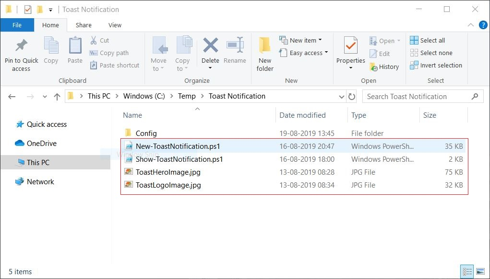
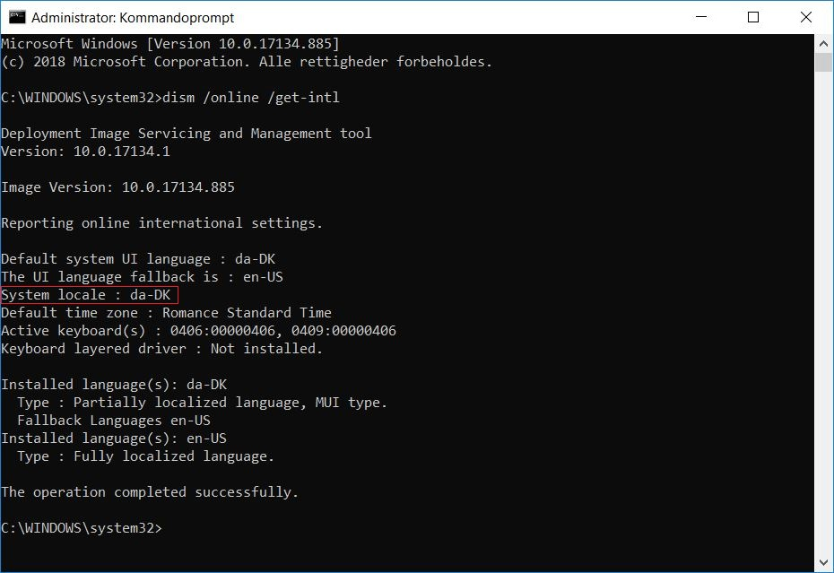
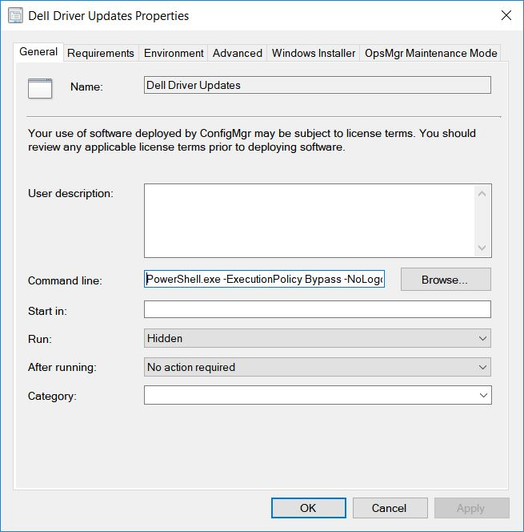

# Win10: Multi-Language Toast Notifications

## BEFORE YOU BEGIN


In this blog I will be using a Toast Notification script created by [Martin Bengtsson](https://twitter.com/mwbengtsson).


## TOAST NOTIFICATION&#x20;

In my search for a solution to display notifications to our end users during our new **Dynamic Driver and BIOS Update** process, I found a blog by [Martin Bengtsson](https://twitter.com/mwbengtsson).

**Martin’s Blog:** [https://bit.ly/35o4sz4](https://bit.ly/35o4sz4)

I will not be deep-diving into the details, so please read Martin’s blog above if you want detailed information about Toast Notifications.

My version is modified to fit our multi-language environment and other needs.

.JPG>)

.JPG>)

<div align="center"></div>


If you can't make it work with "Software Center" as the app for toast notifications, make sure you haven't deleted or hidden the original Software Center shortcut!


**Changes I've made:**&#x20;

Added:

* Multi-Language support
* Several new text variables in the XML config file
* Look in WMI for given name if no local AD is available.
* More detailed logging

Changed:

* Date formatting
* All text can now be edited directly in the XML config file
* Log Path
* Removed a few script errors showing while running it manually in PowerShell ISE

### Deploy it

In my environment we are using ConfigMgr so I want to show how it's done in our environment, but read Martin's documentation to see how it can be deployed through Group Policy.

What I've done in our environment is create a package that contains all the files except the configuration files because I point to them through a UNC path for easier access if I need to change anything.



Then I create a program running PowerShell that executes Show-ToastNotification.ps1, this script will look at the system locale language, and execute the New-ToastNotification.ps1 with the correct language configuration file.





**Command line example:**

```
PowerShell.exe -ExecutionPolicy Bypass -NoLogo -NonInteractive -NoProfile -WindowStyle Hidden -File ".\Show-ToastNotification.ps1"
```

To implement my modified edition of Martin's Toast Notification script to your environment, download it from my [GitHub](https://github.com/SuneThomsenDK/Win10Customization/tree/master/ToastNotification) repo.

### Script&#x20;

**Script (Config.xml)**&#x20;

```markup
<?xml version="1.0" encoding="utf-8"?>
<Configuration>
	<Feature Name="Toast" Enabled="True" /> <!-- Enables or disables the entire toast notification -->
	<Feature Name="UpgradeOS" Enabled="False" />	<!-- Specifies if the toast is used for OS upgrades. If set to True, the targetOS build is taking into account -->
	<Feature Name="PendingRebootUptime" Enabled="False" />	<!-- Enables the toast for reminding users of restarting their device if it exceeds the uptime defined in MaxUptimeDays -->
	<Feature Name="PendingRebootCheck" Enabled="False" />	<!-- Enables the toast for reminding users of pending reboots found in registry/WMI -->
	<Option Name="TargetOS" Build="18134" />	<!-- The actual build number of the targeted OS. 18351 = 1903 | 17763 = 1809. This option has no effect if OSUpgrade is set to False -->
	<Option Name="MaxUptimeDays" Value="-6" />	<!-- When using the toast for checking for pending reboots. A reboot is considered pending if computer uptime exceeds the value set here -->
	<Option Name="PendingRebootUptimeText" Enabled="False" Value="Your computer is required to restart due to having exceeded the maximum allowed uptime." />	<!-- Adds an additional group to the toast with text about the uptime of the computer -->
	<Option Name="PendingRebootCheckText" Enabled="False" Value="Reason: Pending reboots was found in registry or WMI." />	<!--  -->
	<Option Name="Deadline" Enabled="True" Value="30-09-2019 08:00" />	<!-- Adds an additional group to the toast with text about the deadline of the OSUpgrade. The value must be entered "dd-MM-yyyy HH:mm" it will be formatted to correct culture format by the PowerShell Script -->
	<Option Name="UseSoftwareCenterApp" Enabled="False" />	<!-- The app in Windows doing the action notification - can't be both SoftwareCenter and Powershell -->
	<Option Name="UsePowershellApp" Enabled="True" />	<!-- The app in Windows doing the action notification - can't be both SoftwareCenter and Powershell -->
	<Option Name="CustomAudio" Enabled="False" TextToSpeech="Hey you - wake up. Your computer needs to restart. Do it now."/>
	<Option Name="ActionButton" Enabled="True" Value="Install" />	<!-- Enables or disables the action button. Value is equal to the name displayed on the button -->
	<Option Name="DismissButton" Enabled="True" Value="Not now" />	<!-- Enables or disables the dismiss button. Value is equal to the name displayed on the button -->
	<Option Name="SnoozeButton" Enabled="True" Value="Snooze" /> <!-- Enabling this option will always enable action button and dismiss button -->
	<Option Name="Scenario" Type="reminder" />	<!-- Possible values are: reminder | short | long -->
	<Option Name="Action" Value="softwarecenter:Page=OSD" />	<!-- Action taken when using the ActionButton. Can be link to SoftwareCenter if used with UpgradeOS -->
	<Text Option="GreetGivenName" Enabled="True" />	<!-- Displays the toast with a personal greeting using the users given name retrieved from AD -->
	<Text Name="AttributionText">www.osdsune.com</Text>
	<Text Name="HeaderText">Kindly reminder from HelpDesk.</Text>
	<Text Name="TitleText">New updates available!</Text>
	<Text Name="BodyText1">There are new Dell drivers and BIOS updates available. Do yourself a favor and install them yourself... Or we will do it for you ;-)</Text>
	<Text Name="BodyText2">It will take 10-40 minutes and requires a restart of your PC. But don't worry, you will receive an adequate amount of reminders before any actions are taken automatically.</Text>
	<Text Name="SnoozeText">Click Snooze to be reminded again in:</Text>
	<Text Name="DeadlineText">Your deadline is:</Text>
	<Text Name="GreetMorningText">Good morning</Text>
	<Text Name="GreetAfternoonText">Good afternoon</Text>
	<Text Name="GreetEveningText">Good evening</Text>
	<Text Name="MinutesText">Minutes</Text>
	<Text Name="HourText">Hour</Text>
	<Text Name="HoursText">Hours</Text>
	<Text Name="ComputerUptimeText">Computer uptime:</Text>
	<Text Name="ComputerUptimeDaysText">days.</Text>
</Configuration>
```

**Script (Show-ToastNotification.ps1)**&#x20;

```
<#
.SYNOPSIS
	Language detection for toasted notifications in Windows 10.

.DESCRIPTION
	This script will check for "System Locale" language in registry.
	0414 = nb_NO
	0406 = da_DK
	0409 = en_US

.NOTES
	Version: 1.9.8.19
	Author: Sune Thomsen
	Creation date: 15-08-2019
	Last modified date: 19-08-2019

.LINK
	https://www.osdsune.com
#>

$RegKey = "HKLM:\SYSTEM\CurrentControlSet\Control\Nls\Language"
$RegName = "Default"
$RegValue_daDK = "0406"
$RegValue_nbNO = "0414"
$OSLanguage = Get-ItemPropertyValue -Path $RegKey -Name $RegName -ErrorAction SilentlyContinue

	if ($OSLanguage -eq "$RegValue_daDK"){
		PowerShell.exe -ExecutionPolicy Bypass -NoLogo -NonInteractive -NoProfile -WindowStyle Hidden -File $PSScriptRoot\New-ToastNotification.ps1 -Config "\\UNCPath\Config\config-toast-update-daDK.xml"
		break
	}

	if ($OSLanguage -eq "$RegValue_nbNO"){
		PowerShell.exe -ExecutionPolicy Bypass -NoLogo -NonInteractive -NoProfile -WindowStyle Hidden -File $PSScriptRoot\New-ToastNotification.ps1 -Config "\\UNCPath\Config\config-toast-update-nbNO.xml"
		break
	}

	if (($OSLanguage -ne "$RegValue_daDK") -and ($OSLanguage -ne "$RegValue_nbNO")){
		PowerShell.exe -ExecutionPolicy Bypass -NoLogo -NonInteractive -NoProfile -WindowStyle Hidden -File $PSScriptRoot\New-ToastNotification.ps1 -Config "\\UNCPath\Config\config-toast-update-enUS.xml"
		break
	}
```

**Script (New-ToastNotification.ps1)**

```
<#
.SYNOPSIS
	Create nice Windows 10 toast notifications for the logged on user in Windows.

.DESCRIPTION
	Everything is customizeable through config-toast.xml.
	Config-toast.xml can be locally or set to an UNC path with the -Config parameter.
	This way you can quickly modify the configuration without the need to push new files to the computer running the toast.
	Can be used for improving the numbers in Windows Servicing as well as kindly reminding users of pending reboots.
	All actions are logged to a local log file in C:\Windows\Temp\New-Toastnotificaion.log

.PARAMETER Config
	Specify the path for the config.xml. If none is specificed, the script uses the local config.xml

.NOTES
	Filename: New-ToastNotification.ps1
	Version: 1.2
	Author: Martin Bengtsson
	Blog: www.imab.dk
	Twitter: @mwbengtsson

	Version history:
	1.0 - script created
	1.1 - Separated checks for pending reboot in registry/WMI from OS uptime.
		  More checks for conflicting options in config.xml.
		  The content of the config.xml is now imported with UTF-8 encoding enabling other characters to be used in the text boxes.
	1.2 - Added option for personal greeting using given name retreived from Active Directory. If no AD available, the script will use a placeholder.
		  Added ToastReboot protocol example, enabling the toast to carry out a potential reboot.

	2019-08-21 Modified by @SuneThomsenDK
	OSDSune https://www.osdsune.com/home/blog/2019/windows10-toast-notification
		Added:
		 - Multi-Language support
		 - Several new text variables in XML config file
		 - Look in WMI for given name if no local AD is available.
		 - More detailed logging

		Changed:
		 - Date formatting
		 - All text can now be edited directly in the XML config file
		 - Log Path
		 - Removed a few script errors showing while running it manually in PowerShell ISE

		Removed:
		 -

	To use it for multi-language purpose execute this command: PowerShell.exe -ExecutionPolicy Bypass -NoLogo -NonInteractive -NoProfile -WindowStyle Hidden -File .\Show-ToastNotification.ps1

.LINKS
	https://www.imab.dk/windows-10-toast-notification-script/
#>

[CmdletBinding()]
param(
	[Parameter(HelpMessage='Path to XML Configuration File')]
	[string]$Config
)

######### FUNCTIONS #########

# Create write log function
function Write-Log {
	[CmdletBinding()]
	param(
		[Parameter(Mandatory=$true,ValueFromPipelineByPropertyName=$true)]
		[ValidateNotNullOrEmpty()]
		[Alias("LogContent")]
		[string]$Message,

		# EDIT with your location for the local log file
		[Parameter(Mandatory=$false)]
		[Alias('LogPath')]
		[string]$Path="$env:SystemRoot\Temp\" + "New-ToastNotification.log",

		[Parameter(Mandatory=$false)]
		[ValidateSet("Error","Warn","Info")]
		[string]$Level="Info"
	)

	Begin
	{
		# Set VerbosePreference to Continue so that verbose messages are displayed.
		$VerbosePreference = 'Continue'
	}
	Process
	{
		if ((Test-Path $Path)){
			$LogSize = (Get-Item -Path $Path).Length/1MB
			$MaxLogSize = 5
		}

		# Check for file size of the log. If greater than 5MB, it will create a new one and delete the old.
		if ((Test-Path $Path) -AND $LogSize -gt $MaxLogSize){
			Write-Error "Log file $Path already exists and file exceeds maximum file size. Deleting the log and starting fresh."
			Remove-Item $Path -Force
			$NewLogFile = New-Item $Path -Force -ItemType File
		}
		# If attempting to write to a log file in a folder/path that doesn't exist create the file including the path.
		elseif (!(Test-Path $Path)){
			Write-Verbose "Creating $Path."
			$NewLogFile = New-Item $Path -Force -ItemType File
		}
		else{
			# Nothing to see here yet.
		}

		# Format Date for our Log File
		$FormattedDate = Get-Date -Format "yyyy-MM-dd HH:mm:ss"

		# Write message to error, warning, or verbose pipeline and specify $LevelText
		switch ($Level){
			'Error' {
				Write-Error $Message
				$LevelText = 'ERROR:'
			}
			'Warn' {
				Write-Warning $Message
				$LevelText = 'WARNING:'
			}
			'Info' {
				Write-Verbose $Message
				$LevelText = 'INFO:'
			}
		}

		# Write log entry to $Path
		"$FormattedDate $LevelText $Message" | Out-File -FilePath $Path -Append
	}
	End
	{
	}
}

# Create Pending Reboot function for registry
function Test-PendingRebootRegistry {
	Write-Log -Message "Running Test-PendingRebootRegistry function"
	$CBSRebootKey = Get-ChildItem "HKLM:\Software\Microsoft\Windows\CurrentVersion\Component Based Servicing\RebootPending" -ErrorAction Ignore
	$WURebootKey = Get-Item "HKLM:\SOFTWARE\Microsoft\Windows\CurrentVersion\WindowsUpdate\Auto Update\RebootRequired" -ErrorAction Ignore
	$FileRebootKey = Get-ItemProperty "HKLM:\SYSTEM\CurrentControlSet\Control\Session Manager" -Name PendingFileRenameOperations -ErrorAction Ignore

	if (($CBSRebootKey -ne $null) -OR ($WURebootKey -ne $null) -OR ($FileRebootKey -ne $null)){
		Write-Log -Message "Check returned TRUE on ANY of the registry checks: Reboot is pending!"
		return $true
	}
	Write-Log -Message "Check returned FALSE on ANY of the registry checks: Reboot is NOT pending!"
	return $false
}

# Create Pending Reboot function for WMI via SCCM client
function Test-PendingRebootWMI {
	Write-Log -Message "Running Test-PendingRebootWMI function"
	if (Get-Service -Name ccmexec){
		Write-Log -Message "Computer has SCCM client installed - checking for pending reboots in WMI"
		$Util = [wmiclass]"\\.\root\ccm\clientsdk:CCM_ClientUtilities"
		$Status = $Util.DetermineIfRebootPending()
		if(($Status -ne $null) -AND $Status.RebootPending){
			Write-Log -Message "Check returned TRUE on checking WMI for pending reboot: Reboot is pending!"
			return $true
		}
		Write-Log -Message "Check returned FALSE on checking WMI for pending reboot: Reboot is NOT pending!"
		return $false
	}
	else{
		Write-Log -Message "Computer has no SCCM client installed - skipping checking WMI for pending reboots" -Level Warn
		return $false
	}
}

# Create Get Device Uptime function
function Get-DeviceUptime {
	$OS = Get-WmiObject Win32_OperatingSystem
	$Uptime = (Get-Date) - ($OS.ConvertToDateTime($OS.LastBootUpTime))
	$Uptime.Days
}

# Create Get GivenName function
function Get-GivenName {
	# Thanks to Trevor Jones @ http://smsagent.blog
	Add-Type -AssemblyName System.DirectoryServices.AccountManagement
	Clear-Variable -Name GivenName -ErrorAction SilentlyContinue
	try{
		$PrincipalContext = [System.DirectoryServices.AccountManagement.PrincipalContext]::new([System.DirectoryServices.AccountManagement.ContextType]::Domain, [System.DirectoryServices.ActiveDirectory.Domain]::GetCurrentDomain())
		$GivenName = ([System.DirectoryServices.AccountManagement.Principal]::FindByIdentity($PrincipalContext,[System.DirectoryServices.AccountManagement.IdentityType]::SamAccountName,[Environment]::UserName)).GivenName
		$PrincipalContext.Dispose()
	}
	catch [System.Exception]{
		Write-Log -Message "$_."
	}

	if ($GivenName){
		Write-Log -Message "Given name retrieved from Active Directory"
		$GivenName
	}
	elseif (!($GivenName)){
		Write-Log -Message "Given name not found in AD or no local AD available. Continuing looking for given name elsewhere"
		if (Get-Service -Name ccmexec){
			Write-Log -Message "Looking for given name in WMI with CCM client"
			$LoggedOnSID = Get-WmiObject -Namespace ROOT\CCM -Class CCM_UserLogonEvents -Filter "LogoffTime=null" | Select -ExpandProperty UserSID
			if ($LoggedOnSID.GetType().IsArray){
				Write-Log -Message "Multiple SID's found. Skipping"
				$GivenName = ""
				$GivenName
			}
			else{
				$RegKey = "HKLM:\SOFTWARE\Microsoft\Windows\CurrentVersion\Authentication\LogonUI\SessionData"
				$DisplayName = (Get-ChildItem -Path $RegKey | Where-Object {$_.GetValue("LoggedOnUserSID") -eq $LoggedOnSID}).GetValue("LoggedOnDisplayName")
				if ($DisplayName){
					Write-Log -Message "Given name found in WMI with the CCM client"
					$GivenName = $DisplayName.Split()[0].Trim()
					$GivenName
				}
				else{
					$GivenName = ""
					$GivenName
				}
			}
		}
	}
	elseif (!($GivenName)){
		# More options for given name here
	}
	else{
		Write-Log -Message "No given name found. Using nothing as placeholder"
		$GivenName = ""
		$GivenName
	}
}

######### GENERAL VARIABLES #########

# Getting executing directory
$global:ScriptPath = Split-Path -Parent $MyInvocation.MyCommand.Definition

# Setting image variables
$LogoImage = "file:///$global:ScriptPath/ToastLogoImage.jpg"
$HeroImage = "file:///$global:ScriptPath/ToastHeroImage.jpg"
$RunningOS = Get-WmiObject -Class Win32_OperatingSystem | Select-Object BuildNumber

# If no config file is set as parameter, use the default.
# Default is executing directory. In this case, the config-toast.xml must exist in same directory as the New-ToastNotification.ps1 file
if (!$Config){
	Write-Log -Message "No config file set as parameter. Using local config file"
	$Config = Join-Path ($global:ScriptPath) "config-toast.xml"
}

# Load config.xml
if (Test-Path $Config){
	try{
		$Xml = [xml](Get-Content -Path $Config -Encoding UTF8)
		Write-Log -Message "Successfully loaded $Config"
	}
	catch{
		$ErrorMessage = $_.Exception.Message
		Write-Log -Message "Error, could not read $Config"
		Write-Log -Message "Error message: $ErrorMessage"
		Exit 1
	}
}
else{
	Write-Log -Message "Error, could not find or access $Config"
	Exit 1
}

# Load xml content into variables
try{
	Write-Log -Message "Loading xml content from $Config into variables"

	# Load Toast Notification features
	$ToastEnabled = $Xml.Configuration.Feature | Where-Object {$_.Name -like 'Toast'} | Select-Object -ExpandProperty 'Enabled'
	$UpgradeOS = $Xml.Configuration.Feature | Where-Object {$_.Name -like 'UpgradeOS'} | Select-Object -ExpandProperty 'Enabled'
	$PendingRebootUptime = $Xml.Configuration.Feature | Where-Object {$_.Name -like 'PendingRebootUptime'} | Select-Object -ExpandProperty 'Enabled'
	$PendingRebootCheck = $Xml.Configuration.Feature | Where-Object {$_.Name -like 'PendingRebootCheck'} | Select-Object -ExpandProperty 'Enabled'

	# Load Toast Notification options
	$PendingRebootUptimeTextEnabled = $Xml.Configuration.Option | Where-Object {$_.Name -like 'PendingRebootUptimeText'} | Select-Object -ExpandProperty 'Enabled'
	$PendingRebootUptimeTextValue = $Xml.Configuration.Option | Where-Object {$_.Name -like 'PendingRebootUptimeText'} | Select-Object -ExpandProperty 'Value'
	$MaxUptimeDays = $Xml.Configuration.Option | Where-Object {$_.Name -like 'MaxUptimeDays'} | Select-Object -ExpandProperty 'Value'
	$PendingRebootCheckTextEnabled = $Xml.Configuration.Option | Where-Object {$_.Name -like 'PendingRebootCheckText'} | Select-Object -ExpandProperty 'Enabled'
	$PendingRebootCheckTextValue = $Xml.Configuration.Option | Where-Object {$_.Name -like 'PendingRebootCheckText'} | Select-Object -ExpandProperty 'Value'
	$TargetOS = $Xml.Configuration.Option | Where-Object {$_.Name -like 'TargetOS'} | Select-Object -ExpandProperty 'Build'
	$DeadlineEnabled = $Xml.Configuration.Option | Where-Object {$_.Name -like 'Deadline'} | Select-Object -ExpandProperty 'Enabled'
	$DeadlineContent = $Xml.Configuration.Option | Where-Object {$_.Name -like 'Deadline'} | Select-Object -ExpandProperty 'Value'
	$SCAppName = $Xml.Configuration.Option | Where-Object {$_.Name -like 'UseSoftwareCenterApp'} | Select-Object -ExpandProperty 'Name'
	$SCAppStatus = $Xml.Configuration.Option | Where-Object {$_.Name -like 'UseSoftwareCenterApp'} | Select-Object -ExpandProperty 'Enabled'
	$PSAppName = $Xml.Configuration.Option | Where-Object {$_.Name -like 'UsePowershellApp'} | Select-Object -ExpandProperty 'Name'
	$PSAppStatus = $Xml.Configuration.Option | Where-Object {$_.Name -like 'UsePowershellApp'} | Select-Object -ExpandProperty 'Enabled'
	$CustomAudio = $Xml.Configuration.Option | Where-Object {$_.Name -like 'CustomAudio'} | Select-Object -ExpandProperty 'Enabled'
	$CustomAudioTextToSpeech = $Xml.Configuration.Option | Where-Object {$_.Name -like 'CustomAudio'} | Select-Object -ExpandProperty 'TextToSpeech'
	$Scenario = $Xml.Configuration.Option | Where-Object {$_.Name -like 'Scenario'} | Select-Object -ExpandProperty 'Type'
	$Action = $Xml.Configuration.Option | Where-Object {$_.Name -like 'Action'} | Select-Object -ExpandProperty 'Value'

	# Load Toast Notification buttons
	$ActionButtonEnabled = $Xml.Configuration.Option | Where-Object {$_.Name -like 'ActionButton'} | Select-Object -ExpandProperty 'Enabled'
	$ActionButtonContent = $Xml.Configuration.Option | Where-Object {$_.Name -like 'ActionButton'} | Select-Object -ExpandProperty 'Value'
	$DismissButtonEnabled = $Xml.Configuration.Option | Where-Object {$_.Name -like 'DismissButton'} | Select-Object -ExpandProperty 'Enabled'
	$DismissButtonContent = $Xml.Configuration.Option | Where-Object {$_.Name -like 'DismissButton'} | Select-Object -ExpandProperty 'Value'
	$SnoozeButtonEnabled = $Xml.Configuration.Option | Where-Object {$_.Name -like 'SnoozeButton'} | Select-Object -ExpandProperty 'Enabled'
	$SnoozeButtonContent = $Xml.Configuration.Option | Where-Object {$_.Name -like 'SnoozeButton'} | Select-Object -ExpandProperty 'Value'

	# Load Toast Notification text
	$GreetGivenName = $Xml.Configuration.Text| Where-Object {$_.option -like 'GreetGivenName'} | Select-Object -ExpandProperty 'Enabled'
	$AttributionText = $Xml.Configuration.Text| Where-Object {$_.Name -like 'AttributionText'} | Select-Object -ExpandProperty '#text'
	$HeaderText = $Xml.Configuration.Text | Where-Object {$_.Name -like 'HeaderText'} | Select-Object -ExpandProperty '#text'
	$TitleText = $Xml.Configuration.Text | Where-Object {$_.Name -like 'TitleText'} | Select-Object -ExpandProperty '#text'
	$BodyText1 = $Xml.Configuration.Text | Where-Object {$_.Name -like 'BodyText1'} | Select-Object -ExpandProperty '#text'
	$BodyText2 = $Xml.Configuration.Text | Where-Object {$_.Name -like 'BodyText2'} | Select-Object -ExpandProperty '#text'
	$SnoozeText = $Xml.Configuration.Text | Where-Object {$_.Name -like 'SnoozeText'} | Select-Object -ExpandProperty '#text'
	$DeadlineText = $Xml.Configuration.Text | Where-Object {$_.Name -like 'DeadlineText'} | Select-Object -ExpandProperty '#text'
	$GreetMorningText = $Xml.Configuration.Text | Where-Object {$_.Name -like 'GreetMorningText'} | Select-Object -ExpandProperty '#text'
	$GreetAfternoonText = $Xml.Configuration.Text | Where-Object {$_.Name -like 'GreetAfternoonText'} | Select-Object -ExpandProperty '#text'
	$GreetEveningText = $Xml.Configuration.Text | Where-Object {$_.Name -like 'GreetEveningText'} | Select-Object -ExpandProperty '#text'
	$MinutesText = $Xml.Configuration.Text | Where-Object {$_.Name -like 'MinutesText'} | Select-Object -ExpandProperty '#text'
	$HourText = $Xml.Configuration.Text | Where-Object {$_.Name -like 'HourText'} | Select-Object -ExpandProperty '#text'
	$HoursText = $Xml.Configuration.Text | Where-Object {$_.Name -like 'HoursText'} | Select-Object -ExpandProperty '#text'
	$ComputerUptimeText = $Xml.Configuration.Text | Where-Object {$_.Name -like 'ComputerUptimeText'} | Select-Object -ExpandProperty '#text'
	$ComputerUptimeDaysText = $Xml.Configuration.Text | Where-Object {$_.Name -like 'ComputerUptimeDaysText'} | Select-Object -ExpandProperty '#text'

	Write-Log -Message "Successfully loaded xml content from $Config"
}
catch{
	Write-Log -Message "Xml content from $Config was not loaded properly"
	Exit 1
}

# Check if toast is enabled in config.xml
if ($ToastEnabled -ne "True"){
	Write-Log -Message "Toast notification is not enabled. Please check $Config file"
	Exit 1
}

# Checking for conflicts in config. Some combinations makes no sense, thus trying to prevent those from happening
if (($UpgradeOS -eq "True") -AND ($PendingRebootCheck -eq "True")){
	Write-Log -Message "Error. Conflicting selection in the $Config file" -Level Warn
	Write-Log -Message "Error. You can't have both ÜpgradeOS feature set to True AND PendingRebootCheck feature set to True at the same time" -Level Warn
	Exit 1
}
if (($UpgradeOS -eq "True") -AND ($PendingRebootUptime -eq "True")){
	Write-Log -Message "Error. Conflicting selection in the $Config file" -Level Warn
	Write-Log -Message "Error. You can't have both ÜpgradeOS feature set to True AND PendingRebootUptime feature set to True at the same time" -Level Warn
	Exit 1
}
if (($PendingRebootCheck -eq "True") -AND ($PendingRebootUptime -eq "True")){
	Write-Log -Message "Error. Conflicting selection in the $Config file" -Level Warn
	Write-Log -Message "Error. You currently can't have both PendingReboot features set to True. Please use them seperately." -Level Warn
	Exit 1
}
if (($SCAppStatus -eq "True") -AND ($PSAppStatus -eq "True")){
	Write-Log -Message "Error. Conflicting selection in the $Config file" -Level Warn
	Write-Log -Message "Error. You can't have both SoftwareCenter app set to True AND PowershellApp set to True at the same time" -Level Warn
	Exit 1
}
if (($SCAppStatus -ne "True") -AND ($PSAppStatus -ne "True")){
	Write-Log -Message "Error. Conflicting selection in the $Config file" -Level Warn
	Write-Log -Message "Error. You need to enable at least 1 app in the config doing the notification. ie. Software Center or Powershell" -Level Warn
	Exit 1
}
if (($UpgradeOS -eq "True") -AND ($PendingRebootUptimeTextEnabled -eq "True")){
	Write-Log -Message "Error. Conflicting selection in the $Config file" -Level Warn
	Write-Log -Message "Error. You can't have UpgradeOS set to True and PendingRebootUptimeText set to True at the same time" -Level Warn
	Exit 1
}
if (($UpgradeOS -eq "True") -AND ($PendingRebootCheckTextEnabled -eq "True")){
	Write-Log -Message "Error. Conflicting selection in the $Config file" -Level Warn
	Write-Log -Message "Error. You can't have UpgradeOS set to True and PendingRebootCheckText set to True at the same time" -Level Warn
	Exit 1
}
if (($PendingRebootUptimeTextEnabled -eq "True") -AND ($PendingRebootCheckTextEnabled -eq "True")){
	Write-Log -Message "Error. Conflicting selection in the $Config file" -Level Warn
	Write-Log -Message "Error. You can't have PendingRebootUptimeText set to True and PendingRebootCheckText set to True at the same time" -Level Warn
	Write-Log -Message "You should only enable one of the text options." -Level Warn
	Exit 1
}
if (($PendingRebootCheck -eq "True") -AND ($PendingRebootUptimeTextEnabled -eq "True")){
	Write-Log -Message "Error. Conflicting selection in the $Config file" -Level Warn
	Write-Log -Message "Error. You can't have PendingRebootCheck set to True and PendingRebootUptimeText set to True at the same time." -Level Warn
	Write-Log -Message "You should use PendingRebootCheck with the PendingRebootCheckText option instead" -Level Warn
	Exit 1
}
if (($PendingRebootUptime -eq "True") -AND ($PendingRebootCheckTextEnabled -eq "True")){
	Write-Log -Message "Error. Conflicting selection in the $Config file" -Level Warn
	Write-Log -Message "Error. You can't have PendingRebootUptime set to True and PendingRebootCheckText set to True at the same time." -Level Warn
	Write-Log -Message "You should use PendingRebootUptime with the PendingRebootUptimeText option instead" -Level Warn
	Exit 1
}

# Running Pending Reboot Checks
if ($PendingRebootCheck -eq "True"){
	Write-Log -Message "PendingRebootCheck set to True. Checking for pending reboots"
	$TestPendingRebootRegistry = Test-PendingRebootRegistry
	$TestPendingRebootWMI = Test-PendingRebootWMI
}
if ($PendingRebootUptime -eq "True"){
	Write-Log -Message "PendingRebootUptime set to True. Checking for device uptime"
	$Uptime = Get-DeviceUptime
}

# Check for required entries in registry for when using Software Center as application for the toast
if ($SCAppStatus -eq "True"){

	# Path to the notification app doing the actual toast
	$RegPath = "HKCU:\SOFTWARE\Microsoft\Windows\CurrentVersion\Notifications\Settings"
	$App = "Microsoft.SoftwareCenter.DesktopToasts"

	# Creating registry entries if they don't exists
	if (!(Test-Path -Path "$RegPath\$App")){
		New-Item -Path "$RegPath\$App" -Force
		New-ItemProperty -Path "$RegPath\$App" -Name "ShowInActionCenter" -Value 1 -PropertyType "DWORD" -Force
		New-ItemProperty -Path "$RegPath\$App" -Name "Enabled" -Value 1 -PropertyType "DWORD" -Force
	}

	# Make sure the app used with the action center is enabled
	if ((Get-ItemProperty -Path "$RegPath\$App" -Name "Enabled" -ErrorAction SilentlyContinue).Enabled -ne "1"){
		New-ItemProperty -Path "$RegPath\$App" -Name "Enabled" -Value 1 -PropertyType "DWORD" -Force
	}
}

# Check for required entries in registry for when using Powershell as application for the toast
if ($PSAppStatus -eq "True"){

	# Register the AppID in the registry for use with the Action Center, if required
	$RegPath = "HKCU:\SOFTWARE\Microsoft\Windows\CurrentVersion\Notifications\Settings"
	$App =  "{1AC14E77-02E7-4E5D-B744-2EB1AE5198B7}\WindowsPowerShell\v1.0\powershell.exe"

	# Creating registry entries if they don't exists
	if (!(Test-Path -Path "$RegPath\$App")){
		New-Item -Path "$RegPath\$App" -Force
		New-ItemProperty -Path "$RegPath\$App" -Name "ShowInActionCenter" -Value 1 -PropertyType "DWORD"
	}

	# Make sure the app used with the action center is enabled
	if ((Get-ItemProperty -Path "$RegPath\$App" -Name "ShowInActionCenter" -ErrorAction SilentlyContinue).ShowInActionCenter -ne "1"){
		New-ItemProperty -Path "$RegPath\$App" -Name "ShowInActionCenter" -Value 1 -PropertyType "DWORD" -Force
	}
}

# Checking if running toast with personal greeting with given name
if ($GreetGivenName -eq "True"){
	Write-Log -Message "Greeting with given name selected. Replacing HeaderText"
	$Hour = (Get-Date).TimeOfDay.Hours
	if ($Hour –ge 0 –and $Hour –lt 12){
		$Greeting = $GreetMorningText
	}
	elseif ($Hour –ge 12 –and $Hour –lt 16){
		$Greeting = $GreetAfternoonText
	}
	else{
		$Greeting = $GreetEveningText
	}
	$GivenName = Get-GivenName
	$HeaderText = "$Greeting $GivenName"
}

# Create the default toast notification XML with action button and dismiss button
if (($ActionButtonEnabled -eq "True") -AND ($DismissButtonEnabled -eq "True")){
	Write-Log -Message "Creating the xml for displaying both action button and dismiss button"
[xml]$Toast = @"
<toast scenario="$Scenario">
	<visual>
	<binding template="ToastGeneric">
		<image placement="hero" src="$HeroImage"/>
		<image id="1" placement="appLogoOverride" hint-crop="circle" src="$LogoImage"/>
		<text placement="attribution">$AttributionText</text>
		<text>$HeaderText</text>
		<group>
			<subgroup>
				<text hint-style="title" hint-wrap="true" >$TitleText</text>
			</subgroup>
		</group>
		<group>
			<subgroup>
				<text hint-style="body" hint-wrap="true" >$BodyText1</text>
			</subgroup>
		</group>
		<group>
			<subgroup>
				<text hint-style="body" hint-wrap="true" >$BodyText2</text>
			</subgroup>
		</group>
	</binding>
	</visual>
	<actions>
		<action activationType="protocol" arguments="$Action" content="$ActionButtonContent"/>
		<action activationType="system" arguments="dismiss" content="$DismissButtonContent"/>
	</actions>
</toast>
"@
}

# NO action button and NO dismiss button
if (($ActionButtonEnabled -ne "True") -AND ($DismissButtonEnabled -ne "True")){
	Write-Log -Message "Creating the xml for no action button and no dismiss button"
[xml]$Toast = @"
<toast scenario="$Scenario">
	<visual>
	<binding template="ToastGeneric">
		<image placement="hero" src="$HeroImage"/>
		<image id="1" placement="appLogoOverride" hint-crop="circle" src="$LogoImage"/>
		<text placement="attribution">$AttributionText</text>
		<text>$HeaderText</text>
		<group>
			<subgroup>
				<text hint-style="title" hint-wrap="true" >$TitleText</text>
			</subgroup>
		</group>
		<group>
			<subgroup>
				<text hint-style="body" hint-wrap="true" >$BodyText1</text>
			</subgroup>
		</group>
		<group>
			<subgroup>
				<text hint-style="body" hint-wrap="true" >$BodyText2</text>
			</subgroup>
		</group>
	</binding>
	</visual>
	<actions>
	</actions>
</toast>
"@
}

# Action button and NO dismiss button
if (($ActionButtonEnabled -eq "True") -AND ($DismissButtonEnabled -ne "True")){
	Write-Log -Message "Creating the xml for no dismiss button"
[xml]$Toast = @"
<toast scenario="$Scenario">
	<visual>
	<binding template="ToastGeneric">
		<image placement="hero" src="$HeroImage"/>
		<image id="1" placement="appLogoOverride" hint-crop="circle" src="$LogoImage"/>
		<text placement="attribution">$AttributionText</text>
		<text>$HeaderText</text>
		<group>
			<subgroup>
				<text hint-style="title" hint-wrap="true" >$TitleText</text>
			</subgroup>
		</group>
		<group>
			<subgroup>
				<text hint-style="body" hint-wrap="true" >$BodyText1</text>
			</subgroup>
		</group>
		<group>
			<subgroup>
				<text hint-style="body" hint-wrap="true" >$BodyText2</text>
			</subgroup>
		</group>
	</binding>
	</visual>
	<actions>
		<action activationType="protocol" arguments="$Action" content="$ActionButtonContent"/>
	</actions>
</toast>
"@
}

# Dismiss button and NO action button
if (($ActionButtonEnabled -ne "True") -AND ($DismissButtonEnabled -eq "True")){
	Write-Log -Message "Creating the xml for no action button"
[xml]$Toast = @"
<toast scenario="$Scenario">
	<visual>
	<binding template="ToastGeneric">
		<image placement="hero" src="$HeroImage"/>
		<image id="1" placement="appLogoOverride" hint-crop="circle" src="$LogoImage"/>
		<text placement="attribution">$AttributionText</text>
		<text>$HeaderText</text>
		<group>
			<subgroup>
				<text hint-style="title" hint-wrap="true" >$TitleText</text>
			</subgroup>
		</group>
		<group>
			<subgroup>
				<text hint-style="body" hint-wrap="true" >$BodyText1</text>
			</subgroup>
		</group>
		<group>
			<subgroup>
				<text hint-style="body" hint-wrap="true" >$BodyText2</text>
			</subgroup>
		</group>
	</binding>
	</visual>
	<actions>
		<action activationType="system" arguments="dismiss" content="$DismissButtonContent"/>
	</actions>
</toast>
"@
}

# Snooze button - this option will always enable both action button and dismiss button regardless of config settings
if ($SnoozeButtonEnabled -eq "True"){
	Write-Log -Message "Creating the xml for snooze button"
[xml]$Toast = @"
<toast scenario="$Scenario">
	<visual>
	<binding template="ToastGeneric">
		<image placement="hero" src="$HeroImage"/>
		<image id="1" placement="appLogoOverride" hint-crop="circle" src="$LogoImage"/>
		<text placement="attribution">$AttributionText</text>
		<text>$HeaderText</text>
		<group>
			<subgroup>
				<text hint-style="title" hint-wrap="true" >$TitleText</text>
			</subgroup>
		</group>
		<group>
			<subgroup>
				<text hint-style="body" hint-wrap="true" >$BodyText1</text>
			</subgroup>
		</group>
		<group>
			<subgroup>
				<text hint-style="body" hint-wrap="true" >$BodyText2</text>
			</subgroup>
		</group>
	</binding>
	</visual>
	<actions>
		<input id="snoozeTime" type="selection" title="$SnoozeText" defaultInput="15">
			<selection id="15" content="15 $MinutesText"/>
			<selection id="30" content="30 $MinutesText"/>
			<selection id="60" content="1 $HourText"/>
			<selection id="240" content="4 $HoursText"/>
			<selection id="480" content="8 $HoursText"/>
		</input>
		<action activationType="protocol" arguments="$Action" content="$ActionButtonContent"/>
		<action activationType="system" arguments="snooze" hint-inputId="snoozeTime" content="$SnoozeButtonContent"/>
		<action activationType="system" arguments="dismiss" content="$DismissButtonContent"/>
	</actions>
</toast>
"@
}

# Add an additional group and text to the toast xml used for notifying about possible deadline. Used with UpgradeOS option
if ($DeadlineEnabled -eq "True"){

	$LocalCulture = Get-Culture
	$RegionDateFormat = [System.Globalization.CultureInfo]::GetCultureInfo($LocalCulture.LCID).DateTimeFormat.LongDatePattern
	$RegionTimeFormat = [System.Globalization.CultureInfo]::GetCultureInfo($LocalCulture.LCID).DateTimeFormat.ShortTimePattern
	$DeadlineContent = $DeadlineContent
	$LocalFormat = $DeadlineContent
	$LocalFormat = [DateTime]::ParseExact($LocalFormat, "dd-MM-yyyy HH:mm", $Null)
	$LocalFormat = Get-Date $LocalFormat -f "$RegionDateFormat $RegionTimeFormat"

$DeadlineGroup = @"
		<group>
			<subgroup>
				<text hint-style="base" hint-align="left">$DeadlineText</text>
				 <text hint-style="caption" hint-align="left">$LocalFormat</text>
			</subgroup>
		</group>
"@
	$Toast.toast.visual.binding.InnerXml = $Toast.toast.visual.binding.InnerXml + $DeadlineGroup
}

# Add an additional group and text to the toast xml
if ($PendingRebootCheckTextEnabled -eq "True"){
$PendingRebootGroup = @"
		<group>
			<subgroup>
				<text hint-style="body" hint-wrap="true" >$PendingRebootCheckTextValue</text>
			</subgroup>
		</group>
"@
	$Toast.toast.visual.binding.InnerXml = $Toast.toast.visual.binding.InnerXml + $PendingRebootGroup
}

# Add an additional group and text to the toast xml used for notifying about computer uptime. Only add this if the computer uptime exceeds MaxUptimeDays.
if (($PendingRebootUptimeTextEnabled -eq "True") -AND ($Uptime -gt "$MaxUptimeDays")){
$UptimeGroup = @"
		<group>
			<subgroup>
				<text hint-style="body" hint-wrap="true" >$PendingRebootUptimeTextValue</text>
			</subgroup>
		</group>
		<group>
			<subgroup>
				<text hint-style="base" hint-align="left">$ComputerUptimeText $Uptime $ComputerUptimeDaysText</text>
			</subgroup>
		</group>
"@
	$Toast.toast.visual.binding.InnerXml = $Toast.toast.visual.binding.InnerXml + $UptimeGroup
}

# Toast used for upgrading OS. Checking running OS buildnumber. No need to display toast, if the OS is already running on TargetOS
if (($UpgradeOS -eq "True") -AND ($RunningOS.BuildNumber -lt "$TargetOS")){
	Write-Log -Message "Toast notification is used in regards to OS upgrade. Taking running OS build into account"
	# Load required objects
	$Load = [Windows.UI.Notifications.ToastNotificationManager, Windows.UI.Notifications, ContentType = WindowsRuntime]
	$Load = [Windows.Data.Xml.Dom.XmlDocument, Windows.Data.Xml.Dom.XmlDocument, ContentType = WindowsRuntime]

	# Load the notification into the required format
	$ToastXml = New-Object -TypeName Windows.Data.Xml.Dom.XmlDocument
	$ToastXml.LoadXml($Toast.OuterXml)

	# Display the toast notification
	try{
		Write-Log -Message "All good. Displaying the toast notification"
		[Windows.UI.Notifications.ToastNotificationManager]::CreateToastNotifier($App).Show($ToastXml)
	}
	catch{
		Write-Log -Message "Something went wrong when displaying the toast notification" -Level Warn
		Write-Log -Message "Make sure the script is running as the logged on user" -Level Warn
	}

	if ($CustomAudio -eq "True"){
		Invoke-Command -ScriptBlock {Add-Type -AssemblyName System.Speech
		$speak = New-Object System.Speech.Synthesis.SpeechSynthesizer
		$speak.Speak("$CustomAudioTextToSpeech")
		$speak.Dispose()
		}
	}
	# Stopping script. No need to accidently run further toasts
	break
}

# Toast used for PendingReboot check and considering OS uptime
if (($PendingRebootUptime -eq "True") -AND ($Uptime -gt "$MaxUptimeDays")){
	Write-Log -Message "Toast notification is used in regards to pending reboot. Uptime count is greater than $MaxUptimeDays"
	# Load required objects
	$Load = [Windows.UI.Notifications.ToastNotificationManager, Windows.UI.Notifications, ContentType = WindowsRuntime]
	$Load = [Windows.Data.Xml.Dom.XmlDocument, Windows.Data.Xml.Dom.XmlDocument, ContentType = WindowsRuntime]

	# Load the notification into the required format
	$ToastXml = New-Object -TypeName Windows.Data.Xml.Dom.XmlDocument
	$ToastXml.LoadXml($Toast.OuterXml)

	# Display the toast notification
	try{
		Write-Log -Message "All good. Displaying the toast notification"
		[Windows.UI.Notifications.ToastNotificationManager]::CreateToastNotifier($App).Show($ToastXml)
	}
	catch{
		Write-Log -Message "Something went wrong when displaying the toast notification" -Level Warn
		Write-Log -Message "Make sure the script is running as the logged on user" -Level Warn
	}

	if ($CustomAudio -eq "True"){
		Invoke-Command -ScriptBlock {Add-Type -AssemblyName System.Speech
		$speak = New-Object System.Speech.Synthesis.SpeechSynthesizer
		$speak.Speak("$CustomAudioTextToSpeech")
		$speak.Dispose()
		}
	}
	# Stopping script. No need to accidently run further toasts
	break
}

# Toast used for pendingReboot check and considering checks in registry
if (($PendingRebootCheck -eq "True") -AND ($TestPendingRebootRegistry -eq $True)){
	Write-Log -Message "Toast notification is used in regards to pending reboot registry. TestPendingRebootRegistry returned $TestPendingRebootRegistry"
	# Load required objects
	$Load = [Windows.UI.Notifications.ToastNotificationManager, Windows.UI.Notifications, ContentType = WindowsRuntime]
	$Load = [Windows.Data.Xml.Dom.XmlDocument, Windows.Data.Xml.Dom.XmlDocument, ContentType = WindowsRuntime]

	# Load the notification into the required format
	$ToastXml = New-Object -TypeName Windows.Data.Xml.Dom.XmlDocument
	$ToastXml.LoadXml($Toast.OuterXml)

	# Display the toast notification
	try{
		Write-Log -Message "All good. Displaying the toast notification"
		[Windows.UI.Notifications.ToastNotificationManager]::CreateToastNotifier($App).Show($ToastXml)
	}
	catch{
		Write-Log -Message "Something went wrong when displaying the toast notification" -Level Warn
		Write-Log -Message "Make sure the script is running as the logged on user" -Level Warn
	}

	if ($CustomAudio -eq "True"){
		Invoke-Command -ScriptBlock {Add-Type -AssemblyName System.Speech
		$speak = New-Object System.Speech.Synthesis.SpeechSynthesizer
		$speak.Speak("$CustomAudioTextToSpeech")
		$speak.Dispose()
		}
	}
	# Stopping script. No need to accidently run further toasts
	break
}

# Toast used for pendingReboot check and considering checks in WMI
if (($PendingRebootCheck -eq "True") -AND ($TestPendingRebootWMI -eq $True)){
	Write-Log -Message "Toast notification is used in regards to pending reboot WMI. TestPendingRebootWMI returned $TestPendingRebootWMI"
	# Load required objects
	$Load = [Windows.UI.Notifications.ToastNotificationManager, Windows.UI.Notifications, ContentType = WindowsRuntime]
	$Load = [Windows.Data.Xml.Dom.XmlDocument, Windows.Data.Xml.Dom.XmlDocument, ContentType = WindowsRuntime]

	# Load the notification into the required format
	$ToastXml = New-Object -TypeName Windows.Data.Xml.Dom.XmlDocument
	$ToastXml.LoadXml($Toast.OuterXml)

	# Display the toast notification
	try{
		Write-Log -Message "All good. Displaying the toast notification"
		[Windows.UI.Notifications.ToastNotificationManager]::CreateToastNotifier($App).Show($ToastXml)
	}
	catch{
		Write-Log -Message "Something went wrong when displaying the toast notification" -Level Warn
		Write-Log -Message "Make sure the script is running as the logged on user" -Level Warn
	}

	if ($CustomAudio -eq "True"){
		Invoke-Command -ScriptBlock {Add-Type -AssemblyName System.Speech
		$speak = New-Object System.Speech.Synthesis.SpeechSynthesizer
		$speak.Speak("$CustomAudioTextToSpeech")
		$speak.Dispose()
		}
	}
	# Stopping script. No need to accidently run further toasts
	break
}

# Toast not used for either OS upgrade or Pending reboot. Run this if all features are set to false in config.xml
if (($UpgradeOS -ne "True") -AND ($PendingRebootCheck -ne "True") -AND ($PendingRebootUptime -ne "True")){
	Write-Log -Message "Toast notification is not used in regards to OS upgrade OR Pending Reboots. Displaying default toast"
	# Load required objects
	$Load = [Windows.UI.Notifications.ToastNotificationManager, Windows.UI.Notifications, ContentType = WindowsRuntime]
	$Load = [Windows.Data.Xml.Dom.XmlDocument, Windows.Data.Xml.Dom.XmlDocument, ContentType = WindowsRuntime]

	# Load the notification into the required format
	$ToastXml = New-Object -TypeName Windows.Data.Xml.Dom.XmlDocument
	$ToastXml.LoadXml($Toast.OuterXml)

	# Display the toast notification
	try{
		Write-Log -Message "All good. Displaying the toast notification"
		[Windows.UI.Notifications.ToastNotificationManager]::CreateToastNotifier($App).Show($ToastXml)
	}
	catch{
		Write-Log -Message "Something went wrong when displaying the toast notification" -Level Warn
		Write-Log -Message "Make sure the script is running as the logged on user" -Level Warn
	}

	if ($CustomAudio -eq "True"){
		Invoke-Command -ScriptBlock {Add-Type -AssemblyName System.Speech
		$speak = New-Object System.Speech.Synthesis.SpeechSynthesizer
		$speak.Speak("$CustomAudioTextToSpeech")
		$speak.Dispose()
		}
	}
	# Stopping script. No need to accidently run further toasts
	break
}
```

A special thanks go to [Martin](https://twitter.com/mwbengtsson)! If you have any questions regarding this topic, feel free to reach out to me. I am most active on [Twitter](https://twitter.com/SuneThomsenDK)!

Now go out and impress your boss and colleagues!
