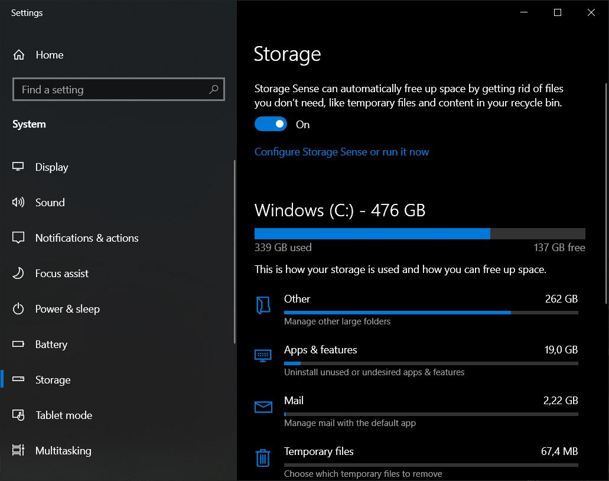
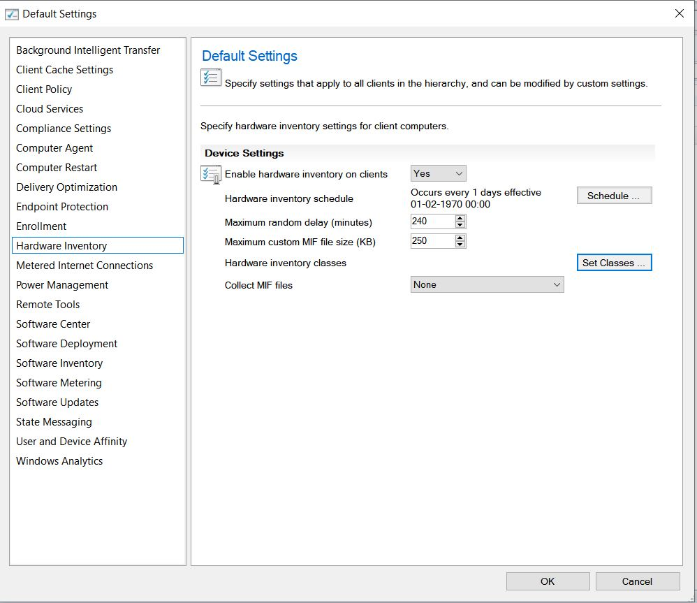
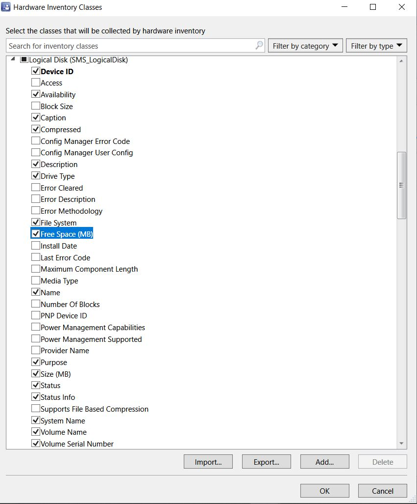
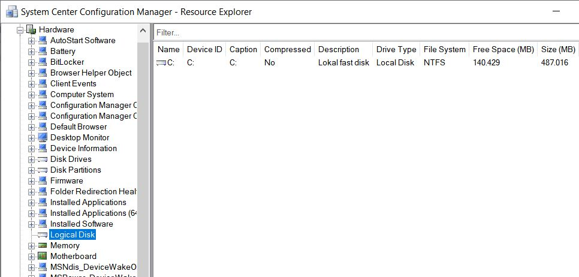
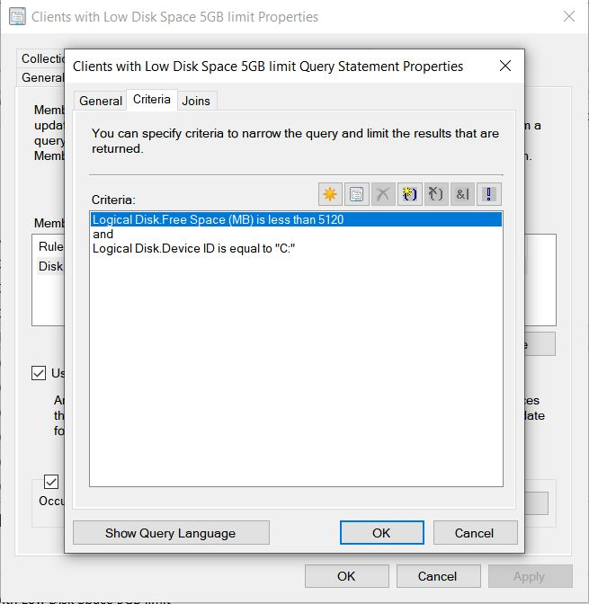

# Toast Notification: Low Disk Space

## BEFORE YOU BEGIN


If you have not read my original blog on [Multi-Language Toast Notifications](https://www.osdsune.com/home/blog/2019/windows10-toast-notification), I recommend that you do so before reading any further.


## LOW DISK SPACE

Now that I have successfully used  [Martin Bengtsson](https://twitter.com/mwbengtsson) awesome **Toast Notifications** script for our **Driver Dynamic Driver and BIOS Update** process, I could also see other usage for this script! So here comes one of our latest uses of **Toast Notifications**.

**Martin’s Blog:** [https://bit.ly/35o4sz4](https://bit.ly/35o4sz4)

I will not be deep-diving into the details, so please read my previous blog or Martin’s blog above if you want detailed information about **Toast Notifications**.

Let´s get started - We have for a long time been using collections in **ConfigMgr** that exclude devices with less than 5GB of free disk space from Applications/Program install and Windows Updates, these collections trigger a clean up script to run on these devices.

We want to make our end users aware that when they have less than 5GB of free disk space left on (C:), it has some consequences and that they can do clean up on their device themselves.

I have decided to use **Toasted Notifications** for this awareness purpose which allows users to remind them later or to click on a clean up button which will lead them to the **Storage Sense** in **settings**.

The only difference from my previous **Toast Notification** used for the **Driver Dynamic Driver and BIOS Update** process, is that the text and option for action in the \*.XML has changed to the below value.

```
<Option Name="Action" Value="ms-settings:storagesense" />
```

.JPG>)




If you can't make it work with "Software Center" as the app for toast notifications, make sure you haven't deleted or hidden the original Software Center shortcut!


### ConfigMgr Preparations

We must configure a device collection in **ConfigMgr** that collect devices with less than 5GB of disk space. If not already done, the first thing we need to do here is extend our **Hardware Inventory Class** -> **Logical Disk (SMS\_LogicalDisk)** with **Free Space (MB)** otherwise we will not be able to measure for free disk space on our devices. Just follow these few steps:

**Step 1.** Select **Administration** in the **ConfigMgr** console and go to **Client Settings**

**Step 2.** Open the **Default Client Settings**

.JPG>)

**Step 3.** Select **Hardware Inventory** and click **Set Classes**…



**Step 4.** Scroll down to **Logical Disk (SMS\_LogicalDisk)** and tick the checkbox for **Free Space (MB)**.



**Step 5.** Now wait for the devices to run **Hardware Inventory Cycle** (Default 7 days)

Once **Hardware Inventory** has finished run its cycle we will be able to see **Free Space (MB)** in the resource explorer for any given device.



We will now be able to create a device collection that collects devices based on free disk space. Just follow these few steps:

Step 1. Create a new **Device Collection** and add a **query rule**

Step 2. Set the following configuration in the query properties



```
select SMS_R_SYSTEM.ResourceID,SMS_R_SYSTEM.ResourceType,SMS_R_SYSTEM.Name,SMS_R_SYSTEM.SMSUniqueIdentifier,SMS_R_SYSTEM.ResourceDomainORWorkgroup,SMS_R_SYSTEM.Client from SMS_R_System inner join SMS_G_System_LOGICAL_DISK on SMS_G_System_LOGICAL_DISK.ResourceID = SMS_R_System.ResourceId where SMS_G_System_LOGICAL_DISK.FreeSpace < 5120 and SMS_G_System_LOGICAL_DISK.DeviceID = "C:"
```

That's all, folks! We are now ready to deploy the **Toast Notification** to our newly created collection to inform our end users to clean up their device. Nice!

For further information on how to deploy a **Toast Notification** with **ConfigMgr**, please take a look at my previous blog post on [Multi-Language Toast Notification](https://www.osdsune.com/home/blog/2019/windows10-toast-notification).

A special thanks go to [Martin](https://twitter.com/mwbengtsson)! If you have any questions regarding this topic, feel free to reach out to me. I am most active on [Twitter](https://twitter.com/SuneThomsenDK)!

Now go out and impress your boss and colleagues!
