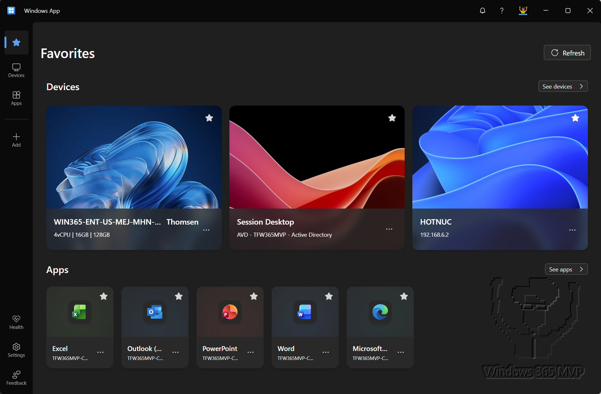
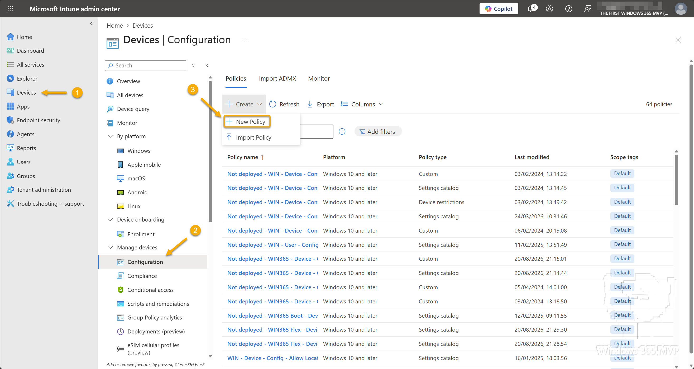
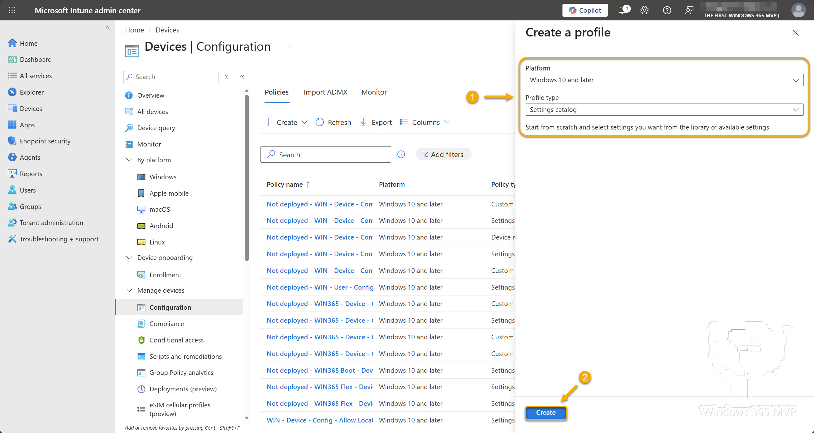
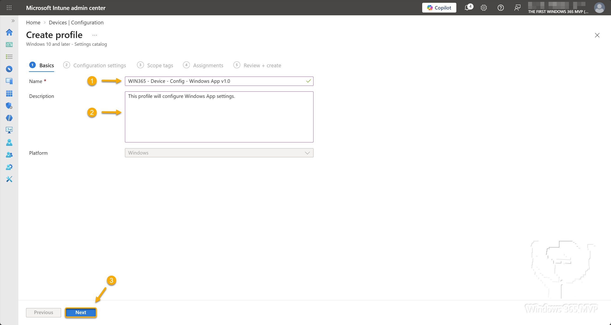
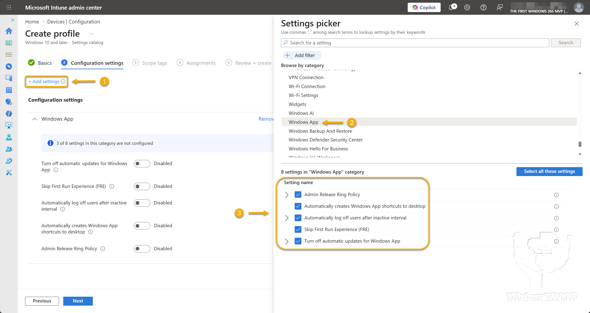
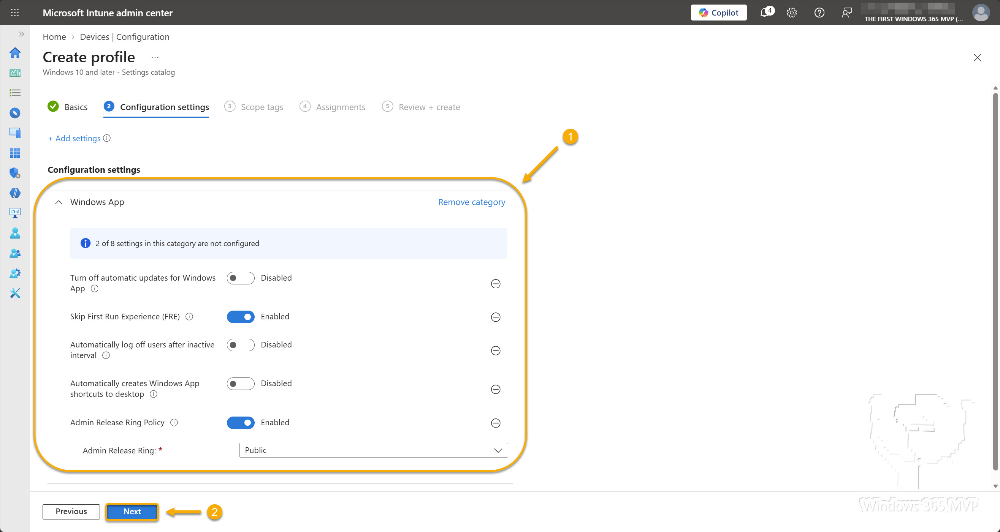
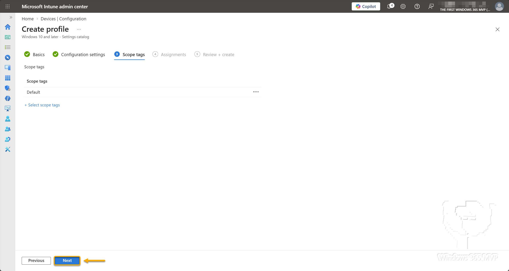
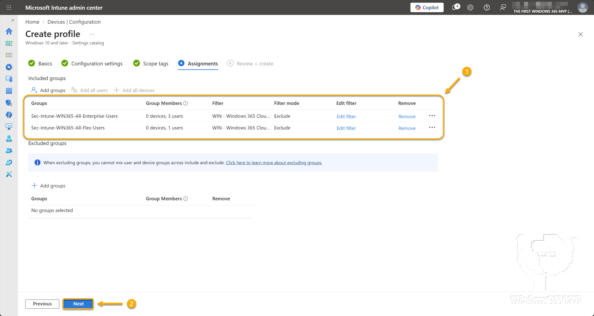
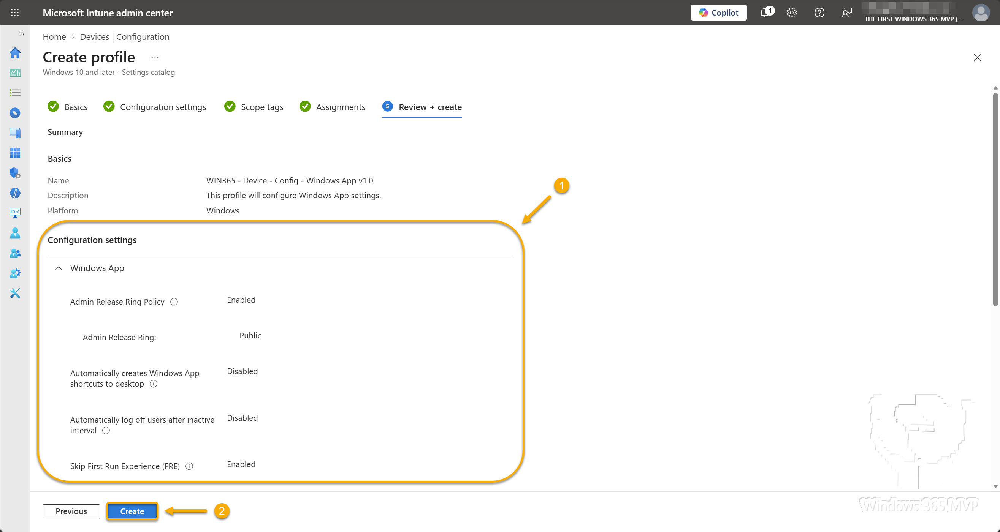
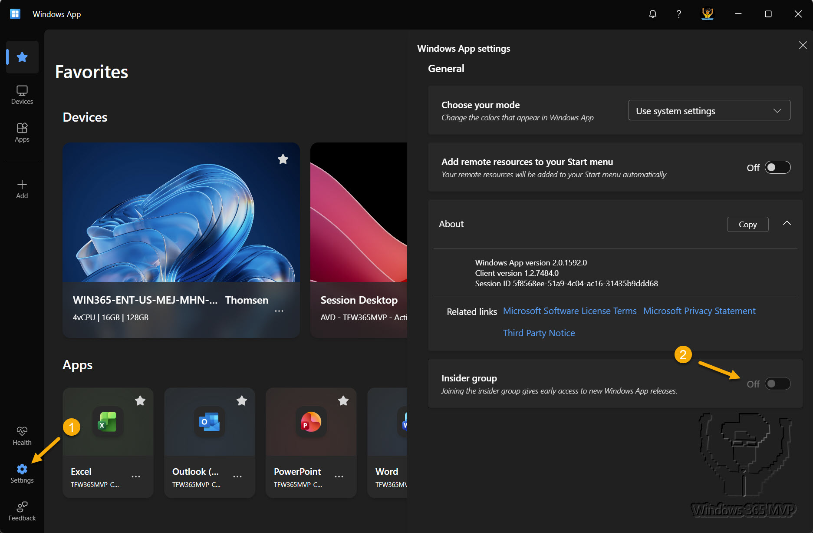

# Centralized Windows App Management

## BEFORE YOU BEGIN


**Disclaimer:** All information and content in this blog post is provided without any warranty whatsoever. The entire risk of using this information or executing the provided content remains with you. Under no circumstances should the mentioned persons or vendors, the author, or anyone else involved in creating these blog posts be held liable for any damage or data loss.


Hi folks! It's been a while since I last published a blog post. Over the past few years, life has thrown a few major challenges my way, from losing family members to settling into a new home and balancing other commitments. As a result, I needed to take a step back and focus on what mattered most.

But now I'm back, and I've got a backpack full of topics lined up for upcoming posts, so stay tuned!

In this post, we'll look at managing Windows App settings on Windows devices using Microsoft Intune.

<figure><figcaption></figcaption></figure>

When the Windows App first launched, only a handful of settings were available, and users configured them themselves. Today, the landscape looks very different. Microsoft has introduced additional settings, and several of them can now be managed centrally by IT admins. This gives organizations greater control over settings such as skipping the first-run experience, managing update behavior, defining a release ring, and more.

So buckle up and join me as we explore the available Windows App settings, how they're deployed, and what the user experience looks like.

**In this post, I’ll cover the following topics.**

* [**What is Windows App?**](centralized-windows-app-management.md#what-is-windows-app)
* [**Windows App Configuration Options**](centralized-windows-app-management.md#windows-app-configuration-options)
* [**Configuring Windows App**](centralized-windows-app-management.md#configuring-windows-app)
* [**Test and Verification**](centralized-windows-app-management.md#test-and-verification)
* [**Summary**](centralized-windows-app-management.md#summary)

## What is Windows App? 

Before we dive into the main topic of this post, let's take a moment to look at what Windows App is and what it's used for. Windows App serves as a launchpad for connecting to Windows devices and apps across Azure Virtual Desktop, Windows 365, Microsoft Dev Box, Remote Desktop Services, and physical PCs.

<figure><figcaption></figcaption></figure>

You can use Windows App across a wide range of platforms, including Windows, macOS, iOS/iPadOS, and Android, and on various device types such as desktops, laptops, tablets, smartphones, the Meta Quest VR headset, and even through a web browser.

For more information, see [_**What is Windows App?**_](https://learn.microsoft.com/en-us/windows-app/overview)

## Windows App Configuration Options 

IT admins can currently manage five Windows App settings through either the Microsoft Intune Settings Catalog or Group Policy using the Windows App administrative template (ADMX).


This post focuses on centrally managing Windows App settings on managed Windows devices using the Microsoft Intune Settings Catalog. If you’re looking to manage Windows App settings through Group Policy instead, refer to the guidance available on [_**Microsoft Learn**_](https://learn.microsoft.com/en-us/windows-app/configure-windows-app-settings-intune-gpo#windows-app-settings-using-group-policy)


The following table provides an overview of the Windows App settings that can be managed through either Microsoft Intune or Group Policy.

| Setting                                                | Value                                                                                                                                                                                                    | Short Description                                                                                                                       |
| ------------------------------------------------------ | -------------------------------------------------------------------------------------------------------------------------------------------------------------------------------------------------------- | --------------------------------------------------------------------------------------------------------------------------------------- |
| Admin Release Ring Policy                              | <ul><li>Public</li><li>Insider</li><li>Not configured</li></ul>                                                                                                                                          | Allows administrators to specify the release ring for the Windows App.                                                                  |
| Automatically creates Windows App shortcuts to desktop | <ul><li>Enabled</li><li>Disabled</li><li>Not configured</li></ul>                                                                                                                                        | Automatically creates Windows App shortcuts on the desktop to launch resources specified by the IT admins.                              |
| Automatically log off users after inactive interval    | <ul><li>Enabled</li><li>Disabled</li><li>Not configured</li></ul>                                                                                                                                        | Automatically signs out of the Windows App after a period of inactivity. This does not sign the user out of any remote session.         |
| Skip First Run Experience (FRE)                        | <ul><li>Enabled</li><li>Disabled</li><li>Not configured</li></ul>                                                                                                                                        | Skips the initial first-run experience and quick tour when the Windows App launches, taking the user directly to the connection center. |
| Turn off automatic updates for Windows App             | <ul><li>Turn on updates</li><li>Turn off updates from all locations</li><li>Turn off updates from Microsoft Store</li><li>Turn off updates from non-Store CDN locations</li><li>Not configured</li></ul> | Controls how the Windows App checks for and installs updates.                                                                           |

For more information, see [_**Windows App settings**_](https://learn.microsoft.com/en-us/windows-app/configure-windows-app-settings-intune-gpo#windows-app-settings)

## Configuring Windows App 

Now that we’ve covered the available Windows App settings, the configuration process is straightforward. The following steps walk you through creating a new configuration profile based on the Settings Catalog and configuring the available Windows App settings.

Go to [_**Microsoft Intune admin center**_](https://intune.microsoft.com/)\
In the left navigation pane, go to **Devices** > **Configuration** (under **Manage devices**).\
Click **+ Create** and select **New policy**.

<figure><figcaption></figcaption></figure>

On the **Create a profile** blade, select:

* **Platform:** Windows 10 and later
* **Profile type:** Settings catalog

Click **Create.**

<figure><figcaption></figcaption></figure>

On the **Basics** page, enter a unique name for the profile and click **Next**.


Although the **Description** field is optional, I recommend filling it out. A clear description helps other IT admins understand the purpose of the configuration profile.


<figure><figcaption></figcaption></figure>

On the **Configuration settings** page, click **+ Add settings**.\
In the **Settings picker**, navigate to **Windows App** and select the settings you want to manage.\
Close the **Settings picker.**

<figure><figcaption></figcaption></figure>

Configure each setting by selecting either **Enabled** or **Disabled** based on your organization's requirements, and then click **Next**.

<figure><figcaption></figcaption></figure>

On the **Scope tags** page, configure scope tags if required, and then click **Next**.

<figure><figcaption></figcaption></figure>

On the **Assignments** page, assign the profile to the relevant users or devices and then click **Next**.

<figure><figcaption></figcaption></figure>

Review the profile settings on the **Review + create** page and click **Create**.

<figure><figcaption></figcaption></figure>

## Test and Verification 

To verify that the Windows App is being centrally managed, open the app on a managed Windows device and navigate to **Settings**. The **Insider group** setting should appear greyed out and set to **Off**. In this scenario, that behavior is expected because the **Admin Release Ring** setting is configured to **Public** in the Intune configuration profile.

<figure><figcaption></figcaption></figure>

## Summary 

In this blog post, you learned how to centrally manage Windows App settings on Windows devices using the Microsoft Intune Settings Catalog. I covered the five currently available Windows App settings and explained how IT admins can manage each one, including the **Admin Release Ring**, automatic updates, desktop shortcuts, inactivity logoff, and the first-run experience.

I also provided step-by-step instructions for creating a new configuration profile in Intune, selecting the Windows App settings, and assigning the profile to users or devices. Finally, I demonstrated how to verify that Windows App is being managed correctly by confirming that settings such as the **Insider group** are enforced and greyed out for end users.

That’s it, folks. Happy testing, and have fun exploring 🤓\
If you have any questions regarding this topic, please feel free to reach out to me.



## Centralized Windows App Management

This is a test!


