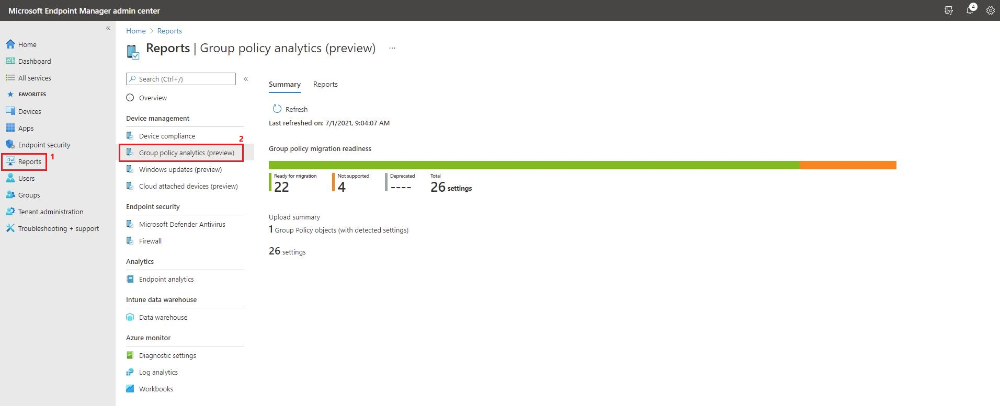

# Analyze on-premises GPOs with MEM Group Policy Analytics (preview)

## BEFORE YOU BEGIN


**Disclaimer:** All information and content in this blog post is provided without any warranty whatsoever. The entire risk of using this information or executing the provided content remains with you. Under no circumstances should the mentioned persons or vendors, the author, or anyone else involved in creating these blog posts be held liable for any damage or data loss.


## Introduction

In this blog post I will be looking at Group Policy Analytics (preview) in Microsoft Endpoint Manager. Organizations have been using group policy objects (GPOs) for decades to configure user and computer settings on devices in their environment. But in these modern days, where many organizations are embracing cloud solutions and they want to move workloads to Microsoft Endpoint Manager, we need a way to review and analyze the on-premises GPOs to determine which settings can be moved to the cloud, this is where Group Policy Analytics in Microsoft Endpoint Manager will be handy.\
\
Group Policy Analytics is a feature in Microsoft Endpoint Manager that analyzes your on-premises GPOs. It helps you determine how your GPOs translate in the cloud. The output shows which settings are supported in MDM providers, including Microsoft Intune. It also shows any deprecated settings, or settings not available to MDM providers.\
Source: [Microsoft Docs](https://docs.microsoft.com/en-us/mem/intune/configuration/group-policy-analytics)\
\
**Note.** This is a preview feature – but don't worry, public previews are fully supported by Microsoft - Source: [Microsoft Docs](https://docs.microsoft.com/en-us/mem/intune/fundamentals/public-preview)

## Prerequisites and Requirements

* On-premises Computer / Domain Controller
* Policies applicable for Windows 10 and later
* Microsoft Endpoint Manager
* A MEM Role that has the Security Baselines permissions or one of the following permissions in AAD
  * Global Administrator
  * Intune Administrator

## Export / Backup GPOs as an XML File

So, first we'll need to export the GPOs in order to analyze them in Group Policy Analytics.\
\
**Note.** Make sure that the file is less than 4 MB. If the exported file is greater than 4 MB, then include fewer GPOs when you save your report from the Group Policy Management. Group Policy Analytics will check the sizes of your individual GPO XML files. A single GPO can't be bigger than 4 MB though. The import will fail if the GPO XML file is larger than 4 MB.\
Source: [Microsoft Docs](https://docs.microsoft.com/en-us/mem/intune/configuration/group-policy-analytics#export-gpos-as-an-xml-file)\
\
Open “**Group Policy Management**” from a on-premises computer \*\* or domain controller.\
Expand to “**Group Policy Objects**” and right-click on a GPO and select either “**Back Up…**” or “**Save Report…**”

_\*\* Requires that the optional feature RSAT is installed._

.JPG>)

If you selected “**Back Up…**” – Set location, add description (optional), click “**Back Up**” and click “**OK**”

.JPG>)

.JPG>)

If you selected “**Save Report…**” – Navigate to the correct location, add file name and type. Click “**Save**”

.JPG>)

This is of course also possible from PowerShell, just edit and run this command from an elevated PowerShell session on a DC.

```
Get-GPOReport -Name "The_Policy_Name" -ReportType XML -Path "C:\Temp\The_Policy_Name.xml"
```

.JPG>)

I ran all three methods just for the sake of this blog post – the results should look something like this

.JPG>)

## Group Policy Analytics (preview)

Once we have exported the GPO, we must import it to Group Policy Analytics.\
Go to [https://endpoint.microsoft.com](https://endpoint.microsoft.com/)\
\
Click on “**Devices**” and select “**Group Policy analytics (preview)**” from the “**Policy**” section. Click “**Import**”

.JPG>)

Select your exported GPO – once the status is “**import completed**” you can close this page by clicking on the **X**.

.JPG>)

Microsoft Endpoint Manager will analyze the GPO and determine which settings in this policy has MDM support.\
\
The GPO will be listed with the following information:

|       **Column Name**       | **Description**                                                                                                                                                   |
| :-------------------------: | ----------------------------------------------------------------------------------------------------------------------------------------------------------------- |
|    **Group Policy name**    | The name is automatically generated using information in the GPO.                                                                                                 |
| **Active Directory Target** | The target is automatically generated using the organizational unit (OU) target information in the GPO.                                                           |
|       **MDM Support**       | Shows the percentage of group policy settings in the GPO that have the same setting in Intune.                                                                    |
|     **Unknown Settings**    | This is new and doesn't seem to be documented yet – but I'll guess it could be custom settings (e.g. Registry settings) or unsupported settings.                  |
|      **Targeted in AD**     | <p><strong>Yes</strong> means the GPO is linked to an OU in on-premises group policy.<br><strong>No</strong> means the GPO isn't linked to an on-premises OU.</p> |
|      **Last imported**      | Shows the date of the last import.                                                                                                                                |

In my example - 84% of the settings in my GPO will be MDM supported.\
Click on the percentage for your policy.

.JPG>)

The GPO settings will be listed with the following information:

|          **Column Name**          | **Description**                                                                                                                                                                                                                                                                                                                               |
| :-------------------------------: | --------------------------------------------------------------------------------------------------------------------------------------------------------------------------------------------------------------------------------------------------------------------------------------------------------------------------------------------- |
|          **Setting Name**         | The name is automatically generated using information in the GPO setting.                                                                                                                                                                                                                                                                     |
| **Group Policy Setting Category** | Shows the setting category for ADMX settings, such as Internet Explorer and Microsoft Edge. Not all settings have a setting category.                                                                                                                                                                                                         |
|          **ADMX Support**         | <p><strong>Yes</strong> means there's an ADMX template for this setting.<br><strong>No</strong> means there isn't an ADMX template for the specific setting.</p>                                                                                                                                                                              |
|          **MDM Support**          | <p><strong>Yes</strong> means there's a matching setting available in Endpoint Manager. You can configure this setting in a device configuration profile. Settings in device configuration profiles are mapped to Windows CSPs.<br><strong>No</strong> means there isn't a matching setting available to MDM providers, including Intune.</p> |
|             **Value**             | Shows the value imported from the GPO. It shows different values, such true, 900, enabled, false, and so on.                                                                                                                                                                                                                                  |
|         **Min OS Version**        | Shows the minimum Windows OS version build numbers that the GPO setting applies. It may show 18362 (1903), 17130 (1803), and other Windows 10 versions.                                                                                                                                                                                       |
|             **Scope**             | Shows if the imported GPO targets users or targets devices.                                                                                                                                                                                                                                                                                   |
|            **CSP Name**           | A Configuration Service Provider (CSP) exposes device configuration settings in Windows 10. This column shows the CSP that includes the setting. For example, you may see Policy, BitLocker, PassportforWork, and so on.                                                                                                                      |
|          **CSP Mapping**          | Shows the OMA-URI path for the on-premises policy. You can use the OMA-URI in a custom device configuration profile.                                                                                                                                                                                                                          |

### Supported CSPs

Group Policy Analytics can parse the following CSPs:

* [Policy CSP](https://docs.microsoft.com/en-us/windows/client-management/mdm/policy-configuration-service-provider)
* [PassportForWork CSP](https://docs.microsoft.com/en-us/windows/client-management/mdm/passportforwork-csp)
* [BitLocker CSP](https://docs.microsoft.com/en-us/windows/client-management/mdm/bitlocker-csp)
* [Firewall CSP](https://docs.microsoft.com/en-us/windows/client-management/mdm/firewall-csp)
* [AppLocker CSP](https://docs.microsoft.com/en-us/windows/client-management/mdm/applocker-csp)

The above information explains each column very well and I have marked a few settings in the below screenshot that we will take a closer look at.

.JPG>)

**Settings Page Visibility/Settings Page Visibility**

|          **Column Name**          | **Description**                                         |
| :-------------------------------: | ------------------------------------------------------- |
|          **Setting Name**         | Settings Page Visibility/Settings Page Visibility       |
| **Group Policy Setting Category** | Control Panel                                           |
|          **ADMX Support**         | No                                                      |
|          **MDM Support**          | No                                                      |
|             **Value**             | hide:gaming-gamebar;gaming-gamedvr;gaming-broadcasting… |
|         **Min OS Version**        | 0                                                       |
|             **Scope**             | Device                                                  |
|            **CSP Name**           | N/A                                                     |
|          **CSP Mapping**          | N/A                                                     |

**Show first sign-in animation**

|          **Column Name**          | **Description**                                                                      |
| :-------------------------------: | ------------------------------------------------------------------------------------ |
|          **Setting Name**         | Show first sign-in animation                                                         |
| **Group Policy Setting Category** | System/Logon                                                                         |
|          **ADMX Support**         | No                                                                                   |
|          **MDM Support**          | Yes                                                                                  |
|             **Value**             | Disabled                                                                             |
|         **Min OS Version**        | 18362 (Windows 10 build 1903)                                                        |
|             **Scope**             | Device                                                                               |
|            **CSP Name**           | Policy                                                                               |
|          **CSP Mapping**          | <p>./Device/Vendor/MSFT/Policy/Config/WindowsLogon/<br>EnableFirstLogonAnimation</p> |

**Show Windows Store apps on the taskbar**

|          **Column Name**          | **Description**                                                                        |
| :-------------------------------: | -------------------------------------------------------------------------------------- |
|          **Setting Name**         | Show Windows Store apps on the taskbar                                                 |
| **Group Policy Setting Category** | Start Menu and Taskbar                                                                 |
|          **ADMX Support**         | Yes                                                                                    |
|          **MDM Support**          | Yes                                                                                    |
|             **Value**             | Disabled                                                                               |
|         **Min OS Version**        | 15063 (Windows 10 build 1703)                                                          |
|             **Scope**             | User                                                                                   |
|            **CSP Name**           | Policy                                                                                 |
|          **CSP Mapping**          | <p>./User/Vendor/MSFT/Policy/Config/ADMX_Taskbar/<br>ShowWindowsStoreAppsOnTaskbar</p> |

One setting is not supported (we'll get back to that one...) - two of the settings is MDM supported, which means that you can create a custom device configuration profile in Microsoft Endpoint Manager by using the OMA-URI from the CSP Mapping column – but as you can see from the above information, the “**Show Windows Store apps on the taskbar**” setting is also ADMX supported, which means that there is an ADMX template for this setting.\
\
Let's take a look at how to create a device configuration profile based on the above results.\
\
Creating a device configuration profile based on CSP (OMA-URI)

.JPG>)

Creating a device configuration profile based on ADMX template.

.JPG>)

### Settings catalog (preview)

Settings catalog lists all the settings you can configure, and all in one place. There are thousands of settings to choose, including settings that haven't been available before. These settings are directly generated from the Windows configuration service providers (CSPs). You can also configure Administrative Templates (ADMX) and have more Administrative Template settings available. As Windows adds or exposes more settings to MDM providers, these settings are added quicker to Microsoft Intune for you to configure. - Source: [Microsoft Docs](https://docs.microsoft.com/en-us/mem/intune/configuration/settings-catalog)\
\
Try out the new settings catalog (preview) I quickly found all three settings from the above examples.

.JPG>)

## Group Policy Analytics Report

As written earlier in this post, I would come back to the setting “**Settings Page Visibility/Settings Page Visibility**” which is unsupported and by looking at its name it doesn't seem right.\
\
So, let's see if the report for Group Policy Analytics can give us any clue on what is going on.\
Go to [https://endpoint.microsoft.com](https://endpoint.microsoft.com/)\
\
Click on “**Reports**” and select “**Group policy analytics (preview)**” from the “**Device management**” section.



From the summary page we can see that we have uploaded 1 GPO with 26 settings in total and 4 settings is not supported.\
\
Click on “**Reports**” and click on “**Group policy migration readiness**”

.JPG>)

From the reports page, we can filter on Migration Readiness, Profile Type and CSP name.\
Once the report is generated, we can choose to export it as an CSV file.

.JPG>)

.JPG>)

Select “**Not supported**” from the migration readiness dropdown menu and click “**Generate again**”

.JPG>)

And as expected we can see that the setting “**Settings Page Visibility/Settings Page Visibility**” is listed as “**Not supported**”

.JPG>)

This is where things get weird, because I was able to find the setting in the settings catalog! If we go back to the previous migration readiness report, we can actually see that each of the four unsupported settings are listed twice (as supported and unsupported) and you won't find that information anywhere else besides in this report.

.JPG>)

So, I will leave that hanging in the unknown – but I would say it's a bug and that's to be expected when still in preview.

## Summary

Now you know how to analyze your on-premises GPOs with Group Policy Analytics in Microsoft Endpoint Manager and generate a readiness report. I think it's a awesome tool! Yes, it still need some work and I would like to see some kind of automation built into it. I've actually heard that they are working on a feature that will be able to create device configuration profiles automatically based on your supported GPO settings - I've tried to sign up for this feature but haven't heard back from them yet.\
\
That's it folks. Happy testing!\
If you have any questions regarding this topic, feel free to reach out to me. I am most active on [Twitter](https://www.twitter.com/SuneThomsenDK)!
