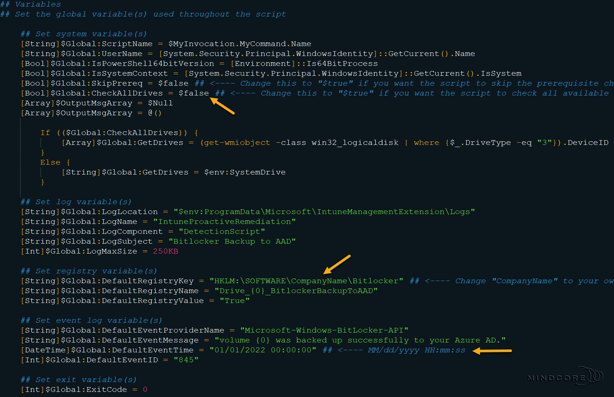
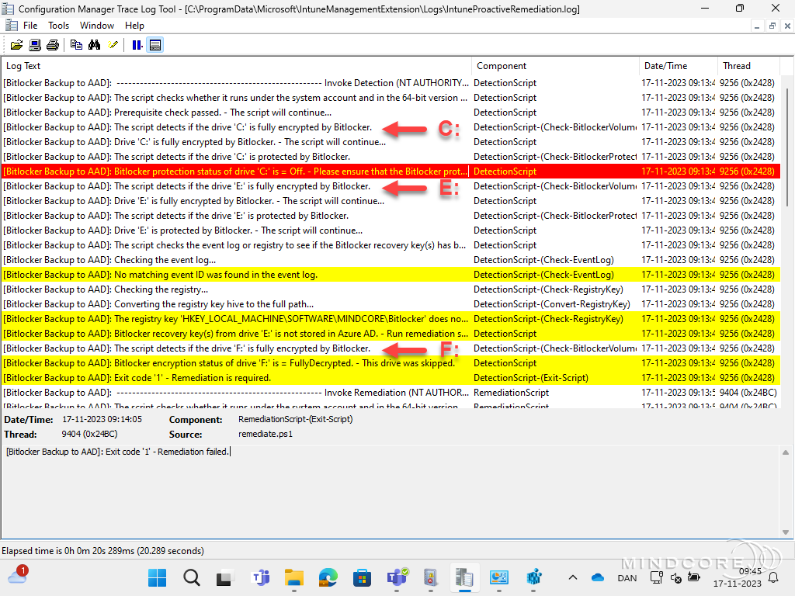
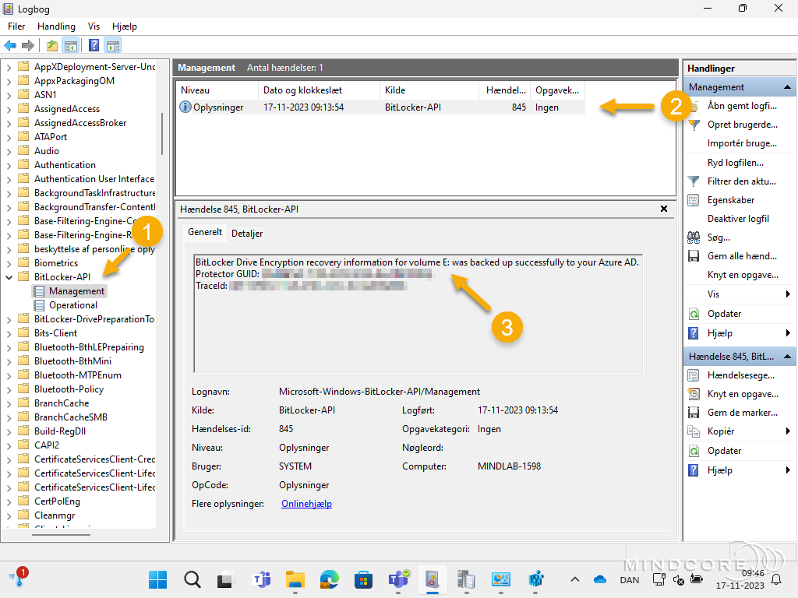
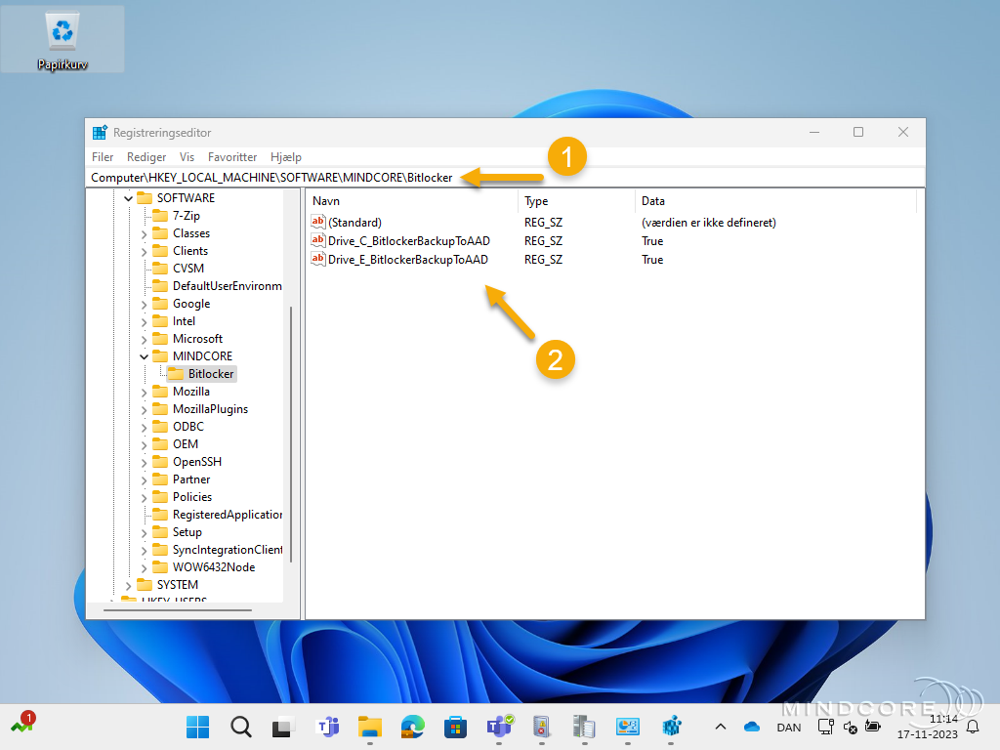
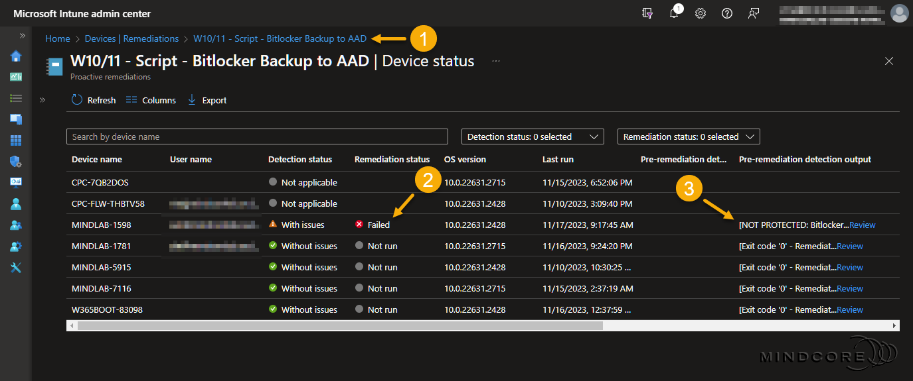
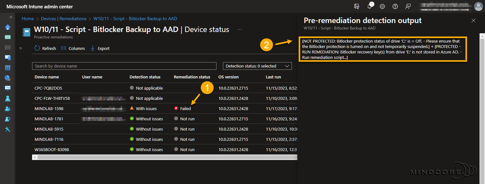

# How to migrate BitLocker key(s) from all fixed drives to Microsoft Entra ID.

## BEFORE YOU BEGIN


<mark style="color:orange;">**Disclaimer:**</mark> <mark style="color:orange;"></mark><mark style="color:orange;">All information and content in this blog post is provided without any warranty whatsoever. The entire risk of using this information or executing the provided content remains with you. Under no circumstances should the mentioned persons or vendors, the author, or anyone else involved in creating these blog posts be held liable for any damage or data loss.</mark>


It's been almost a year since I published my original post about how to **migrate BitLocker Recovery Key(s) to Azure AD (Microsoft Entra ID)** using a remediation script. It didn't take long before several companies started using it, and since then, I've received a few inquiries about support for multiple fixed drives.

Today, I'm excited to announce the release of an updated version of the remediation script, which supports multiple fixed drives and an improved script output in **Microsoft Intune**.


&#x20;<mark style="color:orange;">**Important:**</mark> <mark style="color:orange;"></mark><mark style="color:orange;">Read about the prerequisites and requirements for remediation scripts in</mark> <mark style="color:orange;"></mark><mark style="color:orange;">**Microsoft Intune**</mark> <mark style="color:orange;"></mark><mark style="color:orange;">and the script usage in the original blog post here ⤵️</mark>




**In this post, I'll cover the following topics.**

* [**Migrate BitLocker key(s) from all fixed drives**](how-to-migrate-bitlocker-key-s-from-all-fixed-drives-to-microsoft-entra-id..md#migrate-bitlocker-key-s-from-all-fixed-drives)
* [**Remediation verification**](how-to-migrate-bitlocker-key-s-from-all-fixed-drives-to-microsoft-entra-id..md#remediation-verification)
* [**The improved script output in Microsoft Intune**](how-to-migrate-bitlocker-key-s-from-all-fixed-drives-to-microsoft-entra-id..md#the-improved-script-output-in-microsoft-intune)
* [**Summary**](how-to-migrate-bitlocker-key-s-from-all-fixed-drives-to-microsoft-entra-id..md#summary)

## Migrate BitLocker key(s) from all fixed drives


&#x20;<mark style="color:orange;">**Important:**</mark> <mark style="color:orange;"></mark><mark style="color:orange;">Please download the</mark> [<mark style="color:orange;">**detection**</mark>](https://github.com/SuneThomsenDK/OSDSUNE/blob/master/Scripts/ProactiveRemediation/BitLockerBackupToEntraID/Detect_BitLockerBackupToEntraID.ps1) <mark style="color:orange;">and</mark> [<mark style="color:orange;">**remediation**</mark>](https://github.com/SuneThomsenDK/OSDSUNE/blob/master/Scripts/ProactiveRemediation/BitLockerBackupToEntraID/Remediate_BitLockerBackupToEntraID.ps1) <mark style="color:orange;">script from my</mark> [<mark style="color:orange;">**GitHub repository**</mark>](https://github.com/SuneThomsenDK/OSDSUNE/tree/master/Scripts/ProactiveRemediation/BitLockerBackupToEntraID) <mark style="color:orange;">before continuing.</mark>


In the variables section of both scripts, you will find a new global variable named **$Global:CheckAllDrives** with a default value set to **$false** (see the screenshot below)

* If set to **$false** (default) - the script will only check the system drive.
* If set to **$true** - the script will check all fixed drives.

So, if you want to check all fixed drives on your devices, change this new global variable to **$true** in both the detect and the remediation script and upload them to **Microsoft Intune**.


&#x20;<mark style="color:blue;">**Note:**</mark> <mark style="color:blue;"></mark><mark style="color:blue;">As stated in my</mark> [<mark style="color:blue;">**original blog post**</mark>](https://www.osdsune.com/home/blog/microsoft-intune/migrate-bitlocker-recovery-key-s-to-azure-ad-with-proactive-remediation)<mark style="color:blue;">, you still need to change the "</mark><mark style="color:blue;">**CompanyName**</mark><mark style="color:blue;">" in the registry path to a name of your choice (such as your company name).</mark>



&#x20;<mark style="color:blue;">**Tip:**</mark> <mark style="color:blue;"></mark><mark style="color:blue;">Although changing the event log time variable is optional, I suggest you change it to the date you plan to put the scripts into production.</mark>


<figure><figcaption></figcaption></figure>

## Remediation verification

After uploading both scripts to **Microsoft Intune**, it's time to verify that everything works as intended.

The first place I will check is in the **IntuneProactiveRemediation** log file.

```
C:\ProgramData\Microsoft\IntuneManagementExtension\Logs\IntuneProactiveRemediation.log
```

As you can see in the example below, the script checks drive **C**:, **E**:, and **F**:

<figure><figcaption></figcaption></figure>

The second place I will check is in the **Event Viewer**.


&#x20;<mark style="color:blue;">**Applications and Services Logs | Microsoft | Windows | BitLocker-API | Management**</mark>


<figure><figcaption></figcaption></figure>

The third and final place I would check is in the **Registry Editor**.


&#x20;<mark style="color:blue;">**HKEY\_LOCAL\_MACHINE\SOFTWARE\CompanyName\BitLocker**</mark>


<figure><figcaption></figcaption></figure>

## The improved script output in Microsoft Intune

Let's have a look at the improved script output in **Microsoft Intune**.

Go to [**https://intune.microsoft.com**](https://intune.microsoft.com)\
Next, go to **Devices | Remediations (under Policy)** and select your script package from the overview.\
Choose **Device status (under Monitor)** in the script package.

The **Device status overview** provides visibility into the detection and remediation status. The following example shows that the detection process finished with issues, and the remediation failed.

<figure><figcaption></figcaption></figure>

Let's look at what information the output can provide us. In the below example, we can see that the improved script output now supports multiple outputs!

* **Output 1** - BitLocker protection status of drive 'C:' is = Off. - Please ensure that the BitLocker protection is turned on and not temporarily suspended.
* **Output 2** - BitLocker recovery key(s) from drive 'E:' is not stored in Azure AD. - Run remediation script…


&#x20;<mark style="color:blue;">**Note:**</mark> <mark style="color:blue;"></mark><mark style="color:blue;">The script output(s) are separated with</mark> <mark style="color:blue;"></mark><mark style="color:blue;">**\[Output 1] + \[Output 2] + \[Output 3]**</mark><mark style="color:blue;">...</mark>


Why did the remediation fail? – Because I'd temporarily suspended the BitLocker protection on drive **C:**

<figure><figcaption></figcaption></figure>

## Summary

In this blog post, you learned about the new capabilities of my remediation script used for **migrating BitLocker key(s) to Microsoft Entra ID**. You should now be able to upload BitLocker key(s) for all fixed drives to **Microsoft Entra ID** and check the improved script output in **Microsoft Intune**.

That's it, folks. Happy testing, and have fun exploring 🤓\
If you have any questions regarding this topic, please feel free to reach out to me.
