# How to configure Windows 365 Enterprise in Microsoft Endpoint Manager

## BEFORE YOU BEGIN


**Disclaimer:** All information and content in this blog post is provided without any warranty whatsoever. The entire risk of using this information or executing the provided content remains with you. Under no circumstances should the mentioned persons or vendors, the author, or anyone else involved in creating these blog posts be held liable for any damage or data loss.



&#x20;**Attention:** Microsoft has paused their free Windows 365 trial program while they provision additional capacity!

[Sign up](https://info.microsoft.com/ww-landing-signup-for-updates-windows-from-the-cloud.html?LCID=EN-US) to learn more about Windows 365



&#x20;The word on Twitter is that Windows 365 trial license may be available. Well, for some at least! I don´t see it in my tenants yet! So, the reality is that the trial license may only be available in certain countries for now.

Didn’t you get a Windows 365 trial license in first round? Try again - You might be lucky...

Source: [Twitter](https://twitter.com/rnabmitra/status/1451728339912347652?s=20)



.jpg>)

## Introduction

In this blog post we'll take a first look at Windows 365 Enterprise and how to configure it in Microsoft Endpoint Manager Admin Center. Windows 365 is a cloud-based service also known as Software/Desktop as a Service (SaaS/DaaS) provided by Microsoft which delivers a personalized Windows Cloud PC experience and is accessible from anywhere, on any endpoint.\
\
By default, Windows 365 Enterprise Cloud PCs are joined to your Active Directory domain, synced to Azure AD and fully managed by Microsoft Endpoint Manager. Each Cloud PC is assigned to an individual user and is their dedicated Windows device. Assigning a Cloud PC to a user is just like assigning an Exchange Online mailbox to a user. When a Windows 365 license is assigned to a user, provisioning of a new Cloud PC automatically starts and the Cloud PC is enrolled into Microsoft Endpoint Manager.\
\
As mentioned, Windows 365 does require a user-based license and the license price depends on the size and performance of the Cloud PC needed - More details about [Windows 365 plans and pricing](https://www.microsoft.com/en-us/windows-365/all-pricing)\
\
Source: [Microsoft Docs](https://docs.microsoft.com/en-us/windows-365/overview)

## Prerequisites and Requirements

* An active Azure subscription
* Sufficient Azure subscription permissions (e.g. Subscription Owner) to grant Windows 365 each of the following:
  * A reader role on the subscription
  * Network contributor permissions on the resource group
  * A network contributor role on the virtual network (VNet)
* A valid and working Intune and Azure AD tenant.
* Azure virtual network (VNet) with access to an enterprise domain controller, either in Azure or on-premises and it must be able to resolve DNS entries for your Active Directory Domain Services (AD DS) environment
* Site-to-Site VPN or Express route for connectivity to your on-premises Active Directory
* A subnet within the virtual network (VNet) and available IP address space
* An Active Directory user account with sufficient permissions to join the computer to your Active Directory domain
* The Active Directory must be in sync with Azure AD to provide hybrid identity in Azure AD (AD Connect)
* Users that are assigned Cloud PCs must have a synced identity available in both Active Directory and Azure AD
* Supported Azure regions for Cloud PC provisioning (The virtual network (VNet) should be in a supported region)
  * US East, US East 2, US West 2, US South central, Asia Southeast, Australia East, Europe North, Europe West, UK South, Canada Central, India Central, Japan East, France Central
* Microsoft Intune supported licenses (e.g. Microsoft 365 E3) in order to manage the devices
* Users must have licenses for Windows, Intune, Azure AD, and Windows 365 to use their Cloud PC (e.g. Microsoft 365 E3 + Windows 365 Enterprise 4 vCPU, 16 GB, 128 GB)
* Microsoft Endpoint Manager Admin Center for Cloud PC management
* The new built-in Cloud PC Administrator role in MEM or one of the following permissions in AAD
  * Global Administrator
  * Intune Administrator

&#x20;Source: [Microsoft Docs](https://docs.microsoft.com/en-us/windows-365/requirements)


&#x20;**Note:** I will be skipping the part about Azure subscription, Azure Virtual Network (VNet), Site-to-Site VPN and Hybrid Azure AD join configuration, since I've already got these prerequisites in place for my Azure Virtual Desktop (AVD) configuration.

For more information about that, please take a look at the following sites.

* [How to create a Site-to-site connection in the Azure portal](https://docs.microsoft.com/en-us/azure/vpn-gateway/tutorial-site-to-site-portal)
* [Build in the cloud with an Azure free account](https://azure.microsoft.com/en-us/free/)
* [How to create an additional Azure subscription](https://docs.microsoft.com/en-us/azure/cost-management-billing/manage/create-subscription)
* [How to configure Hybrid Azure AD join for managed domains](https://docs.microsoft.com/en-us/azure/active-directory/devices/hybrid-azuread-join-managed-domains)


## Purchase and assign Windows 365 licenses

Okay, let's get started! - The first thing we need to do is purchase a Windows 365 Enterprise license.\
Go to [https://admin.microsoft.com](https://admin.microsoft.com)

Expand “**Billing**”, select “**Purchase services**” and click on “**Windows 365**”\
\
As you can see on this page, there are 3 x Windows 365 editions available.

* Windows 365 Business
* Windows 365 Business (with Windows Hybrid Benefit)
* Windows 365 Enterprise

In this blog post we will be focusing on the enterprise edition. Are you looking for a Windows 365 Business vs. Enterprise comparison? - More details about [get started with Windows 365 Business](https://techcommunity.microsoft.com/t5/windows-it-pro-blog/get-started-with-windows-365-business/ba-p/2595485)

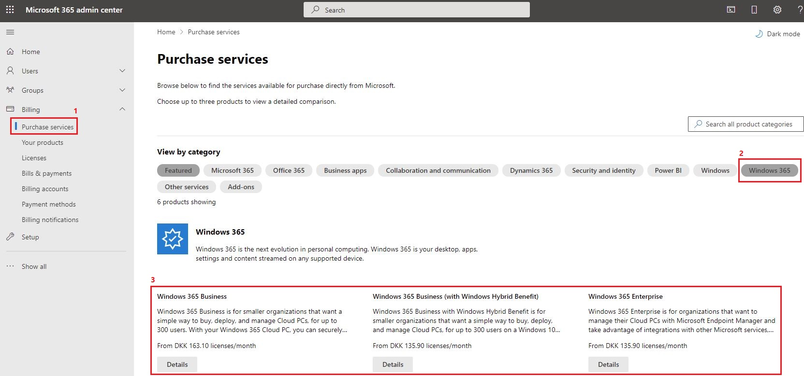

Click on “**Licenses**”\
\
From the licenses page you can select products to view and assign licenses (not recommended).\
\
As you can see, I've added a “**Windows 365 Enterprise 4 vCPU, 16GB, 128GB**” trial license for the purpose of this blog post.

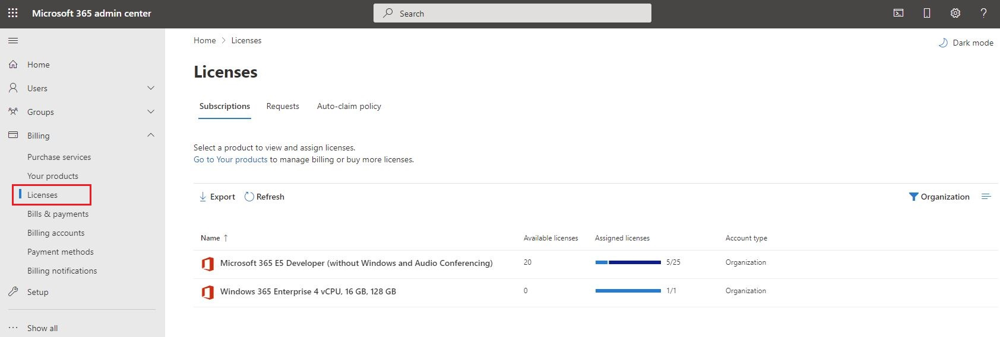

Let's assign license directly to a user.\
Go to [https://endpoint.microsoft.com](https://endpoint.microsoft.com)


&#x20;**Important:** Group based license assignment will block the Windows 365 Cloud PC resize feature.


\
Click on “**Groups**”, create a new user-based security group and give it a friendly group name and description (optional).\
\
**Note.** We recommend using a synced user-based security group from your on-premises Active Directory.

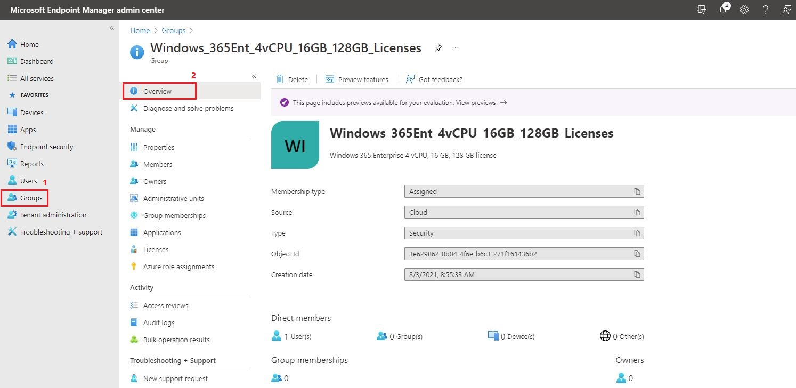

Select your newly created security group. Click on “**Members**” and then click “**Add members**”.\
Click on the user we just added to the group.

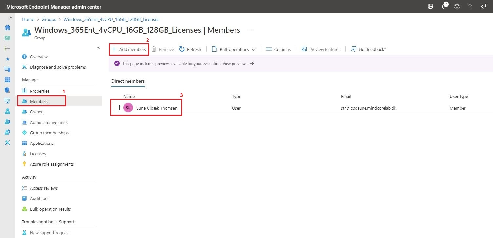

Click on “**Licenses**” and assign your Windows 365 license to the user.

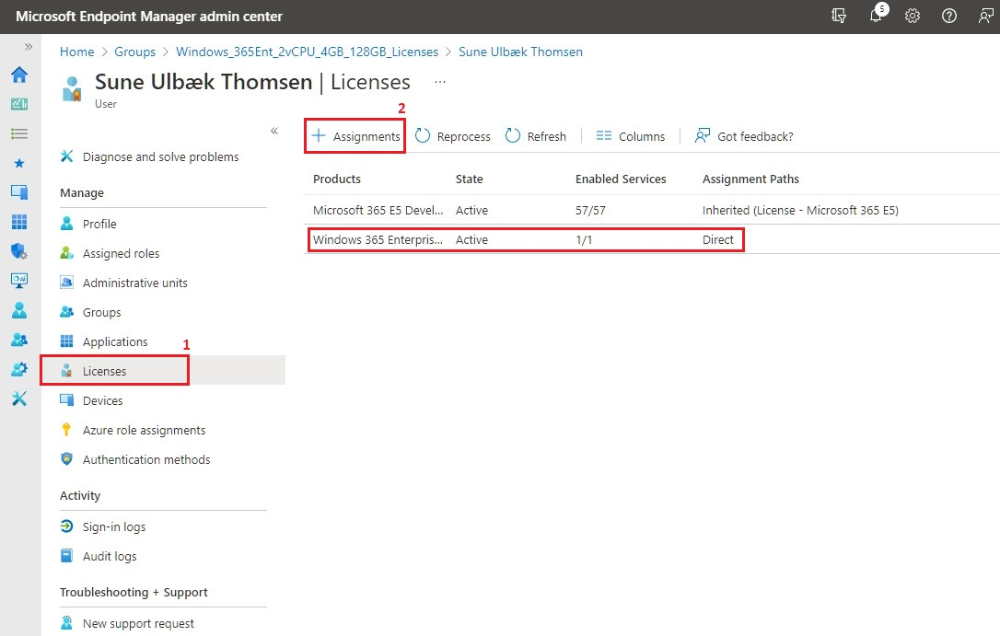

## Windows 365 Configuration

We can continue with the Windows 365 configuration, when all the prerequisites and requirements are met.\
\
Click on “**Devices**” and select “**Windows 365**” from the “**Provisioning**” section in Microsoft Endpoint Manager Admin Center.

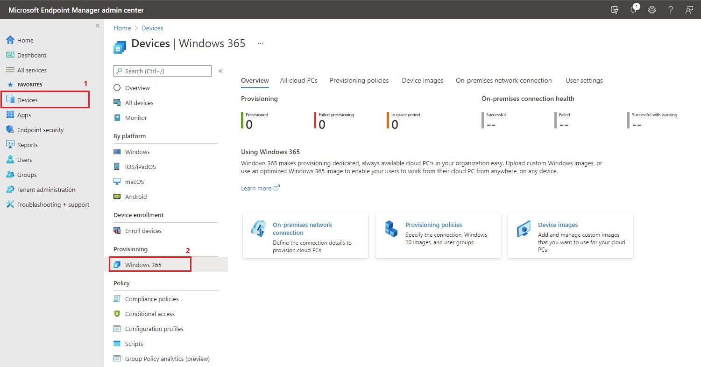

### On-premises network connection

First we'll need to configure a on-premises network connection, which is required so that the Cloud PCs can be created, domain joined and managed with Microsoft Endpoint Manager.\
\
Click on the “**On-premises network connection**” tab and select “**Create connection**”

.JPG>)

On the “**Network details**” page, we need to give the configuration a friendly name. Next, select your Azure subscription, Resource group, Virtual network and Subnet from the drop-down menus.\
\
**Note.** If you have multiple locations, we recommend that you add the region to the name (e.g. MINDCORELAB West Europe)\
\
Click “**Next**”

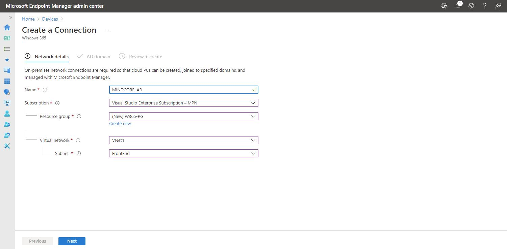

On the “**AD domain**” page, we need to enter the required Active Directory domain information and credentials.\
\
**Note.** The “**Organizational Unit**” field is optional.\
\
Click “**Next**”

.JPG>)

Review the information and click “**Review + create**”

.JPG>)

After completing the on-premises network connection configuration, a service called Watchdog runs in the background and will check your environment for all the prerequisites and requirements needed to use Windows 365 Enterprise.\
\
Within 5-10 minutes we should be able to check the on-premises network connection status.\
\
Click on the status.

.JPG>)

If you see any errors or warnings on the status page, I would suggest that you address those before continuing the Windows 365 configuration. I encountered a warning for "**Azure AD device sync**" during my first try and it turned out that I forgot to add the new Active Directory device OU for Windows 365 devices in AD Connect - Everything passed after I fixed that small issue.

.JPG>)

To review or change the on-premises network connection details, select the “**Properties**” tab.

.JPG>)

### Provisioning policy&#x20;

Once the on-premises network connection is created and with all check successful passed, you can go ahead and configure the provisioning policy.\
\
Click on “**Windows 365**” from the “**Provisioning**” section, select the “**Provisioning policies**” tab and then click on “**Create policy**”

.JPG>)

Give the policy a friendly name and a description (optional). Select your on-premises network connection and click “**Next**”\
\
**Note.** If you have multiple locations, we recommend that you add the region to the name (e.g. MINDCORELAB West Europe)

.JPG>)

Select your image type and click “**Select**” - I will be using one from the PC OS image gallery.\
\
**Note.** It is possible to upload and use a custom image.

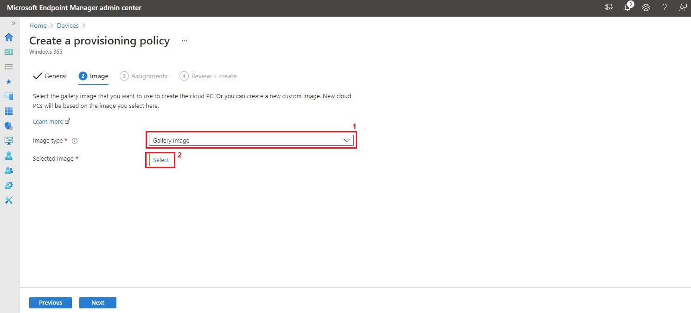

Select an image and click “**Select**”

.JPG>)

Click “**Next**”

.JPG>)

Select the user-based security group we created earlier and click “**Next**”

.JPG>)

Review the information and click “**Create**”

.JPG>)

You'll see the new policy in the list of provisioning policies.

.JPG>)

Provisioning of a new Cloud PC starts automatically for each user in the assigned security group.\
\
Click on the “**All cloud PCs**” tab.

.JPG>)

After 20-50 minutes the Cloud PCs are ready to use and the status has changed to “**Provisioned**”\
\
Whoopsie… In my eager to get started with Windows 365 I accidentally selected the wrong user (a cloud only user) DOH!

.JPG>)

At this point we should be able to see the Cloud PCs in our Active Directory, Azure AD and Intune.\
\
Access you domain controller, open “**Active Directory Users and Computers**” and navigate to the OU as provided during the creation of the on-premises network connection.

.JPG>)

The view from “**All devices**” in Azure AD.

.JPG>)

The view from “**Windows devices**” in Intune.

.JPG>)

### Self-service purchases (Enabled by default)

Here is something to consider! - Do you want to allow your end users to make self-service purchases? If not, you should consider disable that option since it's enabled by default.\
\
More details about [Self-service purchases](https://docs.microsoft.com/da-dk/microsoft-365/commerce/subscriptions/allowselfservicepurchase-powershell?view=o365-worldwide)

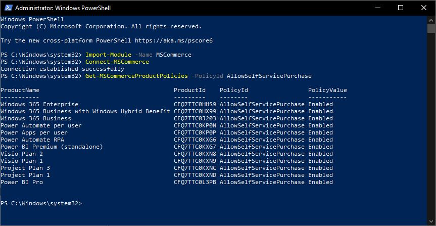

## Results

We are finally ready to test the newly created Windows 365 Cloud PC.\
Go to [https://cloudpc.microsoft.com](https://cloudpc.microsoft.com) or [https://myapplications.microsoft.com](https://myapplications.microsoft.com)

.JPG>)

Click “**Next, Next, Next…**”

.JPG>)

### Windows 365 web portal

From within the web portal you should see your cloud PC and its configuration.

.JPG>)

If you click on the gear icon in the right corner, you will find the self-service capabilities for end users (Restart, Rename and Troubleshoot).\
\
To start the Cloud PC from within the web portal, click on “**Open in browser**”

.JPG>)

Click “**Allow**”

.JPG>)

Enter your credentials.

.JPG>)

And we are connected - Awesome!\
\
**Note.** By default the users does not have local admin rights. However, it is possible to provide local admin rights to a user-based security group through "**User settings**" for Windows 365 in Microsoft Endpoint Manager Admin Center.

.JPG>)

From a Command Prompt, I can confirm that the Cloud PC is hybrid joined and it can communicate with on-premises devices.

.JPG>)

.JPG>)

Let's start writing on a word document and then close the web browser.

.JPG>)

### Remote Desktop

From within the web portal, click on the “**download icon**” and download the “**Microsoft Remote Desktop for Windows**”

.JPG>)

Install the “**Microsoft Remote Desktop for Windows**” and start the “**Remote Desktop**” app.\
\
Choose to subscribe with URL and you should see your Cloud PC workspace appear within a few seconds.

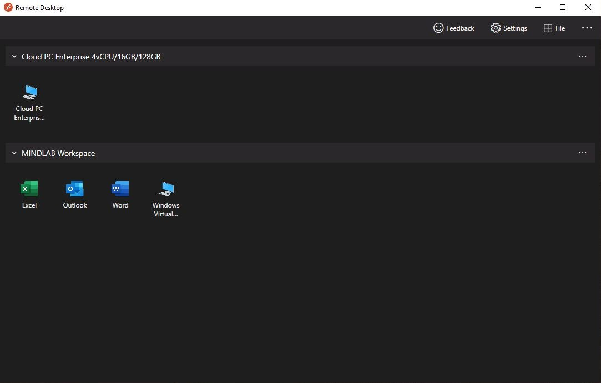

Double-click on your Cloud PC and enter your credentials.

.JPG>)

You will immediately notice that the word document is still open and that we can continue our writing.

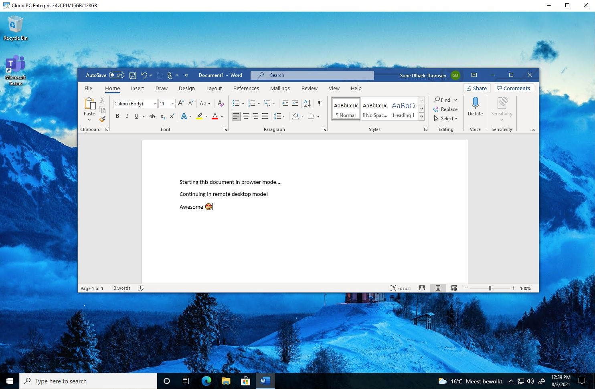

## Summary

That was our very first look at Windows 365 Enterprise edition!\
\
There are many prerequisites and requirements to address before setting up Windows 365 Enterprise - Microsoft has announced that native Azure AD support will be available for Windows 365 Enterprise soon, which will simplify the process even further and at a lower cost. But once the prerequisites and requirements are met, Windows 365 was quite simple to configure and easy to use from both a web browser and remote desktop app. - That's it folks. Happy testing!\
\
If you have any questions regarding this topic, feel free to reach out to me. I am most active on [Twitter](https://www.twitter.com/SuneThomsenDK)!
