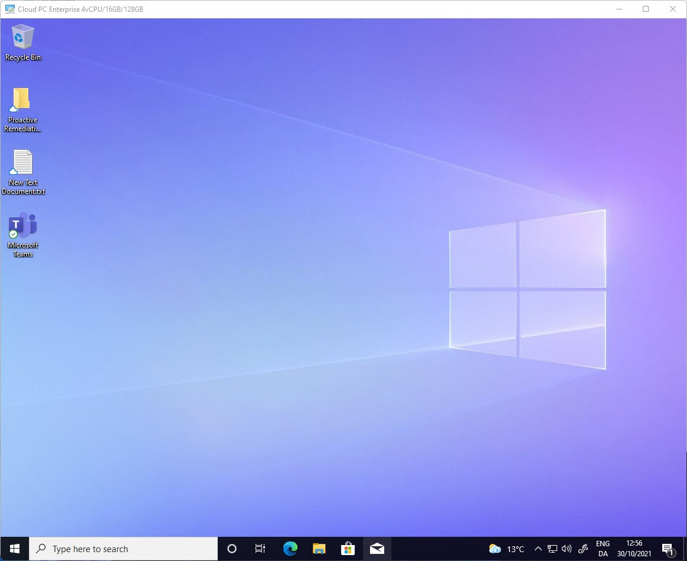
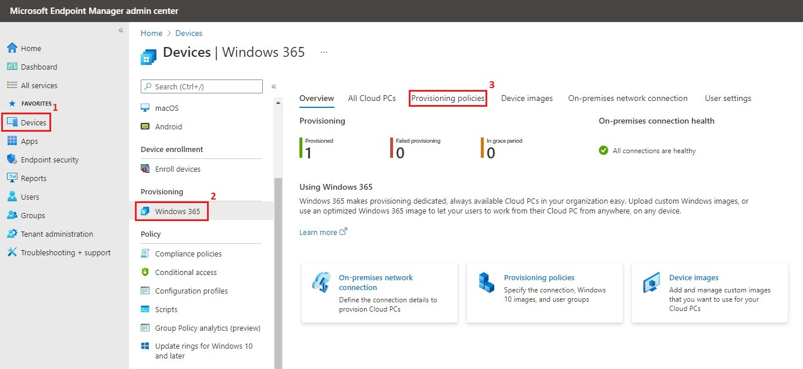
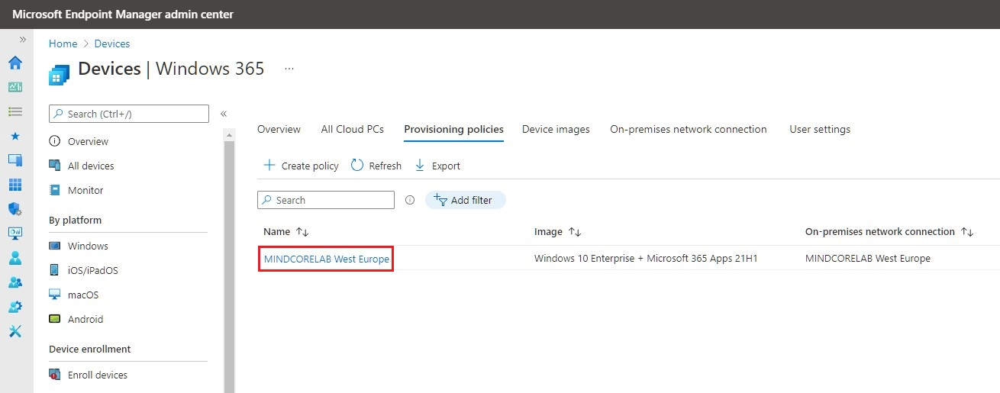
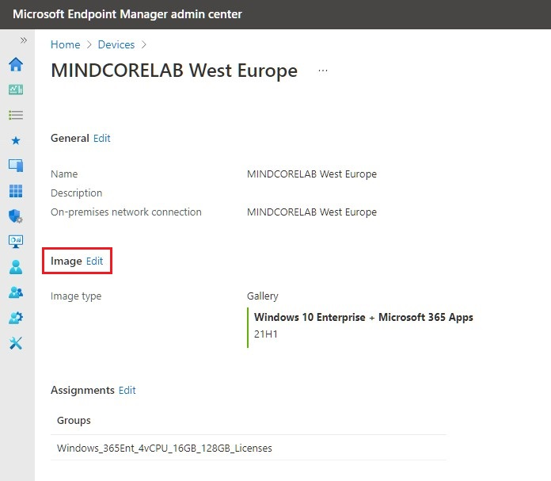
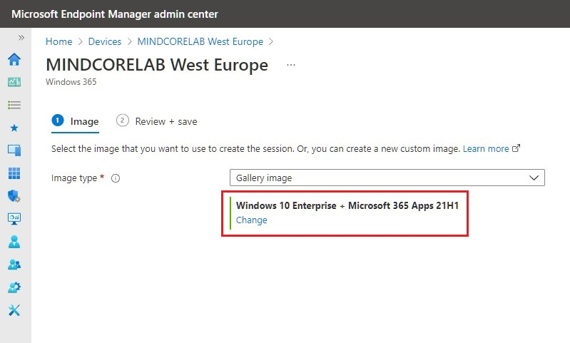
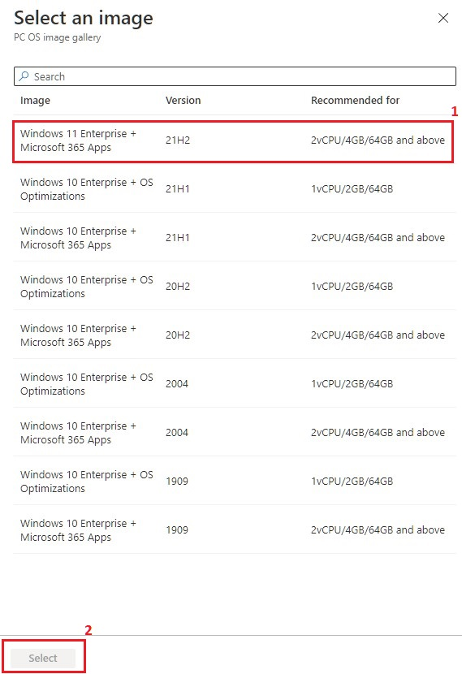
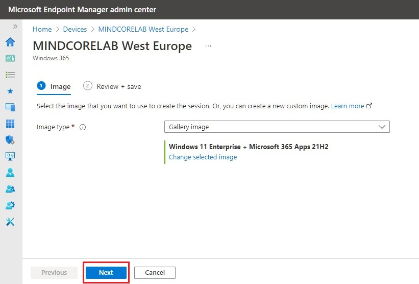
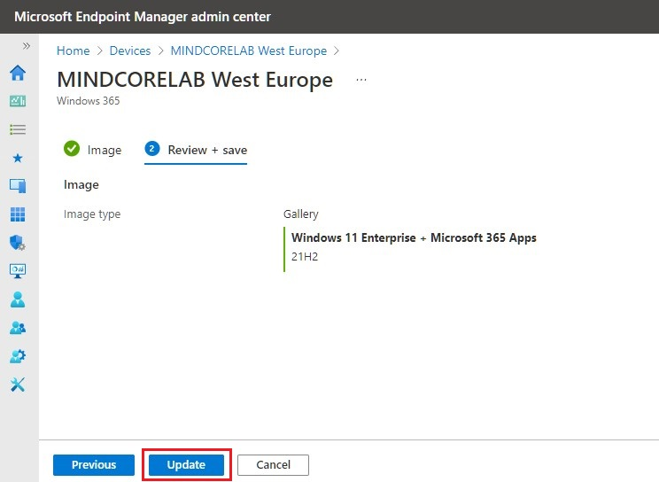
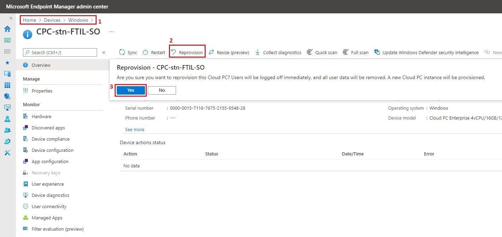
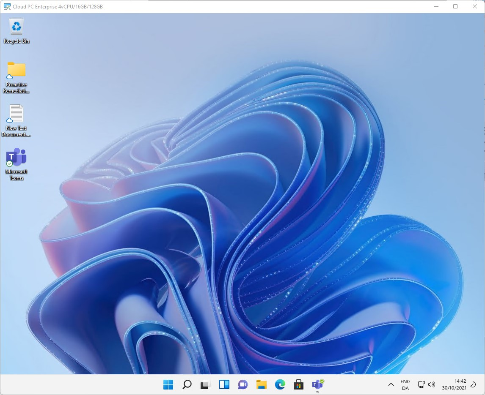

# How to reprovision existing Cloud PC (Windows 365) to Windows 11

## BEFORE YOU BEGIN


**Disclaimer:** All information and content in this blog post is provided without any warranty whatsoever. The entire risk of using this information or executing the provided content remains with you. Under no circumstances should the mentioned persons or vendors, the author, or anyone else involved in creating these blog posts be held liable for any damage or data loss.


<figure><figcaption>
<em>A Cloud PC (Windows 365) with Windows 11 on my son’s iPad and some hot chocolate – What’s not to like?</em>
</figcaption></figure>

## Introduction

A few months back I wrote a blog post about how to configure Windows 365 Enterprise in Microsoft Endpoint Manager, which was released with Windows 10. But now that Windows 11 has become general available, I think it’s time for a quick post where I walk you through the process of how to reprovision your existing Cloud PC(s) to Windows 11.

<figure><figcaption></figcaption></figure>

The original blog post – [How to configure Windows 365 Enterprise in Microsoft Endpoint Manager](https://www.osdsune.com/home/blog/2021/configure-windows-365-enterprise)

## Reprovision Cloud PC (Windows 365)

If I connect to my current Cloud PC we can quickly confirm that it is running Windows 10 at the moment.&#x20;

<figure><figcaption></figcaption></figure>

Let’s reprovision it to Windows 11.\
Go to [https://intune.microsoft.com](https://intune.microsoft.com)\
\
Click on **Devices | Windows 365 | Provisioning policies.**

<figure><figcaption></figcaption></figure>

Select your provisioning policy.

<figure><figcaption></figcaption></figure>

Click on **Edit**.

<figure><figcaption></figcaption></figure>

Click on **Change.**

<figure><figcaption></figcaption></figure>

Choose the **Windows 11 Enterprise + Microsoft 365 Apps** image.\
Click **Select.**

<figure><figcaption></figcaption></figure>

Click **Next.**

<figure><figcaption></figcaption></figure>

Click **Update.**

<figure><figcaption></figcaption></figure>

Click on **Devices | Windows 365 | All Cloud PCs** or **Devices | Windows.** \
Select your Cloud PC from the list of devices and click on **Reprovision.**\
Click **Yes.**

<figure><figcaption></figcaption></figure>

Approximately 1 hour later your new Cloud PC with Windows 11 will be ready for use.

<figure><figcaption></figcaption></figure>

## Summary

That´s it folks. – Now you know how to reprovision your existing Cloud PC(s). From a personal perspective, I hope that we in a near future will have the opportunity to perform an in-place upgrade. Happy testing!

As always, if you have any questions regarding this topic, feel free to reach out to me.
