# The Concept of Windows 365 Boot

## BEFORE YOU BEGIN


<mark style="color:orange;">**Disclaimer:**</mark> <mark style="color:orange;"></mark><mark style="color:orange;">All information and content in this blog post is provided without any warranty whatsoever. The entire risk of using this information or executing the provided content remains with you. Under no circumstances should the mentioned persons or vendors, the author, or anyone else involved in creating these blog posts be held liable for any damage or data loss.</mark>


In this blog post, I will explore the concept of Windows 365 Boot, a unique feature that complements Windows 365 Frontline well. Windows 365 Boot became generally available (GA) in September 2023 and is revolutionizing the way users can access their Cloud PCs.

<figure><figcaption><p>Source: <a href="https://designer.microsoft.com/"><strong>Microsoft Designer</strong></a></p></figcaption></figure>

So, buckle up for my next venture, and let's look at what this relatively new feature is all about and which use cases it covers. Also, let me show you how to configure Windows 365 Boot and how we can restrict user access on the physical Windows 365 Boot device.

**In this post, I'll cover the following topics.**

* [**Prerequisites and Requirements**](the-concept-of-windows-365-boot.md#prerequisites-and-requirements)
* [**What is Windows 365 Boot?**](the-concept-of-windows-365-boot.md#what-is-windows-365-boot)
* [**The Use Cases of Windows 365 Boot**](the-concept-of-windows-365-boot.md#the-use-cases-of-windows-365-boot)
* [**How to Configure Windows 365 Boot**](the-concept-of-windows-365-boot.md#how-to-configure-windows-365-boot)
* [**Test and Verification**](the-concept-of-windows-365-boot.md#test-and-verification)
* [**Restrict User Access**](the-concept-of-windows-365-boot.md#restrict-user-access)
* [**Summary**](the-concept-of-windows-365-boot.md#summary)

## Prerequisites and Requirements <a href="#prerequisites-and-requirements" id="prerequisites-and-requirements"></a>

* Windows 11-based devices (Pro & Enterprise).
* The physical device (and Cloud PCs) must be running Windows 11 version (22621.2361 or later).
* You must have a valid and working Microsoft Entra and Intune tenant.
* You must have a Windows 365 Cloud PC license to access the Windows 365 Boot guided scenario.
* You must use Microsoft Intune to manage your Windows 365 Boot devices and policies.
* Microsoft Intune Administrator rights.

## What is Windows 365 Boot? <a href="#what-is-windows-365-boot" id="what-is-windows-365-boot"></a>

Windows 365 Boot lets IT admins configure Windows 11 physical devices so that users can sign in directly to their Cloud PC from the physical device's Windows 11 login screen, making it the primary Windows experience on the device with no additional steps. Signing out of the Cloud PC will return the physical device to the Windows 11 login screen - ready for the next user. This makes the Windows 365 Boot a great feature, especially when combined with Windows 365 Frontline, and for users who work shifts and share physical devices.

\- So, we are basically turning the physical device into some sort of a thin client based on Windows 11.

<figure>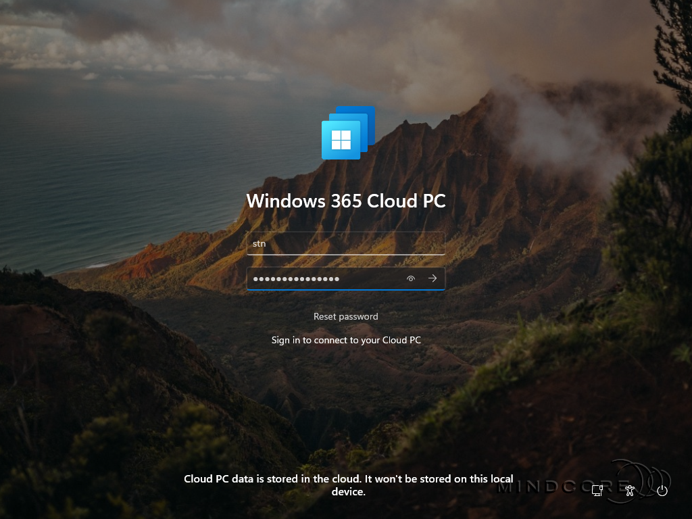<figcaption></figcaption></figure>

### What's New for Windows 365 Boot

Microsoft announced these new features when Windows 365 Boot was made generally available:

<details>

<summary><strong>Bluetooth</strong></summary>

Now, users can seamlessly fine-tune their Bluetooth settings straight from their Windows 11 device with Windows 365 Boot.\
\
**Bluetooth Support**\
To connect to Bluetooth devices from your Windows 365 Boot Cloud PC:\
\
1\. Open **Quick Settings** | **Bluetooth.**\
2\. In the **Settings** window, pair and connect to Bluetooth devices.

</details>

<details>

<summary><strong>Multiple Cloud PCs</strong></summary>

End users have the power to handpick their Cloud PC of choice, making personalization a breeze.\
\
**Multiple Cloud PCs**\
To set a default Cloud PC to use each time you sign in:\
\
1\. Navigate to [**https://windows365.microsoft.com**](https://windows365.microsoft.com/)\
2\. In the card for the Cloud PC you want to set as default, select the ellipses (…) | **Settings.**\
3\. In the **Integrated experiences** tab, under **Boot to this Cloud PC**, select **Connect while signed in to device.**\
4\. Select **Update.**

</details>

<details>

<summary><strong>Windows 365 Frontline Cloud PCs</strong></summary>

IT admins can configure Windows 365 Boot with their Windows 365 Frontline licenses.

</details>

<details>

<summary><strong>Max Connection Timeout Preferences</strong></summary>

IT admins can now set the max connection timeout between 5 and 20 minutes based on their needs.

</details>

<details>

<summary><strong>Security Baseline Profiles</strong></summary>

IT admins can now configure their security baseline profile on the Boot device recommended by Microsoft as part of their Guided Scenario.

</details>

Source: [**Windows 365 Boot is now generally available!**](https://techcommunity.microsoft.com/t5/windows-it-pro-blog/windows-365-boot-is-now-generally-available/ba-p/3938441)

### Upcoming Features and Improvements for Windows 365 Boot

The following improvements are beginning to roll out for Windows 365 Boot:

<details>

<summary><strong>Dedicated mode for Windows 365 Boot</strong></summary>

We are now launching a new mode for Windows 365 Boot – dedicated mode. You can now boot to your Windows 365 Cloud PC from your designated company-owned device. You will be able to seamlessly login to your Windows 365 Cloud PC from Windows 11 login screen using password-less authentication methods like Windows Hello for Business. The new dedicated mode also comes with fast account switcher experience to effortlessly switch profiles to login in, personalized experience with your username and password, display picture on lock and login screen, remember your username, etc.\
\
**The feature will begin to get enabled for Windows 365 customers via a private preview in early 2024.**

</details>

<details>

<summary><strong>Customized company logo and name for Windows 365 Boot</strong></summary>

In shared mode, organizations can now customize the login page to include their company branding from Intune.\
\
**The feature will begin to get enabled for Windows 365 customers via a private preview in early 2024.**

</details>

<details>

<summary><strong>Fail fast mechanism for Windows 365 Boot</strong></summary>

You no longer need to wait for the sign in process to the Cloud PC to complete only to find out Windows 365 Boot failed due to network issues or incomplete setup. The smart logic proactively informs users to resolve network issues or complete app setup so users can experience a smooth login to their Cloud PC.

</details>

<details>

<summary><strong>Manage local PC settings through Windows 365 Boot</strong></summary>

With this feature, it is now easier for you to access and manage sound, display, and other device specific settings of their local PC directly from your Cloud PC in under Windows 365 Boot.

</details>

Source: [**Announcing Windows 11 Insider Preview Build 22635.2915 (Beta Channel)**](https://blogs.windows.com/windows-insider/2023/12/14/announcing-windows-11-insider-preview-build-22635-2915-beta-channel/)

## The Use Cases of Windows 365 Boot

Who would benefit from the Windows 365 Boot feature? Well, I could definitely see this as an ideal solution for **hospitals**, **retail stores**, or **call centers**, especially when combined with Windows 365 Frontline.


&#x20;<mark style="color:blue;">**Note:**</mark> <mark style="color:blue;"></mark><mark style="color:blue;">Want to learn more about Windows 365 Frontline? See</mark> [<mark style="color:blue;">**The Concept of Windows 365 Frontline.**</mark>](https://www.osdsune.com/home/blog/windows-365/the-concept-of-windows-365-frontline)


Why, you ask? – It’s because Windows 365 Boot targets the same type of workers, such as nurses, salespeople, and other professionals who share company physical devices. Such kinds of workers might frequently switch between physical tasks and computer-based interactions. Windows 365 Boot lets them bypass the lengthy startup process and boot directly into their Cloud PC to continue their work right where they left off.

## How to Configure Windows 365 Boot

Now that you know the concept behind Windows 365 Boot let me show you how to set this up using the guided scenario in **Microsoft Intune**. We start by creating a security group for our Windows 365 Boot devices. Next, we’ll create the resources required for Windows 365 Boot to work via the guided scenario and prepare each physical device for the transition.

### Windows 365 Boot Guided Scenario

Go to [**https://intune.microsoft.com**](https://intune.microsoft.com/)\
In the left pane, select **Groups.**

Create a new **Microsoft Entra ID security group** for the Windows 365 Boot devices. – The group can be based on direct or dynamic membership.

<figure>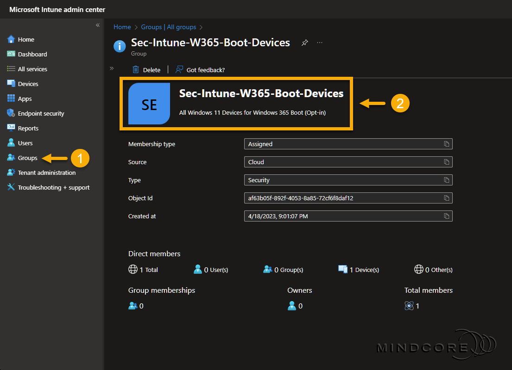<figcaption></figcaption></figure>

Next, select **Devices** | **Windows 365** (under **Provisioning**) to start the Windows 365 Boot guided scenario.

<figure>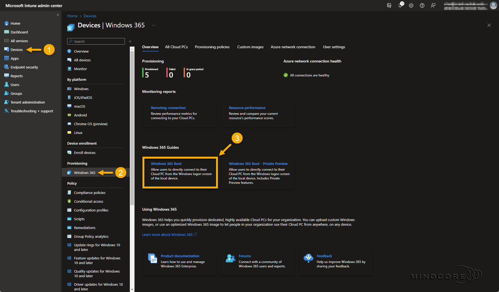<figcaption></figcaption></figure>

Click **Next** to begin the guided scenario.

<figure>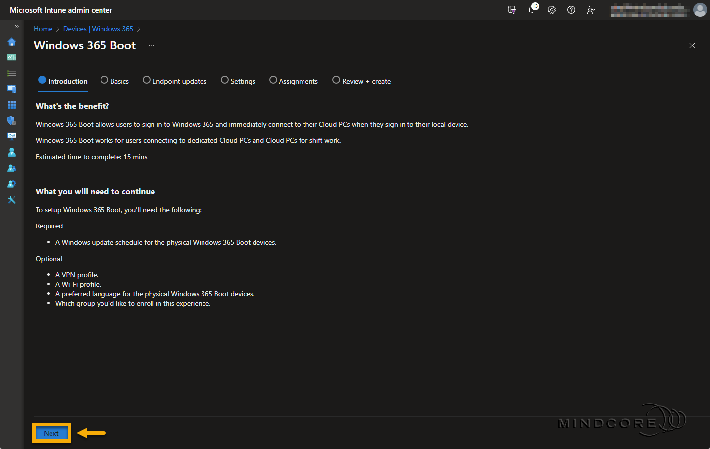<figcaption></figcaption></figure>

Fill in the required **Device name** and **Resource prefix name** field on the **Basics** page.\
Click **Next.**


&#x20;<mark style="color:blue;">**Tip:**</mark> <mark style="color:blue;"></mark><mark style="color:blue;">Although the</mark> <mark style="color:blue;"></mark><mark style="color:blue;">**Description**</mark> <mark style="color:blue;"></mark><mark style="color:blue;">field is optional, I recommend filling it out. Leaving some breadcrumbs is always a great idea, so others know precisely why someone created the configuration profile(s).</mark>


<figure>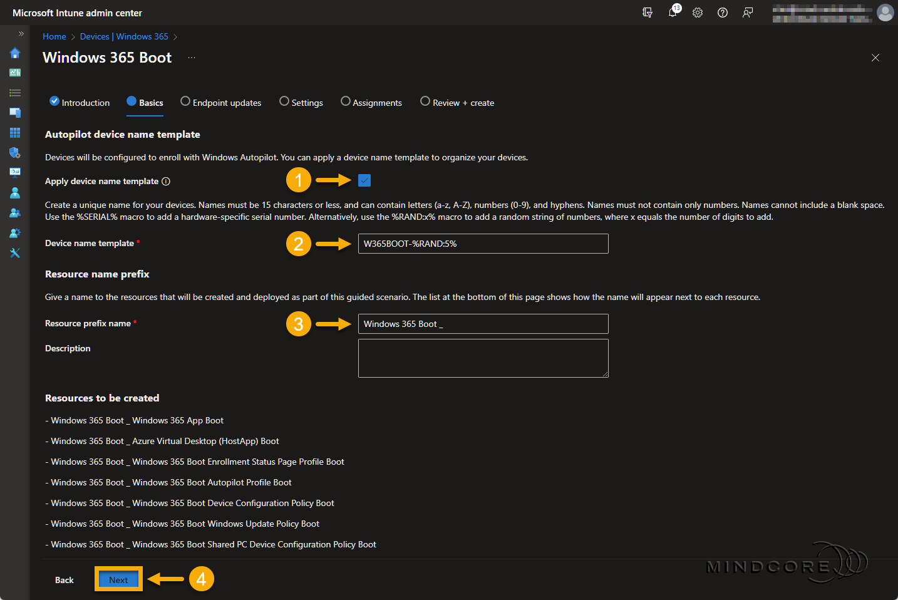<figcaption></figcaption></figure>

Keep the **Windows update settings** as is and click **Next.**

<figure>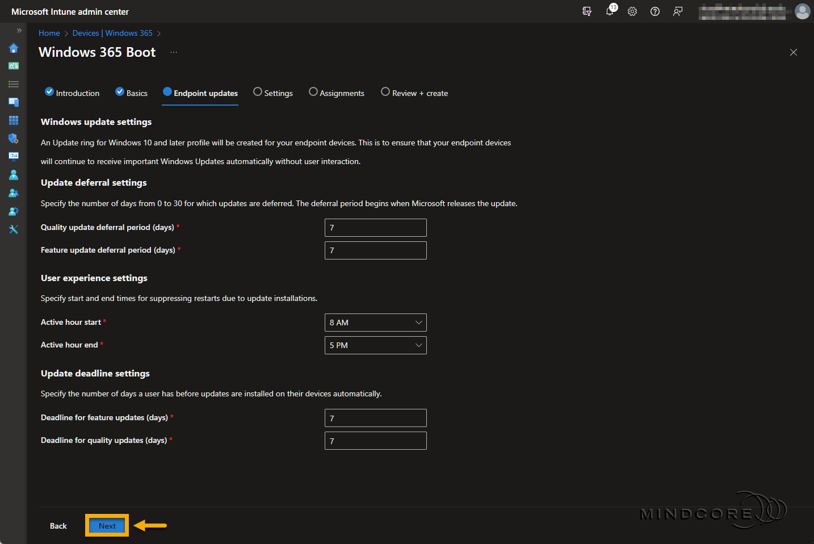<figcaption></figcaption></figure>

Select your preferred **Language (Region)** for the Windows Autopilot deployment profile.\
Set the **Max Connection Timeout** to a value of your choice.\
Click **Next.**


&#x20;<mark style="color:blue;">**Note:**</mark> <mark style="color:blue;"></mark><mark style="color:blue;">Besides</mark> <mark style="color:blue;"></mark><mark style="color:blue;">**Language (Region)**</mark> <mark style="color:blue;"></mark><mark style="color:blue;">and</mark> <mark style="color:blue;"></mark><mark style="color:blue;">**Max Connection Timeout**</mark><mark style="color:blue;">, you also have the option to select a</mark> <mark style="color:blue;"></mark><mark style="color:blue;">**VPN**</mark> <mark style="color:blue;"></mark><mark style="color:blue;">profile, a</mark> <mark style="color:blue;"></mark><mark style="color:blue;">**Wi-Fi**</mark> <mark style="color:blue;"></mark><mark style="color:blue;">profile, and a</mark> <mark style="color:blue;"></mark><mark style="color:blue;">**Security Baseline**</mark> <mark style="color:blue;"></mark><mark style="color:blue;">profile.</mark>


<figure>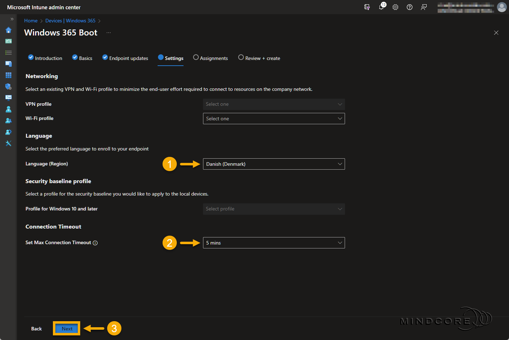<figcaption></figcaption></figure>

Next, we’ll assign my newly created Windows 365 Boot security group to these resources.\
Click **Next.**

<figure>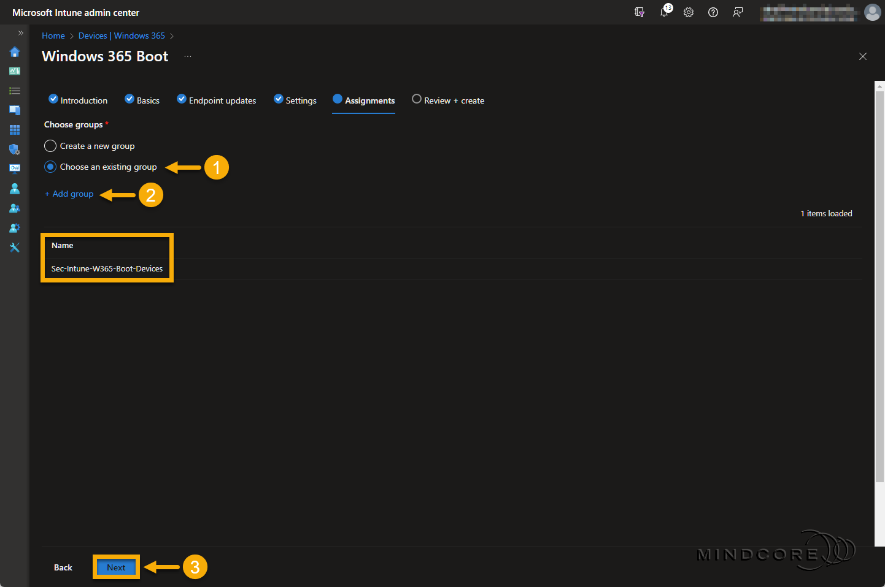<figcaption></figcaption></figure>

Review that everything is correct and click **Save.**

<figure>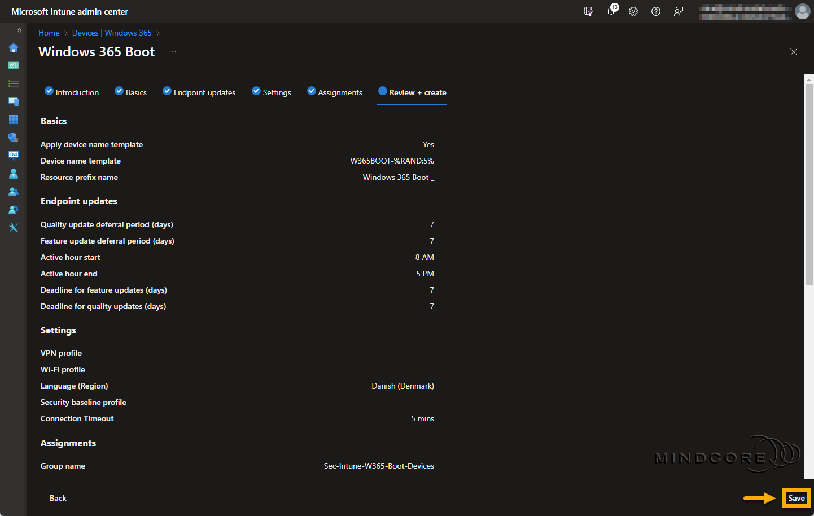<figcaption></figcaption></figure>

Once ready, we can move our attention to the preparation of the physical device.

<figure>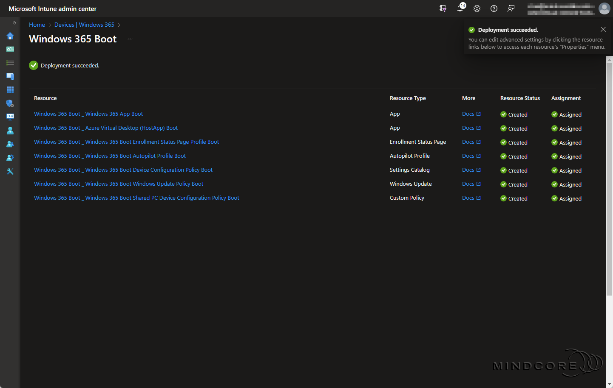<figcaption></figcaption></figure>

### The Windows 365 Boot Physical Device Setup

Let’s move on to preparing the physical devices, which requires adding them to our security group, a device wipe from **Microsoft Intune**, and Windows Autopilot registration.

Go to [**https://intune.microsoft.com**](https://intune.microsoft.com/)\
In the left pane, select **Groups.**

Select the newly created Windows 365 Boot security group.\
Click **+ Add members**, choose a device, and click **Select.**

<figure>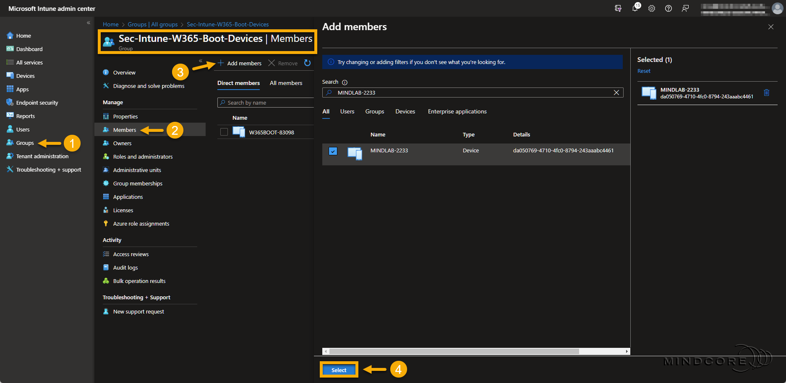<figcaption></figcaption></figure>

Next, select **Devices** | **Windows** (under **By platform**), choose the device you added to the Windows 365 Boot security group, and select **Wipe.** – Don’t select any of the boxes in the wipe confirmation box!\
Click **Wipe.**

<figure>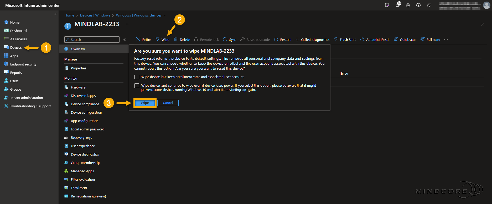<figcaption></figcaption></figure>


&#x20;<mark style="color:blue;">**Note:**</mark> <mark style="color:blue;"></mark><mark style="color:blue;">Skip this section if the device is already registered with Windows Autopilot.</mark>


From the **Out-of-Box-Experience (OOBE)** stage, use **Shift+F10** to open a command prompt.

Run the following commands:

```
PowerShell.exe
Set-ExecutionPolicy Bypass
Install-Script -Name Get-WindowsAutopilotInfo -Force
Get-WindowsAutopilotInfo.ps1 -Online
Restart-Computer
```

When prompted, sign in with a user that has the **Intune Administrator role**. After sign-in, the device is automatically enrolled in **Microsoft Intune.** – Wait a few minutes and then reboot the device.

<figure>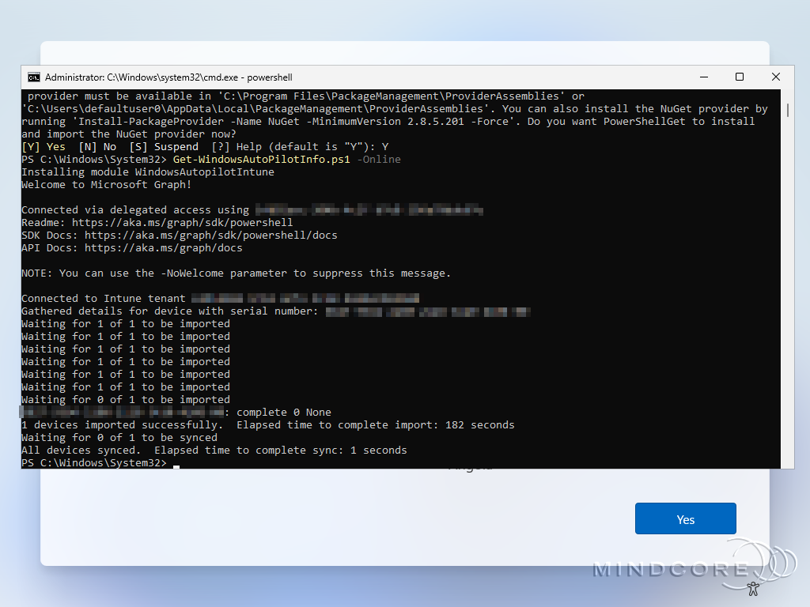<figcaption></figcaption></figure>

Now, complete the **Out-of-Box-Experience (OOBE)** as you would with any user.

<figure>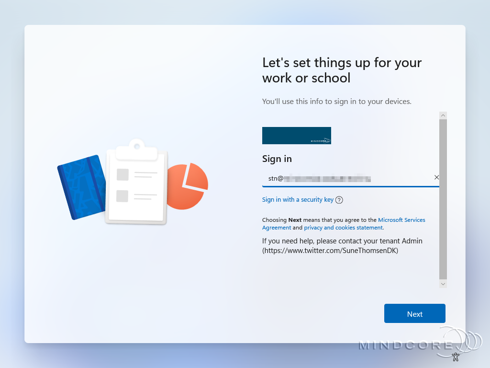<figcaption></figcaption></figure>

It runs through the **Enrollment Status Page (ESP)**

<figure>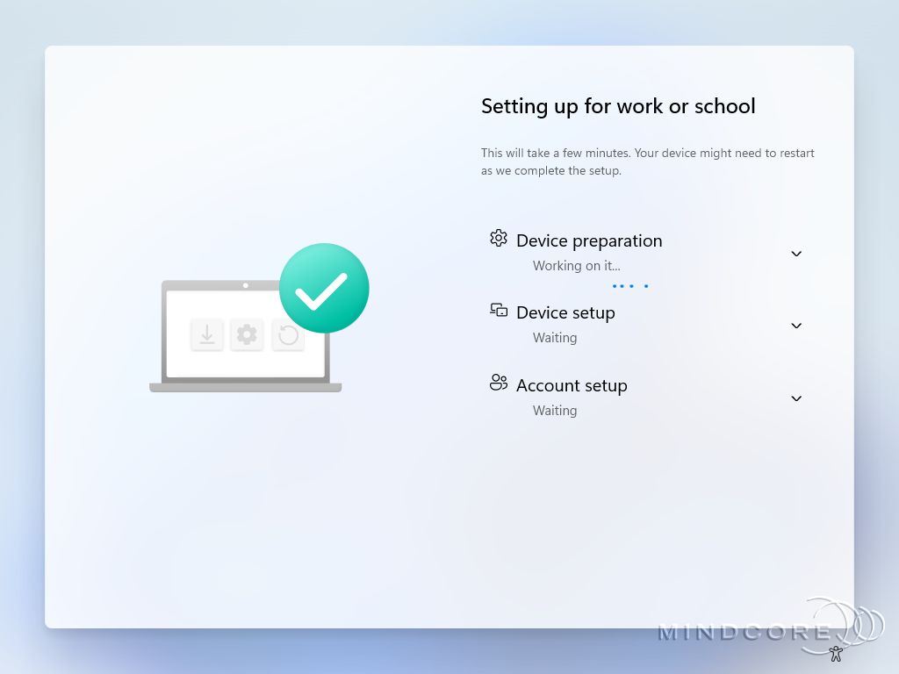<figcaption></figcaption></figure>

The Windows Autopilot provisioning is complete when you see the Windows 11 login screen.

<figure><figcaption></figcaption></figure>

## Test and Verification

The user signs in with their **Microsoft account** on the Windows 11 login screen.

<figure><figcaption></figcaption></figure>

Once the credentials are validated, the user seamlessly connects to their Windows 365 Cloud PC.

<figure>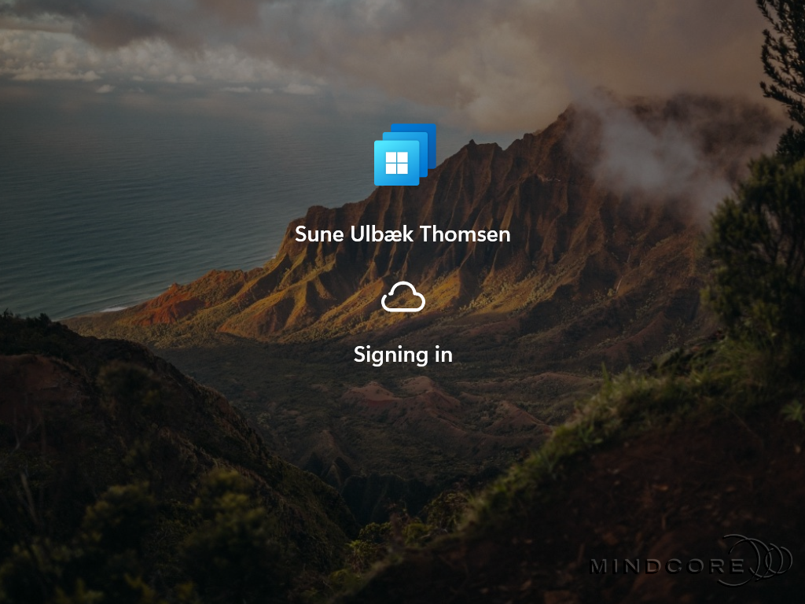<figcaption></figcaption></figure>

<figure>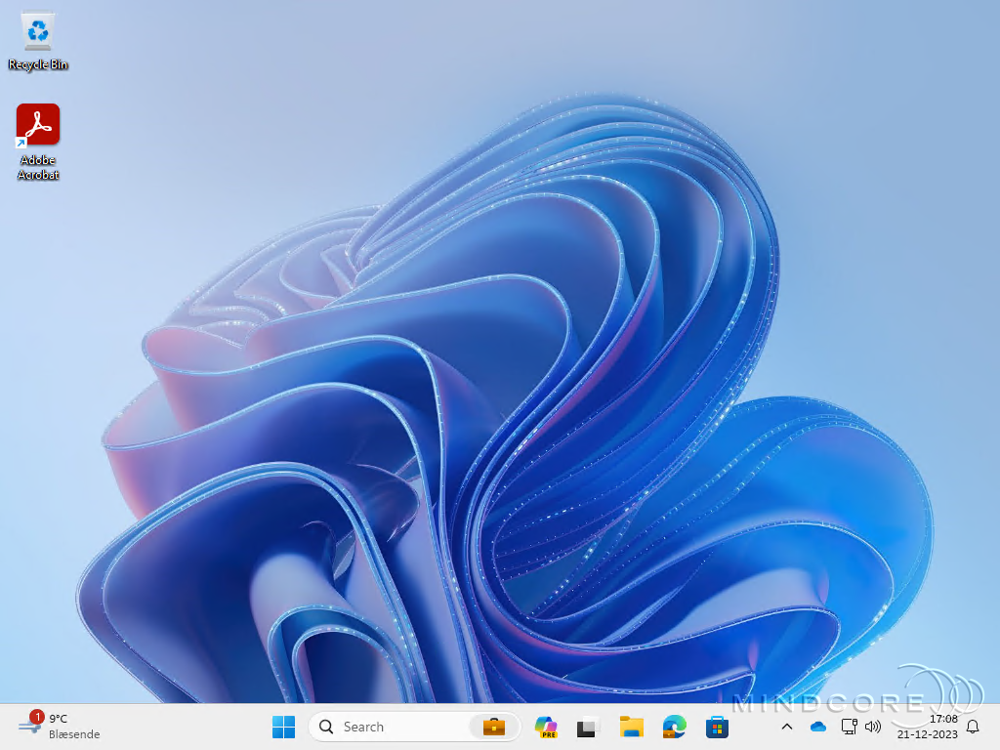<figcaption></figcaption></figure>

I’m often asked if signing in locally to the physical device is possible, and the answer is NO! However, users are not completely restricted in accessing specific resources on the physical device. – In the next section, I will show you how to restrict access to specific resources with a few additional policies from **Microsoft Intune.**

<figure>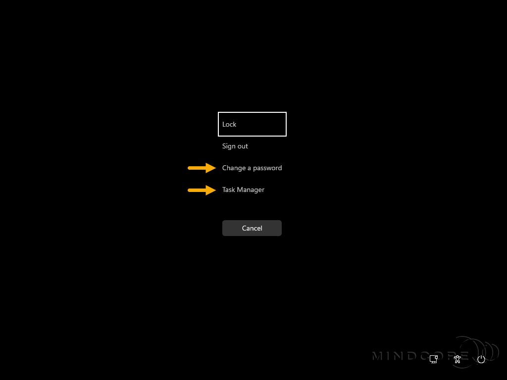<figcaption></figcaption></figure>

## Restrict User Access

The purpose of Windows 365 Boot physical devices is to let users interact directly with their Windows 365 Cloud PCs without the ability to access specific resources on the physical device. – However, IT admins must configure a few additional policies to achieve this goal.


&#x20;<mark style="color:blue;">**Note:**</mark> <mark style="color:blue;"></mark><mark style="color:blue;">Windows 365 Boot doesn’t fully restrict end users from accessing specific resources on the physical device. You should review the configuration policies you can apply to your Windows 365 Boot devices to meet your organization’s security needs for preventing access to the physical device.</mark>\
\ <mark style="color:blue;">For more information, see</mark> [<mark style="color:blue;">**Restrict user access to Windows 365 Boot physical device**</mark>](https://learn.microsoft.com/en-us/windows-365/enterprise/windows-365-boot-restrict-user-access-physical-device)<mark style="color:blue;">**.**</mark>


Let’s remove the ability to access the **Task Manager** and **Change a password**.

Go to [**https://intune.microsoft.com**](https://intune.microsoft.com/)\
Select **Devices** | **Windows** (under **By platform**) | **Configuration profiles**\
Click **+ New Policy**, choose **Windows 10 and later**, and the **Settings catalog**, and click **Create.**

<figure>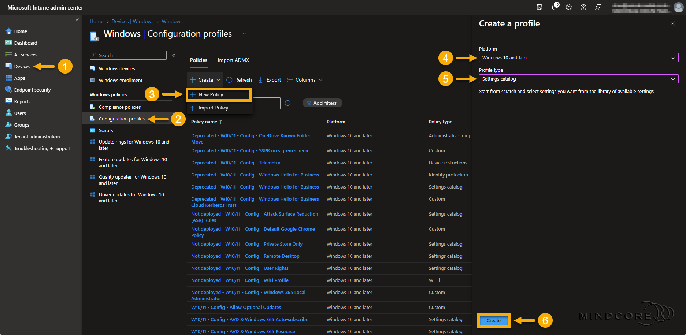<figcaption></figcaption></figure>

Fill in the required **Name** field on the **Basics** page.


&#x20;<mark style="color:blue;">**Tip:**</mark> <mark style="color:blue;"></mark><mark style="color:blue;">Although the</mark> <mark style="color:blue;"></mark><mark style="color:blue;">**Description**</mark> <mark style="color:blue;"></mark><mark style="color:blue;">field is optional, I recommend filling it out. Leaving some breadcrumbs is always a great idea, so others know precisely why someone created the configuration profile(s).</mark>


<figure>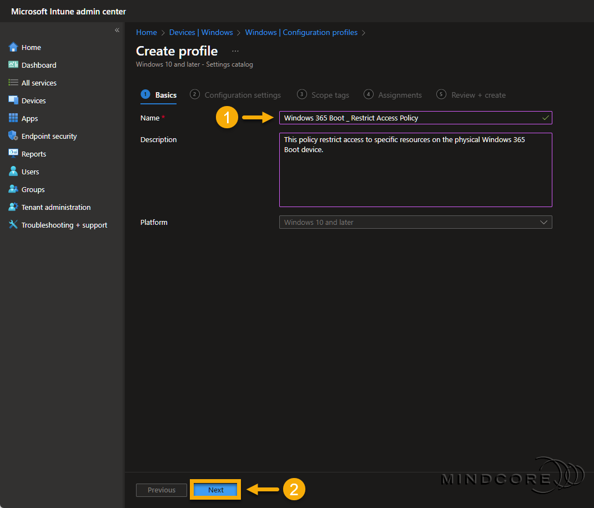<figcaption></figcaption></figure>

Click **+ Add settings** on the **Configuration settings** page. In the **Settings picker**, search for **Del Options.**

Choose **Administrative Templates\System\Ctrl+Alt+Del Options** and select the following two settings:

* Remove Change Password (User)
* Remove Task Manager (User)

Close the **Settings picker.**

<figure>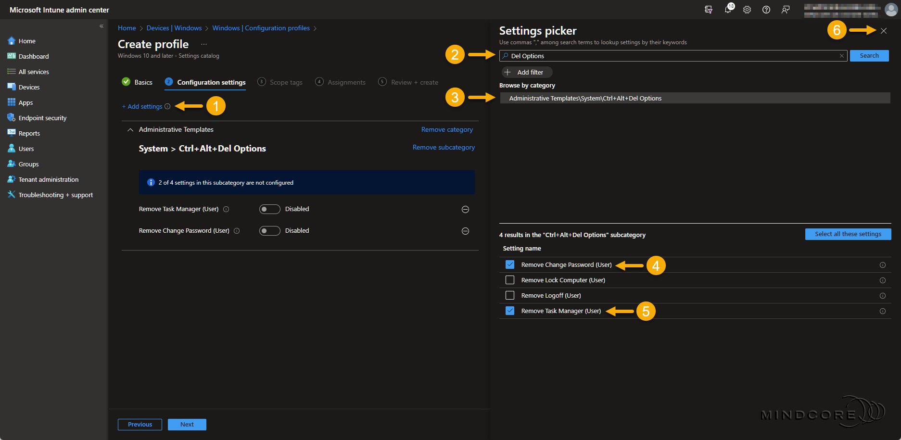<figcaption></figcaption></figure>

Enable both settings and click **Next.**

<figure>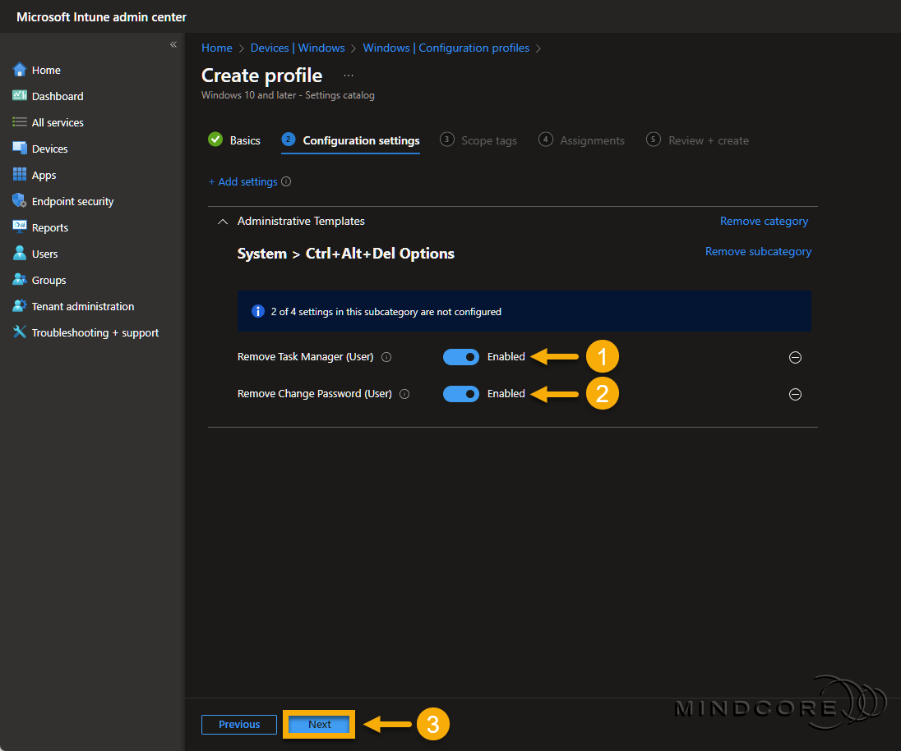<figcaption></figcaption></figure>

Select **Scope tags** if needed and click **Next.**

<figure>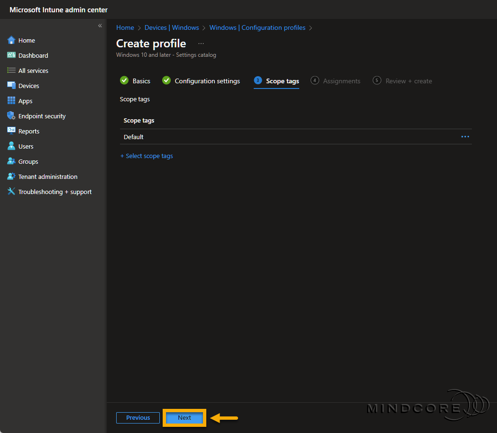<figcaption></figcaption></figure>

On the **Assignments** page, assign the Windows 365 Boot security group to this policy and click **Next.**

<figure>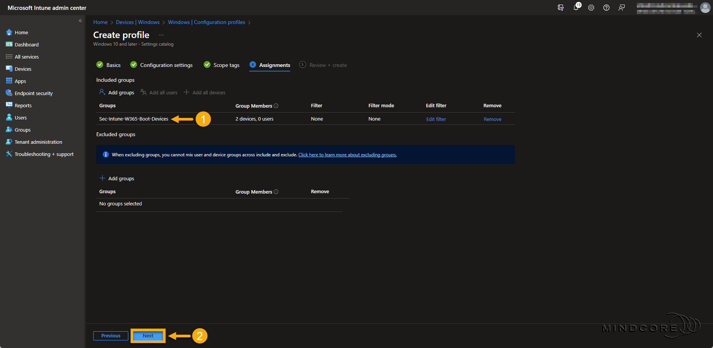<figcaption></figcaption></figure>

Review that everything is correct and click **Create.**

<figure>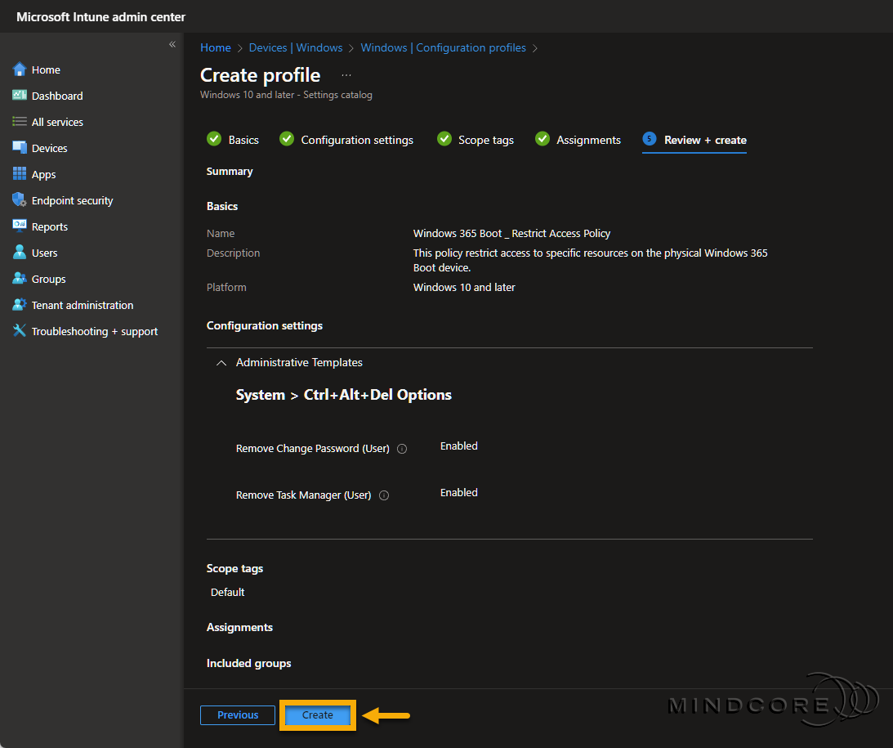<figcaption></figcaption></figure>

### Verification

End users will no longer be able to access the **Task Manager** or **Change a password** on the physical device.

<figure>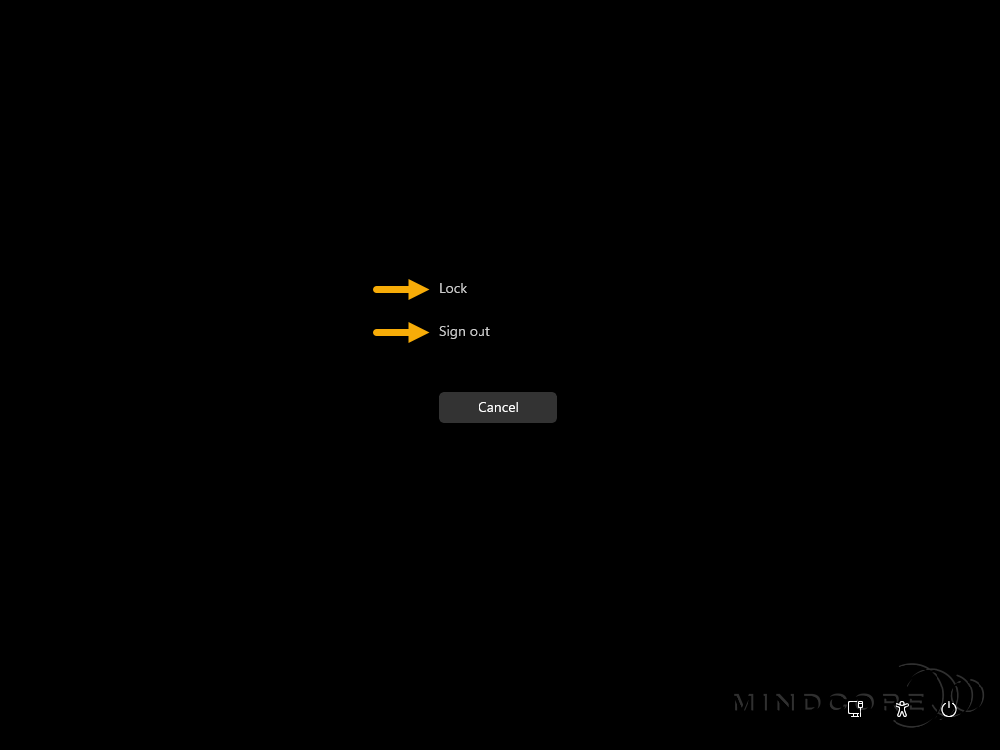<figcaption></figcaption></figure>

## Summary

In this blog post, you learned about the concept of Windows 365 Boot and why it complements Windows 365 Frontline so well. I shared my view on use cases and took you through the guided scenario in **Microsoft Intune.**

In addition, you also learned that Windows 365 Boot doesn’t fully restrict end users from accessing specific resources on the physical device and what you can do to restrict access to those resources.

That’s it, folks. Happy testing, and Merry Christmas!🎄🎅\
If you have any questions regarding this topic, please feel free to reach out to me.
