# The Concept of Windows 365 Frontline

## BEFORE YOU BEGIN


<mark style="color:orange;">**Disclaimer:**</mark> <mark style="color:orange;"></mark><mark style="color:orange;">All information and content in this blog post is provided without any warranty whatsoever. The entire risk of using this information or executing the provided content remains with you. Under no circumstances should the mentioned persons or vendors, the author, or anyone else involved in creating these blog posts be held liable for any damage or data loss.</mark>


In this blog post, I will explore the concept of Windows 365 Frontline. Windows 365 Frontline became generally available (GA) in July 2023, and it should not be confused with the Microsoft 365 F1 or F3 licenses.

<table data-card-size="large" data-view="cards"><thead><tr><th align="center"></th><th align="center"></th><th align="center"></th><th></th><th></th></tr></thead><tbody><tr><td align="center">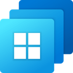</td><td align="center">

<strong>Windows 365 Enterprise</strong>
</td><td align="center">

<em>For organizations that want to manage Cloud PCs through Microsoft Intune and take advantage of integrations with other Microsoft services.</em>
</td><td>

<ul><li><strong>Dedicated, all-day Cloud PC access</strong></li><li>Personalized, full Windows experience</li><li>Predictable monthly pricing</li></ul>

</td><td><a href="https://www.microsoft.com/en-us/windows-365/enterprise"><strong>Read more ></strong></a></td></tr><tr><td align="center"></td><td align="center">

<strong>Windows 365 Frontline</strong>
</td><td align="center">

<em>For organizations of any size that employ shift and part-time workers who only need access to corporate data, apps, and resources during their shift.</em>
</td><td>

<ul><li><strong>Cloud PC access only when they need it (for example, during their shift)</strong></li><li>Personalized, full Windows experience</li><li>Predictable monthly pricing</li></ul>

</td><td><a href="https://www.microsoft.com/en-us/windows-365/frontline"><strong>Read more ></strong></a></td></tr></tbody></table>

So, buckle up and join me as I explore this “new” license model from Microsoft, where a single Windows 365 Frontline license supports up to three personal Cloud PCs. Also, let’s look at use cases and who would benefit from the Windows 365 Frontline license model.

**In this post, I’ll cover the following topics.**

* [**Prerequisites and Requirements**](the-concept-of-windows-365-frontline.md#prerequisitesrequirements)
* [**What is Windows 365 Frontline?**](the-concept-of-windows-365-frontline.md#whatiswindows365frontline)
* [**The Windows 365 Enterprise License Model**](the-concept-of-windows-365-frontline.md#enterpriselicensemodel)
* [**The Windows 365 Frontline License Model**](the-concept-of-windows-365-frontline.md#frontlinelicensemodel)
* [**The Use Cases of Windows 365 Frontline**](the-concept-of-windows-365-frontline.md#usecases)
* [**How to Configure Windows 365 Frontline Cloud PCs**](the-concept-of-windows-365-frontline.md#configurew365frontlinecpc)
* [**Monitor Concurrent Frontline Cloud PC Connections**](the-concept-of-windows-365-frontline.md#concurrentconnections)
* [**How to Time Limit the Session on Frontline Cloud PCs**](the-concept-of-windows-365-frontline.md#timelimitw365frontlinecpc)
* [**Summary**](the-concept-of-windows-365-frontline.md#summary)

### Prerequisites and Requirements 

* You must have a valid and working Microsoft Entra and Intune tenant.
* You must have Windows 365 Enterprise or Frontline licenses to manage Cloud PC configurations.
* You must use Microsoft Intune to manage your Cloud PCs.
* To configure and provision Cloud PCs, you must have the Cloud PC Administrator role in Microsoft Intune or one of the following roles in Microsoft Entra ID:
  * Global Administrator
  * Intune Administrator
  * Windows 365 Administrator

### **Licensing Requirements**

* Windows 10 Enterprise or Windows 11 Enterprise
* Microsoft Entra ID P1
* Microsoft Intune


&#x20;<mark style="color:blue;">**Windows 10/11 Enterprise, Microsoft Entra ID, and Microsoft Intune licenses are included in:**</mark>\ <mark style="color:blue;">Microsoft 365 E3, Microsoft 365 E5, Microsoft 365 F3, Microsoft 365 A3, Microsoft 365 A5, Microsoft 365 Business Premium, and Microsoft 365 Education Student Use Benefit subscriptions.</mark>


## What is Windows 365 Frontline? 

Windows 365 Frontline is a version of Windows 365 Enterprise (they share the same capabilities) designed for employees who do not require constant access to their personal Cloud PCs.

Frontline Cloud PCs can be helpful for employees who are:

* On a rotating shift schedule.
* Working across time zones and regions (for example, the follow-the-sun model).
* Part-time workers.
* Contingent staff (for example, consultants and freelancers).

Unlike other licenses, the licensing structure of Windows 365 Frontline is based on pooled licenses applied at the tenant level rather than directly to individual users. But how do we then keep track of license usage, you might ask? License usage is tracked via the **Frontline Cloud PC provisioning policy**, where the licenses are assigned, and the **Concurrent Frontline Cloud PC connections** report can also be used as an indicator for license usage (see the screenshots below).

<figure>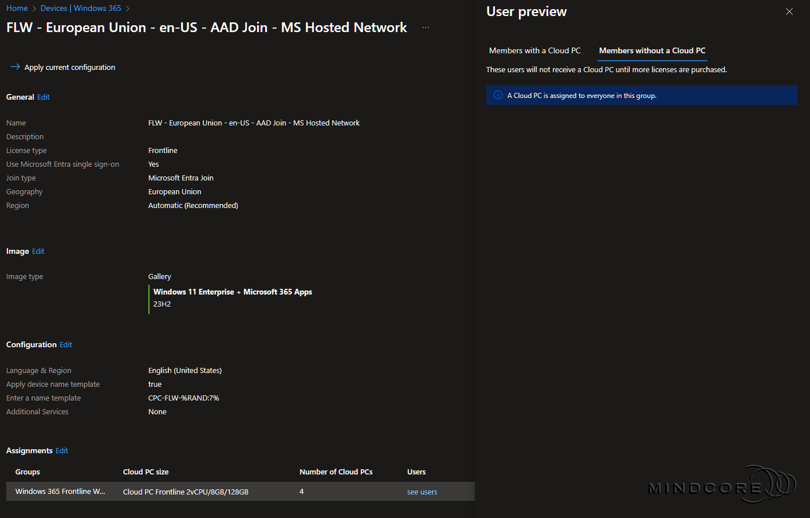<figcaption></figcaption></figure>

<figure>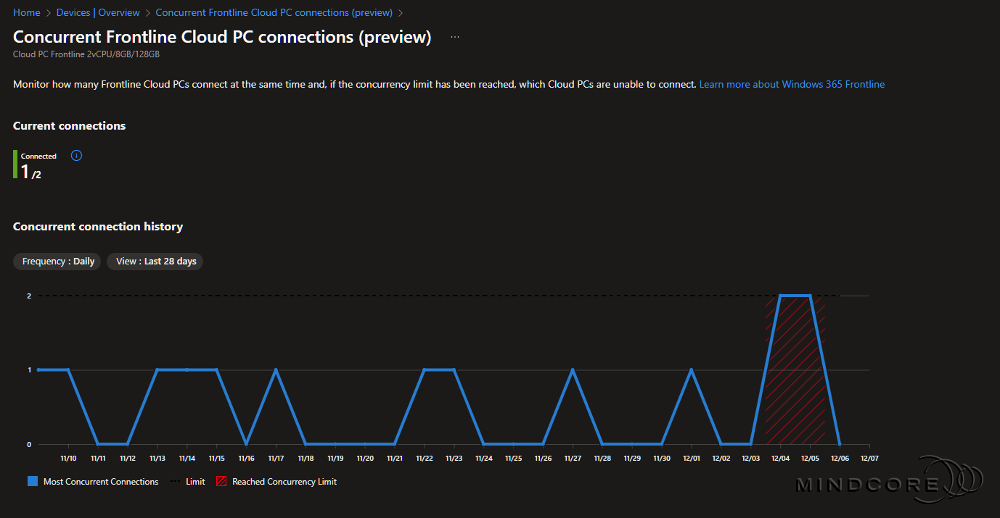<figcaption></figcaption></figure>

### **Power On and Power Off**

When employees log on, the Frontline Cloud PC is powered on, and a license is taken from the shared license pool (if any licenses are available). As they log off, their Frontline Cloud PC is powered off, and the license is returned to the shared license pool, making it available for other users to start their Frontline Cloud PC.

But what happens if an employee forgets to log off or disconnect? By default, Windows 365 Frontline detects user inactivity and automatically disconnects after two hours. Well, that’s great! But we can all agree that it’s not ideal for employees to wait two hours for a license to become available, right?

So what can you do about it? We’ll look at that later in this post, where I’ll create a policy to enforce an **idle session time limit** and configure it to disconnect after 15 minutes – although that might be a bit too aggressive!


&#x20;<mark style="color:blue;">**Note:**</mark> <mark style="color:blue;"></mark><mark style="color:blue;">IT Admins can</mark> <mark style="color:blue;"></mark><mark style="color:blue;">**Power on**</mark> <mark style="color:blue;"></mark><mark style="color:blue;">and</mark> <mark style="color:blue;"></mark><mark style="color:blue;">**Power off**</mark> <mark style="color:blue;"></mark><mark style="color:blue;">a Frontline Cloud PC via remote actions, along with the ability to view the power state of a Frontline Cloud PC in</mark> <mark style="color:blue;"></mark><mark style="color:blue;">**Microsoft Intune**</mark><mark style="color:blue;">.</mark>


<figure>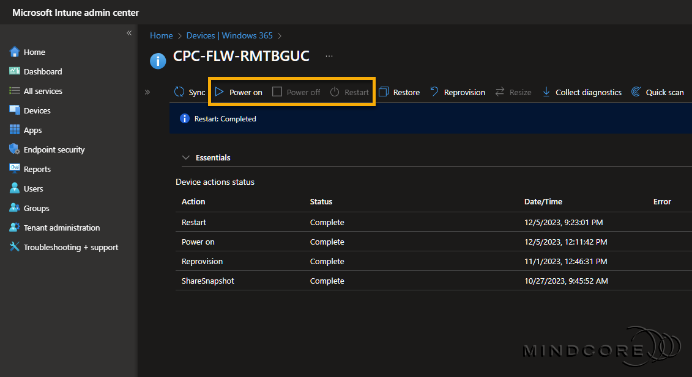<figcaption></figcaption></figure>

### **Windows Update Optimizations for Frontline Cloud PCs**

This feature works together with Windows Update for Business (WUfB) to apply OS reboots outside of work hours when the user disconnects, increasing productivity and minimizing disruption.

<figure>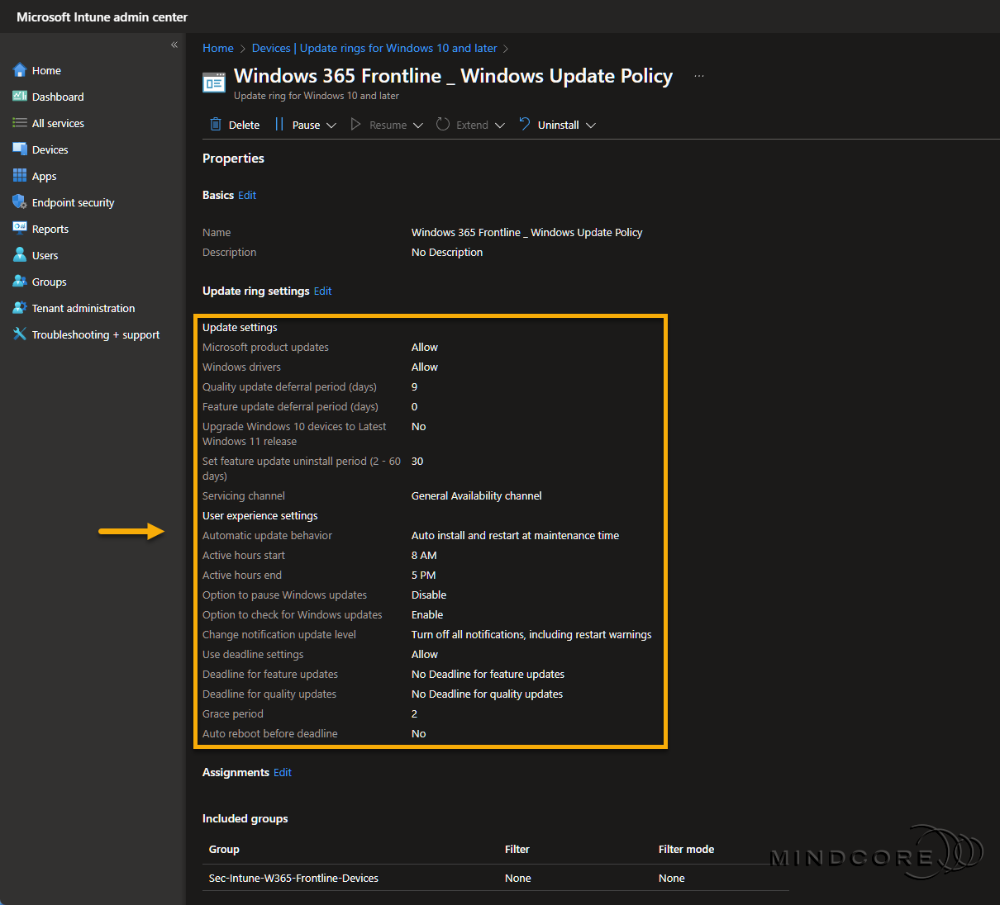<figcaption>
To learn more, see <a href="https://learn.microsoft.com/en-us/windows-365/enterprise/windows-update-frontline-cloud-pc"><strong>Configure Windows Update for Windows 365 Frontline Cloud PCs</strong></a>.
</figcaption></figure>

### **Management and Accessibility**

Management of Windows 365 Frontline Cloud PCs happens through **Microsoft Intune**, providing you centralized control over these Cloud PCs and other devices within your tenant.

<figure>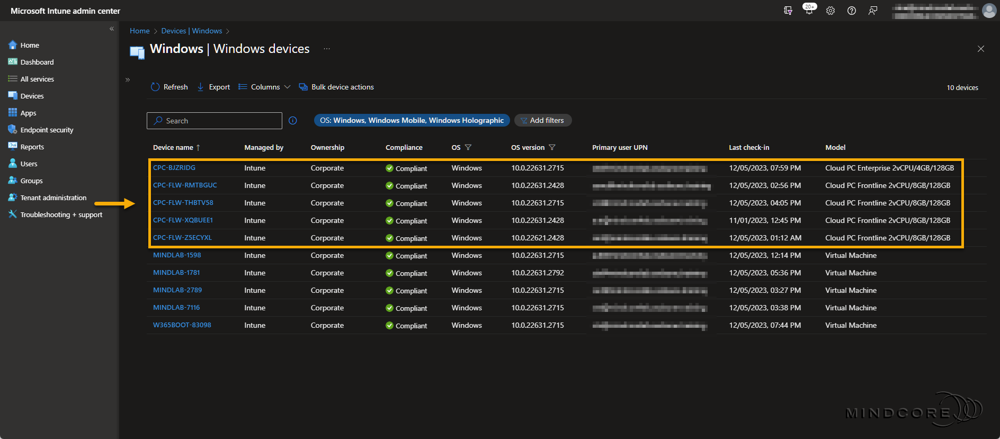<figcaption></figcaption></figure>

Users can access their Windows 365 Frontline Cloud PC directly via a physical **Windows 365 Boot device**, the **Windows 365 Web Client**, or the new **Windows App** (_formerly known as the Windows 365 App_). The Windows App is available on **Windows**, **macOS**, **iOS**, **iPadOS**, and **web browsers**.


&#x20;<mark style="color:blue;">**Note:**</mark> <mark style="color:blue;"></mark><mark style="color:blue;">Windows 365 Boot supports Windows 365 Frontline Cloud PCs after it became generally available (GA) in September 2023. Windows 365 Boot makes it easier for people to log on to their Windows 11 experience on their Frontline Cloud PC, helping</mark> <mark style="color:blue;"></mark><mark style="color:blue;">**Frontline**</mark><mark style="color:blue;">,</mark> <mark style="color:blue;"></mark><mark style="color:blue;">**Shift**</mark><mark style="color:blue;">, and</mark> <mark style="color:blue;"></mark><mark style="color:blue;">**Part-time workers**</mark> <mark style="color:blue;"></mark><mark style="color:blue;">become productive from the moment they log on.</mark>


<figure>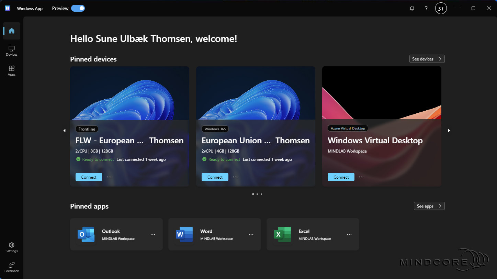<figcaption>
To learn more about Windows App, see <a href="https://learn.microsoft.com/en-us/windows-app/overview"><strong>What is Windows App?</strong></a>
</figcaption></figure>

## The Windows 365 Enterprise License Model 

The traditional Windows 365 Enterprise license model is based on every user having a Windows 365 license, which gives them their own personal PC in the cloud that’s available 24/7.

In the example below, we have three shifts with 10 employees on each shift. This gives us 30 employees in total, so 30 traditional Windows 365 licenses are needed! Let’s say that each license SKU costs approx. 75€ per user/month. That’s 2.250€ per month! – Pretty expensive, huh?

<figure>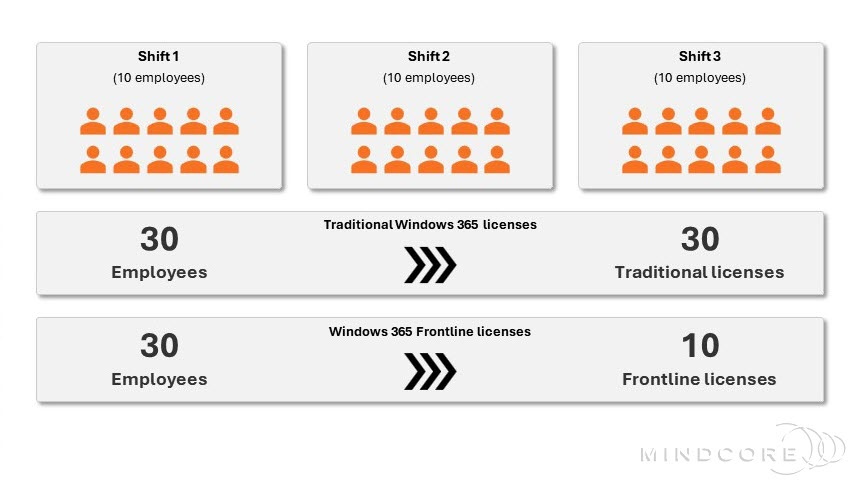<figcaption></figcaption></figure>

But organizations that operate with shift workers don’t necessarily need Cloud PCs that are available 24/7. They may only need to be available during the employee’s shift and can be offline the rest of the time.

## The Windows 365 Frontline License Model 

So, with Windows 365 Frontline, Microsoft has introduced a license model where a single Windows 365 Frontline license supports up to three personal Cloud PCs, which can be used by any employee if only one employee per license is active at any given time.

– Or told in another way, you can have ten concurrent connections with 10 x Windows 365 Frontline licenses.

Using the previous example, we can now settle for 10 x Windows 365 Frontline licenses; each equivalent license SKU costs approx. 113€ per license/month. That’s 1.130€ per month, which is much more affordable than the traditional licenses!

## The Use Cases of Windows 365 Frontline 

But who would benefit from the Windows 365 Frontline license model? Well, I could see this as an ideal solution for **hospitals** or **call centers** that operate with **shift workers** or **part-time employees**, or how about employees that need more than one Cloud PC of the same SKU size – interesting thought, huh?

<table data-view="cards" data-full-width="false"><thead><tr><th align="center"></th><th></th></tr></thead><tbody><tr><td align="center"></td><td>

Source: <a href="https://designer.microsoft.com/"><strong>Microsoft Designer</strong></a>
</td></tr><tr><td align="center"></td><td></td></tr><tr><td align="center"></td><td></td></tr></tbody></table>

## How to Configure Windows 365 Frontline Cloud PCs 

Now that you know everything about Windows 365 Frontline let me show you how to set this up in **Microsoft Intune**. We start by creating a security group for our Windows 365 Frontline users. Next, we’ll create a provisioning policy for Frontline Cloud PCs and assign the Windows 365 Frontline licenses.

Go to [**https://intune.microsoft.com**](https://intune.microsoft.com/)\
In the left pane, select **Groups.**

Create a new **Microsoft Entra ID security group** for the Windows 365 Frontline users. I have created a group and added four members. – The group can be based on direct or dynamic membership.

<figure>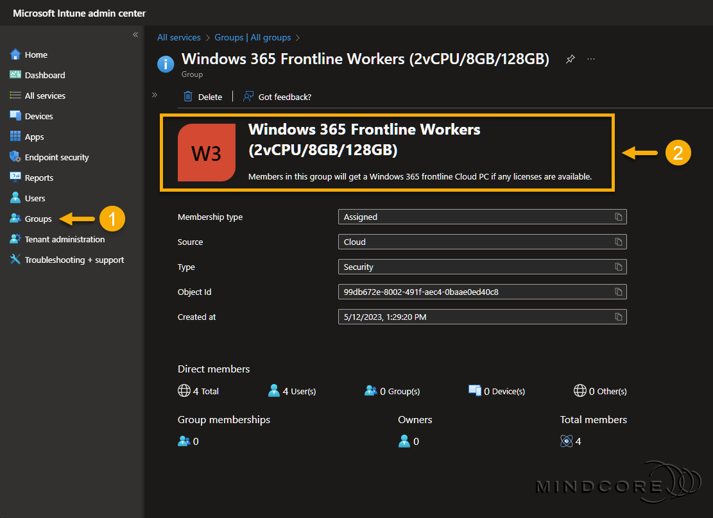<figcaption></figcaption></figure>

Next, select **Devices** | **Windows 365** (under **Provisioning**) | **Provisioning policies** to create a **provisioning policy** for Frontline Cloud PCs.

<figure>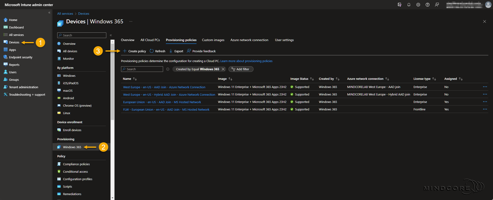<figcaption></figcaption></figure>

Fill in the required **Name** field on the **General** page and select **Frontline** as the **License type.**\
Next, choose the **European Union** under the **Microsoft Hosted Network.**\
Click **Next.**

<figure>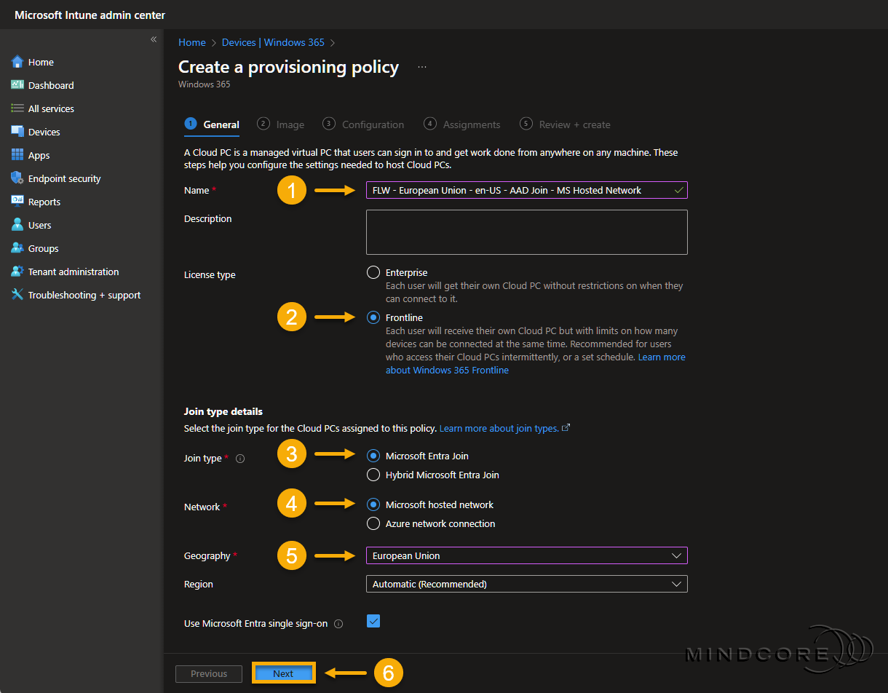<figcaption></figcaption></figure>

Keep the **Image type** as is and click **Next.**

<figure>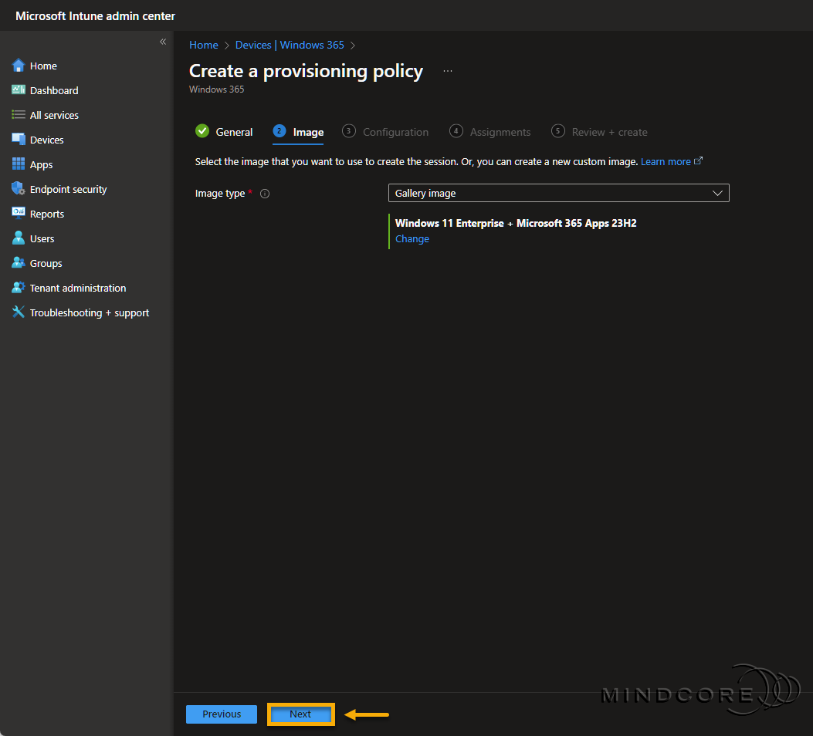<figcaption></figcaption></figure>

Define a **Cloud PC naming** convention and click **Next.** – I’ve added **FLW** to the naming for some traceability.

<figure>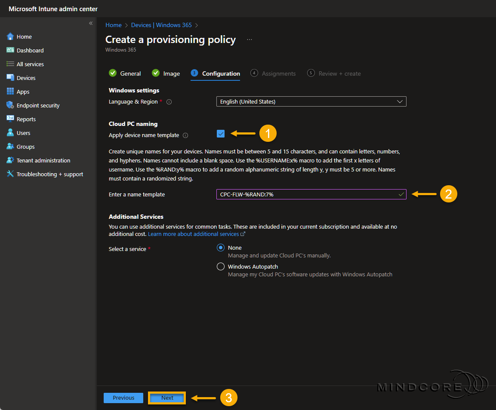<figcaption></figcaption></figure>

Next, we’ll select my newly created Windows 365 Frontline security group to be assigned to this policy.\
You then need to choose a **Cloud PC license SKU size.**\
Click **Select** and **Next.**


&#x20;<mark style="color:blue;">**Note:**</mark> <mark style="color:blue;"></mark><mark style="color:blue;">You will see a warning if there are fewer Frontline Cloud PCs for the selected SKU size than members in the security group. – If you continue, some members won’t receive a Cloud PC.</mark>


<figure>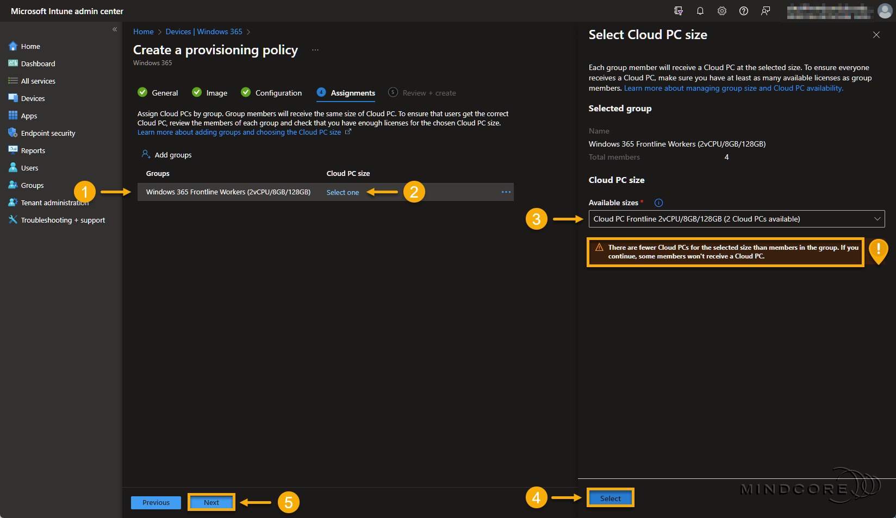<figcaption></figcaption></figure>

Review that everything is correct and click **Create.**

<figure>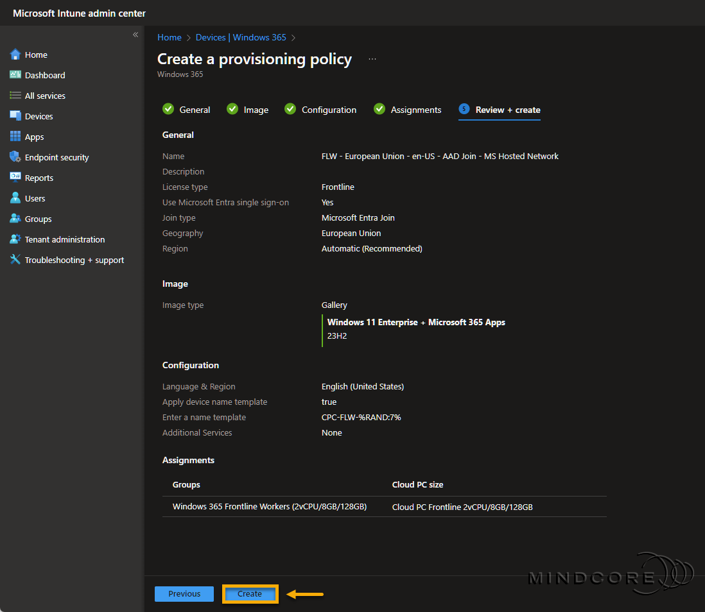<figcaption></figcaption></figure>

If you added more users than available Frontline Cloud PC licenses, the members who won’t receive a Cloud PC will be listed under **User preview** in the **provisioning policy**.

<figure>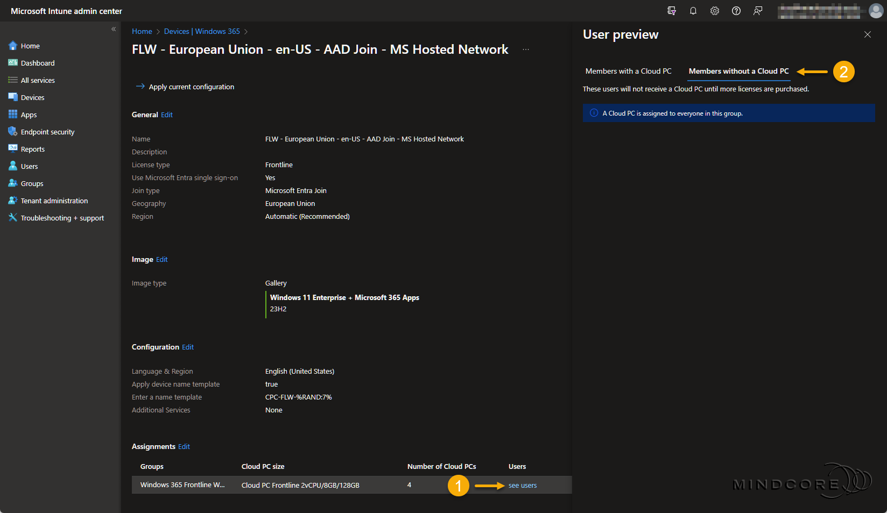<figcaption></figcaption></figure>

## Monitor Concurrent Frontline Cloud PC Connections 

Now, let me show you where to monitor the concurrent Frontline Cloud PC connections in **Microsoft Intune.**

Reviewing the **maximum concurrent Frontline Cloud PC connections** lets you decide if you need to purchase more licenses to ensure your end users aren’t blocked from using their Windows 365 Frontline Cloud PCs.


&#x20;<mark style="color:blue;">**Note:**</mark> <mark style="color:blue;"></mark><mark style="color:blue;">This report is specific to Windows 365 Frontline and doesn’t apply to other Windows 365 plans. The report will show no results if no Frontline licenses have been purchased on your tenant.</mark>\
\ <mark style="color:blue;">To learn more, see</mark> [<mark style="color:blue;">**Connected Frontline Cloud PCs report (preview)**</mark>](https://learn.microsoft.com/en-us/windows-365/enterprise/report-connected-frontline-cloud-pcs)


Go to [**https://intune.microsoft.com**](https://intune.microsoft.com/)\
Select **Devices** | **Cloud PC performance (preview)**\
Click **View report** under **Connected Frontline Cloud PCs (preview).**

<figure>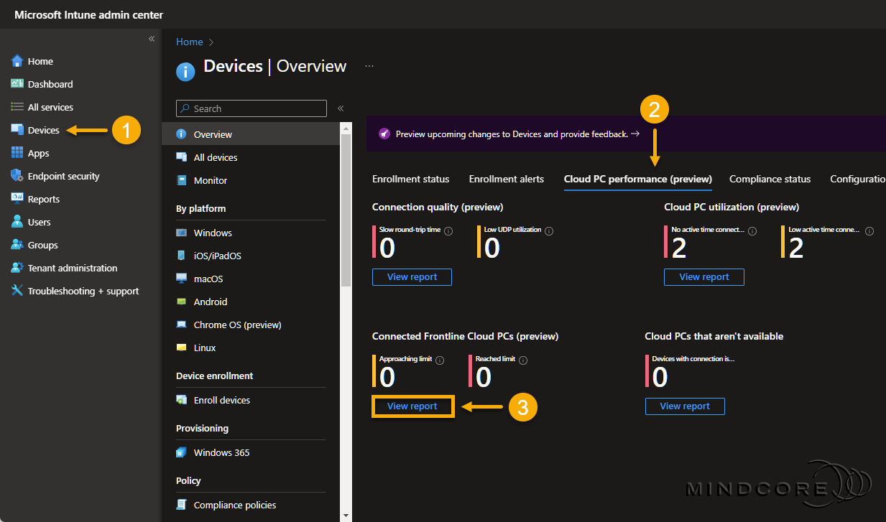<figcaption></figcaption></figure>

IT admins can monitor the **concurrent Frontline Cloud PC connections** from this report.

<figure>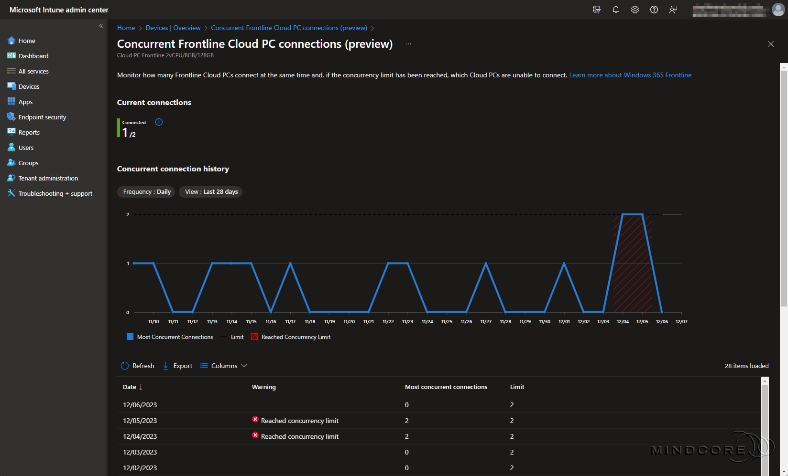<figcaption></figcaption></figure>

## How to Time Limit the Session on Frontline Cloud PCs 

As mentioned earlier in this post, Windows 365 Frontline detects user inactivity and automatically disconnects the session after two hours by default. Now, let me show you how we can prevent users from blocking a license for two hours for another user by creating a policy to enforce **idle session time limits.**

Go to [**https://intune.microsoft.com**](https://intune.microsoft.com/)\
Select **Devices** | **Windows** (under **By platform**) | **Configuration profiles**\
Click **+ New Policy**, choose **Windows 10 and later**, and the **Settings catalog**, and click **Create.**

<figure>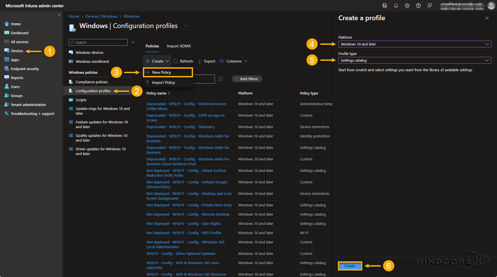<figcaption></figcaption></figure>

Fill in the required **Name** field on the **Basics** page.


&#x20;<mark style="color:blue;">**Tip:**</mark> <mark style="color:blue;"></mark><mark style="color:blue;">Although the</mark> <mark style="color:blue;"></mark><mark style="color:blue;">**Description**</mark> <mark style="color:blue;"></mark><mark style="color:blue;">field is optional, I recommend filling it out. Leaving some breadcrumbs is always a great idea so others know precisely why someone created the configuration profile.</mark>


<figure>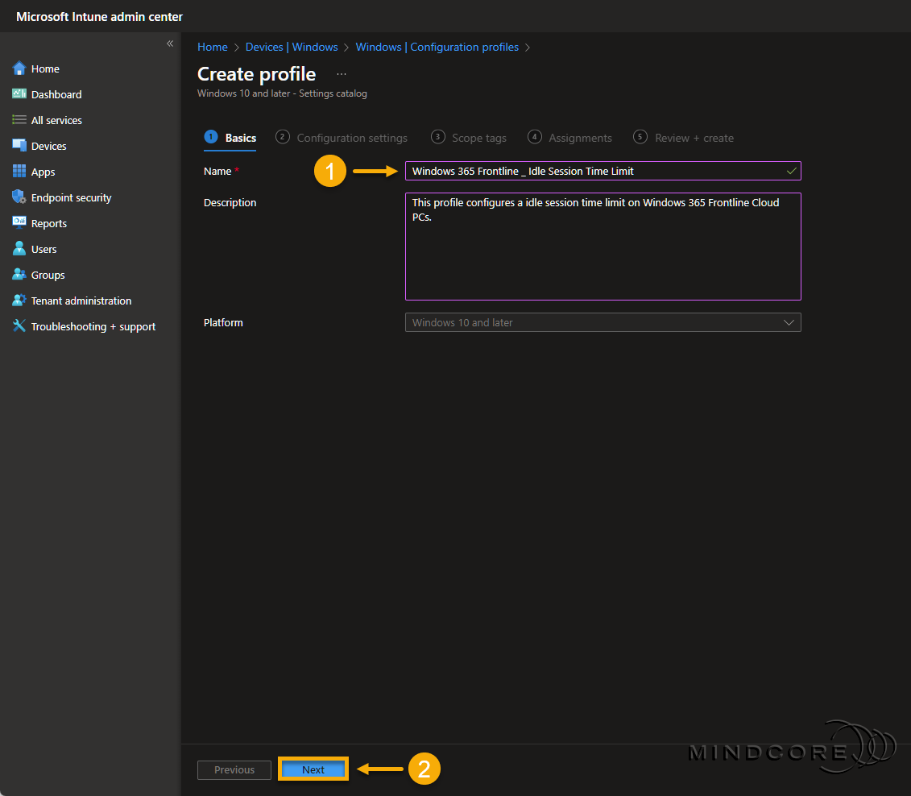<figcaption></figcaption></figure>

Click **+ Add settings** on the **Configuration settings** page. In the **Settings picker**, search for **Session Time Limit.**

Choose **Windows Components\Remote Desktop Services\Remote Desktop Session Host\Session Time Limits** and select the following two settings:

* End session when time limits are reached
* Set time limit for active but idle Remote Desktop Services sessions

Close the **Settings picker.**

<figure>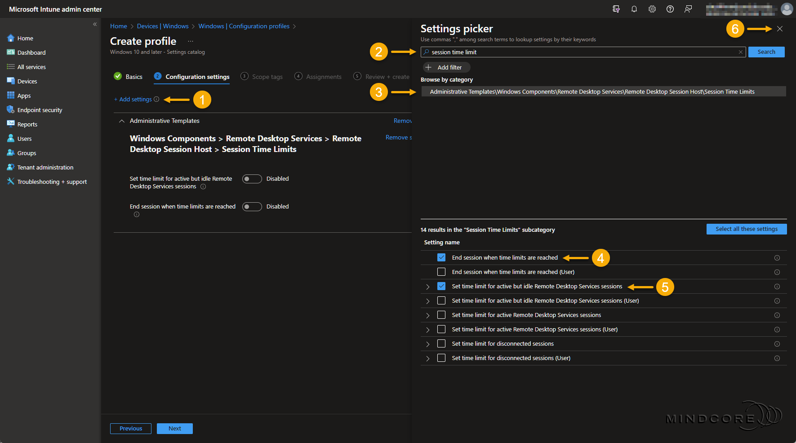<figcaption></figcaption></figure>

Enable both settings and set the **Idle session limit: (Device)** to a value of your choice.\
Click **Next.**

<figure>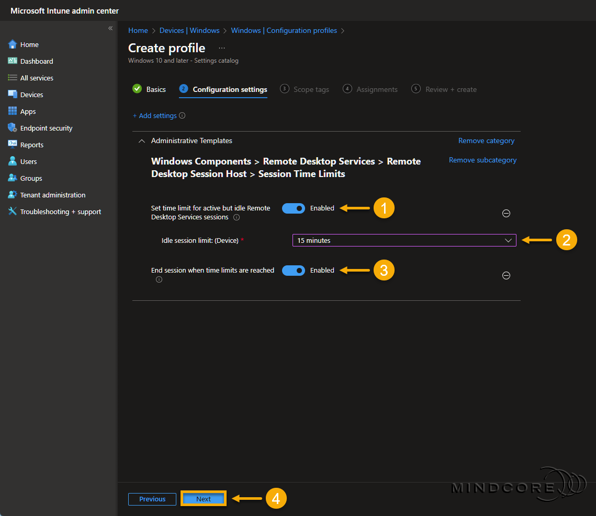<figcaption></figcaption></figure>

Select **Scope tags** if needed and click **Next.**

<figure>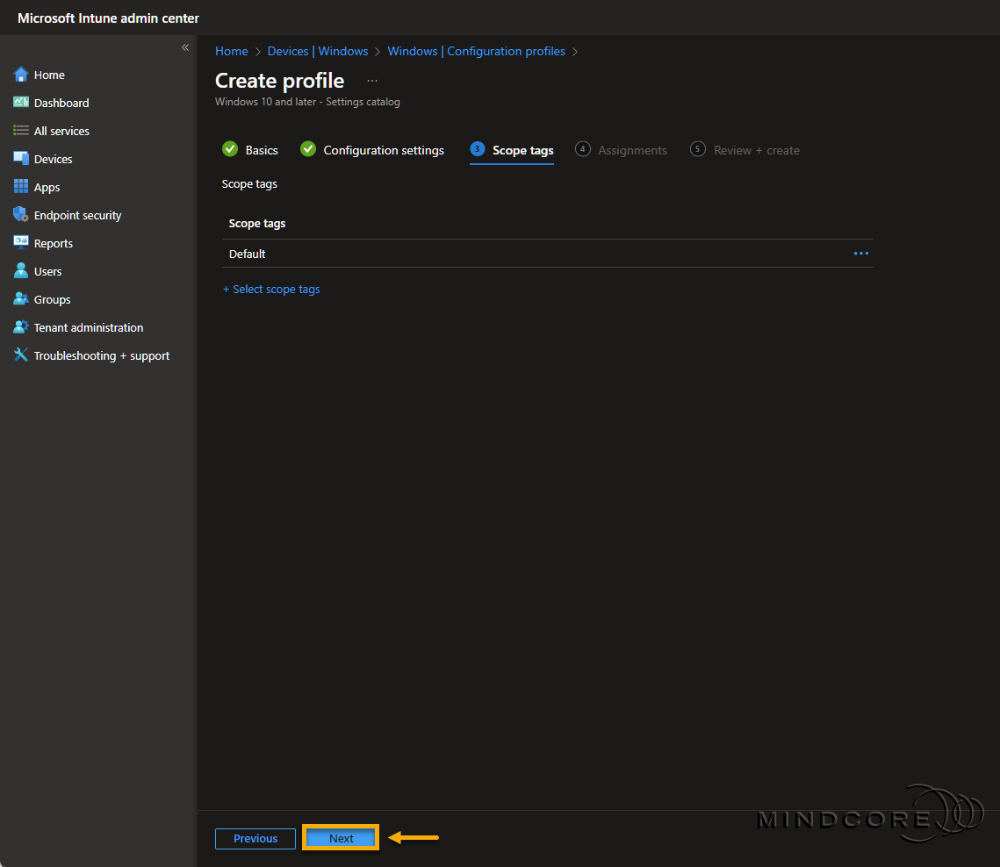<figcaption></figcaption></figure>

On the **Assignments** page, add a security group containing Frontline Cloud PCs to be assigned to this policy.\
Click **Next.**

<figure>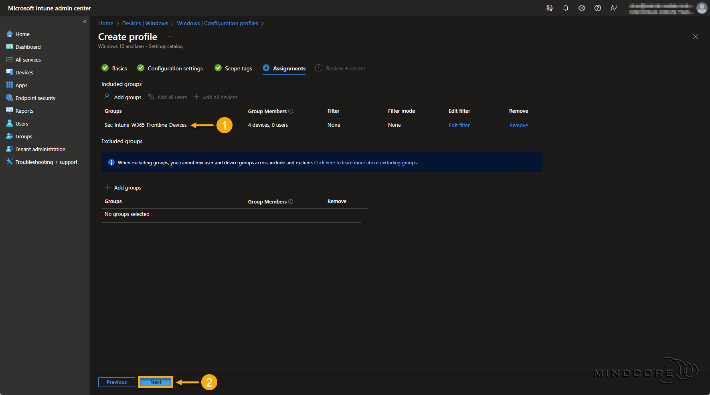<figcaption></figcaption></figure>

Review that everything is correct and click **Create.**

<figure>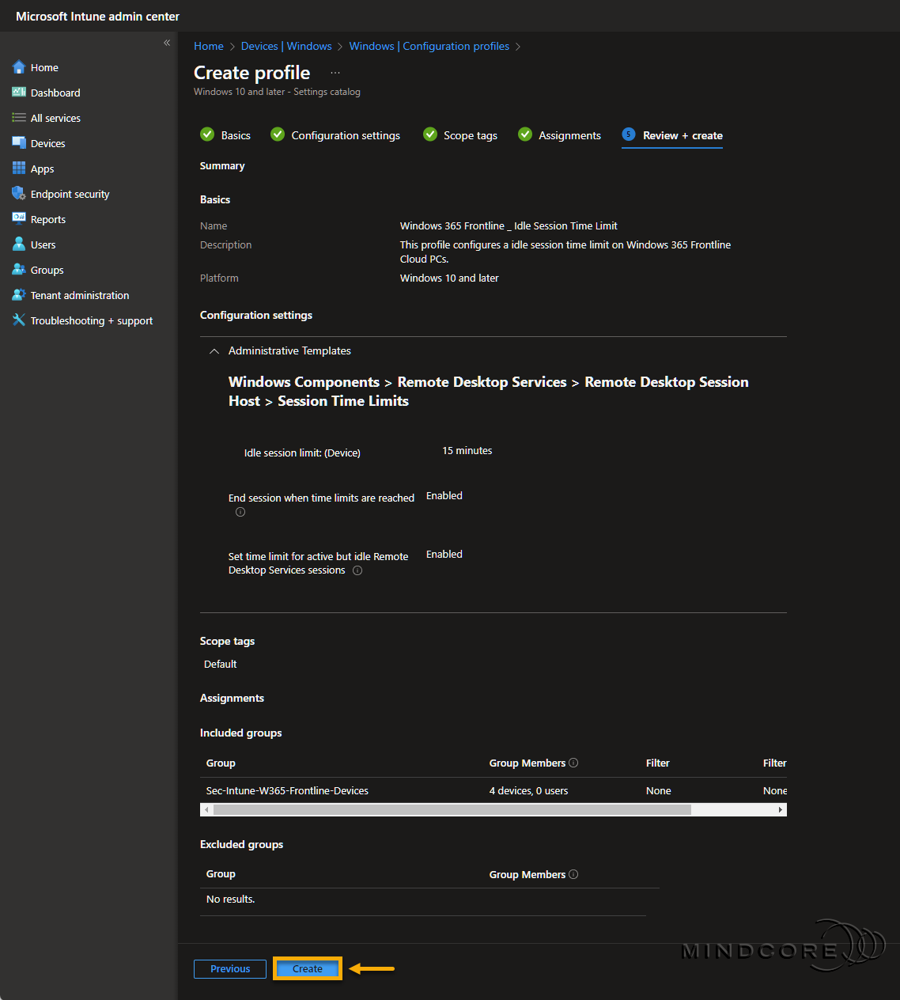<figcaption></figcaption></figure>

### **Verification**

End users will encounter these dialog boxes when a Windows 365 Frontline session is ended due to inactivity.

<figure>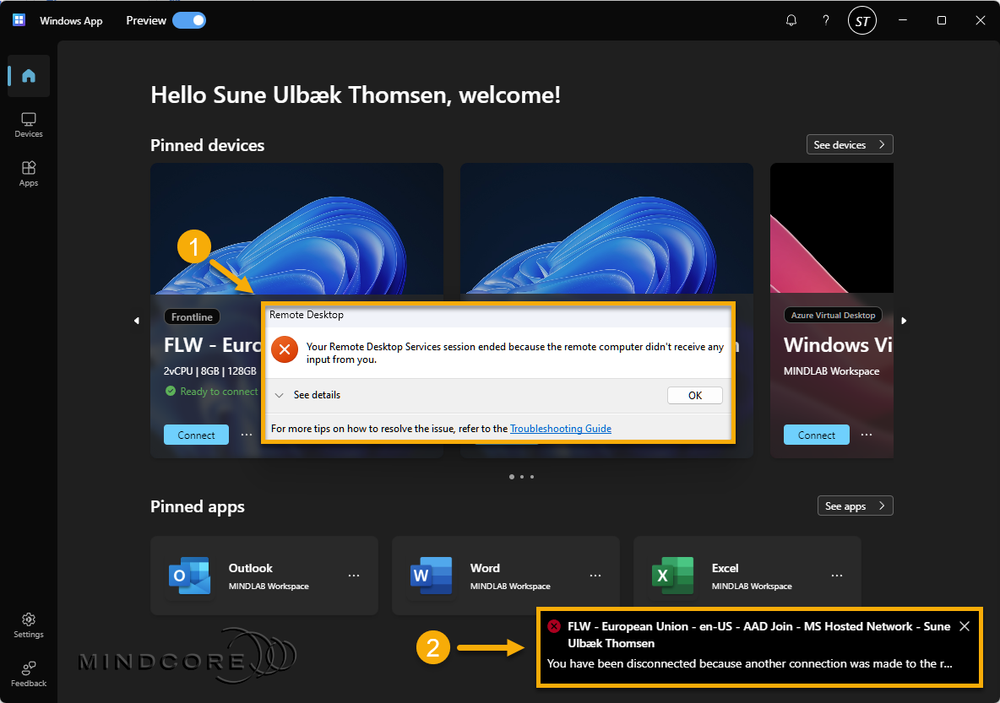<figcaption></figcaption></figure>

## Summary 

In this blog post, you learned about the concept of Windows 365 Frontline and how it differs from the Enterprise edition. I shared my view on use cases, knowledge about how to set up a provisioning policy for Frontline Cloud PCs, and a few ways to track license usage.

In addition, I also showed you how to prevent users from blocking a license for two hours for another user by enforcing an **idle session time limit** policy.

That’s it, folks. Happy testing, and have fun exploring 🤓\
If you have any questions regarding this topic, please feel free to reach out to me.
