# Windows 365 Boot: Why User-Driven Mode?

## BEFORE YOU BEGIN


**Disclaimer:** All information and content in this blog post is provided without any warranty whatsoever. The entire risk of using this information or executing the provided content remains with you. Under no circumstances should the mentioned persons or vendors, the author, or anyone else involved in creating these blog posts be held liable for any damage or data loss.


Ever since writing about [**The Concept of Windows 365 Boot**](the-concept-of-windows-365-boot.md), I’ve been puzzled by Microsoft’s choice to use User-Driven mode in the Windows Autopilot deployment profile when configuring Shared PC mode through the Windows 365 Boot guided scenari&#x6F;**.** To me, it seems illogical to use User-Driven mode in a Shared PC scenario, which is basically a kiosk mode. So, if we assume that the Shared PC Scenario is the most common use case for Windows 365 Boot, their configuration choice simply doesn’t make sense 🤔

<figure>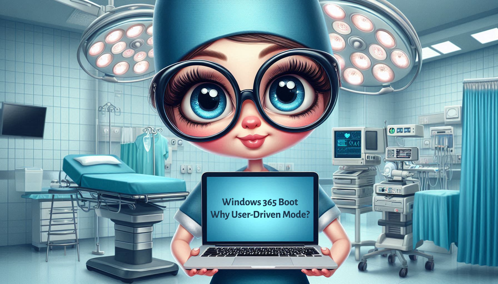<figcaption></figcaption></figure>

You might wonder why that doesn’t make sense! – Let me elaborate: In User-Driven mode, the user who enrolls the device will become the primary user of that device, requiring their credentials during provisioning. But do we want a primary user associated with the device in a Shared PC scenario? In my opinion, no! – In a Shared PC scenario, I prefer Self-Deploying mode because it requires no user interaction and doesn’t automatically assign a primary user during the Windows Autopilot provisioning.

– So, join me as I try to demystify Microsoft’s rationale for using User-Driven mode. We’ll explore what happens and what to be aware of if switching to Self-Deploying mode for the Windows 365 Boot Share PC scenario.

**In this post, I’ll cover the following topics.**

* [**Shared vs. Dedicated PC scenarios**](windows-365-boot-why-user-driven-mode.md#scenarios)
* [**Configuring Self-Deploying Mode**](windows-365-boot-why-user-driven-mode.md#configselfdeploymode)
* [**Test and Verification**](windows-365-boot-why-user-driven-mode.md#testandverification)
* [**Why?**](windows-365-boot-why-user-driven-mode.md#why)
* [**Summary**](windows-365-boot-why-user-driven-mode.md#summary)

## Shared vs. Dedicated PC scenarios 

Before we delve into configuring Self-Deploying mode, let’s explore the different kinds of Boot to Cloud modes:

* **Boot to Cloud Shared PC Mode (Shared PC scenarios)**\
  The Shared PC scenario enables multiple users to sign in to their personal Cloud PCs via the same physical device. Moreover, this scenario is ideal for workers like **nurses**, **salespeople**, and **call center staff**. In particular, these workers often share company devices and frequently switch between tasks and computer interactions.
* **Boot to Cloud Dedicated Mode (Dedicated PC scenarios)**\
  In this scenario, a specific user is assigned to the physical device. This allows them to sign in on the device using **Windows Hello for Business (e.g., PIN, biometrics)** to connect to their secure Cloud PCs. The Dedicated mode also preserves user personalization, including their profile picture and username on the physical device. Additionally, it also enables fast account switching.

For more information, see [**What is Windows 365 Boot?**](https://learn.microsoft.com/en-us/windows-365/enterprise/windows-365-boot-overview)

## Configuring Self-Deploying Mode 

First, let’s examine the Windows Autopilot deployment profile properties set during the Windows 365 Boot-guided scenario. The screenshot below shows that the **Deployment mode** is set to **User-Driven.**

<figure>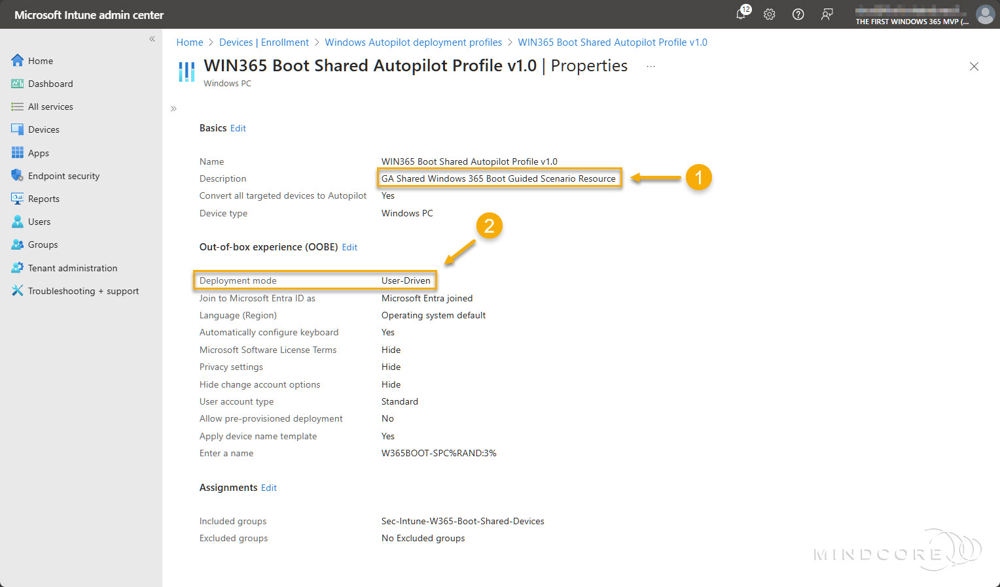<figcaption></figcaption></figure>

Next, let’s find out if everything will blow up in our faces 💥 if we replace it with a new Windows Autopilot deployment profile based on Self-Deploying mode.

<figure><figcaption></figcaption></figure>

Log in to [**https://intune.microsoft.com**](https://intune.microsoft.com/)\
Go to **Devices** | **Enrollment** (under **Device onboarding**) | **Deployment profiles** (under **Windows Autopilot**).

<figure>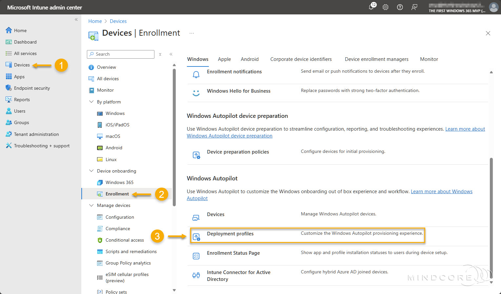<figcaption></figcaption></figure>

Select **+ Create profile**, and choose **Windows PC.**

<figure>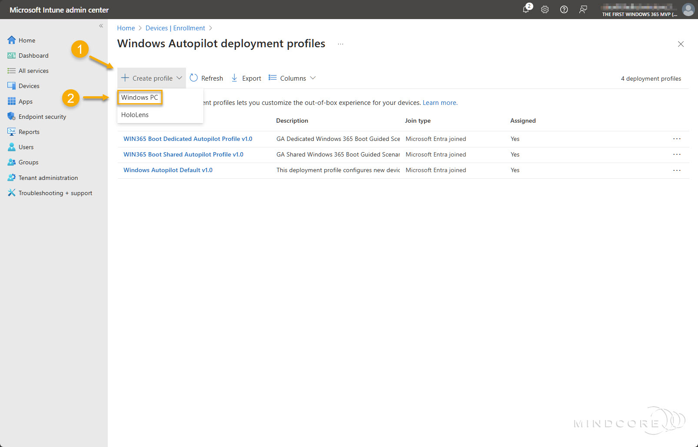<figcaption></figcaption></figure>

On the **Basics** tab, fill in the required **Name** field and set **Convert all targeted devices to Autopilot** to **Yes.**\
Click **Next.**


Tip

Although the **Description** field is optional, I recommend filling it out. Leaving some breadcrumbs helps others understand the purpose of the deployment profile(s).


<figure>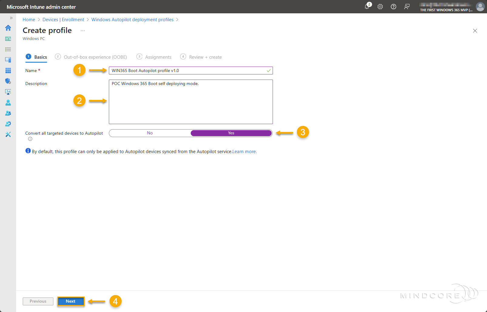<figcaption></figcaption></figure>

Set the **Deployment mode** to **Self-Deploying** on the **Out-of-box experience (OOBE)** tab.\
Define a device naming convention and click **Next.**

<figure>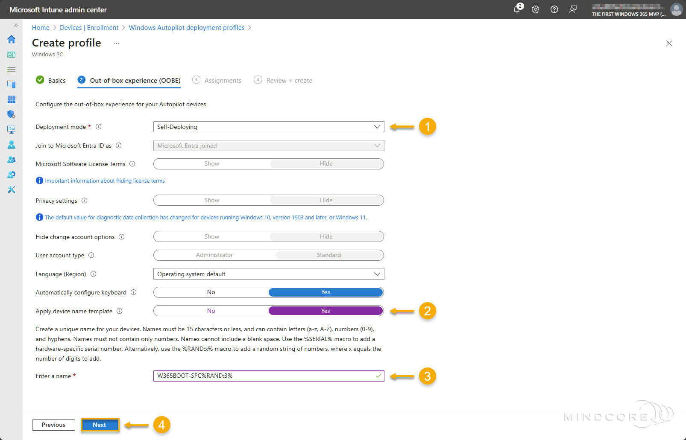<figcaption></figcaption></figure>

On the **Assignments** tab, assign the deployment profile to a security group containing the devices it applies to.\
Click **Next.**

<figure>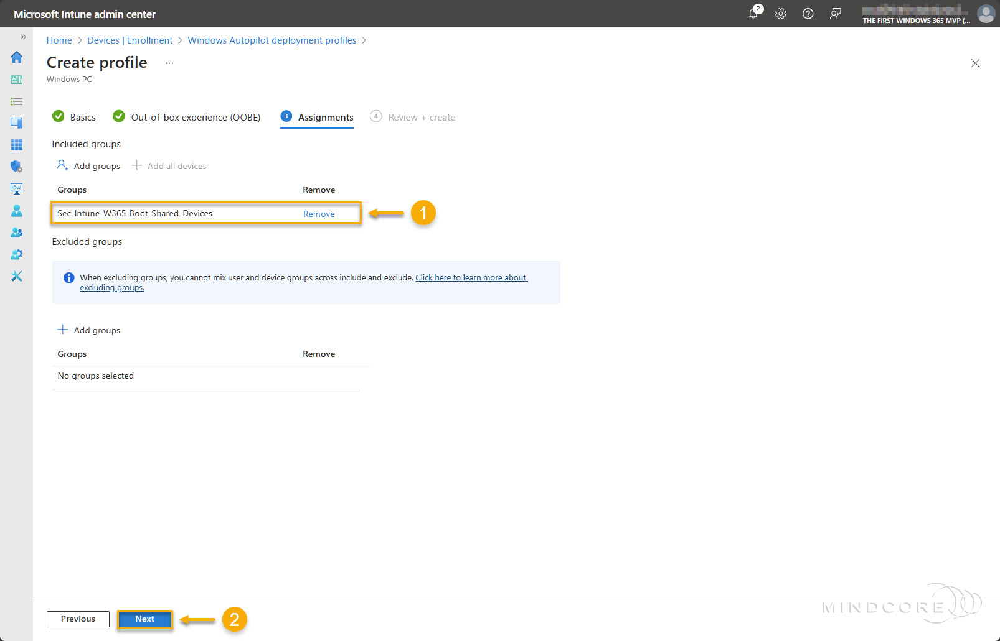<figcaption></figcaption></figure>

Review that everything is correct and click **Create.**

<figure>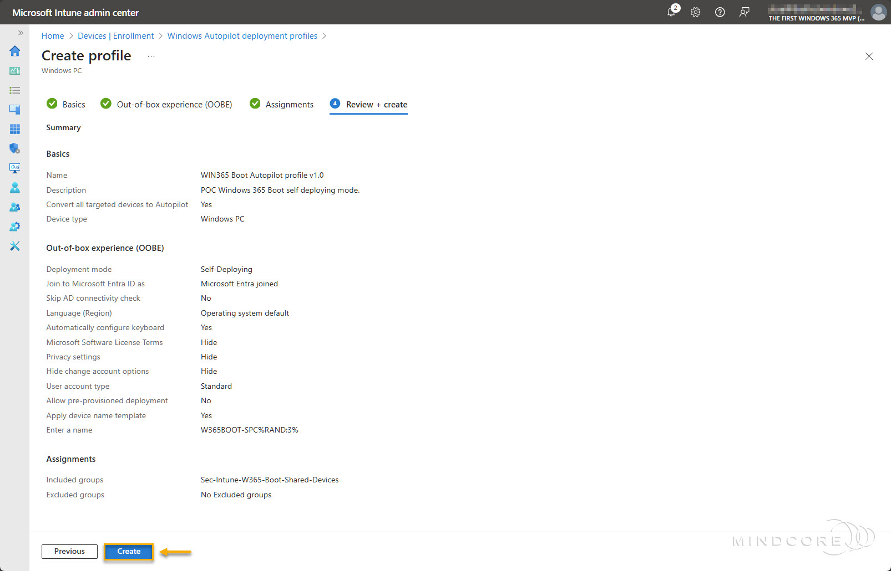<figcaption></figcaption></figure>

## Test and Verification 


**Important**\
\
You must remove the old assignment before testing the new self-deploying deployment profile.


Log in to [**https://intune.microsoft.com**](https://intune.microsoft.com/)\
Go to **Devices** | **Enrollment** (under **Device onboarding**) | **Deployment profiles** (under **Windows Autopilot**).\
Select the deployment profile created during the Windows 365 Boot-guided scenario.

<figure>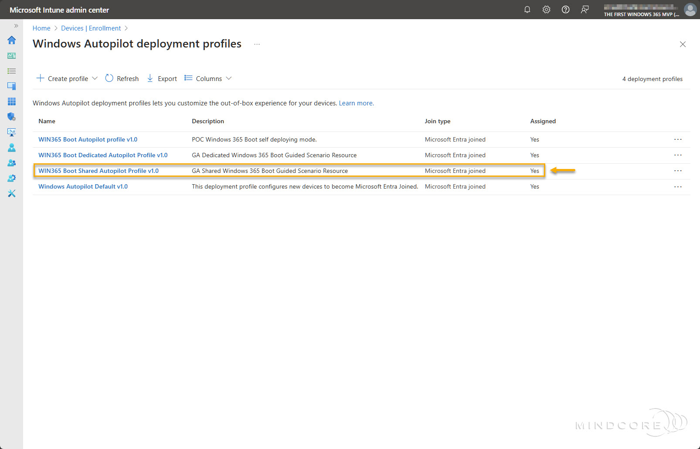<figcaption></figcaption></figure>

Go to **Properties** and click **Edit** next to **Assignments.**

<figure>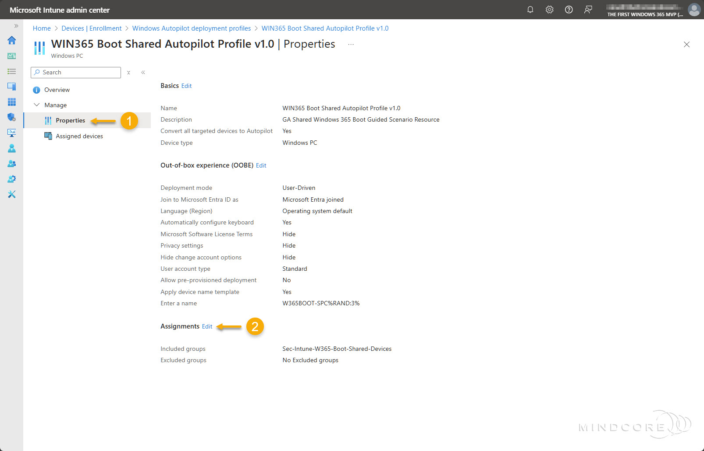<figcaption></figcaption></figure>

Click **Remove.**\
Click **Review + Save.**

<figure>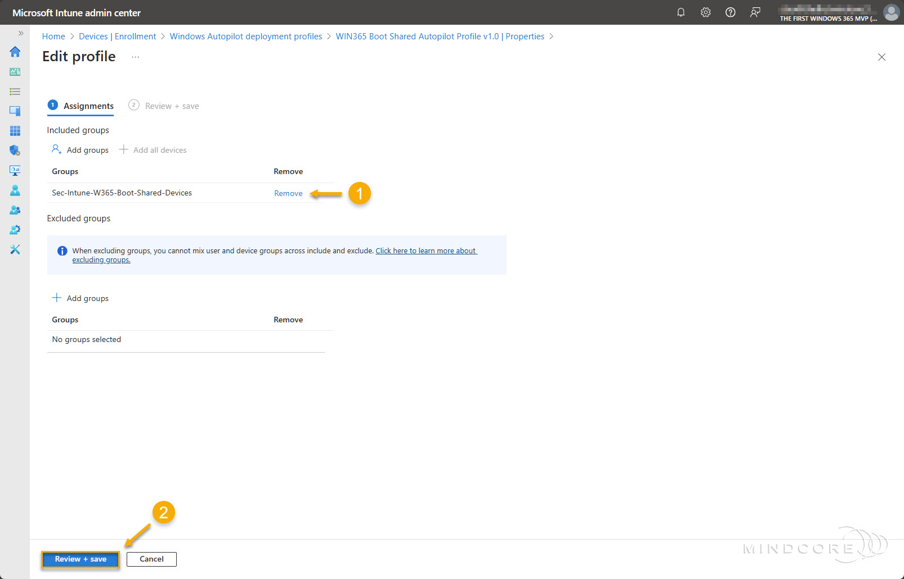<figcaption></figcaption></figure>

It’s time to reset our Windows 365 Boot device, which currently has a primary user associated with it.\
\
Go to **Devices** | **Windows** (under **By platform**).\
Select the Windows 365 Boot device from the device overview and select **Wipe.**


**Note**\
\
Don’t select any of the boxes in the wipe confirmation box. The next time the device connects to the internet, it will be wiped. This process can take several minutes.\
\
Source: [**Windows 365 Boot physical device setup and requirements**](https://learn.microsoft.com/en-us/windows-365/enterprise/windows-365-boot-physical-device-requirements)


Click **Wipe.**


**Important**\
\
If a self-deploying mode deployment is attempted on a device that doesn’t have support for TPM 2.0 or on a Virtual Machine, the process fails when verifying the device with an **0x800705B4** timeout error. This limitation includes Hyper-V virtual TPMs.\
\
Source: [**Windows Autopilot self-deploying mode**](https://learn.microsoft.com/en-us/autopilot/self-deploying#requirements)


<figure>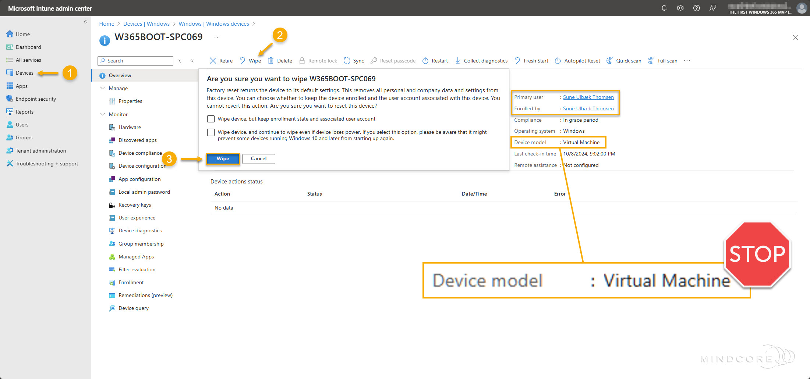<figcaption></figcaption></figure>

Here’s what happens if you use Hyper-V Virtual Machines (with virtual TPM) for Self-Deploying deployment. The first step in the Enrollment Status Page (ESP) progress will fail with **Error 800705b4.**\
\
For more details, see [**Securing your hardware (Failed: 0x800705b4)**](https://learn.microsoft.com/en-us/troubleshoot/mem/intune/device-enrollment/troubleshoot-windows-enrollment-errors#securing-your-hardware-failed-0x800705b4)

<figure>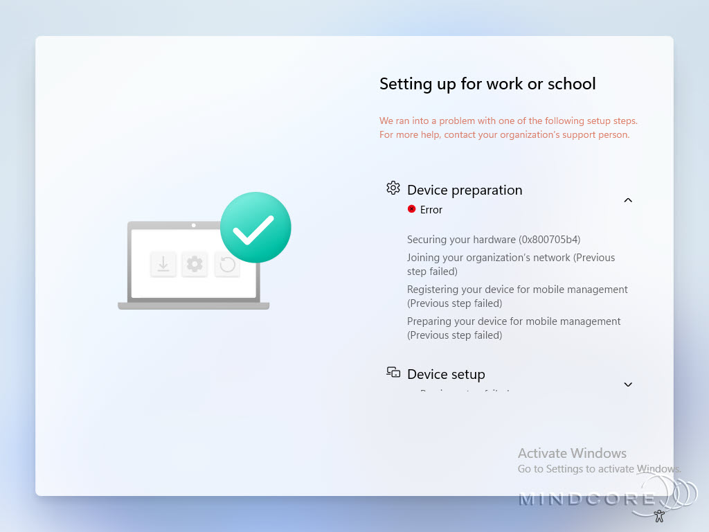<figcaption></figcaption></figure>

### **End-User Experience**

Unfortunately, I don’t have a spare physical device that meets Windows Autopilot Self-Deploying requirements. However, with a bit of workaround magic, I can still demonstrate the end-user experience using a Hyper-V Virtual Machine.


**STOP**\
\
Under no circumstances can I recommend using a Virtual Machine for Windows Autopilot Self-Deploying mode. I only used it to prove my point and showcase the end-user experience.\
\
– I strongly advise following Microsoft’s recommendations!


Nevertheless, this is what the Windows Autopilot Self-Deploying provisioning looks like. The “_**Welcome! Let’s get you set up for work.**_” page is only seen during Windows Autopilot Self-Deploying scenarios.

As previously mentioned, Windows Autopilot Self-Deploying mode requires no user interaction, enabling zero-touch deployment. Furthermore, it does not automatically assign a primary user to the device. – Perfect 🤩

<figure>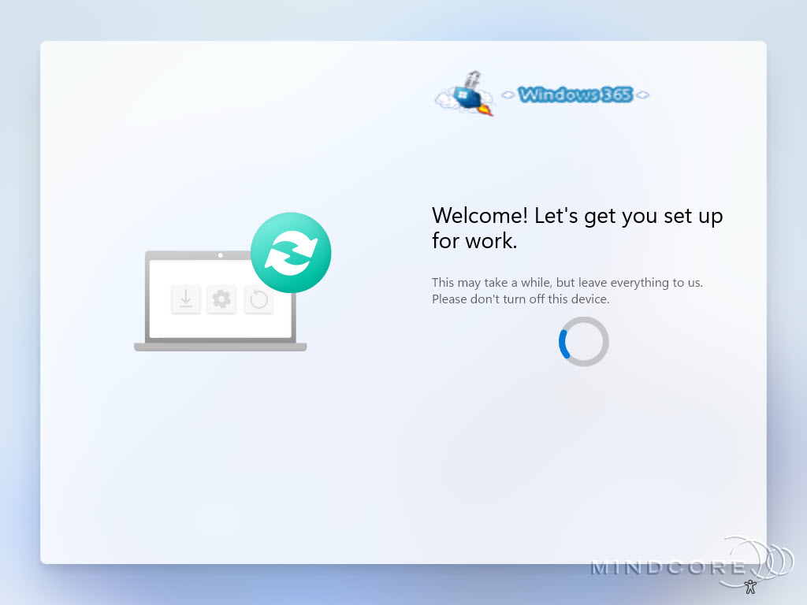<figcaption></figcaption></figure>

The Enrollment Status Page (ESP) looks the same across all Windows Autopilot deployment modes.

<figure>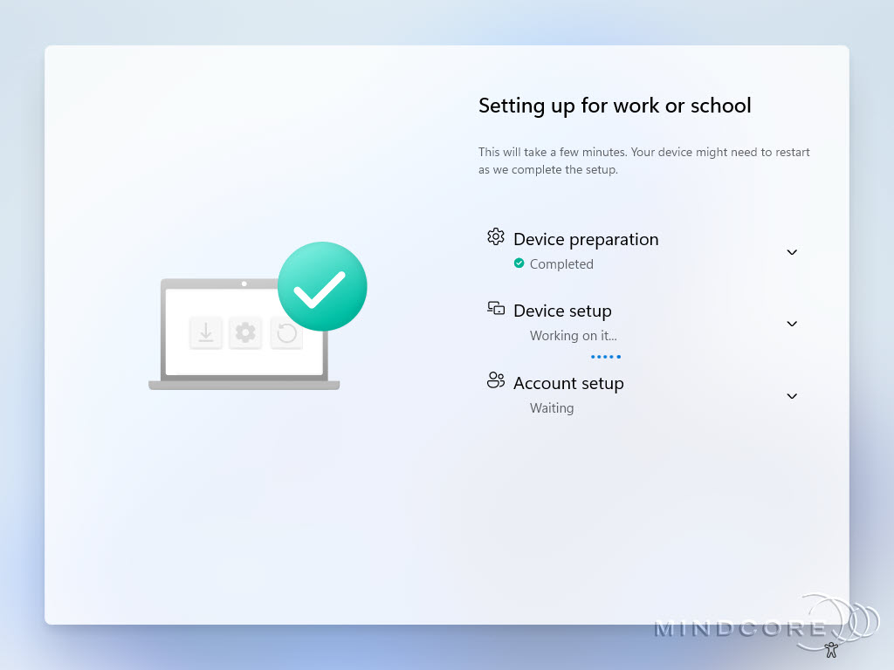<figcaption></figcaption></figure>

The Windows Autopilot Self-Deploying provisioning is complete when you see the Windows 11 login screen.

<figure>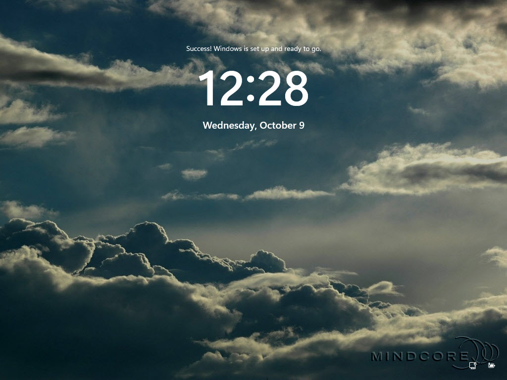<figcaption></figcaption></figure>

The users must sign in with their **work or school account** on the Windows 11 login screen.

<figure>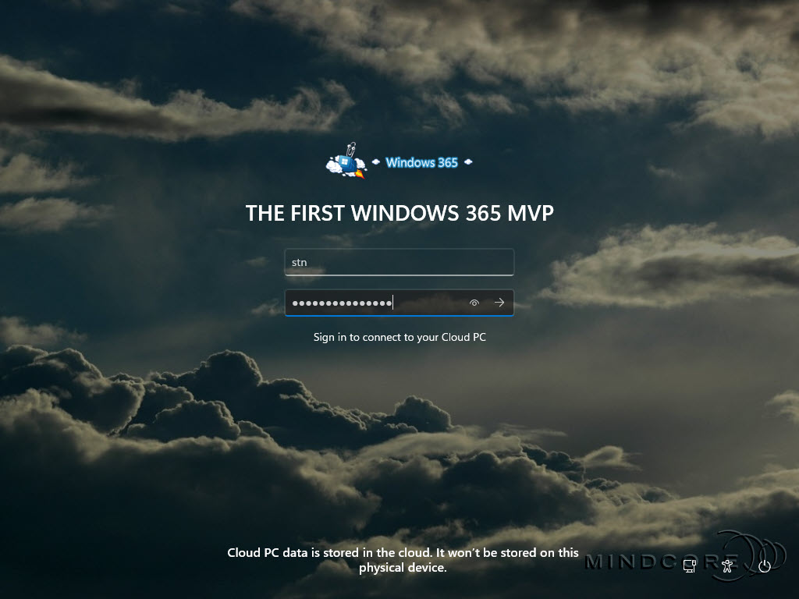<figcaption></figcaption></figure>

Once the credentials are validated, the user seamlessly connects to their personal Windows 365 Cloud PC.

<figure>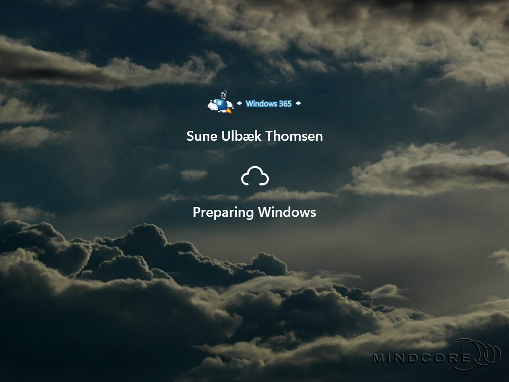<figcaption></figcaption></figure>

<figure>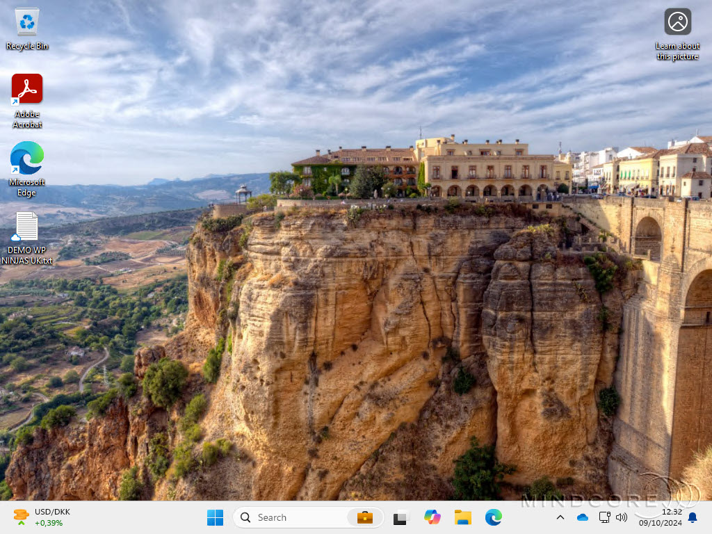<figcaption></figcaption></figure>

Finally, let’s confirm via Microsoft Intune that the devices no longer have a primary user assigned.

Log in to [**https://intune.microsoft.com**](https://intune.microsoft.com/)\
Go to **Devices** | **Windows** (under **By platform**).\
Select the newly provisioned Windows 365 Boot device from the device overview.

The screenshot below shows that the device lacks an assigned primary user, which is the intended result.

<figure><figcaption></figcaption></figure>

## Why? 

Why did Microsoft choose to use User-Driven mode? As I have demonstrated, the Self-Deploying mode with Windows 365 Boot works perfectly. Therefore, what is the rationale behind their decision? Honestly, my research didn’t provide me with a clear answer. However, one plausible explanation could be that they prefer not to rely on a feature that is “still” in preview. 🤭

<figure>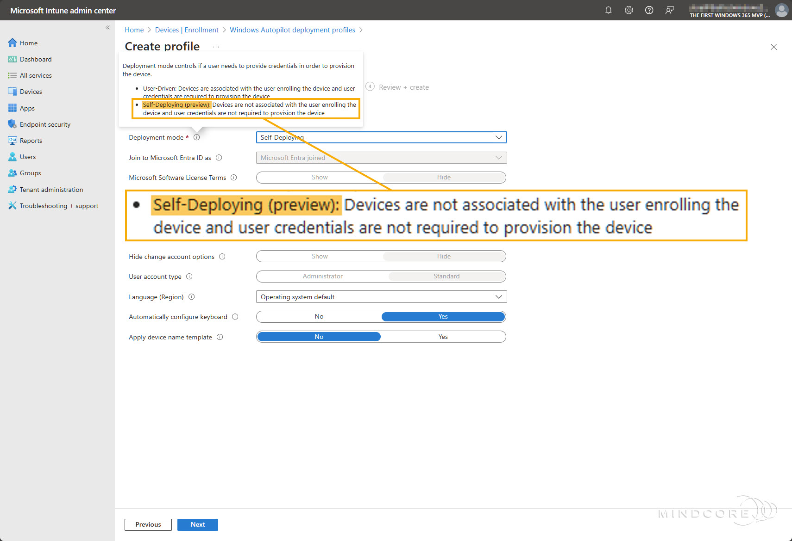<figcaption></figcaption></figure>

Perhaps Microsoft should revisit it since the Self-Deploying mode became generally available in February 2024.

<figure>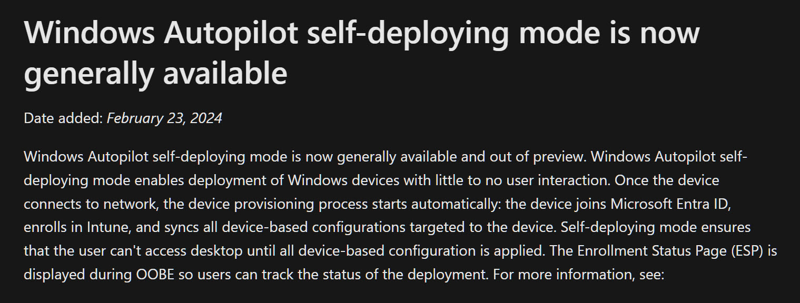<figcaption></figcaption></figure>

Source: [**What’s new in Windows Autopilot**](https://learn.microsoft.com/en-us/autopilot/whats-new#windows-autopilot-self-deploying-mode-is-now-generally-available-)

## Summary 

In this blog post, you learned about the differences between User-Driven and Self-Deploying modes in the Windows Autopilot deployment profile for Windows 365 Boot. Furthermore, I highlighted why the Self-Deploying mode is more suitable for Shared PC scenarios.

I provided detailed steps on how to configure Self-Deploying mode using Microsoft Intune. Additionally, I explained the process of testing and verifying the new deployment profile. Moreover, I described the end-user experience during Windows Autopilot Self-Deploying provisioning.

That’s it, folks. Happy testing, and have fun exploring 🤓\
If you have any questions regarding this topic, please feel free to reach out to me.
